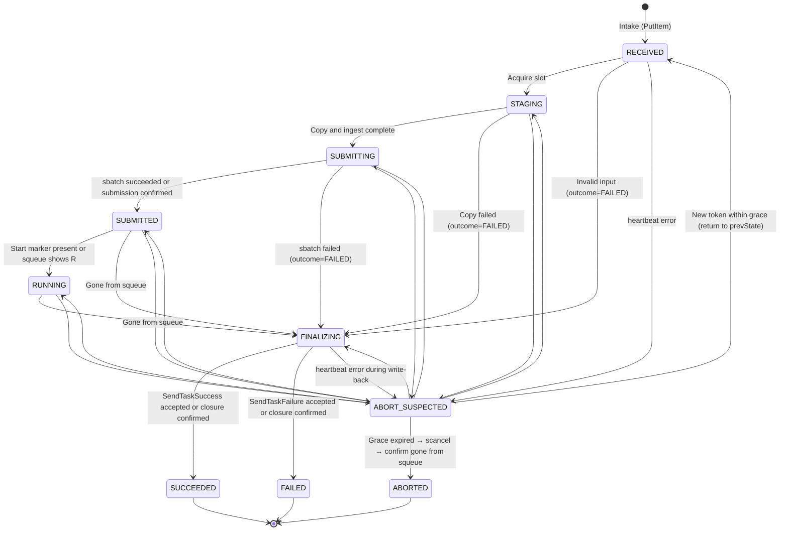

# VAMS Integration Specification

This document describes the shapes of the messages, files, and states of the VAMS integration, and the rules the poller follows.
It is intended for developers who modify the integration and operators who investigate failures.
The overall flow and constraints of the integration are described in [How the VAMS Integration Works](/hyperpod/docs/en/VAMS_INTEGRATION/ARCHITECTURE.md), and the setup procedure is described in [Setting Up and Operating the VAMS Integration](/hyperpod/docs/en/VAMS_INTEGRATION/OVERVIEW.md).

## SQS Message

The VAMS Step Functions send a JSON message body of the following shape from the SQS step.

```json
{
  "body": {
    "workflowDatabaseId": "...",
    "workflowId": "...",
    "workflowExecutionId": "...",
    "workflowExecutionS3InputOutputBucket": "...",
    "executingUserName": "...",
    "executingRequestContext": "...",
    "inputManifestS3Location": "s3://<bucket>/<key>",
    "inputConfigurationS3Location": "s3://<bucket>/<key>",
    "TaskToken": "..."
  }
}
```

| Item | Content | How the poller uses it |
|---|---|---|
| `workflowDatabaseId`, `workflowId`, `workflowExecutionId` | IDs of the VAMS workflow and execution | Recorded in the DynamoDB item, `vams_context.json`, and MLflow tags |
| `workflowExecutionS3InputOutputBucket` | Name of the bucket used for the VAMS execution | Validated as a required item. Not recorded in the DynamoDB item; the write-back destination is `outputs.bucket` in the manifest |
| `executingUserName` | Name of the user who ran the workflow | Recorded in `vams_context.json` and in the MLflow tag `vams.executing_user_name` |
| `executingRequestContext` | VAMS sets the same value as `executingUserName` | Not used |
| `inputManifestS3Location` | Location of the manifest (`s3://` URI) | Reads the locations of the input and the outputs |
| `inputConfigurationS3Location` | Location of the configuration JSON in which VAMS has substituted the template tags (`s3://` URI) | Reads the training parameters |
| `TaskToken` | Token of the Step Functions task | Used for heartbeat and `SendTask*` |

The locations of the input files and outputs do not appear in the body. They appear in the manifest.

The message does not carry `MessageGroupId`.
A FIFO queue does not accept messages without `MessageGroupId`, so the queue is a standard queue.
A standard queue may deliver the same message two or more times, and it does not guarantee the order of messages.

A message for the same execution may also be resent with a new TaskToken.
The VAMS SQS step retries transient errors at send time (such as `SQS.SdkClientException` in `CALLBACK_TRANSIENT_RETRYABLE_ERRORS`) with `IntervalSeconds` 5, `BackoffRate` 2, and `MaxAttempts` 2.
A retry runs the step again from the beginning. If the first send had actually arrived, both a message with the old token and a message with the new token reach PASK.
The old token becomes unusable when the retry starts, because the task is closed at that point.
The poller identifies the execution by pipelineExecutionId, and replaces the token only when the `SentTimestamp` of the message is newer (see the "Intake Loop" section).

The wait time of the VAMS step (taskTimeout) is given in seconds when the pipeline is registered.
The upper limit is 604800 seconds. If it is not specified, 86400 seconds is used.
taskTimeout includes all of the following: waiting in the Slurm queue, copying data, training (`--time=48:00:00` in `slurm_train.sh`), and write-back.
For the values in the bundled definition (`hyperpod/vams/pipeline.json`) and the reasons for them, see "Registering the Pipeline" in [Setting Up and Operating the VAMS Integration](/hyperpod/docs/en/VAMS_INTEGRATION/OVERVIEW.md).
The VAMS SQS step does not set `HeartbeatSeconds`, so a lapse in heartbeats never fails the task.

## manifest

The manifest at `inputManifestS3Location` is a JSON document with the following envelope.

| Item | Content |
|---|---|
| `schemaVersion` | `1` |
| `inputFiles` | Array of entries for the input files |
| `inputMetadataS3Location` | Location of the metadata JSON (`metadata.json`) |
| `outputs` | `{bucket, files, previews, metadata, results}`. `bucket` is the name of the output bucket. The others are complete key prefixes within that bucket |
| `outputTarget` | `{locationType, assetId, databaseId, fileBaseExecutionPathExtension}`. The asset into which VAMS imports the outputs |
| `auxBucket` | Name of the auxiliary bucket |
| `auxTempPrefix` | Working prefix within the auxiliary bucket. Its form is `pipelines/{pipelineName}/{executionId}/` |
| `auxPreviewPipelineSuffix` | Auxiliary prefix for previews. Not used |
| `systemConfig` | `{orchestrationBusArn, orchestrationEventPrefix}` |

Each entry of `inputFiles` has the following items.

| Item | Content |
|---|---|
| `relativePath` | Relative path within the asset. `/` when the whole asset is specified |
| `databaseId`, `assetId` | Input asset |
| `assetRootS3Key` | Prefix of the asset root within `bucket` |
| `auxPreviewPrefix` | Preview prefix in the auxiliary bucket. Not used |
| `bucket` | Input asset bucket |
| `key` | Key of the file. The prefix when the whole asset is specified |
| `versionId` | Version of the file. Empty when the whole asset is specified |

PASK accepts only executions that specify a whole asset.
When the whole asset is specified, `inputFiles` contains one entry (the prefix), `relativePath` is `/`, and `versionId` is empty.
If `inputFiles` does not contain exactly one entry, or `relativePath` is not `/` (for example, when a single file was selected), the execution fails with `PASK.InvalidRequest`.
The poller obtains the list of files by listing the objects under `assetRootS3Key` in `bucket`.
If the input is a curation view, the poller obtains the files of the original asset from the manifest of the view (see the "Determining the Input Kind" section).

pipelineExecutionId is taken from `systemConfig.orchestrationEventPrefix`.
VAMS builds this value in the form `<eventSourcePrefix>.execution.<executionId>.pipeline.<pipelineExecutionId>`.
The poller takes the part after the last `.pipeline.` as pipelineExecutionId, and checks that it matches `^[A-Za-z0-9_-]+$`.
pipelineExecutionId is used in the job name, S3 keys, and FSx paths. If it does not match, the execution fails with `PASK.InvalidRequest`.

pipelineName is taken from the second element of `auxTempPrefix` (`pipelines/{pipelineName}/{executionId}/`).
VAMS puts the pipelineId in this element, not the display name of the pipeline. Therefore, the value of `pipelineName` in `vams_context.json` and of the MLflow tag `vams.pipeline_name` is the pipelineId.

From `metadata.json` at `inputMetadataS3Location`, the poller reads `assetName`, `description`, and `tags` of the input asset.
When `schemaVersion` is 2, each element of `assets[]` in `metadata.json` has `databaseId`, `assetId`, and `assetData{assetName, description, tags}`.
The poller uses the `assetData` of the element whose `databaseId` and `assetId` match those of `inputFiles`.
These values are included only when asset metadata is enabled in the `metadataInputs` of the workflow. If they are absent, omit them.

## Training Parameters

Training parameters are received through the template and the tags of the VAMS pipeline.
The poller reads only the JSON in `inputConfigurationS3Location`, in which VAMS has substituted the tags.
This JSON is a flat object whose keys are environment variable names and whose values are the configured values.

Values are converted to strings before validation.
Strings are used as they are, booleans must be `true` or `false`, and integers are converted to decimal strings.
A value that is a number other than an integer, `null`, an object, or an array causes the execution to fail with `PASK.InvalidRequest`.

Only keys on the allowlist are accepted.
If even one key is not on the allowlist, the execution fails with `PASK.InvalidRequest`.
A key that is absent from the JSON takes the default value of `slurm_train.sh`.

| Key | Validation regex |
|---|---|
| `POLICY_TYPE` | `^(pi05\|pi0)$` |
| `PRETRAINED_PATH` | `^(?!.*\.\.)[A-Za-z0-9._/-]{1,200}$` |
| `FINETUNE_MODE` | `^(lora\|expert_only\|full)$` |
| `LORA_R`, `LORA_ALPHA`, `STEPS`, `BATCH_SIZE`, `SAVE_FREQ`, `LOG_FREQ`, `NUM_WORKERS` | `^[1-9][0-9]{0,8}$` |
| `COMPILE_MODEL` | `^(true\|false)$` |
| `IMAGE_TAG` | `^[A-Za-z0-9._-]{1,128}$` |

The regular expression for `PRETRAINED_PATH` rejects values that contain `..`.
Values that begin with `/` are accepted.
`NUM_WORKERS` accepts only values of 1 or greater.

The following keys are rejected, because the poller decides them or because they affect things outside training.
Every key that is not on the allowlist is rejected. The keys that have an explicit reason for rejection are listed below.

| Key | Reason for rejection |
|---|---|
| `RESUME`, `OUTPUT_DIR`, `DATASET_ROOT`, `DATASET_REPO_ID` | Decided by the poller |
| `EXTRA_ARGS` | Would allow arbitrary arguments to be added to the training command |
| `CONTAINER_IMAGE` | Would allow an arbitrary image to be run |
| `HF_TOKEN` | Credential |
| `MLFLOW_*` | The MLflow connection and experiment are decided by the poller |
| `VAMS_*` | The VAMS execution information is decided by the poller |

The poller sets `DATASET_REPO_ID` to `vams/<databaseId>/<assetId>`.
Because `DATASET_ROOT` is passed, the dataset is not fetched from the Hugging Face Hub.

The Slurm partition is decided by the poller setting (`PASK_VAMS_SLURM_PARTITION`).
If it is empty, the default partition of Slurm is used.
Resources such as the CPU count and memory remain the `#SBATCH` values in `slurm_train.sh`, and are not accepted as training parameters.

## Determining the Input Kind

There are two kinds of input: a regular dataset and a curation view.
In STAGING, the poller lists the latest versions under the root of the input asset, and then determines the kind in the following order.

1. If `curation_manifest.json` exists directly under the root, read it with the VersionId from the listing. If it is not UTF-8 JSON, the execution fails with `PASK.InvalidRequest`.
2. If `curation_manifest_version` is not `2`, or `mode` is neither `view` nor `materialize`, the execution fails with `PASK.InvalidRequest`.
3. If `mode` is `view`, treat the input as a view. An absent `meta/info.json` at the root does not cause an error.
4. If `mode` is `materialize`, treat the input as a regular dataset.
5. If `curation_manifest.json` does not exist, or `mode` is `materialize`, and `meta/info.json` does not exist at the root, the execution fails with `PASK.InvalidRequest`.

The result of the decision is written to `kind` in `input_manifest.json` (see the "Files in the Run Directory" section).
A written `input_manifest.json` is never regenerated, so a retried STAGING uses the same kind and the same versions.
For a view, a retried STAGING rereads and validates the `curation_manifest.json` of the version listed in `view.objects` of `input_manifest.json`.
RECEIVED does not take a listing; it validates only the files of the S3 request. This prevents it from seeing versions from a different point in time than STAGING.

### Validating the View Manifest

The poller validates the `curation_manifest.json` of a view against the following items.
If any item is not met, the execution fails with `PASK.InvalidRequest`.

| Item | Condition |
|---|---|
| `curation_manifest_version` | `2` |
| `mode` | `view` |
| `source.database_id`, `source.asset_id` | Non-empty strings |
| `source.storage.bucket`, `source.storage.asset_root_key` | Non-empty strings. `asset_root_key` ends with `/` |
| Location of the source | `source.storage.bucket` is the same as `bucket` of the input asset, and `source.database_id` is the same as `databaseId` of the input asset |
| `source.files` | An array of one or more elements. The `path` of each element is non-empty, does not begin with `/`, and contains no empty, `.`, or `..` segments. `path` values are not duplicated. `version_id` is non-empty and not `"null"`. `size` is an integer of 0 or greater |
| Required files | `source.files` contains `meta/info.json`, `meta/tasks.parquet`, one or more files under `meta/episodes/`, and one or more files under `data/` |
| `episodes` | One or more integers of 0 or greater (booleans excluded), in ascending order without duplicates. If `source.total_episodes` is an integer, every value is less than it |
| `excluded_episodes` | Absent, or an array. The `episode_index` of each element is an integer of 0 or greater, and is not included in `episodes` |
| `stats.path` | Non-empty string. PASK does not use this value for training |

A file whose `version_id` is `"null"` is not accepted, because training on a view whose version cannot be pinned could read content different from what existed when the view was created.
Checking the location of the source enforces, in code, the premise that the view and the source asset are in the same database (see "Permissions and Security" in [How the VAMS Integration Works](/hyperpod/docs/en/VAMS_INTEGRATION/ARCHITECTURE.md)).

After the manifest is validated, the poller runs `HeadObject(Bucket=source.storage.bucket, Key=asset_root_key + path, VersionId=version_id)` in parallel for each file in `source.files`.
The results are handled as follows.

| Result | Handling |
|---|---|
| Succeeds, and `ContentLength` equals `size` | Added to `objects` in `input_manifest.json` |
| Succeeds, but `ContentLength` differs from `size` | `PASK.InvalidRequest`. The cause is "view source file `<path>` size differs from the curation manifest" |
| 404 (`NoSuchVersion`, `NoSuchKey`), or 400 (`InvalidArgument`) because the form of `version_id` is invalid | Treated as the recorded version not existing: `PASK.InvalidRequest`. The cause is "view source file `<path>` version is no longer available" |
| 403 (`AccessDenied`) | `PASK.StagingFailed`. The cause begins with "the poller role cannot read the source asset of the view" |
| Throttling, 5xx, connection errors | Retried as transient failures |

The cause includes only `path`. It does not include the bucket name or `version_id`.
When there are many files, the checks may take longer than the heartbeat interval, so the checks of the view are performed while continuing to extend the heartbeat and the lease.

## Paths and Keys on the PASK Side

The paths and keys on the PASK side are determined from pipelineExecutionId (hereafter `<id>`) as follows.
`<id>` is a value that has been verified to match `^[A-Za-z0-9_-]+$`.

| Target | Path or key |
|---|---|
| Staging prefix in the PASK data bucket | `<S3Prefix>vams/<id>/` |
| Dataset on FSx (`DATASET_ROOT`) | `/fsx<FileSystemPath>/vams/<id>/` |
| Run directory (`VAMS_RUN_DIR`) | `<LEROBOT_PI_BASE_DIR>/vams-runs/<id>/` |
| Output directory (`OUTPUT_DIR`) | `<LEROBOT_PI_OUTPUT_DIR>/vams-<id>` |
| Training directory (`--chdir` of sbatch) | `<LEROBOT_PI_BASE_DIR>/training` |
| Slurm job name | `vams-<id>` |

`<S3Prefix>` is the PASK setting `Lustre.S3Prefix`. If it is not empty, a trailing `/` is added so that it ends with `/`.
The default is empty, so the staging prefix is `vams/<id>/`.
`<FileSystemPath>` is `Lustre.FileSystemPath`. With the default `/s3link`, the dataset on FSx is `/fsx/s3link/vams/<id>/`.
The expiration lifecycle rule of the PASK data bucket and the IAM permission prefix also use `<S3Prefix>vams/`.

The run directory and the output directory are placed outside `/fsx<FileSystemPath>`.
If they were placed under it, they would be replicated to the PASK data bucket by automatic export.
The output directory is separate from the run directory because `slurm_train.sh` fails when `OUTPUT_DIR` already exists.

The input data is copied in the following steps.

1. List the objects under `assetRootS3Key` in `bucket` with `ListObjectVersions`, and obtain the key, VersionId, ETag, and size of the latest version (`IsLatest=true`, excluding delete markers). Exclude VAMS folder markers (keys ending with `/`) and preview files (keys containing `.previewFile.`).
2. Write this list to `input_manifest.json` in the run directory. A list that has been written is not regenerated. This prevents a different version from being copied when the copy is retried.
3. From the total size of the list and the free space on FSx (`lfs df`), check whether the dataset and the checkpoints fit. If they do not fit, fail with `PASK.StagingFailed`.
4. Copy each object to `<path relative to assetRootS3Key>` under the staging prefix, passing the VersionId in `CopySource`. Objects larger than 5 GB are copied as multipart copies. Because the copy overwrites the same key, the result is the same no matter how many times it is retried.
5. Wait until every key in the list is visible with the same size at the dataset path on FSx. If the wait exceeds the limit (`PASK_VAMS_INGEST_WAIT_SECONDS`, default 3600 seconds), fail with `PASK.StagingFailed`.

If the input is a view, the kind is determined from the listing of step 1 (see "Determining the Input Kind"), and steps 2 through 5 change as follows.

- The list of step 2 is not a list of the assets of the view. It is the files of the source asset (`source.files`) that were checked with `HeadObject`. The files of the view itself (`curation_manifest.json` and `meta/stats.json`) are not copied.
- The destination key of step 4 is `<path of source.files>` under the staging prefix. On FSx, it appears as `/fsx<FileSystemPath>/vams/<id>/<path>`.
- After the ingest completes, `curation_manifest.json` is written to the run directory, and `view_dataset/` is created (see "Files in the Run Directory"). Both are created again in a retried STAGING.

During the copy, the heartbeat and the lease extension continue on a separate thread.
If the heartbeat indicates an abort, the copy stops at a boundary between objects.

When versioning is disabled on the asset bucket, the VersionId is `null`.
In this case, training still runs, and `versioned` is set to `false` in `input_manifest.json` and `vams_context.json`, recording that the version could not be pinned.

The poller submits the training job in the following form.

```bash
sbatch --parsable --no-requeue \
  --job-name="vams-<id>" \
  --chdir="<LEROBOT_PI_BASE_DIR>/training" \
  --output="<run directory>/slurm_%j.out" --error="<run directory>/slurm_%j.err" \
  [--partition="<PASK_VAMS_SLURM_PARTITION>"] \
  --export=ALL \
  slurm_train.sh "vams-<id>"
```

`--partition` is added only when `PASK_VAMS_SLURM_PARTITION` is not empty.
`--no-requeue` stops automatic resubmission after a node failure and similar events.
If the job were resubmitted, the output directory would remain, so `slurm_train.sh` would fail, and there would be two MLflow runs.
The job name is fixed to `vams-<id>` so that whether the job has already been submitted can be checked with `squeue --name`.

The poller builds the environment variables for the training job with `env` of `subprocess`, and passes them to the job with `--export=ALL`.
Values such as `HF_TOKEN` are not placed on the command line, and no shell is used.

| Environment variable | Value |
|---|---|
| Keys of the training env file | Values in `~/.config/pask/lerobot-openpi.env` |
| Training parameters that passed the allowlist | Value of `inputConfigurationS3Location` |
| `DATASET_ROOT`, `DATASET_REPO_ID`, `VAMS_VIEW_MANIFEST_FILE` | Vary with the input kind (table below) |
| `OUTPUT_DIR` | Output directory |
| `VAMS_RUN_DIR` | Run directory |
| `VAMS_CONTEXT_FILE` | `<run directory>/vams_context.json` |
| `RESUME` | `false` |
| `MLFLOW_EXPERIMENT_NAME` | Poller setting `PASK_VAMS_MLFLOW_EXPERIMENT_NAME` |

The environment variables that vary with the input kind are as follows.

| Environment variable | Regular dataset | View |
|---|---|---|
| `DATASET_ROOT` | Path of the dataset on FSx | `<run directory>/view_dataset` |
| `DATASET_REPO_ID` | `vams/<databaseId>/<assetId>` | Same. databaseId and assetId are the values of the view asset |
| `VAMS_VIEW_MANIFEST_FILE` | Not set. Removed even if a value is present in the training env file or elsewhere | `<run directory>/curation_manifest.json` |

The poller reads the input kind from `kind` in `input_manifest.json`.
`VAMS_VIEW_MANIFEST_FILE` begins with `VAMS_`, so a user cannot specify it as a training parameter.

When `VAMS_VIEW_MANIFEST_FILE` is set, `slurm_train.sh` behaves as follows.

1. If `VAMS_CONTEXT_FILE` is not set, if the file of `VAMS_VIEW_MANIFEST_FILE` does not exist, or if `DATASET_ROOT` is not a directory, it fails without starting training.
2. It passes `VAMS_VIEW_MANIFEST_FILE` to the container. It does not set `HF_HUB_OFFLINE`. Even when dataset files are missing, `repo_id` (`vams/<databaseId>/<assetId>`) is split into three parts, so it fails with `HFValidationError` before any communication with the Hugging Face Hub. Pretrained weights and the tokenizer can be fetched from the Hub, as in regular training.
3. Before training, within the same job, it runs `compute_view_stats.py --root "${DATASET_ROOT}" --manifest "${VAMS_VIEW_MANIFEST_FILE}"` with `srun`, and writes the normalization statistics of the retained episodes to `${DATASET_ROOT}/meta/stats.json`. If this fails, training does not start, and the script ends with its exit code.
4. It does not perform the check and recomputation of pi05 quantiles (the last paragraph of this section).

`compute_view_stats.py` fails in the following cases.

- `codebase_version` in `meta/info.json` is not `v3.0`
- `episodes` contains a number that is greater than or equal to `total_episodes` in `meta/info.json`
- `meta/episodes` has no row for a retained episode
- The data files have no row for a retained episode

LeRobot accepts out-of-range episodes with only a warning, so this script checks the range.

The training env file `~/.config/pask/lerobot-openpi.env` is written by `setup.sh` with the same values as `~/.bashrc` (owner ubuntu, mode 0600).
`~/.bashrc` is not read by non-interactive runs from systemd services, so the poller reads this file instead.
The file holds one `KEY=VALUE` per line. It does not use `export`, quotes, or `${}`; the expanded values are written.
The keys are `LEROBOT_PI_BASE_DIR`, `LEROBOT_PI_LOG_DIR`, `LEROBOT_PI_OUTPUT_DIR`, `LEROBOT_PI_CACHE_DIR`, `LEROBOT_PI_HF_HOME`, `LEROBOT_PI_HF_LEROBOT_HOME`, `HF_TOKEN`, `MLFLOW_TRACKING_URI`, `AWS_DEFAULT_REGION`, `PASK_CLUSTER_NAME`, `ENROOT_CACHE_PATH`, `ENROOT_DATA_PATH`, and `ENROOT_TEMP_PATH`.

If the input is a regular dataset, `POLICY_TYPE` is `pi05`, and `meta/stats.json` of the dataset has no `q01` and `q99` for `observation.state` and `action`, `slurm_train.sh` recomputes the quantiles before training, within the same job (the same processing as `slurm_prepare_dataset.sh`).
The recomputed `stats.json` is written only to the dataset on FSx (the copy under the staging prefix of the PASK data bucket). The VAMS data is not changed.

## Files in the Run Directory

The following files are placed in the run directory.
All JSON files are UTF-8.

| File | Written by | Read by |
|---|---|---|
| `input_manifest.json` | Poller (STAGING) | Poller, `mlflow_train.py` |
| `vams_context.json` | Poller (STAGING) | `mlflow_train.py` |
| `curation_manifest.json` (view only) | Poller (STAGING) | `mlflow_train.py`, `compute_view_stats.py` |
| `view_dataset/` (view only) | Poller (STAGING). `meta/stats.json` is written by `compute_view_stats.py` | `lerobot-train`, `mlflow_train.py` |
| `job_started.json` | `slurm_train.sh` (at start) | Poller |
| `job_exit.json` | `slurm_train.sh` (at exit, via `trap ... EXIT`) | Poller |
| `mlflow_run.json` | `mlflow_train.py` (when the run starts) | Poller |
| `slurm_<jobid>.out`, `slurm_<jobid>.err` | Slurm | Poller (confirming submission, and the cause on failure) |

`curation_manifest.json` is the content of the view manifest verified by the poller, written as JSON.

`view_dataset/` is the dataset root (`DATASET_ROOT`) used for training the view.

```
<run directory>/view_dataset/
├── meta/                real directory
│   ├── info.json        -> /fsx<FileSystemPath>/vams/<id>/meta/info.json
│   ├── tasks.parquet    -> /fsx<FileSystemPath>/vams/<id>/meta/tasks.parquet
│   ├── episodes         -> /fsx<FileSystemPath>/vams/<id>/meta/episodes
│   └── stats.json       written by compute_view_stats.py
├── data                 -> /fsx<FileSystemPath>/vams/<id>/data
└── videos               -> /fsx<FileSystemPath>/vams/<id>/videos (if present in the original)
```

Each entry directly under the dataset root on FSx (except `meta`), and each entry directly under `meta/` (except `stats.json`), is made into a symbolic link with an absolute path.
`meta/` is a real directory because the files and directories imported into FSx are owned by root, and the training job cannot write `meta/stats.json`.
A retried STAGING recreates the links, and deletes the `meta/stats.json` written by the previous training job.
When the run directory is deleted during cleanup, symbolic links are removed without being followed, so the dataset on FSx is not affected.

`input_manifest.json` is the list of copied inputs.
`etag` is the value with the surrounding quotation marks removed.
If versioning is disabled, `versioned` is `false` and `versionId` is `"null"`.
`relativePath` is the path relative to `assetRootS3Key`.

```json
{
  "schemaVersion": 1,
  "bucket": "<asset bucket>",
  "assetRootS3Key": "<assetRootS3Key>",
  "versioned": true,
  "objects": [
    {
      "bucket": "<asset bucket>",
      "key": "<key>",
      "versionId": "<VersionId>",
      "etag": "<ETag>",
      "size": 12345,
      "relativePath": "<relative path>"
    }
  ]
}
```

The `input_manifest.json` of a regular dataset has `schemaVersion` 1 and no `kind`.
The `input_manifest.json` of a view has `schemaVersion` 2, and `kind` is `"view"`.

```json
{
  "schemaVersion": 2,
  "kind": "view",
  "bucket": "<bucket of the view asset>",
  "assetRootS3Key": "<assetRootS3Key of the view>",
  "versioned": true,
  "view": {
    "objects": [
      {
        "bucket": "<bucket of the view asset>",
        "key": "<assetRootS3Key of the view>curation_manifest.json",
        "versionId": "<VersionId>",
        "etag": "<ETag>",
        "size": 1234,
        "relativePath": "curation_manifest.json"
      }
    ]
  },
  "source": {
    "databaseId": "<source databaseId>",
    "assetId": "<source assetId>",
    "assetVersion": "1",
    "bucket": "<source bucket>",
    "assetRootS3Key": "<source asset_root_key>"
  },
  "episodes": [0, 2, 4],
  "objects": [
    {
      "bucket": "<source bucket>",
      "key": "<asset_root_key + path>",
      "versionId": "<version_id>",
      "etag": "<ETag>",
      "size": 91011,
      "relativePath": "<path>"
    }
  ]
}
```

| Item | Content |
|---|---|
| `view.objects` | List of the latest versions under the root of the view asset. The shape is the same as `objects` |
| `source` | The `source` value of the manifest. `assetVersion` is omitted if the manifest's `source.asset_version` is not a string |
| `episodes` | `episodes` of the manifest |
| `objects` | The files of the source asset (`source.files`) as checked with `HeadObject`. Sorted by `relativePath`. This is the list that is copied |

`versioned` of a view is always `true`.
A manifest that has a file whose `version_id` is `"null"` is rejected during validation.

`vams_context.json` holds the VAMS execution information and the provenance of the input.
Because the list of files is long, it is not placed directly in an environment variable. Only its path is passed to the container, through `VAMS_CONTEXT_FILE`.
`input.assetName` is omitted if it is not present in `metadata.json`.

```json
{
  "schemaVersion": 1,
  "trigger": "vams",
  "workflowDatabaseId": "...",
  "workflowId": "...",
  "workflowExecutionId": "...",
  "pipelineExecutionId": "...",
  "pipelineName": "...",
  "executingUserName": "...",
  "input": {
    "databaseId": "...",
    "assetId": "...",
    "assetName": "...",
    "bucket": "...",
    "assetRootS3Key": "...",
    "versioned": true
  },
  "output": {"databaseId": "...", "assetId": "..."},
  "datasetDigest": "sha256:...",
  "inputManifestFile": "<run directory>/input_manifest.json",
  "resultFile": "<run directory>/mlflow_run.json"
}
```

`output` holds the `databaseId` and `assetId` of `outputTarget` in the manifest.

The above shape is for a regular dataset, and `schemaVersion` is 1.
For a view, `schemaVersion` is 2, and `input.kind` and `view` are added. The other items are the same as for a regular dataset.

```json
{
  "schemaVersion": 2,
  "trigger": "vams",
  "input": {
    "databaseId": "<view databaseId>",
    "assetId": "<view assetId>",
    "assetName": "...",
    "bucket": "...",
    "assetRootS3Key": "...",
    "versioned": true,
    "kind": "view"
  },
  "view": {
    "manifestFile": "<run directory>/curation_manifest.json",
    "createdAt": "...",
    "reviewUpdatedAt": "...",
    "episodeCount": 3,
    "excludedEpisodeCount": 2,
    "source": {
      "databaseId": "...",
      "assetId": "...",
      "assetVersion": "1",
      "bucket": "...",
      "assetRootS3Key": "..."
    }
  }
}
```

| Item | Content |
|---|---|
| `view.manifestFile` | `curation_manifest.json` in the run directory |
| `view.createdAt`, `view.reviewUpdatedAt` | `created_at` and `source.review_updated_at` of the manifest. Omitted if the value is absent |
| `view.episodeCount`, `view.excludedEpisodeCount` | Counts of `episodes` and `excluded_episodes` |
| `view.source` | Same as `source` in `input_manifest.json` |

`schemaVersion` is raised so that a `mlflow_train.py` that does not support views does not start training without narrowing the episodes.
A `mlflow_train.py` that does not support views rejects `schemaVersion` 2 when it reads the file.
`mlflow_train.py` accepts 1 and 2. It fails when `schemaVersion` is 2 and `input.kind` is not `view`, and when `schemaVersion` is 1 and `input.kind` is `view`.

For a view, `mlflow_train.py` reads `episodes` from the `view.manifestFile`, appends `--dataset.episodes=[0,2,4]` to the end of `sys.argv`, and then calls `lerobot_train.main()`.
If the number of `episodes` differs from `view.episodeCount`, or if `sys.argv` already contains `--dataset.episodes`, it fails without starting training.

`job_started.json` and `job_exit.json` are written by `slurm_train.sh` only when `VAMS_RUN_DIR` is set.
Times are UTC in ISO 8601 (ending with `Z`).
`job_exit.json` is written by `trap ... EXIT`, so it remains even when the script exits early with `set -e`.
It may not remain after a forced termination by Slurm or a node failure.

```json
{"slurmJobId": "123", "startedAt": "2026-01-01T00:00:00Z", "hostname": "..."}
```

```json
{"slurmJobId": "123", "exitCode": 0, "finishedAt": "2026-01-01T12:00:00Z"}
```

`mlflow_run.json` is the reverse link to the MLflow run.
After the job ends, the poller reads it and records the values in DynamoDB and in `results/pask_training.json`.
The poller does not need MLflow permissions.

```json
{"run_id": "...", "experiment_id": "...", "tracking_uri": "..."}
```

The dataset digest is a value that identifies the versions of the inputs without reading their contents.
Sort the `objects` of `input_manifest.json` by `key`, turn each element into a line `f"{key}\t{versionId}\t{etag}\t{size}\n"`, concatenate the lines, take the SHA-256 of the result in hexadecimal, and express it in the form `sha256:<hex>`.
The same set of files with the same versions gives the same value. If the version of any file changes, the value changes.
For a view, the value is computed with the same formula from the list that combines `objects` and `view.objects`.
When the view manifest is updated and its version changes (including when `episodes` is changed), the value changes even if the source files are the same.
The view and the source files are under different asset roots, so their keys do not overlap.

## What Is Recorded to MLflow

`mlflow_train.py` treats the run as a VAMS execution if `VAMS_CONTEXT_FILE` is set and the file can be read. If it is not set, the run is treated as a manual run.
If it is set but cannot be read, training does not start and the run fails.
This prevents a run without provenance from being created.

The experiment is `MLFLOW_EXPERIMENT_NAME`, which the poller passes.
Its value is the poller setting `MlflowExperimentName` (default `vams-training`), and it is separate from the experiment of manual training.

The tags are as follows.
A tag whose value is empty is not set.

| Tag | Value |
|---|---|
| `pask.trigger` | `vams` or `manual`. Also set for manual runs |
| `vams.workflow_database_id` | `workflowDatabaseId` |
| `vams.workflow_id` | `workflowId` |
| `vams.workflow_execution_id` | `workflowExecutionId` |
| `vams.pipeline_execution_id` | `pipelineExecutionId` |
| `vams.pipeline_name` | `pipelineName` |
| `vams.executing_user_name` | `executingUserName` |
| `vams.input.database_id` | `input.databaseId` |
| `vams.input.asset_id` | `input.assetId` |
| `vams.input.asset_name` | `input.assetName` |
| `vams.input.versioned` | `input.versioned` (`true` or `false`) |
| `vams.input.kind` | `input.kind`. `dataset` if absent. `view` for a view |
| `vams.output.asset_id` | `output.assetId` |
| `vams.dataset_digest` | `datasetDigest` |

The `vams.input.*` tags hold the values of the view asset even for a view.
This keeps the meaning of "input asset" unchanged.
For a view, the following tags are also set.

| Tag | Value |
|---|---|
| `vams.source.database_id` | `view.source.databaseId` (databaseId of the source asset) |
| `vams.source.asset_id` | `view.source.assetId` (assetId of the source asset) |
| `vams.source.asset_version` | `view.source.assetVersion` (version of the source asset). Not set if absent |
| `vams.view.episode_count` | `view.episodeCount` |
| `vams.view.excluded_episode_count` | `view.excludedEpisodeCount` |
| `vams.view.review_updated_at` | `view.reviewUpdatedAt`. Not set if absent |

As an artifact, `input_manifest.json` is recorded at `vams/input_manifest.json`.
For a view, `input_manifest.json` contains the list of files of the source asset and `source`.
For a view, the following artifacts are also recorded.

| Artifact | Content |
|---|---|
| `vams/curation_manifest.json` | `curation_manifest.json` in the run directory (`view.manifestFile`) |
| `vams/norm_stats.json` | `<DATASET_ROOT>/meta/stats.json` written by `compute_view_stats.py`. These are the normalization statistics used for training |

The input dataset is registered with `mlflow.log_input`.
The source is `s3://<bucket>/<assetRootS3Key>`, and the name is `assetName` (or `assetId` if `assetName` is absent).
For a view, the source is the location of the source asset (`s3://<view.source.bucket>/<view.source.assetRootS3Key>`).
This is because the view asset has no files to train on; the files to train on are in the source asset.
The name remains the `assetName` of the view asset (or `assetId` if it is absent).
MLflow limits the dataset digest to 36 characters (`MAX_DATASET_DIGEST_SIZE`), so `sha256:<hex>` cannot be stored as is.
The first 36 hexadecimal characters are used as the dataset digest, and the complete value is kept in the tag `vams.dataset_digest`.

To avoid creating two runs for the same execution, before creating a new run, the experiment is searched with `tags.vams.pipeline_execution_id = '<id>'`, and if a run is found, that run is continued.
After the run starts, `mlflow_run.json` is written to `resultFile`.

## DynamoDB Item

One execution is stored as one item.
The partition key is `pipelineExecutionId` (string).

| Attribute | Type | Content |
|---|---|---|
| `pipelineExecutionId` | S | Partition key |
| `state` | S | State (see the "State Transitions" section) |
| `version` | N | Increased by 1 on each update that changes the state, and on each replacement of the token |
| `taskToken` | S | Latest TaskToken |
| `tokenSentAt` | N | `SentTimestamp` (epoch milliseconds) of the SQS message that carried `taskToken` |
| `leaseOwner` | S | Poller that is processing the item (hostname and systemd InvocationID) |
| `leaseExpiresAt` | N | Expiry of the lease (epoch seconds) |
| `workflowDatabaseId`, `workflowId`, `workflowExecutionId`, `executingUserName` | S | Values of the message |
| `inputManifestS3Location`, `inputConfigurationS3Location`, `inputMetadataS3Location` | S | Values of the message and the manifest |
| `slurmJobId`, `jobName` | S | Slurm job |
| `stagingPrefix`, `runDir`, `outputDir` | S | Staging prefix, run directory, output directory |
| `holdsSlot` | BOOL | `true` only while the item holds a concurrency slot |
| `outcome` | M | `{status, errorName, cause}`. `status` is `SUCCEEDED` or `FAILED`. It is fixed when the item enters FINALIZING |
| `notifyResult` | S | `ACCEPTED` or `ALREADY_CLOSED` (result of `SendTask*`) |
| `resendPending` | BOOL | `true` only while a new token has arrived for a terminal execution and a resend of `SendTask*` remains |
| `outputs` | M | List of the S3 keys written back (files and results) |
| `mlflowRunId`, `mlflowExperimentId` | S | MLflow run |
| `prevState`, `suspectedAt` | S | State before entering ABORT_SUSPECTED, and the time it was entered |
| `createdAt`, `updatedAt`, `terminalAt` | S | UTC in ISO 8601 |
| `pending` | S | Key of the sparse GSI. `ACTIVE` while the execution is not terminal. `CLEANUP` after it becomes terminal, while cleanup or a resend remains. The attribute is removed when everything has finished |
| `ttl` | N | Set only when the item becomes terminal. Epoch seconds 30 days after `terminalAt` (`PASK_VAMS_ITEM_TTL_DAYS`) |

The reconciler queries the GSI `pending-index` (partition key `pending`, sort key `updatedAt`) with `ACTIVE` and `CLEANUP`.
An item without `pending` does not enter the GSI, so the amount of work per Query does not grow as the number of finished executions increases.

The TTL is 30 days.
If a message for the same execution arrives after its item has been deleted, it would be accepted as a new execution.
To avoid this, the TTL is set longer than the sum of the SQS retention period (14 days) and the upper limit of taskTimeout (7 days).

There is a limit on the number of executions that can advance to STAGING or later at the same time (`PASK_VAMS_MAX_CONCURRENT_RUNS`, default 1).
The FSx capacity is fixed, and the copied datasets and checkpoints grow with the number of executions.
The limit is enforced by a counter item in the same table.

| Attribute | Content |
|---|---|
| `pipelineExecutionId` | `#CONCURRENCY` (fixed. It does not match `^[A-Za-z0-9_-]+$`, so it does not collide with execution items) |
| `active` | N. Number of executions holding a slot |

The counter item has no `pending`, so it does not enter the GSI.
A slot is taken on the transition from RECEIVED to STAGING, and returned when cleanup completes.
Both are updated as a single transaction with `TransactWriteItems`, which updates the counter item and the execution item together.
The slot is not returned until cleanup completes, because the capacity is in use until the copies on FSx and in the PASK data bucket are deleted.
While the limit has been reached, the execution waits in RECEIVED.
While waiting, it continues to send heartbeats, so the wait happens within VAMS's taskTimeout.

## State Transitions



SUCCEEDED, FAILED, and ABORTED are terminal states.
Transitions are performed by a single `UpdateItem` on one item, and `version` is increased by 1.
The exceptions are the transition from RECEIVED to STAGING and the completion of cleanup. These are updated together with the counter item in `TransactWriteItems`.

Let the common condition `C(s)` be `#state = :s AND #version = :v AND leaseOwner = :me AND leaseExpiresAt > :now`.
`:v` is the `version` read before processing.
When the intake loop replaces a token, `version` increases, so an update from the poller that is processing fails the condition. The poller rereads the item and continues with the new token.

| Transition | Processing (side effects) | ConditionExpression | Attributes to SET / REMOVE in addition |
|---|---|---|---|
| (none) → RECEIVED | Intake loop. No side effects | `attribute_not_exists(pipelineExecutionId)` | Initial values of all attributes, `pending=ACTIVE`, `version=1` |
| Token replacement (non-terminal; state unchanged) | Intake loop. No side effects | `attribute_exists(pipelineExecutionId) AND tokenSentAt < :sentAt AND NOT #state IN (:succeeded, :failed, :aborted)` | `taskToken`, `tokenSentAt`, `version+1` |
| Token replacement (terminal; state unchanged) | Intake loop. No side effects | `attribute_exists(pipelineExecutionId) AND tokenSentAt < :sentAt AND #state IN (:succeeded, :failed, :aborted)` | `taskToken`, `tokenSentAt`, `version+1`, `resendPending=true`, `pending=if_not_exists(pending, :cleanup)` |
| RECEIVED → STAGING | Transition after the manifest, config, and metadata are read and validated. Updated together with the counter item in `TransactWriteItems` | Execution item: `C(RECEIVED)`. Counter item: `attribute_not_exists(active) OR active < :max` | Execution item: `stagingPrefix`, `runDir`, `outputDir`, `holdsSlot=true`. Counter item: `ADD active 1` |
| STAGING → SUBMITTING | Transition after the list is created, data is copied, ingestion is awaited, and `vams_context.json` is created (recording the intent) | `C(STAGING)` | `jobName` |
| SUBMITTING → SUBMITTED | After sbatch, or after confirming that the job was already submitted | `C(SUBMITTING)` | `slurmJobId` |
| SUBMITTED → RUNNING | `job_started.json` exists, or `squeue` shows R | `C(SUBMITTED)` | None |
| RUNNING / SUBMITTED → FINALIZING | Not found by `squeue --name`. The result is determined from `job_exit.json` and `mlflow_run.json` | `C(RUNNING)` or `C(SUBMITTED)` | `outcome`, `mlflowRunId`, `mlflowExperimentId` |
| RECEIVED / STAGING / SUBMITTING → FINALIZING | Invalid input, copy failure, or permanent sbatch failure | `C(<original state>)` | `outcome` (`status=FAILED`, `errorName`, `cause`) |
| Record within FINALIZING | Recorded after write-back completes (state unchanged) | `C(FINALIZING)` | `outputs`, `version+1` |
| FINALIZING → SUCCEEDED / FAILED | `SendTaskSuccess` / `SendTaskFailure` was accepted, or a closed-task error was returned while the token was still the latest | `C(FINALIZING) AND outcome.#status = :status` | `notifyResult`, `terminalAt`, `ttl`, `pending=CLEANUP` |
| Non-terminal → ABORT_SUSPECTED | The token used for sending is still the latest (confirmed by rereading and matching), and heartbeat returned `TaskTimedOut` / `TaskDoesNotExist` / `InvalidToken` | `C(<original state>) AND taskToken = :usedToken` | `prevState`, `suspectedAt` |
| ABORT_SUSPECTED → prevState | Heartbeat succeeded with a new token | `C(ABORT_SUSPECTED) AND taskToken <> :suspectedToken` | `REMOVE prevState, suspectedAt` |
| ABORT_SUSPECTED → ABORTED | Grace period expired. After `scancel` (success even if there is no target), confirm with `squeue --name` that the job is gone | `C(ABORT_SUSPECTED) AND taskToken = :suspectedToken AND suspectedAt < :graceLimit` | `terminalAt`, `ttl`, `pending=CLEANUP` |
| Resend to a terminal execution | Send `SendTaskSuccess` / `SendTaskFailure` with the new token, using the saved `outcome`. For ABORTED, `SendTaskFailure` (`PASK.Aborted`) | `#state = :terminalState AND resendPending = :true AND taskToken = :usedToken` | `notifyResult`, `REMOVE resendPending` |
| Cleanup completion (with slot) | After deleting `vams/<id>/` in the PASK data bucket and the output and run directories on FSx. Updated together with the counter item in `TransactWriteItems` | Execution item: `#state IN (:succeeded, :failed, :aborted) AND pending = :cleanup AND holdsSlot = :true AND attribute_not_exists(resendPending)`. Counter item: `active > :zero` | Execution item: `REMOVE pending, holdsSlot`. Counter item: `ADD active -1` |
| Cleanup completion (without slot) | Same as above | `#state IN (:succeeded, :failed, :aborted) AND pending = :cleanup AND attribute_not_exists(holdsSlot) AND attribute_not_exists(resendPending)` | `REMOVE pending` |
| Lease acquisition and extension | None | `attribute_not_exists(leaseOwner) OR leaseExpiresAt < :now OR leaseOwner = :me` | `leaseOwner`, `leaseExpiresAt` (`version` is not changed) |

The intake loop reads the state of the item, and then decides whether to use the non-terminal or the terminal replacement.
If the state becomes terminal after it was read, the condition fails, so the loop rereads the item and tries again.

When the resend marker (`resendPending`) is set on a terminal execution and `pending` has been removed, `pending` is returned to `CLEANUP`.
This lets the reconciler pick up the resend, by putting the item back into the GSI.
Cleanup counts as a success even if there is nothing to delete, so it is safe to return an execution whose cleanup is already done to `CLEANUP` and run it again.
The completion of cleanup is not written until the resend has finished, because removing `pending` would cause the resend to drop out of the GSI.

The length of the lease is 900 seconds (`PASK_VAMS_LEASE_SECONDS`, three times the heartbeat interval).
During long operations (copy, waiting for ingestion, write-back), the lease continues to be extended on a separate thread.

## Order of Side Effects and Idempotency

External side effects are performed in the following order: the intent is recorded in an intermediate state, the side effect is performed, and then the result is recorded.
A terminal state is written only after the last side effect (`SendTask*`) has been accepted, or after confirming that the token is closed.
After a terminal state, only cleanup that does not affect the state, and resends to a terminal execution, are performed.

| Side effect | Handling when retried |
|---|---|
| Copy from S3 to S3 | Overwrites the same version to the same key listed in `input_manifest.json` |
| sbatch | Before submitting, check whether the job was already submitted, using `squeue --name vams-<id>`, the `slurm_*.out` files in the run directory, and `job_started.json`. If found, only the job ID is recorded. Submitting a second job would fail because the output directory remains, and would wrongly produce `SendTaskFailure` |
| Write-back to S3 | Overwrites the same key. `ContentType` is determined from the extension and set |
| `SendTaskSuccess` / `SendTaskFailure` | Errors returned by a duplicate send (`TaskTimedOut`, `InvalidToken`, `TaskDoesNotExist`) are treated as success (`ALREADY_CLOSED`) if the token used for sending is still the latest. If the token has been replaced, it is sent again with the new token |
| `SendTaskHeartbeat` | The result is the same no matter how many times it is sent. Errors are handled as described in the "Handling Aborts" section |
| scancel | Treated as success even if there is no target job |
| Cleanup deletion | Treated as success even if there is no target. Before deleting, the code verifies that the targets are `<S3Prefix>vams/<id>/` in the PASK data bucket, and `vams-runs/<id>/` and `vams-<id>` on FSx |

## Handling Aborts

The heartbeat is sent every 300 seconds (`PASK_VAMS_HEARTBEAT_INTERVAL_SECONDS`) in every non-terminal state.
It is also sent before the copy and before sbatch, and if an abort has been indicated, the process does not proceed.

When the heartbeat returns an error, the poller processes it in the following order.

1. It rereads DynamoDB with strong consistency and checks whether the token used for sending is still the latest. If the token has been replaced, it sends again with the new token.
2. If the latest token gets `TaskTimedOut`, `TaskDoesNotExist`, or `InvalidToken` as the response, it does not run `scancel` immediately, and moves the item to ABORT_SUSPECTED.
3. If a new token arrives within the grace period (1800 seconds, `PASK_VAMS_ABORT_GRACE_SECONDS`), and the heartbeat succeeds with that token, the item returns to the original state (`prevState`).
4. After the grace period, it runs `scancel`, confirms with `squeue --name` that the job is gone, and then moves the item to ABORTED. Cleanup is performed afterwards.

ABORT_SUSPECTED is inserted so that VAMS's send retries are not mistaken for an abort.
On a retry, the old token is closed, so heartbeats with the old token return errors, but the execution continues with the new token.

The grace period of 1800 seconds is sufficiently longer than the time until a new token arrives.
The VAMS retry wait is 5 seconds for the first retry and 10 seconds for the second, for a total of 15 seconds, derived from `IntervalSeconds` 5, `BackoffRate` 2, and `MaxAttempts` 2.
Adding the time of the send and the long-polling wait (up to 20 seconds) still fits within one minute, so the grace period is more than 30 times that.
If the poller was stopped, the intake loop and the reconciler run in parallel after it restarts.
Even if the reconciler sees the error of the old token first, the intake loop processes the new message waiting in the queue within the grace period, so the item returns to its original state.

If VAMS's taskTimeout is exceeded, heartbeat also returns `TaskTimedOut`, and the item becomes ABORTED through the same flow.

## Completion Notification and Write-Back

When the job disappears from `squeue --name`, the poller determines the result from `job_exit.json` in the run directory.

1. If the exit code is 0 and `checkpoints/last/pretrained_model` exists in the output directory, the result is `SUCCEEDED`.
2. If the exit code is other than 0, the result is `FAILED` (`PASK.JobFailed`). The cause includes the exit code and the last part of `slurm_<jobid>.err`.
3. If `job_exit.json` does not exist (forced termination by Slurm, node failure), the result is `FAILED` (`PASK.JobLost`).

For `SUCCEEDED`, the poller writes back to the destinations in the `outputs` of the manifest.

| Destination | Content |
|---|---|
| Prefix `outputs.files` in `outputs.bucket` | Files under `checkpoints/last/pretrained_model`. The part after the prefix is relative to `pretrained_model` |
| `pask_training.json` under the prefix `outputs.results` in `outputs.bucket` | Summary of the training |
| `outputs.previews`, `outputs.metadata` | Not used |

training_state (the optimizer state) is not returned.
Each object to be written back is given a `ContentType` determined from its extension. If it cannot be determined from the extension, `application/octet-stream` is used.

VAMS has the following limits on the outputs it can import.
If a limit is exceeded, the execution fails with `PASK.OutputUploadFailed` before anything is written back.

| Kind | Limit |
|---|---|
| files | 1000 per execution |
| results | 2000 items and 32 MB in total. One file is UTF-8 text of up to about 380 KB |
| previews | Not used |

`pask_training.json` contains the following items.

```json
{
  "pipelineExecutionId": "...",
  "slurmJobId": "...",
  "parameters": {"POLICY_TYPE": "pi05", "STEPS": "30000"},
  "datasetDigest": "sha256:...",
  "inputKind": "view",
  "viewSource": {"databaseId": "...", "assetId": "...", "assetVersion": "1"},
  "viewEpisodeCount": 3,
  "mlflowRunId": "...",
  "mlflowExperimentId": "...",
  "startedAt": "2026-01-01T00:00:00Z",
  "finishedAt": "2026-01-01T12:00:00Z",
  "status": "SUCCEEDED"
}
```

`parameters` holds the training parameters that passed the allowlist.

| Item | Content |
|---|---|
| `inputKind` | Kind of input: `view` or `dataset`. `null` if `vams_context.json` could not be read |
| `viewSource` | Only for a view. `databaseId`, `assetId`, and `assetVersion` of the source asset (`view.source` in `vams_context.json`). `assetVersion` is omitted if it has no value |
| `viewEpisodeCount` | Only for a view. Number of retained episodes (`view.episodeCount`) |

These items are included so that the source asset can be traced from the VAMS execution details without looking at MLflow.

A permanent failure of the write-back (such as exceeding a limit) rewrites `outcome` to `FAILED` (`PASK.OutputUploadFailed`) (`C(FINALIZING)`), and sends `SendTaskFailure`.
A transient error is retried with backoff.

The output of `SendTaskSuccess` is not read by VAMS, so it is limited to the following shape.

```json
{"status": "SUCCEEDED", "slurmJobId": "...", "mlflowRunId": "..."}
```

The error names for `SendTaskFailure` are as follows.
The cause is truncated to the API limit of 32768 characters.

| Error name | Cause |
|---|---|
| `PASK.InvalidRequest` | The format of the message, manifest, or configuration is invalid. The request does not specify a whole asset. The configuration has a key that is not on the allowlist, or a value that does not match its regular expression. `meta/info.json` is absent at the root, and `curation_manifest.json` (with `mode` `view`) is also absent. `curation_manifest_version` is not 2, or `mode` is unknown. The view manifest does not meet the validation items. The manifest points to a different database or bucket. A recorded version does not exist in the source asset, or its size differs from the record |
| `PASK.StagingFailed` | Permanent failure while listing or copying the input. The source asset of the view cannot be read (403). Insufficient capacity on FSx. The limit of the wait for ingestion was exceeded |
| `PASK.SubmitFailed` | Permanent failure of sbatch |
| `PASK.JobFailed` | The training job ended with an exit code other than 0. Or the exit code is 0 but `checkpoints/last/pretrained_model` does not exist. Failure in computing the normalization statistics of the view (`compute_view_stats.py`) is also included here |
| `PASK.JobLost` | The training job disappeared without leaving `job_exit.json` |
| `PASK.OutputUploadFailed` | An output limit was exceeded, or a permanent failure of the write-back occurred |
| `PASK.Aborted` | A new token arrived for an aborted execution |

## Intake Loop

The intake loop processes messages in the following steps.

1. It calls `ReceiveMessage` with long polling. It specifies `SentTimestamp` and `ApproximateReceiveCount` in `MessageSystemAttributeNames`. The visibility timeout is 300 seconds (`PASK_VAMS_VISIBILITY_TIMEOUT_SECONDS`).
2. From the `body` JSON, it takes the required items, reads the manifest, and takes pipelineExecutionId.
3. It creates the RECEIVED item with `PutItem`. If the item already exists, it tries to replace the token. If `SentTimestamp` is less than or equal to the stored `tokenSentAt` (a duplicate delivery by SQS, or an old message), the token is not replaced.
4. When the DynamoDB write is committed (including when no replacement was made), it calls `DeleteMessage`. If the write is not committed, the message is not deleted, and it is left to be redelivered after the visibility timeout.

The visibility timeout of a message is not extended for the duration of training.
The state of the execution has already moved to DynamoDB, so the message does not need to remain.

If a message is malformed (the body is not JSON, a required item is missing, or pipelineExecutionId cannot be extracted from `orchestrationEventPrefix`) so that pipelineExecutionId cannot be obtained, but TaskToken can be read, the poller immediately sends `SendTaskFailure` (`PASK.InvalidRequest`), and then deletes the message.
If TaskToken cannot be read either, the message is not deleted; it is left to enter the DLQ after being received 5 times (`MaxReceiveCount`).
An S3 error while reading the manifest is not treated as a malformed message. The message is not deleted and is left to redelivery.

For an execution whose message has entered the DLQ, VAMS keeps waiting until taskTimeout.
The way to check the DLQ is described in "Checking the DLQ" in [Setting Up and Operating the VAMS Integration](/hyperpod/docs/en/VAMS_INTEGRATION/OVERVIEW.md).

## Recovery for Each Failure Point

| Point of failure | State left behind | Recovery action |
|---|---|---|
| The poller stopped after receiving the message and before PutItem | Message in SQS (not visible) | Redelivered after the visibility timeout, and accepted from the beginning |
| The poller stopped after PutItem and before DeleteMessage | Item is RECEIVED, message remains | On redelivery, PutItem fails its condition, and `SentTimestamp` is compared (if equal, the token is not replaced). Then the message is deleted |
| DynamoDB remains unwritable | Message remains | Not deleted, so it is redelivered. Enters the DLQ when `MaxReceiveCount` is exceeded. VAMS waits until taskTimeout |
| The concurrency limit has been reached | RECEIVED | Stays RECEIVED until a slot is returned, while continuing to send heartbeats |
| The poller stopped during the copy in STAGING | STAGING, `input_manifest.json` may exist | After the lease expires, the reconciler resumes STAGING. If the list exists, the same versions are copied to the same keys again |
| The wait for ingestion exceeded its limit | STAGING | Moves to FINALIZING with `PASK.StagingFailed`, and sends `SendTaskFailure` |
| The poller stopped in SUBMITTING before sbatch | SUBMITTING | Nothing is found by `squeue --name` or in the run directory markers, so sbatch is run |
| sbatch succeeded, but the poller stopped before writing SUBMITTED | SUBMITTING. The job is PENDING or running, or has already finished | If found by `squeue --name`, the job ID is recorded. If it is gone but `slurm_*.out` or `job_started.json` exists, the job is considered submitted, its job ID is recorded from the file name, and the item moves to SUBMITTED (the next monitoring step moves it to FINALIZING) |
| The job finished while the poller was stopped | RUNNING, not in `squeue` | After restart, the result is determined from `job_exit.json`, and the item moves to FINALIZING |
| The job disappeared because of a node failure | RUNNING, `job_exit.json` absent | Not resubmitted because of `--no-requeue`. Fails with `PASK.JobLost` |
| The poller stopped during the write-back | FINALIZING, some keys written | Overwrites the same keys again |
| The poller stopped after `SendTaskSuccess` was accepted and before SUCCEEDED was written | FINALIZING | Resending returns a closed-task error. If the token is the latest, the item becomes SUCCEEDED with `ALREADY_CLOSED` |
| `SendTask*` returned throttling or 5xx | FINALIZING | Retried with backoff. The state is not changed |
| The poller stopped during cleanup after the terminal state was written | Terminal, `pending=CLEANUP`, slot still held | The reconciler redoes the cleanup, and returns the slot when it completes. Copies in the PASK data bucket are also deleted by the lifecycle rule for `vams/` (10 days) |
| VAMS retried, and the heartbeat with the old token returned errors | ABORT_SUSPECTED | A message with a new token arrives within the grace period, and the item returns to its original state |
| VAMS aborted the execution | ABORT_SUSPECTED | After the grace period, `scancel` is run, the job is confirmed gone, and the item moves to ABORTED |
| The poller stopped after `scancel` and before ABORTED was written | ABORT_SUSPECTED | `scancel` is run again (success even if there is no target), and the item moves to ABORTED |
| A message with a new token arrived for a terminal execution | Terminal | The token is replaced and `resendPending` is set. `SendTask*` is resent using the saved outcome |
| The poller holding the lease stopped | Lease remains | After the lease expires, a restarted poller (with a different InvocationID) takes over |
| The login node was replaced | DynamoDB, FSx, and the PASK data bucket remain | A poller is started through the lifecycle, and the reconciler takes over |
| The item was deleted by TTL before cleanup finished | The `active` value of the counter is larger than the actual number | The slot is not returned, so new executions remain in RECEIVED. Correct the `active` value of the counter item by hand |
| A message for the same execution arrived after its item was deleted by TTL | No item | Accepted as a new execution. Avoid this by making the TTL longer than the sum of the SQS retention period and the upper limit of taskTimeout |
