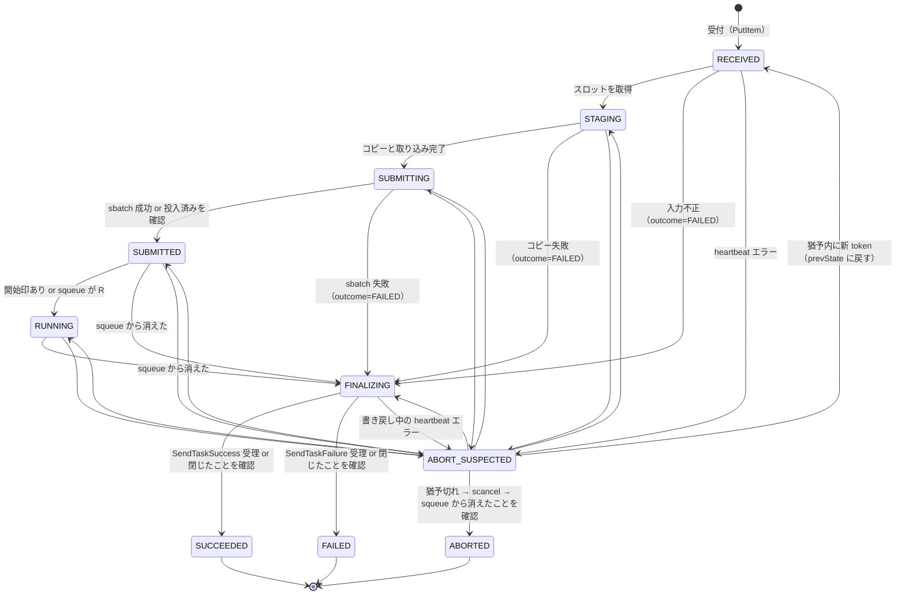

# VAMS 連携の仕様

VAMS 連携のメッセージ、ファイル、状態の形と、ポーラーの処理の規則を示します。
連携を改修する開発者と、障害を調べる運用者に向けた文書です。
連携の全体の流れと制約は [VAMS 連携の仕組み](/hyperpod/docs/ja/VAMS_INTEGRATION/ARCHITECTURE.md)、導入の手順は [VAMS 連携の導入と運用](/hyperpod/docs/ja/VAMS_INTEGRATION/OVERVIEW.md) にあります。

## SQS メッセージ

VAMS の Step Functions は、SQS のステップで次の形の JSON をメッセージ本文として送ります。

```json
{
  "body": {
    "workflowDatabaseId": "...",
    "workflowId": "...",
    "workflowExecutionId": "...",
    "workflowExecutionS3InputOutputBucket": "...",
    "executingUserName": "...",
    "executingRequestContext": "...",
    "inputManifestS3Location": "s3://<bucket>/<key>",
    "inputConfigurationS3Location": "s3://<bucket>/<key>",
    "TaskToken": "..."
  }
}
```

| 項目 | 内容 | ポーラーでの使い方 |
|---|---|---|
| `workflowDatabaseId`、`workflowId`、`workflowExecutionId` | VAMS のワークフローと実行の ID | DynamoDB の item、`vams_context.json`、MLflow のタグに記録します |
| `workflowExecutionS3InputOutputBucket` | VAMS の実行用バケットの名前 | 必須の項目として検証します。DynamoDB の item には記録せず、書き戻し先には manifest の `outputs.bucket` を使います |
| `executingUserName` | ワークフローを実行したユーザーの名前 | `vams_context.json` と MLflow のタグ `vams.executing_user_name` に記録します |
| `executingRequestContext` | VAMS は `executingUserName` と同じ値を入れます | 使いません |
| `inputManifestS3Location` | manifest の位置（`s3://` の URI） | 入力と出力の場所を読みます |
| `inputConfigurationS3Location` | VAMS がテンプレートのタグを置換した設定の JSON の位置（`s3://` の URI） | 学習パラメータを読みます |
| `TaskToken` | Step Functions のタスクの token | heartbeat と `SendTask*` に使います |

入力ファイルや出力の場所は本文に入らず、manifest に入ります。

メッセージには `MessageGroupId` が付きません。
FIFO キューは `MessageGroupId` の無いメッセージを受け付けないので、キューは標準キューにします。
標準キューは同じメッセージを 2 回以上届けることがあり、順序も保証しません。

同じ実行のメッセージが、新しい TaskToken で再送されることもあります。
VAMS の SQS のステップは、送信時の一時的なエラー（`CALLBACK_TRANSIENT_RETRYABLE_ERRORS` の `SQS.SdkClientException` など）を `IntervalSeconds` 5、`BackoffRate` 2、`MaxAttempts` 2 でリトライします。
リトライではステップを最初から実行し直すので、送信が実際には届いていた場合、古い token のメッセージと新しい token のメッセージの両方が PASK に届きます。
古い token は、リトライが始まった時点でタスクが閉じて使えなくなります。
ポーラーは pipelineExecutionId で実行を識別し、メッセージの `SentTimestamp` が新しい場合だけ token を差し替えます（「受付ループ」の節）。

VAMS のステップの待ち時間（taskTimeout）は、パイプラインの登録時に秒で決まります。
上限は 604800 秒で、指定しなければ 86400 秒です。
taskTimeout には、Slurm の待ち行列での待ち、データのコピー、学習（`slurm_train.sh` の `--time=48:00:00`）、書き戻しの時間がすべて入ります。
同梱の定義（`hyperpod/vams/pipeline.json`）の値と、その根拠は [VAMS 連携の導入と運用](/hyperpod/docs/ja/VAMS_INTEGRATION/OVERVIEW.md) の「パイプラインの登録」にあります。
VAMS の SQS のステップには `HeartbeatSeconds` が設定されないので、heartbeat の途絶でタスクが失敗することはありません。

## manifest

`inputManifestS3Location` の manifest は、次の envelope を持つ JSON です。

| 項目 | 内容 |
|---|---|
| `schemaVersion` | `1` |
| `inputFiles` | 入力ファイルのエントリの配列 |
| `inputMetadataS3Location` | メタデータの JSON（`metadata.json`）の位置 |
| `outputs` | `{bucket, files, previews, metadata, results}`。`bucket` は出力先のバケット名で、ほかはそのバケット内の完全なキーの prefix です |
| `outputTarget` | `{locationType, assetId, databaseId, fileBaseExecutionPathExtension}`。VAMS が outputs を取り込むアセット |
| `auxBucket` | 補助バケットの名前 |
| `auxTempPrefix` | 補助バケット内の作業用 prefix。形は `pipelines/{pipelineName}/{executionId}/` |
| `auxPreviewPipelineSuffix` | プレビューの補助 prefix。使いません |
| `systemConfig` | `{orchestrationBusArn, orchestrationEventPrefix}` |

`inputFiles` の各エントリは、次の項目を持ちます。

| 項目 | 内容 |
|---|---|
| `relativePath` | アセット内の相対パス。アセット全体を指定した場合は `/` |
| `databaseId`、`assetId` | 入力のアセット |
| `assetRootS3Key` | `bucket` 内のアセットのルートの prefix |
| `auxPreviewPrefix` | 補助バケットのプレビューの prefix。使いません |
| `bucket` | 入力のアセットバケット |
| `key` | ファイルのキー。アセット全体を指定した場合は prefix |
| `versionId` | ファイルの版。アセット全体を指定した場合は空 |

PASK は、アセット全体を指定した実行だけを受け付けます。
アセット全体を指定すると、`inputFiles` は prefix の 1 件になり、`relativePath` は `/`、`versionId` は空になります。
`inputFiles` が 1 件でない場合と、`relativePath` が `/` でない場合（ファイルを 1 つだけ選んだ場合など）は、`PASK.InvalidRequest` で失敗にします。
ファイルの一覧は、ポーラーが `bucket` の `assetRootS3Key` 配下を列挙して得ます。
入力が curation のビューの場合は、ビューのマニフェストから元のアセットのファイルを得ます（「入力の種類の判定」の節）。

pipelineExecutionId は、`systemConfig.orchestrationEventPrefix` から取り出します。
VAMS はこの値を `<eventSourcePrefix>.execution.<executionId>.pipeline.<pipelineExecutionId>` の形で作ります。
ポーラーは、最後の `.pipeline.` より後ろを pipelineExecutionId とし、`^[A-Za-z0-9_-]+$` に一致することを確かめます。
pipelineExecutionId はジョブ名、S3 のキー、FSx のパスに使うので、一致しなければ `PASK.InvalidRequest` で失敗にします。

pipelineName は、`auxTempPrefix`（`pipelines/{pipelineName}/{executionId}/`）の 2 つ目の要素から取り出します。
VAMS はこの要素にパイプラインの表示名ではなく pipelineId を入れるので、`vams_context.json` の `pipelineName` と MLflow のタグ `vams.pipeline_name` の値は pipelineId になります。

`inputMetadataS3Location` の `metadata.json` からは、入力のアセットの `assetName`、`description`、`tags` を読みます。
`metadata.json` は `schemaVersion` 2 の場合、`assets[]` の各要素に `databaseId`、`assetId`、`assetData{assetName, description, tags}` を持ちます。
ポーラーは、`inputFiles` の `databaseId` と `assetId` に一致する要素の `assetData` を使います。
これらの値は、ワークフローの `metadataInputs` でアセットのメタデータを有効にした場合にだけ入るので、無ければ省きます。

## 学習パラメータ

学習パラメータは、VAMS のパイプラインのテンプレートとタグで受け取ります。
ポーラーは、VAMS がタグを置換した `inputConfigurationS3Location` の JSON だけを読みます。
この JSON は、キーが環境変数名で値が設定値のフラットなオブジェクトです。

値は文字列に直してから検証します。
文字列はそのまま、真偽値は `true` か `false`、整数は 10 進の文字列にします。
整数でない数値、`null`、オブジェクト、配列の値は `PASK.InvalidRequest` で失敗にします。

許可リストにあるキーだけを受け付けます。
許可リストに無いキーが 1 つでもあれば、`PASK.InvalidRequest` で失敗にします。
JSON に無いキーは、`slurm_train.sh` の既定値になります。

| キー | 検証の正規表現 |
|---|---|
| `POLICY_TYPE` | `^(pi05\|pi0)$` |
| `PRETRAINED_PATH` | `^(?!.*\.\.)[A-Za-z0-9._/-]{1,200}$` |
| `FINETUNE_MODE` | `^(lora\|expert_only\|full)$` |
| `LORA_R`、`LORA_ALPHA`、`STEPS`、`BATCH_SIZE`、`SAVE_FREQ`、`LOG_FREQ`、`NUM_WORKERS` | `^[1-9][0-9]{0,8}$` |
| `COMPILE_MODEL` | `^(true\|false)$` |
| `IMAGE_TAG` | `^[A-Za-z0-9._-]{1,128}$` |

`PRETRAINED_PATH` の正規表現は、`..` を含む値を受け付けません。
`/` で始まる値は受け付けます。
`NUM_WORKERS` は 1 以上の値だけを受け付けます。

次のキーは、ポーラーが決めるか、学習の外に影響するので拒否します。
許可リストに無いキーはすべて拒否しますが、明示的に拒否する理由があるものを次に示します。

| キー | 拒否する理由 |
|---|---|
| `RESUME`、`OUTPUT_DIR`、`DATASET_ROOT`、`DATASET_REPO_ID` | ポーラーが決めます |
| `EXTRA_ARGS` | 学習のコマンドに任意の引数を足せるためです |
| `CONTAINER_IMAGE` | 任意のイメージを実行できるためです |
| `HF_TOKEN` | 認証情報です |
| `MLFLOW_*` | MLflow の接続先と experiment はポーラーが決めます |
| `VAMS_*` | VAMS の実行情報はポーラーが決めます |

`DATASET_REPO_ID` は、ポーラーが `vams/<databaseId>/<assetId>` にします。
`DATASET_ROOT` を渡すので、データセットを Hugging Face Hub からは取得しません。

Slurm のパーティションは、ポーラーの設定値（`PASK_VAMS_SLURM_PARTITION`）で決めます。
空なら Slurm の既定のパーティションになります。
CPU 数やメモリなどのリソースは、`slurm_train.sh` の `#SBATCH` の値のままにし、学習パラメータでは受け付けません。

## 入力の種類の判定

入力には、通常のデータセットと curation のビューの 2 種類があります。
ポーラーは STAGING で、入力のアセットのルートの最新版を一覧にした後、次の順に種類を決めます。

1. ルート直下に `curation_manifest.json` があれば、一覧にした VersionId を指定して読みます。UTF-8 の JSON でなければ `PASK.InvalidRequest` にします。
2. `curation_manifest_version` が `2` でないか、`mode` が `view` と `materialize` のどちらでもなければ、`PASK.InvalidRequest` にします。
3. `mode` が `view` なら、ビューとして扱います。ルートに `meta/info.json` が無くてもエラーにしません。
4. `mode` が `materialize` なら、通常のデータセットとして扱います。
5. `curation_manifest.json` が無いか、`mode` が `materialize` の場合、ルートに `meta/info.json` が無ければ `PASK.InvalidRequest` にします。

判定の結果は `input_manifest.json` の `kind` に書きます（「実行ディレクトリのファイル」の節）。
一度書いた `input_manifest.json` は作り直さないので、やり直した STAGING も同じ種類と同じ版を使います。
ビューの場合、やり直した STAGING は `input_manifest.json` の `view.objects` にある版の `curation_manifest.json` を読み直して検証します。
RECEIVED では一覧を取らず、S3 のリクエストのファイルだけを検証します。
STAGING と別の時点の版を見ないようにするためです。

### ビューのマニフェストの検証

ポーラーは、ビューの `curation_manifest.json` を次の項目で検証します。
どれかに当たらなければ `PASK.InvalidRequest` にします。

| 項目 | 条件 |
|---|---|
| `curation_manifest_version` | `2` |
| `mode` | `view` |
| `source.database_id`、`source.asset_id` | 空でない文字列 |
| `source.storage.bucket`、`source.storage.asset_root_key` | 空でない文字列。`asset_root_key` は `/` で終わる |
| 元の場所 | `source.storage.bucket` が入力のアセットの `bucket` と同じで、`source.database_id` が入力のアセットの `databaseId` と同じ |
| `source.files` | 1 件以上の配列。各要素の `path` は空でなく、`/` で始まらず、空、`.`、`..` の区切りを含まない。`path` は重複しない。`version_id` は空でなく、`"null"` でない。`size` は 0 以上の整数 |
| 必須のファイル | `source.files` に、`meta/info.json`、`meta/tasks.parquet`、`meta/episodes/` 配下のファイル 1 件以上、`data/` 配下のファイル 1 件以上がある |
| `episodes` | 0 以上の整数（真偽値を除く）が 1 件以上、重複なしの昇順で並ぶ。`source.total_episodes` が整数なら、すべてその値未満 |
| `excluded_episodes` | 無いか、配列。各要素の `episode_index` は 0 以上の整数で、`episodes` に含まれない |
| `stats.path` | 空でない文字列。PASK はこの値を学習に使いません |

`version_id` が `"null"` のファイルを受け付けないのは、版を固定できないビューで学習すると、ビューを作った時点と別の中身を読む可能性があるためです。
元の場所を確かめるのは、ビューと元のアセットが同じデータベースにあるという前提をコードで守るためです（[VAMS 連携の仕組み](/hyperpod/docs/ja/VAMS_INTEGRATION/ARCHITECTURE.md) の「権限とセキュリティ」）。

マニフェストを検証した後、ポーラーは `source.files` の各ファイルに `HeadObject(Bucket=source.storage.bucket, Key=asset_root_key + path, VersionId=version_id)` を並列に行います。
結果の扱いは次のとおりです。

| 結果 | 扱い |
|---|---|
| 成功し、`ContentLength` が `size` と同じ | `input_manifest.json` の `objects` に加えます |
| 成功したが、`ContentLength` が `size` と違う | `PASK.InvalidRequest`。cause は「view source file `<path>` size differs from the curation manifest」 |
| 404（`NoSuchVersion`、`NoSuchKey`）か、`version_id` の形が不正な 400（`InvalidArgument`） | 記録された版が無いとして `PASK.InvalidRequest`。cause は「view source file `<path>` version is no longer available」 |
| 403（`AccessDenied`） | `PASK.StagingFailed`。cause は「the poller role cannot read the source asset of the view」から始まります |
| スロットリング、5xx、接続のエラー | 一時的な失敗としてリトライします |

cause には `path` だけを入れ、バケット名と `version_id` は入れません。
ファイルが多いと確認が heartbeat の間隔を超える可能性があるので、ビューの確認は heartbeat とリースの延長を続けながら行います。

## PASK 側のパスとキー

PASK 側のパスとキーは、pipelineExecutionId（以下 `<id>`）から次のように決まります。
`<id>` は `^[A-Za-z0-9_-]+$` に一致することを確かめた値です。

| 対象 | パスまたはキー |
|---|---|
| PASK のデータバケットのステージング prefix | `<S3Prefix>vams/<id>/` |
| FSx 上のデータセット（`DATASET_ROOT`） | `/fsx<FileSystemPath>/vams/<id>/` |
| 実行ディレクトリ（`VAMS_RUN_DIR`） | `<LEROBOT_PI_BASE_DIR>/vams-runs/<id>/` |
| 出力ディレクトリ（`OUTPUT_DIR`） | `<LEROBOT_PI_OUTPUT_DIR>/vams-<id>` |
| 学習ディレクトリ（sbatch の `--chdir`） | `<LEROBOT_PI_BASE_DIR>/training` |
| Slurm のジョブ名 | `vams-<id>` |

`<S3Prefix>` は PASK の設定値 `Lustre.S3Prefix` で、空でなければ末尾を `/` にそろえます。
既定は空なので、ステージング prefix は `vams/<id>/` になります。
`<FileSystemPath>` は `Lustre.FileSystemPath` で、既定の `/s3link` なら FSx 上のデータセットは `/fsx/s3link/vams/<id>/` です。
PASK のデータバケットの期限切れのライフサイクルルールと、IAM の権限の prefix も `<S3Prefix>vams/` にします。

実行ディレクトリと出力ディレクトリは `/fsx<FileSystemPath>` の外に置きます。
その下に書くと、自動書き出しで PASK のデータバケットに複製されるためです。
出力ディレクトリを実行ディレクトリと分けるのは、`slurm_train.sh` が `OUTPUT_DIR` が既にあると失敗するためです。

入力データのコピーは次の手順で行います。

1. `bucket` の `assetRootS3Key` 配下を `ListObjectVersions` で列挙し、最新版（`IsLatest=true`、削除マーカーを除く）のキー、VersionId、ETag、サイズを得ます。VAMS のフォルダの印（`/` で終わるキー）とプレビューのファイル（`.previewFile.` を含むキー）は除きます。
2. この一覧を実行ディレクトリの `input_manifest.json` に書きます。一度書いた一覧は作り直しません。コピーをやり直したときに、別の版をコピーしないためです。
3. 一覧の合計サイズと FSx の空き容量（`lfs df`）から、データセットとチェックポイントが収まるかを確かめます。収まらなければ `PASK.StagingFailed` で失敗にします。
4. 各オブジェクトを、`CopySource` に VersionId を付けて、ステージング prefix の `<assetRootS3Key からの相対パス>` にコピーします。5GB を超えるものはマルチパートコピーになります。同じキーへの上書きなので、何度やり直しても結果は同じです。
5. 一覧のすべてのキーが、FSx 上のデータセットのパスに同じサイズで見えるまで待ちます。待ちの上限（`PASK_VAMS_INGEST_WAIT_SECONDS`、既定 3600 秒）を過ぎたら `PASK.StagingFailed` で失敗にします。

入力がビューの場合は、手順 1 の一覧で種類を判定した後（「入力の種類の判定」の節）、手順 2 から 5 を次のように変えます。

- 手順 2 の一覧は、ビューのアセットの一覧ではなく、`HeadObject` で確かめた元のアセットのファイル（`source.files`）です。ビュー自身のファイル（`curation_manifest.json` と `meta/stats.json`）はコピーしません。
- 手順 4 のコピー先のキーは、ステージング prefix の `<source.files の path>` です。FSx 上では `/fsx<FileSystemPath>/vams/<id>/<path>` に現れます。
- 取り込みが終わった後、実行ディレクトリに `curation_manifest.json` を書き、`view_dataset/` を作ります（「実行ディレクトリのファイル」の節）。どちらも、やり直した STAGING では作り直します。

コピーの最中も、別のスレッドで heartbeat とリースの延長を続けます。
heartbeat が中断を示したら、コピーはオブジェクトの区切りで止まります。

アセットバケットのバージョニングが無効の場合、VersionId は `null` になります。
この場合も学習は行い、`input_manifest.json` と `vams_context.json` の `versioned` を `false` にして、版を固定できなかったことを記録します。

ポーラーは学習ジョブを次の形で投入します。

```bash
sbatch --parsable --no-requeue \
  --job-name="vams-<id>" \
  --chdir="<LEROBOT_PI_BASE_DIR>/training" \
  --output="<実行ディレクトリ>/slurm_%j.out" --error="<実行ディレクトリ>/slurm_%j.err" \
  [--partition="<PASK_VAMS_SLURM_PARTITION>"] \
  --export=ALL \
  slurm_train.sh "vams-<id>"
```

`--partition` は、`PASK_VAMS_SLURM_PARTITION` が空でない場合だけ付けます。
`--no-requeue` は、ノード障害などでの自動の再投入を止めます。
再投入されると、出力ディレクトリが残っているので `slurm_train.sh` が失敗し、MLflow の run も 2 つになるためです。
ジョブ名を `vams-<id>` に固定するのは、投入済みかを `squeue --name` で確かめられるようにするためです。

ポーラーは、学習ジョブに渡す環境変数を `subprocess` の `env` で組み立て、`--export=ALL` でジョブに渡します。
コマンドラインには `HF_TOKEN` などの値を入れず、シェルも通しません。

| 環境変数 | 値 |
|---|---|
| 学習用の env ファイルのキー | `~/.config/pask/lerobot-openpi.env` の値 |
| 許可リストを通した学習パラメータ | `inputConfigurationS3Location` の値 |
| `DATASET_ROOT`、`DATASET_REPO_ID`、`VAMS_VIEW_MANIFEST_FILE` | 入力の種類で変わります（下の表） |
| `OUTPUT_DIR` | 出力ディレクトリ |
| `VAMS_RUN_DIR` | 実行ディレクトリ |
| `VAMS_CONTEXT_FILE` | `<実行ディレクトリ>/vams_context.json` |
| `RESUME` | `false` |
| `MLFLOW_EXPERIMENT_NAME` | ポーラーの設定値 `PASK_VAMS_MLFLOW_EXPERIMENT_NAME` |

入力の種類で変わる環境変数は次のとおりです。

| 環境変数 | 通常のデータセット | ビュー |
|---|---|---|
| `DATASET_ROOT` | FSx 上のデータセットのパス | `<実行ディレクトリ>/view_dataset` |
| `DATASET_REPO_ID` | `vams/<databaseId>/<assetId>` | 同じ。databaseId と assetId はビューのアセットの値 |
| `VAMS_VIEW_MANIFEST_FILE` | 設定しません。学習用の env ファイルなどに値があっても除きます | `<実行ディレクトリ>/curation_manifest.json` |

ポーラーは、入力の種類を `input_manifest.json` の `kind` から読みます。
`VAMS_VIEW_MANIFEST_FILE` は `VAMS_` で始まるので、利用者が学習パラメータで指定することはできません。

`slurm_train.sh` は、`VAMS_VIEW_MANIFEST_FILE` が設定されていると、次のように動きます。

1. `VAMS_CONTEXT_FILE` が設定されていない場合、`VAMS_VIEW_MANIFEST_FILE` のファイルが無い場合、`DATASET_ROOT` がディレクトリでない場合は、学習を始めずに失敗します。
2. `VAMS_VIEW_MANIFEST_FILE` をコンテナに渡します。`HF_HUB_OFFLINE` は設定しません。データセットのファイルが足りない場合でも、`repo_id`（`vams/<databaseId>/<assetId>`）が 3 つに区切られているので、Hugging Face Hub への通信の前に `HFValidationError` で失敗します。事前学習の重みとトークナイザーは、通常の学習と同じく Hub から取得できます。
3. 学習の前に、同じジョブの中で `compute_view_stats.py --root "${DATASET_ROOT}" --manifest "${VAMS_VIEW_MANIFEST_FILE}"` を `srun` で実行し、残すエピソードの正規化統計を `${DATASET_ROOT}/meta/stats.json` に書きます。失敗したら学習を始めずに、その終了コードで終わります。
4. pi05 の分位点の確認と計算し直し（この節の最後の段落）は行いません。

`compute_view_stats.py` は、次の場合に失敗します。

- `meta/info.json` の `codebase_version` が `v3.0` でない
- `episodes` に、`meta/info.json` の `total_episodes` 以上の番号がある
- `meta/episodes` に、残すエピソードの行が無い
- data のファイルに、残すエピソードの行が無い

LeRobot は範囲外のエピソードを警告だけで受け付けるので、このスクリプトが範囲を確かめます。

学習用の env ファイル `~/.config/pask/lerobot-openpi.env` は、`setup.sh` が `~/.bashrc` と同じ値で書きます（所有者は ubuntu、権限は 0600）。
`~/.bashrc` は systemd のサービスからの非対話の実行では読まれないため、ポーラーはこのファイルを読みます。
ファイルは 1 行に `KEY=VALUE` を 1 つ持ち、`export`、引用符、`${}` を使わず、展開済みの値を書きます。
キーは `LEROBOT_PI_BASE_DIR`、`LEROBOT_PI_LOG_DIR`、`LEROBOT_PI_OUTPUT_DIR`、`LEROBOT_PI_CACHE_DIR`、`LEROBOT_PI_HF_HOME`、`LEROBOT_PI_HF_LEROBOT_HOME`、`HF_TOKEN`、`MLFLOW_TRACKING_URI`、`AWS_DEFAULT_REGION`、`PASK_CLUSTER_NAME`、`ENROOT_CACHE_PATH`、`ENROOT_DATA_PATH`、`ENROOT_TEMP_PATH` です。

入力が通常のデータセットで、`POLICY_TYPE` が `pi05` で、データセットの `meta/stats.json` に `observation.state` と `action` の `q01` と `q99` が無い場合、`slurm_train.sh` は同じジョブの中で、学習の前に分位点を計算し直します（`slurm_prepare_dataset.sh` と同じ処理）。
計算し直した `stats.json` は FSx 上のデータセット（PASK のデータバケットのステージング prefix のコピー）にだけ書き、VAMS のデータは変えません。

## 実行ディレクトリのファイル

実行ディレクトリには次のファイルを置きます。
JSON はすべて UTF-8 です。

| ファイル | 書く者 | 読む者 |
|---|---|---|
| `input_manifest.json` | ポーラー（STAGING） | ポーラー、`mlflow_train.py` |
| `vams_context.json` | ポーラー（STAGING） | `mlflow_train.py` |
| `curation_manifest.json`（ビューのみ） | ポーラー（STAGING） | `mlflow_train.py`、`compute_view_stats.py` |
| `view_dataset/`（ビューのみ） | ポーラー（STAGING）。`meta/stats.json` は `compute_view_stats.py` | `lerobot-train`、`mlflow_train.py` |
| `job_started.json` | `slurm_train.sh`（開始時） | ポーラー |
| `job_exit.json` | `slurm_train.sh`（終了時の `trap ... EXIT`） | ポーラー |
| `mlflow_run.json` | `mlflow_train.py`（run の開始時） | ポーラー |
| `slurm_<jobid>.out`、`slurm_<jobid>.err` | Slurm | ポーラー（投入済みの確認、失敗時の cause） |

`curation_manifest.json` は、ポーラーが検証したビューのマニフェストの内容を JSON として書いたものです。

`view_dataset/` は、ビューの学習に使うデータセットのルート（`DATASET_ROOT`）です。

```
<実行ディレクトリ>/view_dataset/
├── meta/                実ディレクトリ
│   ├── info.json        -> /fsx<FileSystemPath>/vams/<id>/meta/info.json
│   ├── tasks.parquet    -> /fsx<FileSystemPath>/vams/<id>/meta/tasks.parquet
│   ├── episodes         -> /fsx<FileSystemPath>/vams/<id>/meta/episodes
│   └── stats.json       compute_view_stats.py が書く
├── data                 -> /fsx<FileSystemPath>/vams/<id>/data
└── videos               -> /fsx<FileSystemPath>/vams/<id>/videos（元にある場合）
```

FSx 上のデータセットのルート直下の各項目（`meta` を除く）と、`meta/` 直下の各項目（`stats.json` を除く）を、絶対パスのシンボリックリンクにします。
`meta/` を実ディレクトリにするのは、FSx に取り込まれたファイルとディレクトリが root の所有で、学習ジョブが `meta/stats.json` を書けないためです。
やり直した STAGING ではリンクを作り直し、前の学習ジョブが書いた `meta/stats.json` を消します。
後片付けで実行ディレクトリを消すときは、シンボリックリンクを辿らずに消すので、FSx 上のデータセットには影響しません。

`input_manifest.json` は、コピーした入力の一覧です。
`etag` は前後の引用符を外した値です。
バージョニングが無効なら `versioned` は `false`、`versionId` は `"null"` になります。
`relativePath` は `assetRootS3Key` からの相対パスです。

```json
{
  "schemaVersion": 1,
  "bucket": "<アセットバケット>",
  "assetRootS3Key": "<assetRootS3Key>",
  "versioned": true,
  "objects": [
    {
      "bucket": "<アセットバケット>",
      "key": "<キー>",
      "versionId": "<VersionId>",
      "etag": "<ETag>",
      "size": 12345,
      "relativePath": "<相対パス>"
    }
  ]
}
```

通常のデータセットの `input_manifest.json` は `schemaVersion` 1 で、`kind` を持ちません。
ビューの `input_manifest.json` は `schemaVersion` 2 で、`kind` を `"view"` にします。

```json
{
  "schemaVersion": 2,
  "kind": "view",
  "bucket": "<ビューのアセットのバケット>",
  "assetRootS3Key": "<ビューの assetRootS3Key>",
  "versioned": true,
  "view": {
    "objects": [
      {
        "bucket": "<ビューのアセットのバケット>",
        "key": "<ビューの assetRootS3Key>curation_manifest.json",
        "versionId": "<VersionId>",
        "etag": "<ETag>",
        "size": 1234,
        "relativePath": "curation_manifest.json"
      }
    ]
  },
  "source": {
    "databaseId": "<元の databaseId>",
    "assetId": "<元の assetId>",
    "assetVersion": "1",
    "bucket": "<元のバケット>",
    "assetRootS3Key": "<元の asset_root_key>"
  },
  "episodes": [0, 2, 4],
  "objects": [
    {
      "bucket": "<元のバケット>",
      "key": "<asset_root_key + path>",
      "versionId": "<version_id>",
      "etag": "<ETag>",
      "size": 91011,
      "relativePath": "<path>"
    }
  ]
}
```

| 項目 | 内容 |
|---|---|
| `view.objects` | ビューのアセットのルートの最新版の一覧。形は `objects` と同じです |
| `source` | マニフェストの `source` の値。`assetVersion` はマニフェストの `source.asset_version` が文字列でなければ省きます |
| `episodes` | マニフェストの `episodes` |
| `objects` | 元のアセットのファイル（`source.files`）を `HeadObject` で確かめた結果。`relativePath` の順に並べます。コピーするのはこの一覧です |

ビューの `versioned` は常に `true` です。
`version_id` が `"null"` のファイルを持つマニフェストは、検証で拒否するためです。

`vams_context.json` は、VAMS の実行情報と入力の来歴です。
ファイルの一覧が長いので、環境変数には直接入れず、`VAMS_CONTEXT_FILE` でパスだけをコンテナに渡します。
`input.assetName` は `metadata.json` に無ければ省きます。

```json
{
  "schemaVersion": 1,
  "trigger": "vams",
  "workflowDatabaseId": "...",
  "workflowId": "...",
  "workflowExecutionId": "...",
  "pipelineExecutionId": "...",
  "pipelineName": "...",
  "executingUserName": "...",
  "input": {
    "databaseId": "...",
    "assetId": "...",
    "assetName": "...",
    "bucket": "...",
    "assetRootS3Key": "...",
    "versioned": true
  },
  "output": {"databaseId": "...", "assetId": "..."},
  "datasetDigest": "sha256:...",
  "inputManifestFile": "<実行ディレクトリ>/input_manifest.json",
  "resultFile": "<実行ディレクトリ>/mlflow_run.json"
}
```

`output` は manifest の `outputTarget` の `databaseId` と `assetId` です。

上の形は通常のデータセットのもので、`schemaVersion` は 1 です。
ビューの場合は `schemaVersion` を 2 にし、`input.kind` と `view` を加えます。
ほかの項目は通常のデータセットと同じです。

```json
{
  "schemaVersion": 2,
  "trigger": "vams",
  "input": {
    "databaseId": "<ビューの databaseId>",
    "assetId": "<ビューの assetId>",
    "assetName": "...",
    "bucket": "...",
    "assetRootS3Key": "...",
    "versioned": true,
    "kind": "view"
  },
  "view": {
    "manifestFile": "<実行ディレクトリ>/curation_manifest.json",
    "createdAt": "...",
    "reviewUpdatedAt": "...",
    "episodeCount": 3,
    "excludedEpisodeCount": 2,
    "source": {
      "databaseId": "...",
      "assetId": "...",
      "assetVersion": "1",
      "bucket": "...",
      "assetRootS3Key": "..."
    }
  }
}
```

| 項目 | 内容 |
|---|---|
| `view.manifestFile` | 実行ディレクトリの `curation_manifest.json` |
| `view.createdAt`、`view.reviewUpdatedAt` | マニフェストの `created_at` と `source.review_updated_at`。値が無ければ省きます |
| `view.episodeCount`、`view.excludedEpisodeCount` | `episodes` と `excluded_episodes` の数 |
| `view.source` | `input_manifest.json` の `source` と同じ |

`schemaVersion` を上げるのは、ビューに対応していない `mlflow_train.py` が、エピソードを絞らずに学習を始めないようにするためです。
対応していない `mlflow_train.py` は、`schemaVersion` 2 を読み込みで拒否します。
`mlflow_train.py` は 1 と 2 を受け付け、`schemaVersion` 2 で `input.kind` が `view` でない場合と、`schemaVersion` 1 で `input.kind` が `view` の場合は失敗にします。

`mlflow_train.py` は、ビューの場合に `view.manifestFile` の `episodes` を読み、`--dataset.episodes=[0,2,4]` の形で `sys.argv` の末尾に加えてから `lerobot_train.main()` を呼びます。
`episodes` の数が `view.episodeCount` と違う場合と、`sys.argv` に既に `--dataset.episodes` がある場合は、学習を始めずに失敗します。

`job_started.json` と `job_exit.json` は、`VAMS_RUN_DIR` が設定されている場合だけ `slurm_train.sh` が書きます。
時刻は UTC の ISO 8601（末尾が `Z`）です。
`job_exit.json` は `trap ... EXIT` で書くので、`set -e` で途中で抜けた場合も残ります。
Slurm の強制終了やノード障害では残らないことがあります。

```json
{"slurmJobId": "123", "startedAt": "2026-01-01T00:00:00Z", "hostname": "..."}
```

```json
{"slurmJobId": "123", "exitCode": 0, "finishedAt": "2026-01-01T12:00:00Z"}
```

`mlflow_run.json` は、MLflow の run への逆リンクです。
ポーラーはジョブの終了後にこれを読み、DynamoDB と `results/pask_training.json` に記録します。
ポーラーには MLflow の権限は要りません。

```json
{"run_id": "...", "experiment_id": "...", "tracking_uri": "..."}
```

dataset digest は、入力の版を中身を読まずに識別する値です。
`input_manifest.json` の `objects` を `key` でソートし、各要素を `f"{key}\t{versionId}\t{etag}\t{size}\n"` の行にして連結した文字列の SHA-256 を 16 進で求め、`sha256:<hex>` の形にします。
同じ版の同じファイルの集合からは同じ値になり、どれかのファイルの版が変われば値が変わります。
ビューの場合は、`objects` と `view.objects` を合わせた一覧から、同じ式で求めます。
ビューのマニフェストが更新されて版が変われば（`episodes` を変えた場合を含みます）、元のファイルが同じでも値が変わります。
ビューと元のファイルは別のアセットのルートの下にあるので、キーは重なりません。

## MLflow に記録するもの

`mlflow_train.py` は、`VAMS_CONTEXT_FILE` が設定されていてファイルを読めれば VAMS からの実行、設定されていなければ手動の実行とみなします。
設定されているのに読めない場合は、学習を始めずに失敗します。
来歴の無い run を作らないためです。

experiment は、ポーラーが渡す `MLFLOW_EXPERIMENT_NAME` です。
値はポーラーの設定値 `MlflowExperimentName`（既定 `vams-training`）で、手動の学習の experiment とは分かれます。

タグは次のとおりです。
値が空のタグは付けません。

| タグ | 値 |
|---|---|
| `pask.trigger` | `vams` または `manual`。手動の実行でも付けます |
| `vams.workflow_database_id` | `workflowDatabaseId` |
| `vams.workflow_id` | `workflowId` |
| `vams.workflow_execution_id` | `workflowExecutionId` |
| `vams.pipeline_execution_id` | `pipelineExecutionId` |
| `vams.pipeline_name` | `pipelineName` |
| `vams.executing_user_name` | `executingUserName` |
| `vams.input.database_id` | `input.databaseId` |
| `vams.input.asset_id` | `input.assetId` |
| `vams.input.asset_name` | `input.assetName` |
| `vams.input.versioned` | `input.versioned`（`true` または `false`） |
| `vams.input.kind` | `input.kind`。無ければ `dataset`。ビューなら `view` |
| `vams.output.asset_id` | `output.assetId` |
| `vams.dataset_digest` | `datasetDigest` |

`vams.input.*` のタグは、ビューの場合もビューのアセットの値です。
入力のアセットという意味を変えないためです。
ビューの場合は、次のタグも付けます。

| タグ | 値 |
|---|---|
| `vams.source.database_id` | `view.source.databaseId`（元のアセットの databaseId） |
| `vams.source.asset_id` | `view.source.assetId`（元のアセットの assetId） |
| `vams.source.asset_version` | `view.source.assetVersion`（元のアセットの版）。無ければ付けません |
| `vams.view.episode_count` | `view.episodeCount` |
| `vams.view.excluded_episode_count` | `view.excludedEpisodeCount` |
| `vams.view.review_updated_at` | `view.reviewUpdatedAt`。無ければ付けません |

artifact として、`input_manifest.json` を `vams/input_manifest.json` に記録します。
ビューの場合は、`input_manifest.json` に元のアセットのファイルの一覧と `source` が入ります。
ビューの場合は、次の artifact も記録します。

| artifact | 内容 |
|---|---|
| `vams/curation_manifest.json` | 実行ディレクトリの `curation_manifest.json`（`view.manifestFile`） |
| `vams/norm_stats.json` | `compute_view_stats.py` が書いた `<DATASET_ROOT>/meta/stats.json`。学習に使った正規化統計です |

`mlflow.log_input` で、入力のデータセットを登録します。
source は `s3://<bucket>/<assetRootS3Key>`、name は `assetName`（無ければ `assetId`）です。
ビューの場合、source は元のアセットの場所（`s3://<view.source.bucket>/<view.source.assetRootS3Key>`）です。
ビューのアセットには学習に使うファイルが無く、学習するファイルは元のアセットにあるためです。
name はビューのアセットの `assetName`（無ければ `assetId`）のままです。
MLflow は dataset の digest を 36 文字までに制限している（`MAX_DATASET_DIGEST_SIZE`）ので、`sha256:<hex>` はそのまま入りません。
dataset の digest には 16 進の先頭 36 文字を使い、完全な値はタグ `vams.dataset_digest` に残します。

同じ実行で run を 2 つ作らないように、新しい run を作る前に experiment 内を `tags.vams.pipeline_execution_id = '<id>'` で検索し、あればその run を続けます。
run を開始したら、`resultFile` に `mlflow_run.json` を書きます。

## DynamoDB の item

1 つの実行が 1 つの item になります。
パーティションキーは `pipelineExecutionId`（文字列）です。

| 属性 | 型 | 内容 |
|---|---|---|
| `pipelineExecutionId` | S | パーティションキー |
| `state` | S | 状態（「状態遷移」の節） |
| `version` | N | 状態を変える更新と token の差し替えのたびに 1 増やします |
| `taskToken` | S | 最新の TaskToken |
| `tokenSentAt` | N | `taskToken` を運んだメッセージの SQS の `SentTimestamp`（epoch ミリ秒） |
| `leaseOwner` | S | 処理しているポーラー（ホスト名と systemd の InvocationID） |
| `leaseExpiresAt` | N | リースの期限（epoch 秒） |
| `workflowDatabaseId`、`workflowId`、`workflowExecutionId`、`executingUserName` | S | メッセージの値 |
| `inputManifestS3Location`、`inputConfigurationS3Location`、`inputMetadataS3Location` | S | メッセージと manifest の値 |
| `slurmJobId`、`jobName` | S | Slurm のジョブ |
| `stagingPrefix`、`runDir`、`outputDir` | S | ステージング prefix、実行ディレクトリ、出力ディレクトリ |
| `holdsSlot` | BOOL | 同時実行のスロットを持っているあいだだけ `true` |
| `outcome` | M | `{status, errorName, cause}`。`status` は `SUCCEEDED` か `FAILED`。FINALIZING に入るときに確定させます |
| `notifyResult` | S | `ACCEPTED` か `ALREADY_CLOSED`（`SendTask*` の結果） |
| `resendPending` | BOOL | 終端の実行に新しい token が届き、`SendTask*` の再送が残っているあいだだけ `true` |
| `outputs` | M | 書き戻した S3 のキーの一覧（files と results） |
| `mlflowRunId`、`mlflowExperimentId` | S | MLflow の run |
| `prevState`、`suspectedAt` | S | ABORT_SUSPECTED に入る前の状態と、入った時刻 |
| `createdAt`、`updatedAt`、`terminalAt` | S | UTC の ISO 8601 |
| `pending` | S | スパース GSI のキー。非終端のあいだは `ACTIVE`、終端後に後片付けか再送が残っているあいだは `CLEANUP`。すべて終われば属性を消します |
| `ttl` | N | 終端にしたときだけ付けます。`terminalAt` から 30 日後（`PASK_VAMS_ITEM_TTL_DAYS`）の epoch 秒 |

GSI `pending-index`（パーティションキー `pending`、ソートキー `updatedAt`）を、リコンサイラーが `ACTIVE` と `CLEANUP` で Query します。
`pending` を持たない item は GSI に入らないので、終わった実行の数が増えても Query の量は増えません。

TTL は 30 日です。
item が消えた後に同じ実行のメッセージが届くと、新しい実行として受け付けてしまいます。
これを避けるため、TTL を SQS の保持期間（14 日）と taskTimeout の上限（7 日）の合計より長くしています。

同時に STAGING 以降へ進める実行の数には上限があります（`PASK_VAMS_MAX_CONCURRENT_RUNS`、既定 1）。
FSx の容量が固定で、コピーしたデータセットとチェックポイントが実行の数だけ増えるためです。
上限は、同じテーブルにあるカウンタの item で守ります。

| 属性 | 内容 |
|---|---|
| `pipelineExecutionId` | `#CONCURRENCY`（固定。`^[A-Za-z0-9_-]+$` に一致しないので、実行の item と衝突しません） |
| `active` | N。スロットを持っている実行の数 |

カウンタの item は `pending` を持たないので、GSI に入りません。
スロットは RECEIVED から STAGING への遷移で取り、後片付けの完了で返します。
どちらも、カウンタの item と実行の item を `TransactWriteItems` で 1 つのトランザクションとして更新します。
後片付けの完了まで返さないのは、FSx と PASK のデータバケットのコピーが消えるまで容量を使っているためです。
上限に達しているあいだ、実行は RECEIVED のまま待ちます。
待っているあいだも heartbeat を送るので、VAMS の taskTimeout の中で待ちます。

## 状態遷移



SUCCEEDED、FAILED、ABORTED が終端です。
遷移は単一の item の `UpdateItem` で行い、`version` を 1 増やします。
例外は RECEIVED から STAGING への遷移と後片付けの完了で、カウンタの item と一緒に `TransactWriteItems` で更新します。

共通の条件 `C(s)` を、`#state = :s AND #version = :v AND leaseOwner = :me AND leaseExpiresAt > :now` とします。
`:v` は処理の前に読んだ `version` です。
受付ループが token を差し替えると `version` が増えるので、処理中のポーラーの更新は条件で失敗し、ポーラーは item を読み直して新しい token で続けます。

| 遷移 | 行う処理（副作用） | ConditionExpression | 追加で SET / REMOVE する属性 |
|---|---|---|---|
| （なし）→ RECEIVED | 受付ループ。副作用なし | `attribute_not_exists(pipelineExecutionId)` | 全属性の初期値、`pending=ACTIVE`、`version=1` |
| token の差し替え（非終端。状態は変えない） | 受付ループ。副作用なし | `attribute_exists(pipelineExecutionId) AND tokenSentAt < :sentAt AND NOT #state IN (:succeeded, :failed, :aborted)` | `taskToken`、`tokenSentAt`、`version+1` |
| token の差し替え（終端。状態は変えない） | 受付ループ。副作用なし | `attribute_exists(pipelineExecutionId) AND tokenSentAt < :sentAt AND #state IN (:succeeded, :failed, :aborted)` | `taskToken`、`tokenSentAt`、`version+1`、`resendPending=true`、`pending=if_not_exists(pending, :cleanup)` |
| RECEIVED → STAGING | manifest、config、metadata の読み込みと検証を終えてから遷移。`TransactWriteItems` でカウンタの item と一緒に更新する | 実行の item: `C(RECEIVED)`。カウンタの item: `attribute_not_exists(active) OR active < :max` | 実行の item: `stagingPrefix`、`runDir`、`outputDir`、`holdsSlot=true`。カウンタの item: `ADD active 1` |
| STAGING → SUBMITTING | 一覧の作成、コピー、取り込みの待ち、`vams_context.json` の作成を終えてから遷移（意図の記録） | `C(STAGING)` | `jobName` |
| SUBMITTING → SUBMITTED | sbatch、または投入済みの確認の後 | `C(SUBMITTING)` | `slurmJobId` |
| SUBMITTED → RUNNING | `job_started.json` があるか、`squeue` が R | `C(SUBMITTED)` | なし |
| RUNNING / SUBMITTED → FINALIZING | `squeue --name` で見つからない。`job_exit.json` と `mlflow_run.json` から結果を決める | `C(RUNNING)` または `C(SUBMITTED)` | `outcome`、`mlflowRunId`、`mlflowExperimentId` |
| RECEIVED / STAGING / SUBMITTING → FINALIZING | 入力不正、コピー失敗、sbatch の恒久的な失敗 | `C(<元の状態>)` | `outcome`（`status=FAILED`、`errorName`、`cause`） |
| FINALIZING 内の記録 | 書き戻しを終えたら記録する（状態は変えない） | `C(FINALIZING)` | `outputs`、`version+1` |
| FINALIZING → SUCCEEDED / FAILED | `SendTaskSuccess` / `SendTaskFailure` が受理された、または token が最新のまま閉じたエラーが返った | `C(FINALIZING) AND outcome.#status = :status` | `notifyResult`、`terminalAt`、`ttl`、`pending=CLEANUP` |
| 非終端 → ABORT_SUSPECTED | 送信に使った token が最新（読み直して一致）のまま、heartbeat が `TaskTimedOut` / `TaskDoesNotExist` / `InvalidToken` を返した | `C(<元の状態>) AND taskToken = :usedToken` | `prevState`、`suspectedAt` |
| ABORT_SUSPECTED → prevState | 新しい token で heartbeat が成功した | `C(ABORT_SUSPECTED) AND taskToken <> :suspectedToken` | `REMOVE prevState, suspectedAt` |
| ABORT_SUSPECTED → ABORTED | 猶予切れ。`scancel`（対象無しも成功扱い）の後、`squeue --name` で消えたことを確認 | `C(ABORT_SUSPECTED) AND taskToken = :suspectedToken AND suspectedAt < :graceLimit` | `terminalAt`、`ttl`、`pending=CLEANUP` |
| 終端の実行への再送 | 保存済みの `outcome` で `SendTaskSuccess` / `SendTaskFailure` を新しい token で送る。ABORTED なら `SendTaskFailure`（`PASK.Aborted`） | `#state = :terminalState AND resendPending = :true AND taskToken = :usedToken` | `notifyResult`、`REMOVE resendPending` |
| 後片付けの完了（スロットあり） | PASK のデータバケットの `vams/<id>/`、FSx の出力ディレクトリと実行ディレクトリを削除した後。`TransactWriteItems` でカウンタの item と一緒に更新する | 実行の item: `#state IN (:succeeded, :failed, :aborted) AND pending = :cleanup AND holdsSlot = :true AND attribute_not_exists(resendPending)`。カウンタの item: `active > :zero` | 実行の item: `REMOVE pending, holdsSlot`。カウンタの item: `ADD active -1` |
| 後片付けの完了（スロットなし） | 同上 | `#state IN (:succeeded, :failed, :aborted) AND pending = :cleanup AND attribute_not_exists(holdsSlot) AND attribute_not_exists(resendPending)` | `REMOVE pending` |
| リースの取得と延長 | なし | `attribute_not_exists(leaseOwner) OR leaseExpiresAt < :now OR leaseOwner = :me` | `leaseOwner`、`leaseExpiresAt`（`version` は変えない） |

受付ループは、item の状態を読んでから、非終端と終端のどちらの差し替えを使うかを決めます。
読んだ後で状態が終端に変わると条件で失敗するので、item を読み直してやり直します。

終端の実行への再送の印（`resendPending`）を付けるとき、`pending` が消えていれば `CLEANUP` に戻します。
GSI に戻すことで、リコンサイラーが再送を拾えるようにするためです。
後片付けは対象が無くても成功扱いなので、後片付けが済んだ実行で `CLEANUP` に戻ってもやり直して問題ありません。
再送を終えるまで後片付けの完了を書かないのは、`pending` を消すと再送が GSI から漏れるためです。

リースの長さは 900 秒（`PASK_VAMS_LEASE_SECONDS`、heartbeat の間隔の 3 倍）です。
長い処理（コピー、取り込みの待ち、書き戻し）のあいだは、別のスレッドでリースを延長し続けます。

## 副作用の順序と冪等性

外部への副作用は、意図を中間状態で記録し、副作用を行い、結果を記録する順に行います。
終端の状態は、最後の副作用（`SendTask*`）が受理されたか、token が閉じていることを確かめた後にだけ書きます。
終端の状態の後に行うのは、状態に影響しない後片付けと、終端の実行への再送だけです。

| 副作用 | やり直したときの扱い |
|---|---|
| S3 から S3 へのコピー | `input_manifest.json` の同じ版を同じキーに上書きします |
| sbatch | 投入の前に、`squeue --name vams-<id>` と、実行ディレクトリの `slurm_*.out` と `job_started.json` で投入済みかを確かめます。見つかればジョブ ID を記録するだけにします。2 本目を投入すると出力ディレクトリが残っていて失敗し、誤って `SendTaskFailure` になるためです |
| S3 への書き戻し | 同じキーに上書きします。`ContentType` を拡張子から決めて付けます |
| `SendTaskSuccess` / `SendTaskFailure` | 二重送信で返るエラー（`TaskTimedOut`、`InvalidToken`、`TaskDoesNotExist`）は、送信に使った token が最新であれば成功扱い（`ALREADY_CLOSED`）にします。token が差し替わっていれば新しい token で送り直します |
| `SendTaskHeartbeat` | 何度送っても結果は同じです。エラーの扱いは「中断の扱い」の節に従います |
| scancel | 対象のジョブが無くても成功扱いにします |
| 後片付けの削除 | 対象が無くても成功扱いにします。削除の前に、対象が PASK のデータバケットの `<S3Prefix>vams/<id>/`、FSx の `vams-runs/<id>/` と `vams-<id>` であることをコードで確かめます |

## 中断の扱い

heartbeat は、非終端のすべての状態で 300 秒ごと（`PASK_VAMS_HEARTBEAT_INTERVAL_SECONDS`）に送ります。
コピーの前と sbatch の前にも送り、中断されていれば先に進みません。

heartbeat がエラーを返したら、ポーラーは次の順に処理します。

1. DynamoDB を強い整合性で読み直し、送信に使った token が最新かを確かめます。差し替わっていれば、新しい token で送り直します。
2. 最新の token で `TaskTimedOut`、`TaskDoesNotExist`、`InvalidToken` のどれかが返ったら、すぐには `scancel` せず ABORT_SUSPECTED にします。
3. 猶予（1800 秒、`PASK_VAMS_ABORT_GRACE_SECONDS`）のあいだに新しい token が届き、その token で heartbeat が成功すれば、元の状態（`prevState`）に戻します。
4. 猶予を過ぎたら `scancel` し、`squeue --name` で消えたことを確かめてから ABORTED にします。その後、後片付けを行います。

ABORT_SUSPECTED を挟むのは、VAMS の送信のリトライを中断と取り違えないためです。
リトライでは古い token が閉じるので、古い token の heartbeat はエラーを返しますが、実行は新しい token で続いています。

猶予の 1800 秒は、新しい token が届くまでの時間より十分に長くなります。
VAMS のリトライの待ち時間は、`IntervalSeconds` 5、`BackoffRate` 2、`MaxAttempts` 2 から、1 回目が 5 秒、2 回目が 10 秒で、合計 15 秒です。
これに送信の時間とロングポーリングの待ち（最大 20 秒）を足しても 1 分に収まるので、猶予はその 30 倍以上あります。
ポーラーが停止していた場合は、再起動後に受付ループとリコンサイラーが並行して動きます。
リコンサイラーが古い token のエラーを先に見ても、受付ループがキューに残っている新しいメッセージを猶予の中で処理するので、元の状態に戻ります。

VAMS の taskTimeout を過ぎた場合も、heartbeat が `TaskTimedOut` を返すので、同じ流れで ABORTED になります。

## 完了通知と書き戻し

ジョブが `squeue --name` から消えたら、ポーラーは実行ディレクトリの `job_exit.json` から結果を決めます。

1. 終了コードが 0 で、出力ディレクトリに `checkpoints/last/pretrained_model` があれば `SUCCEEDED` にします。
2. 終了コードが 0 以外なら `FAILED`（`PASK.JobFailed`）にします。cause には終了コードと `slurm_<jobid>.err` の末尾を入れます。
3. `job_exit.json` が無ければ（Slurm の強制終了、ノード障害）、`FAILED`（`PASK.JobLost`）にします。

`SUCCEEDED` の場合、ポーラーは manifest の `outputs` に書き戻します。

| 書き戻す先 | 内容 |
|---|---|
| `outputs.bucket` の `outputs.files` の prefix | `checkpoints/last/pretrained_model` 配下のファイル。prefix の後ろは `pretrained_model` からの相対パス |
| `outputs.bucket` の `outputs.results` の prefix の `pask_training.json` | 学習の要約 |
| `outputs.previews`、`outputs.metadata` | 使いません |

training_state（optimizer の状態）は返しません。
書き戻すオブジェクトには、拡張子から決めた `ContentType` を付け、拡張子から決められなければ `application/octet-stream` にします。

VAMS が取り込める出力には次の上限があります。
上限を超える場合は、書き戻す前に `PASK.OutputUploadFailed` で失敗にします。

| 種類 | 上限 |
|---|---|
| files | 1 実行あたり 1000 件 |
| results | 2000 件かつ合計 32MB。1 ファイルは約 380KB までの UTF-8 テキスト |
| previews | 使いません |

`pask_training.json` には次の項目を入れます。

```json
{
  "pipelineExecutionId": "...",
  "slurmJobId": "...",
  "parameters": {"POLICY_TYPE": "pi05", "STEPS": "30000"},
  "datasetDigest": "sha256:...",
  "inputKind": "view",
  "viewSource": {"databaseId": "...", "assetId": "...", "assetVersion": "1"},
  "viewEpisodeCount": 3,
  "mlflowRunId": "...",
  "mlflowExperimentId": "...",
  "startedAt": "2026-01-01T00:00:00Z",
  "finishedAt": "2026-01-01T12:00:00Z",
  "status": "SUCCEEDED"
}
```

`parameters` は、許可リストを通した学習パラメータです。

| 項目 | 内容 |
|---|---|
| `inputKind` | 入力の種類。`view` か `dataset`。`vams_context.json` を読めなかった場合は `null` |
| `viewSource` | ビューのときだけ。元のアセットの `databaseId`、`assetId`、`assetVersion`（`vams_context.json` の `view.source`）。`assetVersion` は値が無ければ省きます |
| `viewEpisodeCount` | ビューのときだけ。残したエピソードの数（`view.episodeCount`） |

MLflow を見なくても、VAMS の実行の詳細から元のアセットを辿れるように、これらの項目を入れます。

書き戻しの恒久的な失敗（上限の超過など）は、`outcome` を `FAILED`（`PASK.OutputUploadFailed`）に書き換え（`C(FINALIZING)`）、`SendTaskFailure` にします。
一時的なエラーはバックオフしてリトライします。

`SendTaskSuccess` の output は VAMS が読まないので、次の形にとどめます。

```json
{"status": "SUCCEEDED", "slurmJobId": "...", "mlflowRunId": "..."}
```

`SendTaskFailure` の error 名は次のとおりです。
cause は API の上限の 32768 文字に切り詰めます。

| error 名 | 原因 |
|---|---|
| `PASK.InvalidRequest` | メッセージ、manifest、設定の形式が不正。アセット全体の指定でない。許可リストに無いキーか、正規表現に一致しない値がある。ルートに `meta/info.json` も `curation_manifest.json`（`mode` が `view`）も無い。`curation_manifest_version` が 2 以外か、`mode` が不明。ビューのマニフェストが検証の項目に合わない。マニフェストが別のデータベースかバケットを指す。記録された版が元のアセットに無いか、サイズが記録と違う |
| `PASK.StagingFailed` | 入力の列挙かコピーの恒久的な失敗。ビューの元のアセットを読めない（403）。FSx の容量不足。取り込みの待ちの上限超過 |
| `PASK.SubmitFailed` | sbatch の恒久的な失敗 |
| `PASK.JobFailed` | 学習ジョブが 0 以外の終了コードで終わった。または終了コードは 0 だが `checkpoints/last/pretrained_model` が無い。ビューの正規化統計の計算（`compute_view_stats.py`）の失敗もここに入る |
| `PASK.JobLost` | 学習ジョブが `job_exit.json` を残さずに消えた |
| `PASK.OutputUploadFailed` | 出力の上限の超過か、書き戻しの恒久的な失敗 |
| `PASK.Aborted` | 中断された実行に、新しい token が届いた |

## 受付ループ

受付ループは、次の手順でメッセージを処理します。

1. `ReceiveMessage` をロングポーリングで呼びます。`MessageSystemAttributeNames` に `SentTimestamp` と `ApproximateReceiveCount` を指定します。可視性タイムアウトは 300 秒（`PASK_VAMS_VISIBILITY_TIMEOUT_SECONDS`）です。
2. 本文の JSON の `body` から必須の項目を取り出し、manifest を読んで pipelineExecutionId を取り出します。
3. `PutItem` で RECEIVED の item を作ります。既にあれば、token の差し替えを試みます。`SentTimestamp` が保存済みの `tokenSentAt` 以下なら（SQS の重複配信か、古いメッセージなら）差し替えません。
4. DynamoDB への書き込みが確定したら（差し替えなかった場合を含む）、`DeleteMessage` します。確定しなければ削除せず、可視性タイムアウト後の再配信に任せます。

学習のあいだメッセージの可視性タイムアウトを延ばし続けることはしません。
実行の状態は DynamoDB に移っているので、メッセージを残しておく必要が無いためです。

形式の不正（本文が JSON でない、必須の項目が無い、`orchestrationEventPrefix` から pipelineExecutionId を取り出せない）で pipelineExecutionId を得られないが TaskToken は読める場合は、その場で `SendTaskFailure`（`PASK.InvalidRequest`）を送ってから削除します。
TaskToken も読めない場合は削除せず、5 回（`MaxReceiveCount`）受信した後に DLQ に入るのに任せます。
manifest の読み取りの S3 のエラーは形式の不正とみなさず、削除せずに再配信に任せます。

DLQ に入ったメッセージの実行は、VAMS 側では taskTimeout まで待ち続けます。
DLQ の確かめ方は [VAMS 連携の導入と運用](/hyperpod/docs/ja/VAMS_INTEGRATION/OVERVIEW.md) の「DLQ の確認」にあります。

## 障害点ごとの復旧

| 障害が起きた時点 | 残る状態 | 復旧の動作 |
|---|---|---|
| メッセージの受信後、PutItem の前にポーラーが停止した | SQS にメッセージ（不可視） | 可視性タイムアウト後に再配信され、最初から受け付けます |
| PutItem の後、DeleteMessage の前にポーラーが停止した | item は RECEIVED、メッセージが残る | 再配信で PutItem が条件で失敗し、`SentTimestamp` を比べます（同じなら差し替えません）。その後で削除します |
| DynamoDB に書けない状態が続く | メッセージが残る | 削除しないので再配信され、`MaxReceiveCount` を超えると DLQ に入ります。VAMS は taskTimeout まで待ちます |
| 同時実行の上限に達している | RECEIVED | スロットが返るまで RECEIVED のまま待ち、heartbeat を送り続けます |
| STAGING のコピーの途中でポーラーが停止した | STAGING、`input_manifest.json` があるかもしれない | リースの期限が切れた後、リコンサイラーが STAGING を再開します。一覧があれば同じ版を同じキーにコピーし直します |
| 取り込みの待ちが上限を超えた | STAGING | `PASK.StagingFailed` で FINALIZING に移り、`SendTaskFailure` を送ります |
| SUBMITTING で sbatch の前にポーラーが停止した | SUBMITTING | `squeue --name` と実行ディレクトリの印に何も無いので sbatch します |
| sbatch は成功したが、SUBMITTED を書く前にポーラーが停止した | SUBMITTING、ジョブは PENDING か実行中、または既に終了 | `squeue --name` で見つかればそのジョブ ID を記録します。消えていても `slurm_*.out` か `job_started.json` があれば投入済みとみなし、ファイル名からジョブ ID を記録して SUBMITTED にします（次の監視で FINALIZING に進みます） |
| ポーラーが止まっているあいだにジョブが終わった | RUNNING、`squeue` には無い | 再起動後に `job_exit.json` から結果を決めて FINALIZING に進みます |
| ノード障害でジョブが消えた | RUNNING、`job_exit.json` 無し | `--no-requeue` なので再投入されません。`PASK.JobLost` で失敗にします |
| 書き戻しの途中でポーラーが停止した | FINALIZING、一部のキーだけ書かれている | 同じキーに上書きし直します |
| `SendTaskSuccess` が受理された後、SUCCEEDED を書く前にポーラーが停止した | FINALIZING | 送り直すと閉じたエラーが返ります。token が最新なら `ALREADY_CLOSED` で SUCCEEDED にします |
| `SendTask*` がスロットリングか 5xx を返した | FINALIZING | バックオフしてリトライします。状態は変えません |
| 終端を書いた後、後片付けの途中でポーラーが停止した | 終端、`pending=CLEANUP`、スロットを持ったまま | リコンサイラーが後片付けをやり直し、完了時にスロットを返します。PASK のデータバケットのコピーは `vams/` のライフサイクルルール（10 日）でも消えます |
| VAMS がリトライし、古い token の heartbeat がエラーになった | ABORT_SUSPECTED | 猶予内に新しい token のメッセージが届き、元の状態に戻ります |
| VAMS で実行を中断した | ABORT_SUSPECTED | 猶予を過ぎたら `scancel` し、消えたことを確かめて ABORTED にします |
| `scancel` の後、ABORTED を書く前にポーラーが停止した | ABORT_SUSPECTED | `scancel` をやり直し（対象無しでも成功）、ABORTED にします |
| 終端の実行に新しい token のメッセージが届いた | 終端 | token を差し替えて `resendPending` を付け、保存済みの outcome で `SendTask*` を送り直します |
| リースを持つポーラーが停止した | リースが残る | リースの期限が切れた後、再起動したポーラー（別の InvocationID）が引き継ぎます |
| login ノードが置き換わった | DynamoDB、FSx、PASK のデータバケットは残る | ライフサイクルでポーラーが入り、リコンサイラーが続きを引き継ぎます |
| 後片付けを終えないまま TTL で item が消えた | カウンタの `active` が実際より大きいまま | スロットが返らないので、新しい実行が RECEIVED のまま進みません。カウンタの item の `active` を手で直します |
| TTL で item が消えた後に同じ実行のメッセージが届いた | item 無し | 新しい実行として受け付けてしまいます。TTL を SQS の保持期間と taskTimeout の上限の合計より長くして避けます |
