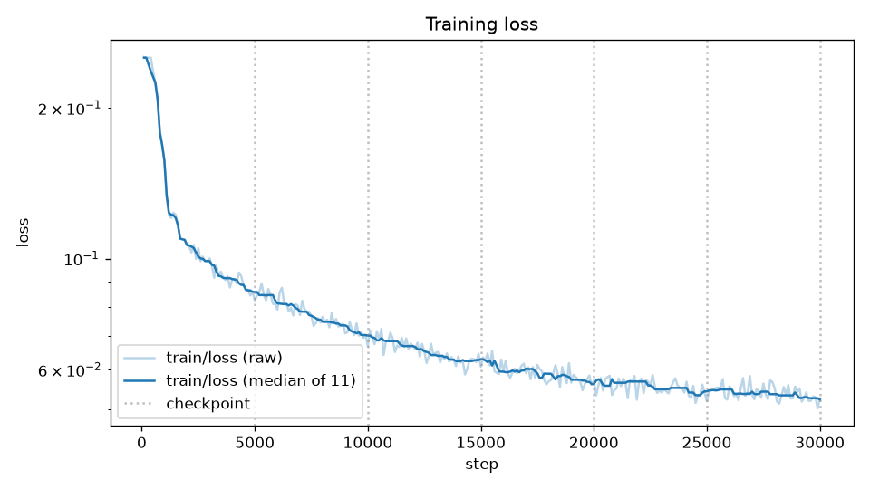
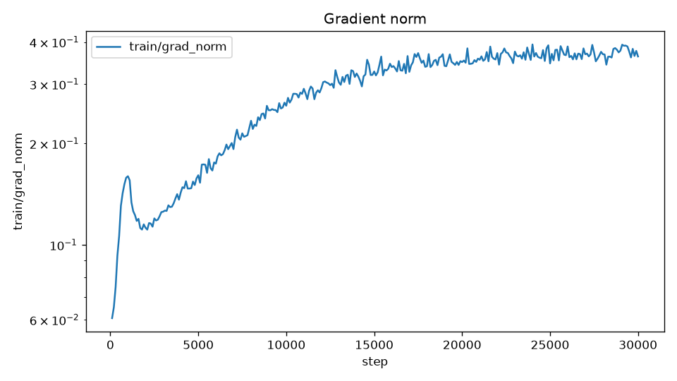
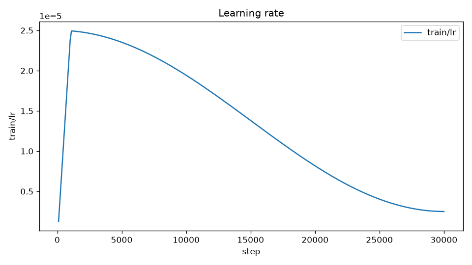
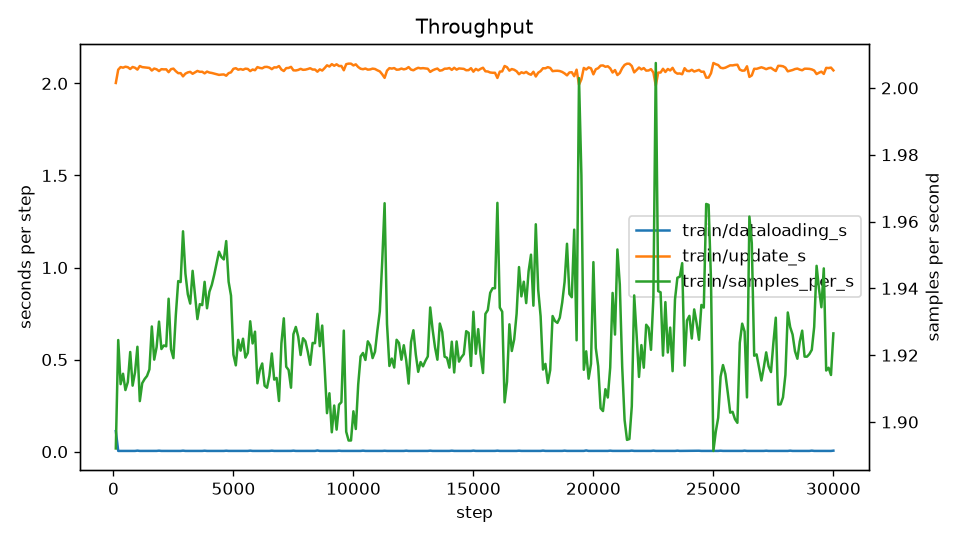
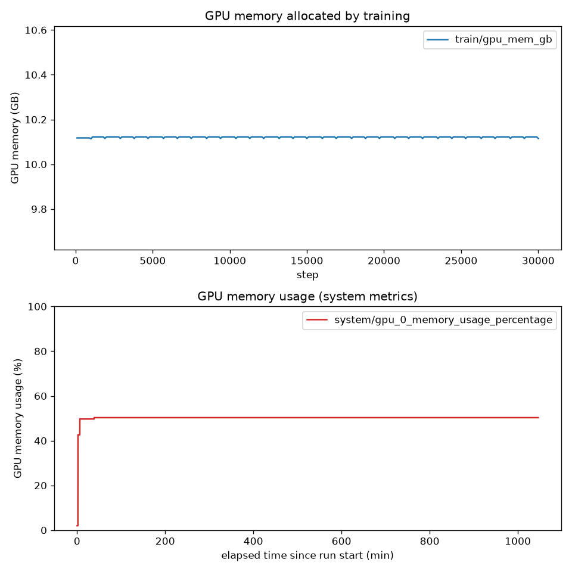

# 学習の診断と次のパラメータの提案: vams-00000000000000000000000000000012

## 1. 対象の run の要約

| 項目 | 値 |
|---|---|
| run 名 | `vams-00000000000000000000000000000012` |
| run ID | `00000000000000000000000000000011` |
| experiment | `vams-training` |
| status | `FINISHED` |
| 開始 | 2026-01-01 00:00:00 UTC（2026-01-01 09:00:00 JST） |
| 終了 | 2026-01-01 17:26:20 UTC（2026-01-02 02:26:20 JST） |
| トリガー | `vams` |
| VAMS の実行 ID | `00000000000000000000000000000012` |
| データセット | `vams/default-XXXXXXXX/teleop_fold_dataset_XXXX`（アセット名 `teleop_fold_dataset_XXXX`） |
| 推定のフレーム数とエピソード数 | 3746.0 フレーム、1.0 エピソード（`train/samples` と `train/epochs` からの推定） |
| 計画の総ステップ数 | 30000 |
| 注記 | なし |

| 項目 | 値 |
|---|---|
| `POLICY_TYPE` | `pi05` |
| `PRETRAINED_PATH` | `lerobot/pi05_base` |
| `FINETUNE_MODE` | `lora` |
| `LORA_R` | 16 |
| `LORA_ALPHA` | 16 |
| `STEPS` | 30000 |
| `BATCH_SIZE` | 4 |
| `SAVE_FREQ` | 5000 |
| `LOG_FREQ` | 100 |
| `NUM_WORKERS` | 4 |
| `COMPILE_MODEL` | false |
| `IMAGE_TAG` | `latest` |

比較の条件は、`vams.dataset_digest` が `sha256:abababababababababababababababababababababababababababababababab` で、experiment `vams-training` と `lerobot-pi` の status `FINISHED` の run（最大 5 件）である。

## 2. 学習曲線の図



`train/loss` の生の値と平滑化（11 点の移動中央値）を対数軸で示す。点線はチェックポイントの位置である。



`train/grad_norm` の推移を示す。



`train/lr` の推移を示す。1000 ステップの warmup のあと cosine で減衰し、30000 ステップで最小値に達している。



`train/dataloading_s`、`train/update_s`、`train/samples_per_s` を示す。



上の図は `train/gpu_mem_gb`（横軸はステップ）、下の図は `system/gpu_0_memory_usage_percentage`（横軸は run の開始からの経過時間（分））である。上下の図で横軸が違う。

比較対象の run が無いため、`compare_loss_step.png` と `compare_loss_samples.png` は作られていない。

## 3. 診断の結果

診断のラベル: `converging`、`overfit_risk`、`gpu_memory_headroom`

| 特徴量 | 値 |
|---|---|
| `num_points` | 300 |
| `last_step` | 30000 |
| `planned_steps` | 30000 |
| `completion_ratio` | 1.0 |
| `initial_loss` | 約 0.1186 |
| `final_loss` | 約 0.0540 |
| `min_loss` | 約 0.0523 |
| `min_loss_step` | 30000 |
| `loss_reduction` | 約 0.5446 |
| `tail_slope_per_1k` | 約 -0.005473 |
| `tail_improvement` | 約 0.02254 |
| `tail_cv` | 約 0.03237 |
| `nonfinite_loss` | 0 |
| `nonfinite_grad_norm` | 0 |
| `loss_spikes` | 0 |
| `grad_norm_spikes` | 0 |
| `lr_progress` | 約 0.1003 |
| `epochs` | 約 32.03 |
| `dataloading_ratio` | 約 0.001926 |
| `gpu_mem_gb_max` | 約 10.12 |
| `gpu_memory_percent_max` | 50.3 |
| `gpu_utilization_median` | 100.0 |
| `samples_per_s_median` | 約 1.923 |
| `estimated_frames` | 3746.0 |
| `estimated_episodes` | 1.0 |
| `final_samples` | 120000.0 |

所見:

1. 損失はまだ下がっている。末尾の改善率 0.02254、末尾の傾きは 1000 ステップあたり -0.005473、最終の損失は 0.054。
2. データを 32.03 周しており、30 周を超えたまま訓練の損失が下がり続けている。
3. 評価の損失が記録されていないため、過学習は直接は判定していない。
4. GPU メモリの使用率の最大は 50.3% で、60% を下回る（学習が確保したのは 10.12 GB）。

> 評価の損失が無いため、過学習は直接は判定していない。`overfit_risk` は `train/epochs` による代理の判定である。

`lr_progress` は約 0.1003 で、preset の `decay_lr / optimizer_lr`（0.1）に近い。`lrScheduleParams` の `scheduler.num_decay_steps` は 30000、`scheduler.decay_lr` は 2.5e-06 で、学習率は学習の最後に減衰しきっている。

## 4. 次のパラメータの提案

| 項目 | 前の値 | 提案の値 | 根拠 | 証拠 |
|---|---|---|---|---|
| `STEPS` | 30000 | 20000 | 1 エピソードのデータを 30 周以上学習しており、評価の損失が無いまま訓練の損失だけが下がっている。学習率は 30000 ステップで減衰しきっていて、これ以上 `STEPS` を延ばしても効果は小さい。データを増やすまでは周回数を減らす | `overfit_risk`、`epochs=32.03416978109984`、`lr_progress=0.10028108681633426`、`estimated_episodes=1.0`、`few_episodes` |

ほかの項目は前の run と同じ。

`converging` も付いているが、`STEPS` を増やす提案はしていない。`STEPS` が 30000 以上では 30000 ステップより後の学習率が最小値のままになり、1 エピソードのデータへの周回だけが増えるためである。

期待する効果: 周回数を減らし、1 エピソードへの過学習の度合いを下げる。訓練の損失の最終値は前の run より高くなる可能性があるが、それ自体は悪化を意味しない。

リスク:

1. 入力のデータセットが 1 エピソードしかない（`few_episodes`）。パラメータの調整より、エピソードを足したデータセットか view を入力にすることを優先する。
2. 評価の損失（`eval/*`）が記録されていないため、過学習は直接は判定していない。`overfit_risk` は `train/epochs` による代理の判定である。
3. `STEPS` を 30000 未満にすると、warmup と cosine 減衰が `STEPS` に合わせて縮むため、同じステップの損失を前の run と単純に比べられない。
4. データセットの品質のフラグ `task_text_issue` が 1 エピソードに立っている。タスクの文の確認を VAMS で行う。

`validate-proposal` の警告は無い。

代わりの案: 12 項目を前の run と同じにする（`STEPS` は 30000 のまま）。エピソードを足したデータセットか view に入力を替える場合に、データの違いだけを比べるための案である。

検証の結果: `validate-proposal` を通った。

## 5. 比較表

比較の条件（同じ `vams.dataset_digest`、status `FINISHED`、experiment `vams-training` と `lerobot-pi`）に合う run は無かった。

同じアセット `teleop_fold_dataset_XXXX` を入力にした run はほかに 3 件ある（6 節）。`vams.dataset_digest` が対象の run と違うため、比較対象にはなっていない。アセットの中身が版によって違う可能性がある。

## 6. 学習に使ったデータセット

### 6.1 データセットの統計

| 項目 | `teleop_fold_dataset_XXXX` |
|---|---|
| アセット ID | `teleop_fold_dataset_XXXX` |
| 使われ方 | `input`（`dataset`） |
| エピソード数 | 1 |
| フレーム数 | 3746 |
| 時間（秒） | 62.433 |
| fps | 60 |
| タスク数 | 1 |
| ロボット | `openarm_bimanual` |
| 品質のフラグ | 1 / 1 エピソード（`task_text_issue`: 1） |
| 品質の計算 | 2026-01-02T00:00:00Z（`qualityVersion` 2） |
| レビュー済みのエピソード数 | 1（最終更新 2026-01-02T00:00:00Z） |
| 統計 | `statsPresent`: true、`statsCountMatchesFrames`: true |
| このアセットを使った run | `FINISHED` 2、`FAILED` 1、`KILLED` 1 |

このアセットを使った run は次のとおり。

| run 名 | run ID | status |
|---|---|---|
| `vams-00000000000000000000000000000012` | `00000000000000000000000000000011` | `FINISHED`（対象の run） |
| `vams-00000000000000000000000000000015` | `00000000000000000000000000000014` | `FAILED` |
| `vams-00000000000000000000000000000017` | `00000000000000000000000000000016` | `KILLED` |
| `vams-00000000000000000000000000000019` | `00000000000000000000000000000018` | `FINISHED` |

### 6.2 品質とレビューの所見

1. `teleop_fold_dataset_XXXX`: 1 エピソードのうち 1 エピソードに品質のフラグがある（`task_text_issue`=1）。エピソードごとのフラグはアセットの品質ファイルにあり、メタデータには無い。
2. レビューは 1 エピソードについて済んでおり、外す判定（`exclude`、`failure`）のエピソードは無い。

### 6.3 次の学習から外す候補

以下は削除ではなく、VAMS のキュレーションで次の学習の入力から外す提案である。この skill は除外を実行しない。

データセットの候補:

| アセット名 | 理由 | 説明 |
|---|---|---|
| `teleop_fold_dataset_XXXX` | `few_episodes` | エピソードが 1（閾値 `fewEpisodesMax` は 1）で、課題のばらつきを学べない。外すより、エピソードを足したデータセットか、複数のエピソードを持つ view に替える |

エピソードの候補: レビューで外す判定のエピソードは無く、候補は無い。既に view で外したエピソードも無い（入力はデータセットの全体）。

除外の手順（人が行う）:

1. 次の学習の `--input-file` に、このアセットを単独で選ばない。同じタスク（T シャツをたたむ）のエピソードを足したデータセットか、複数のエピソードを持つ curation の view を選ぶ。
2. `task_text_issue` のフラグについて、VAMS の画面でタスクの文を確かめる。
3. 新しい入力で学習した run を、この skill でもう一度診断し、損失の変化を比べる。

view の作り方と、view を学習の入力にする方法は `hyperpod/docs/ja/VAMS_INTEGRATION/OVERVIEW.md` にある。

## 7. 実行する場合の手順

実行は、人が提案とレポートを確認し、承認したあとに人が行う。この skill は実行しない。

`vams_parameters.json`:

```json
{
  "pask-lerobot-openpi-training": {
    "templateId": "pask-lerobot-openpi-default",
    "templateTags": [
      {"key": "POLICY_TYPE", "value": "pi05"},
      {"key": "PRETRAINED_PATH", "value": "lerobot/pi05_base"},
      {"key": "FINETUNE_MODE", "value": "lora"},
      {"key": "LORA_R", "value": 16},
      {"key": "LORA_ALPHA", "value": 16},
      {"key": "STEPS", "value": 20000},
      {"key": "BATCH_SIZE", "value": 4},
      {"key": "SAVE_FREQ", "value": 5000},
      {"key": "LOG_FREQ", "value": 100},
      {"key": "NUM_WORKERS", "value": 4},
      {"key": "COMPILE_MODEL", "value": false},
      {"key": "IMAGE_TAG", "value": "latest"}
    ]
  }
}
```

VamsCLI で実行する場合のコマンドの例:

```bash
vamscli workflow execute --workflow-database-id "${DATABASE_ID}" -w "${WORKFLOW_ID}" \
  --input-file "${DATABASE_ID}:<入力のアセットの ID>:/" \
  --output-asset-id "<出力のアセットの ID>" \
  --pipeline-parameters "$(jq -c . <出力ディレクトリ>/vams_parameters.json)"
```

1. `vams_parameters.json` は `{"<pipelineId>": {"templateId": ..., "templateTags": [...]}}` の形で、`--pipeline-parameters` にそのまま渡せる。キーの pipelineId は `validate-proposal` の `--pipeline-id` の値（`pask-lerobot-openpi-training`）である。
2. `templateTags` には変えない項目も含めて 12 項目すべてを入れてある。指定しなかったタグはテンプレートの既定値になるため、項目を削らない。
3. `--input-file` の最後の `/` はアセットの全体を表す。入力にはルートに LeRobot のデータセットを持つアセットを、出力には入力と別のアセットを選ぶ。6.3 節のとおり、入力はエピソードを足したデータセットか view にする。
4. `DATABASE_ID`、`WORKFLOW_ID`、アセットの ID は利用者の環境の値で、この skill は決めない。
