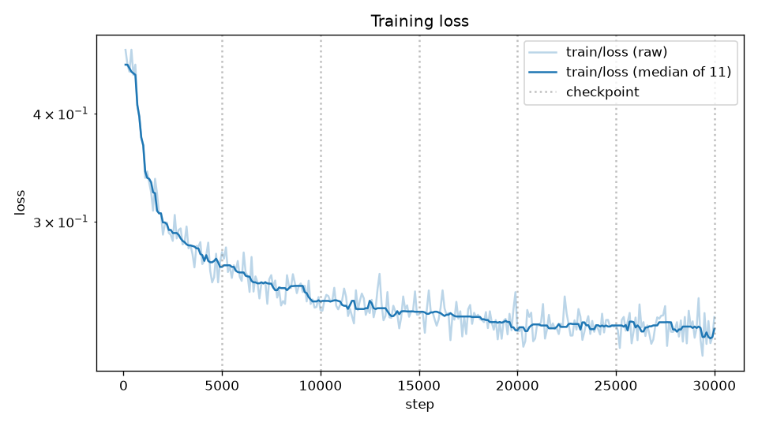
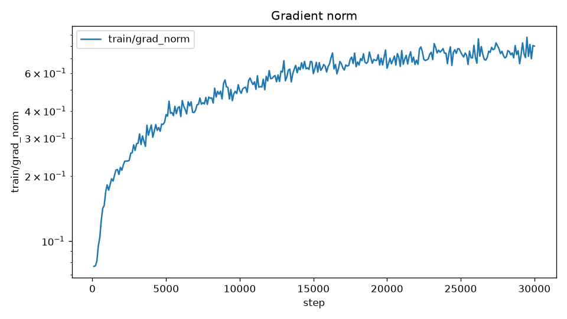
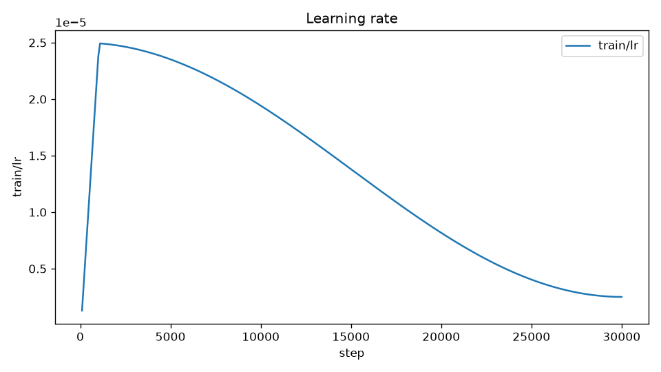
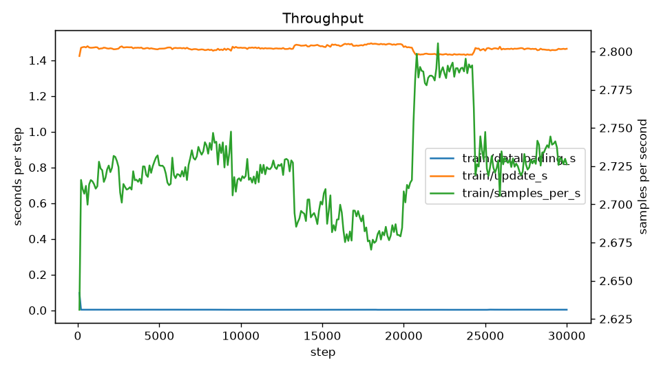
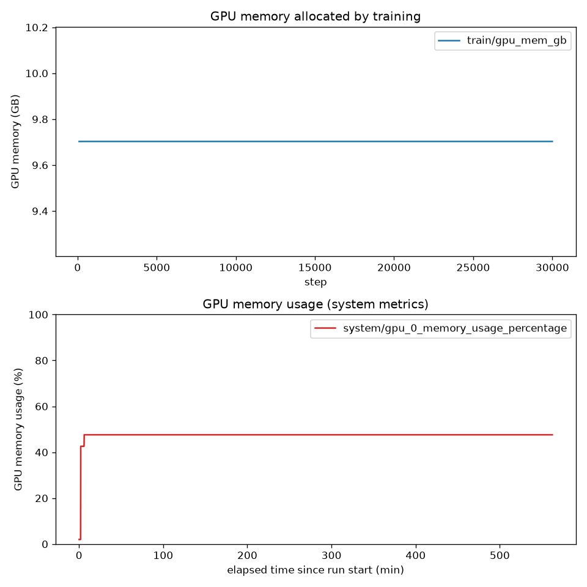
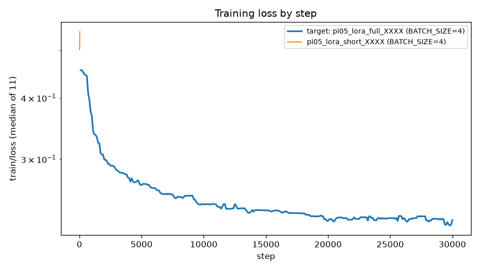
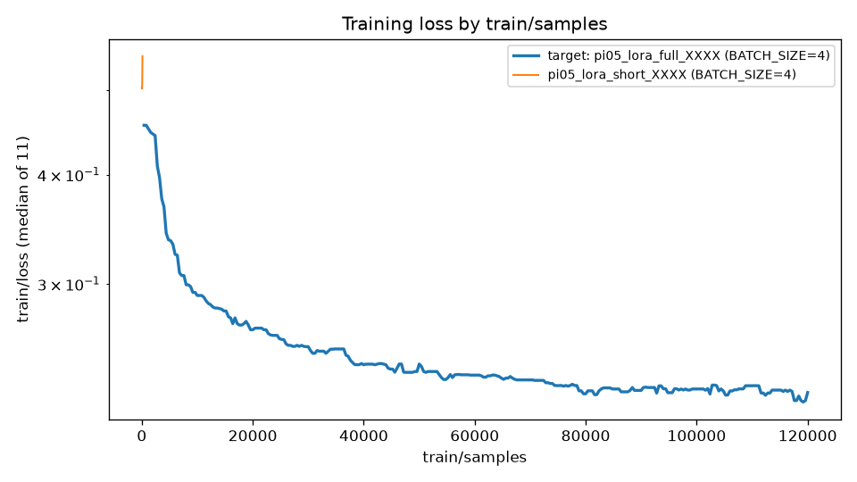

# 学習の診断と次のパラメータの提案: pi05_lora_full_XXXX

## 1. 対象の run の要約

| 項目 | 値 |
|---|---|
| run 名 | `pi05_lora_full_XXXX` |
| run ID | `00000000000000000000000000000001` |
| experiment | `lerobot-pi` |
| status | `FINISHED` |
| 開始 | 2026-01-01 00:00:00 UTC（2026-01-01 09:00:00 JST） |
| 終了 | 2026-01-01 12:21:30 UTC（2026-01-01 21:21:30 JST） |
| トリガー（`pask.trigger`） | 記録なし |
| データセット | `lerobot/libero` |
| 推定のフレーム数 | 273465.0（`train/samples / train/epochs` からの推定） |
| 推定のエピソード数 | 1693.0（`train/episodes / train/epochs` からの推定） |
| 計画の総ステップ数 | 30000 |

12 項目の値:

| 項目 | 値 |
|---|---|
| `POLICY_TYPE` | `pi05` |
| `PRETRAINED_PATH` | `lerobot/pi05_base` |
| `FINETUNE_MODE` | `lora` |
| `LORA_R` | 16 |
| `LORA_ALPHA` | 16 |
| `STEPS` | 30000 |
| `BATCH_SIZE` | 4 |
| `SAVE_FREQ` | 5000 |
| `LOG_FREQ` | 100 |
| `NUM_WORKERS` | 4 |
| `COMPILE_MODEL` | `false` |
| `IMAGE_TAG` | `latest` |

比較の条件: データセットのキー `lerobot.dataset_repo_id` が `lerobot/libero` で、experiment `vams-training` と `lerobot-pi` の status `FINISHED` の run を最大 5 件。

## 2. 学習曲線の図



`train/loss` の生の値と移動中央値（対数軸）。点線はチェックポイントの位置。5000 ステップまでで大きく下がり、25000 ステップ以降はほぼ横ばいである。



`train/grad_norm` の推移。



`train/lr` の推移。warmup のあと cosine で減衰し、30000 ステップで最小値に達している。



`train/dataloading_s`、`train/update_s`、`train/samples_per_s` の推移。



上段は `train/gpu_mem_gb` を学習のステップに対して、下段は `system/gpu_0_memory_usage_percentage` を run の開始からの経過時間（分）に対して描いている。2 つの図の横軸は対応しない。



対象と比較対象の run の `train/loss`（横軸はステップ）。



対象と比較対象の run の `train/loss`（横軸は `train/samples`）。

## 3. 診断の結果

ラベル: `plateau`、`gpu_memory_headroom`

所見:

1. 損失が横ばいになっている。末尾の相対改善 0.004036 が 0.01 を下回り、最終の損失は 0.2269、学習率の進み具合は 0.1003。
2. 評価の損失が記録されていないため、過学習は直接は判定していない。
3. GPU メモリの使用率の最大値は 47.6% で、60% を下回る（学習が確保したメモリは 9.703 GB）。

| 特徴量 | 値 |
|---|---|
| `num_points` | 300 |
| `last_step` | 30000 |
| `planned_steps` | 30000 |
| `completion_ratio` | 1.0 |
| `initial_loss` | 約 0.3239 |
| `final_loss` | 約 0.2269 |
| `min_loss` | 約 0.2198 |
| `min_loss_step` | 29800 |
| `loss_reduction` | 約 0.2996 |
| `tail_slope_per_1k` | 約 -0.001156 |
| `tail_improvement` | 約 0.004036 |
| `tail_cv` | 約 0.02949 |
| `nonfinite_loss` | 0 |
| `nonfinite_grad_norm` | 0 |
| `loss_spikes` | 0 |
| `grad_norm_spikes` | 0 |
| `lr_progress` | 約 0.1003 |
| `epochs` | 約 0.4388 |
| `dataloading_ratio` | 約 0.002099 |
| `gpu_mem_gb_max` | 約 9.703 |
| `gpu_memory_percent_max` | 47.6 |
| `gpu_utilization_median` | 100.0 |
| `samples_per_s_median` | 約 2.723 |
| `estimated_frames` | 273465.0 |
| `estimated_episodes` | 1693.0 |
| `final_samples` | 120000.0 |

> 評価の損失が無いため、過学習は直接は判定していない。`overfit_risk` は `train/epochs` による代理の判定である。

判定に使った閾値: `tailWindowFraction` 0.25、`plateauTailImprovement` 0.01、`gpuMemoryHeadroomPercent` 60。

図との照合: `loss.png` の 25000 ステップ以降の横ばいと、`lr.png` の学習率が最小値まで下がっていることは、`plateau` のラベルと一致する。

## 4. 次のパラメータの提案

| 項目 | 前の値 | 提案の値 | 根拠 | 証拠 |
|---|---|---|---|---|
| `LORA_R` | 16 | 32 | 末尾の窓で損失がほぼ下がっておらず、学習率は減衰しきっている。`STEPS` を 30000 より増やしても学習率は 2.5e-06 のまま一定なので効果は小さい。代わりに LoRA の表現力を上げる | `plateau`、`tail_improvement=0.004035925119422745`、`tail_slope_per_1k=-0.001155525141911819`、`lr_progress=0.10028108681633426` |
| `LORA_ALPHA` | 16 | 32 | `LORA_R` に合わせて上げ、`LORA_ALPHA / LORA_R` の比（1）を保つ | `plateau` |

ほかの項目は前の run と同じ。

期待する効果: LoRA のランクを上げて学習できるパラメータを増やし、30000 ステップで到達する損失を前の run より下げる。

リスク:

1. LoRA のランクを上げると GPU メモリの使用量が増える。前の run の最大使用率は 47.6% で余地はある（`gpu_memory_headroom`）。
2. 評価の損失が記録されていないため、損失の低下が汎化の改善につながるかは確かめられない。
3. 前の run と `STEPS` が同じなので学習率のスケジュールは同じになり、同じステップで損失を比べられる。

代わりの案: `FINETUNE_MODE` を `expert_only` にする。action expert 全体を学習してさらに表現力を上げる案。24 GB の GPU に収まらない可能性が高いため代わりの案に置く。

検証の結果: `validate-proposal` を通った（違反なし）。代わりの案について警告が 1 件ある: `alternatives[0]: FINETUNE_MODE=expert_only: may not fit in a 24 GB GPU; prepare a GPU with more memory`。

## 5. 比較表

| 行 | 対象 | 比較対象 |
|---|---|---|
| run 名 | `pi05_lora_full_XXXX` | `pi05_lora_short_XXXX` |
| run ID | `00000000000000000000000000000001` | `00000000000000000000000000000002` |
| experiment | `lerobot-pi` | `lerobot-pi` |
| `POLICY_TYPE` | `pi05` | `pi05` |
| `PRETRAINED_PATH` | `lerobot/pi05_base` | `lerobot/pi05_base` |
| `FINETUNE_MODE` | `lora` | `lora` |
| `LORA_R` | 16 | 16 |
| `LORA_ALPHA` | 16 | 16 |
| `STEPS` | 30000 | **20** |
| `BATCH_SIZE` | 4 | 4 |
| `SAVE_FREQ` | 5000 | **10** |
| `LOG_FREQ` | 100 | **5** |
| `NUM_WORKERS` | 4 | 4 |
| `COMPILE_MODEL` | `false` | `false` |
| `IMAGE_TAG` | `latest` | `latest` |
| 最終の損失 | 約 0.2269 | 約 0.5145 |
| 処理したサンプル数 | 120000.0 | 120.0 |
| 最小の損失 | 約 0.2198 | 約 0.5016 |
| 減少率 | 約 0.2996 | 約 -0.02231 |
| 完了率 | 1.0 | 1.0 |
| 処理速度（samples/s） | 約 2.723 | 約 2.877 |
| ラベル | `plateau`、`gpu_memory_headroom` | `insufficient_data`、`gpu_memory_headroom` |

比較対象は E2E の動作確認用の短い run で、処理したサンプル数が大きく違うため、最終の損失は単純には比べられない（`compare_loss_samples.png` を参照）。

## 6. 実行する場合の手順

**実行は人が提案とレポートを確認し、承認したあとに人が行う。この skill は実行しない。**

`vams_parameters.json`:

```json
{
  "pask-lerobot-openpi-training": {
    "templateId": "pask-lerobot-openpi-default",
    "templateTags": [
      {"key": "POLICY_TYPE", "value": "pi05"},
      {"key": "PRETRAINED_PATH", "value": "lerobot/pi05_base"},
      {"key": "FINETUNE_MODE", "value": "lora"},
      {"key": "LORA_R", "value": 32},
      {"key": "LORA_ALPHA", "value": 32},
      {"key": "STEPS", "value": 30000},
      {"key": "BATCH_SIZE", "value": 4},
      {"key": "SAVE_FREQ", "value": 5000},
      {"key": "LOG_FREQ", "value": 100},
      {"key": "NUM_WORKERS", "value": 4},
      {"key": "COMPILE_MODEL", "value": false},
      {"key": "IMAGE_TAG", "value": "latest"}
    ]
  }
}
```

```bash
vamscli workflow execute --workflow-database-id "${DATABASE_ID}" -w "${WORKFLOW_ID}" \
  --input-file "${DATABASE_ID}:<入力のアセットの ID>:/" \
  --output-asset-id "<出力のアセットの ID>" \
  --pipeline-parameters "$(jq -c . <出力ディレクトリ>/vams_parameters.json)"
```

1. `vams_parameters.json` は `{"<pipelineId>": {"templateId": ..., "templateTags": [...]}}` の形で、`--pipeline-parameters` にそのまま渡せる。キーの pipelineId は `validate-proposal` の `--pipeline-id` の値（`pask-lerobot-openpi-training`）である。
2. `templateTags` には変えない項目も含めて 12 項目すべてを入れてある。指定しなかったタグはテンプレートの既定値になるため、項目を削らない。
3. `--input-file` の最後の `/` はアセットの全体を表す。入力にはルートに LeRobot のデータセットを持つアセットを、出力には入力と別のアセットを選ぶ。
4. `DATABASE_ID`、`WORKFLOW_ID`、アセットの ID は利用者の環境の値で、この skill は決めない。
