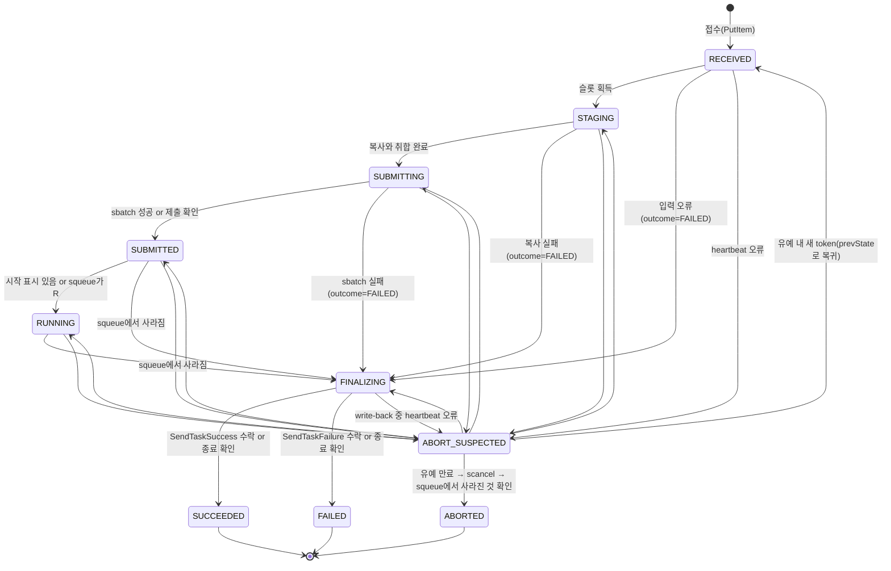

> **참고:** 이 문서는 AI로 자동 번역되었습니다. 정확한 내용은 [영어판](../../en/VAMS_INTEGRATION/SPEC.md) 또는 [일본어판](../../ja/VAMS_INTEGRATION/SPEC.md)을 확인하십시오.

# VAMS 연동 사양

VAMS 연동의 message, file, state의 형태와 poller의 처리 규칙을 설명합니다.
연동을 수정하는 개발자와 장애를 조사하는 운영자를 대상으로 하는 문서입니다.
연동의 전체 흐름과 제약은 [VAMS 연동의 동작 방식](/hyperpod/docs/ko/VAMS_INTEGRATION/ARCHITECTURE.md)에, 도입 절차는 [VAMS 연동의 도입과 운영](/hyperpod/docs/ko/VAMS_INTEGRATION/OVERVIEW.md)에 있습니다.

## SQS 메시지

VAMS의 Step Functions는 SQS step에서 다음 형태의 JSON을 message body로 보냅니다.

```json
{
  "body": {
    "workflowDatabaseId": "...",
    "workflowId": "...",
    "workflowExecutionId": "...",
    "workflowExecutionS3InputOutputBucket": "...",
    "executingUserName": "...",
    "executingRequestContext": "...",
    "inputManifestS3Location": "s3://<bucket>/<key>",
    "inputConfigurationS3Location": "s3://<bucket>/<key>",
    "TaskToken": "..."
  }
}
```

| 항목 | 내용 | poller에서의 사용 방법 |
|---|---|---|
| `workflowDatabaseId`, `workflowId`, `workflowExecutionId` | VAMS workflow와 execution의 ID | DynamoDB item, `vams_context.json`, MLflow tag에 기록합니다 |
| `workflowExecutionS3InputOutputBucket` | VAMS execution용 bucket의 이름 | 필수 항목으로 검증합니다. DynamoDB item에는 기록하지 않으며, write-back 대상으로는 manifest의 `outputs.bucket`을 사용합니다 |
| `executingUserName` | workflow를 실행한 사용자의 이름 | `vams_context.json`과 MLflow tag `vams.executing_user_name`에 기록합니다 |
| `executingRequestContext` | VAMS는 `executingUserName`과 같은 값을 넣습니다 | 사용하지 않습니다 |
| `inputManifestS3Location` | manifest의 위치(`s3://` URI) | 입력과 출력의 위치를 읽습니다 |
| `inputConfigurationS3Location` | VAMS가 템플릿 tag를 치환한 설정 JSON의 위치(`s3://` URI) | 학습 파라미터를 읽습니다 |
| `TaskToken` | Step Functions task의 token | heartbeat와 `SendTask*`에 사용합니다 |

입력 파일과 출력 위치는 본문에 들어가지 않고 manifest에 들어갑니다.

메시지에는 `MessageGroupId`가 붙지 않습니다.
FIFO queue는 `MessageGroupId`가 없는 메시지를 받지 않으므로, queue는 standard queue로 만듭니다.
Standard queue는 같은 메시지를 두 번 이상 전달할 수 있고, 순서도 보장하지 않습니다.

같은 execution의 메시지가 새 TaskToken으로 다시 전송될 수도 있습니다.
VAMS의 SQS step은 전송 시의 일시적인 오류(`CALLBACK_TRANSIENT_RETRYABLE_ERRORS`의 `SQS.SdkClientException` 등)를 `IntervalSeconds` 5, `BackoffRate` 2, `MaxAttempts` 2로 재시도합니다.
재시도에서는 step을 처음부터 다시 실행하므로, 처음 전송이 실제로 도착했다면 이전 token의 메시지와 새 token의 메시지가 모두 PASK에 도착합니다.
이전 token은 재시도가 시작된 시점에 task가 닫히므로 더 이상 사용할 수 없습니다.
poller는 pipelineExecutionId로 execution을 식별하고, 메시지의 `SentTimestamp`가 더 새로운 경우에만 token을 교체합니다(「접수 루프」 절 참고).

VAMS step의 대기 시간(taskTimeout)은 pipeline 등록 시 초 단위로 정합니다.
상한은 604800초이며, 지정하지 않으면 86400초를 사용합니다.
taskTimeout에는 Slurm queue에서의 대기, 데이터 복사, 학습(`slurm_train.sh`의 `--time=48:00:00`), write-back 시간이 모두 포함됩니다.
번들된 정의(`hyperpod/vams/pipeline.json`)의 값과 그 근거는 [VAMS 연동의 도입과 운영](/hyperpod/docs/ko/VAMS_INTEGRATION/OVERVIEW.md)의 「파이프라인 등록」 절에 있습니다.
VAMS의 SQS step에는 `HeartbeatSeconds`가 설정되지 않으므로, heartbeat가 끊겨도 task가 실패하지는 않습니다.

## manifest

`inputManifestS3Location`의 manifest는 다음 envelope를 가진 JSON입니다.

| 항목 | 내용 |
|---|---|
| `schemaVersion` | `1` |
| `inputFiles` | 입력 파일 entry의 배열 |
| `inputMetadataS3Location` | metadata JSON(`metadata.json`)의 위치 |
| `outputs` | `{bucket, files, previews, metadata, results}`. `bucket`은 출력 bucket의 이름이고, 나머지는 그 bucket 안의 완전한 key prefix입니다 |
| `outputTarget` | `{locationType, assetId, databaseId, fileBaseExecutionPathExtension}`. VAMS가 outputs를 가져오는 asset |
| `auxBucket` | 보조 bucket의 이름 |
| `auxTempPrefix` | 보조 bucket 안의 작업용 prefix. 형태는 `pipelines/{pipelineName}/{executionId}/`입니다 |
| `auxPreviewPipelineSuffix` | preview용 보조 prefix. 사용하지 않습니다 |
| `systemConfig` | `{orchestrationBusArn, orchestrationEventPrefix}` |

`inputFiles`의 각 entry는 다음 항목을 가집니다.

| 항목 | 내용 |
|---|---|
| `relativePath` | asset 안의 상대 경로. asset 전체를 지정한 경우 `/` |
| `databaseId`, `assetId` | 입력 asset |
| `assetRootS3Key` | `bucket` 안의 asset root의 prefix |
| `auxPreviewPrefix` | 보조 bucket의 preview prefix. 사용하지 않습니다 |
| `bucket` | 입력 asset bucket |
| `key` | 파일의 key. asset 전체를 지정한 경우 prefix |
| `versionId` | 파일의 version. asset 전체를 지정한 경우 비어 있습니다 |

PASK는 asset 전체를 지정한 실행만 받습니다.
asset 전체를 지정하면 `inputFiles`는 prefix 1건이 되고, `relativePath`는 `/`, `versionId`는 비어 있습니다.
`inputFiles`가 1건이 아닌 경우와 `relativePath`가 `/`가 아닌 경우(파일을 1개만 선택한 경우 등)는 `PASK.InvalidRequest`로 실패시킵니다.
파일 목록은 poller가 `bucket`의 `assetRootS3Key` 아래를 나열하여 얻습니다.
입력이 curation의 view인 경우에는 view의 manifest에서 원래 asset의 파일을 얻습니다(「입력 종류 판정」 절 참고).

pipelineExecutionId는 `systemConfig.orchestrationEventPrefix`에서 꺼냅니다.
VAMS는 이 값을 `<eventSourcePrefix>.execution.<executionId>.pipeline.<pipelineExecutionId>` 형태로 만듭니다.
poller는 마지막 `.pipeline.` 뒤의 부분을 pipelineExecutionId로 하고, `^[A-Za-z0-9_-]+$`에 일치하는지 확인합니다.
pipelineExecutionId는 job 이름, S3 key, FSx 경로에 사용하므로, 일치하지 않으면 `PASK.InvalidRequest`로 실패시킵니다.

pipelineName은 `auxTempPrefix`(`pipelines/{pipelineName}/{executionId}/`)의 두 번째 요소에서 꺼냅니다.
VAMS는 이 요소에 pipeline의 표시 이름이 아니라 pipelineId를 넣으므로, `vams_context.json`의 `pipelineName`과 MLflow tag `vams.pipeline_name`의 값은 pipelineId가 됩니다.

`inputMetadataS3Location`의 `metadata.json`에서는 입력 asset의 `assetName`, `description`, `tags`를 읽습니다.
`metadata.json`은 `schemaVersion`이 2인 경우 `assets[]`의 각 요소에 `databaseId`, `assetId`, `assetData{assetName, description, tags}`를 가집니다.
poller는 `inputFiles`의 `databaseId`와 `assetId`에 일치하는 요소의 `assetData`를 사용합니다.
이 값들은 workflow의 `metadataInputs`에서 asset metadata를 활성화한 경우에만 들어오므로, 없으면 생략합니다.

## 학습 파라미터

학습 파라미터는 VAMS pipeline의 템플릿과 tag로 받습니다.
poller는 VAMS가 tag를 치환한 `inputConfigurationS3Location`의 JSON만 읽습니다.
이 JSON은 key가 환경 변수 이름이고 value가 설정 값인 flat object입니다.

값은 문자열로 바꾼 뒤 검증합니다.
문자열은 그대로 사용하고, 불리언은 `true` 또는 `false`, 정수는 10진수 문자열로 만듭니다.
정수가 아닌 숫자, `null`, object, array 값은 `PASK.InvalidRequest`로 실패시킵니다.

허용 목록(allowlist)에 있는 key만 받습니다.
허용 목록에 없는 key가 하나라도 있으면 `PASK.InvalidRequest`로 실패시킵니다.
JSON에 없는 key는 `slurm_train.sh`의 기본값이 됩니다.

| Key | 검증 정규식 |
|---|---|
| `POLICY_TYPE` | `^(pi05\|pi0)$` |
| `PRETRAINED_PATH` | `^(?!.*\.\.)[A-Za-z0-9._/-]{1,200}$` |
| `FINETUNE_MODE` | `^(lora\|expert_only\|full)$` |
| `LORA_R`、`LORA_ALPHA`、`STEPS`、`BATCH_SIZE`、`SAVE_FREQ`、`LOG_FREQ`、`NUM_WORKERS` | `^[1-9][0-9]{0,8}$` |
| `COMPILE_MODEL` | `^(true\|false)$` |
| `IMAGE_TAG` | `^[A-Za-z0-9._-]{1,128}$` |

`PRETRAINED_PATH`의 정규식은 `..`을 포함하는 값을 거부합니다.
`/`로 시작하는 값은 허용합니다.
`NUM_WORKERS`는 1 이상의 값만 허용합니다.

다음 key는 poller가 결정하거나 학습 바깥에 영향을 주므로 거부합니다.
허용 목록에 없는 key는 모두 거부하지만, 거부 이유가 명확한 것은 아래에 나열합니다.

| Key | 거부 이유 |
|---|---|
| `RESUME`、`OUTPUT_DIR`、`DATASET_ROOT`、`DATASET_REPO_ID` | poller가 결정합니다 |
| `EXTRA_ARGS` | 학습 command에 임의의 인자를 추가할 수 있기 때문입니다 |
| `CONTAINER_IMAGE` | 임의의 image를 실행할 수 있기 때문입니다 |
| `HF_TOKEN` | 인증 정보입니다 |
| `MLFLOW_*` | MLflow의 접속 대상과 experiment는 poller가 결정합니다 |
| `VAMS_*` | VAMS 실행 정보는 poller가 결정합니다 |

`DATASET_REPO_ID`는 poller가 `vams/<databaseId>/<assetId>`로 설정합니다.
`DATASET_ROOT`를 전달하므로, 데이터셋은 Hugging Face Hub에서 가져오지 않습니다.

Slurm 파티션은 poller의 설정 값(`PASK_VAMS_SLURM_PARTITION`)으로 정합니다.
값이 비어 있으면 Slurm의 기본 파티션을 사용합니다.
CPU 수나 메모리 같은 리소스는 `slurm_train.sh`의 `#SBATCH` 값을 그대로 두며, 학습 파라미터로는 받지 않습니다.

## 입력 종류 판정

입력에는 일반 데이터셋과 curation의 view 두 종류가 있습니다.
poller는 STAGING에서 입력 asset의 root 아래 최신 버전을 나열한 뒤, 다음 순서로 종류를 정합니다.

1. root 바로 아래에 `curation_manifest.json`이 있으면, 나열한 VersionId를 지정하여 읽습니다. UTF-8 JSON이 아니면 `PASK.InvalidRequest`로 합니다.
2. `curation_manifest_version`이 `2`가 아니거나, `mode`가 `view`와 `materialize` 중 어느 것도 아니면 `PASK.InvalidRequest`로 합니다.
3. `mode`가 `view`이면 view로 취급합니다. root에 `meta/info.json`이 없어도 오류로 하지 않습니다.
4. `mode`가 `materialize`이면 일반 데이터셋으로 취급합니다.
5. `curation_manifest.json`이 없거나 `mode`가 `materialize`인 경우에, root에 `meta/info.json`이 없으면 `PASK.InvalidRequest`로 합니다.

판정 결과는 `input_manifest.json`의 `kind`에 기록합니다(「실행 디렉터리의 파일」 절 참고).
한 번 쓴 `input_manifest.json`은 다시 만들지 않으므로, 재시도한 STAGING도 같은 종류와 같은 버전을 사용합니다.
view인 경우 재시도한 STAGING은 `input_manifest.json`의 `view.objects`에 있는 버전의 `curation_manifest.json`을 다시 읽어 검증합니다.
RECEIVED에서는 목록을 가져오지 않고, S3 요청에 있는 파일만 검증합니다. STAGING과 다른 시점의 버전을 보지 않도록 하기 위해서입니다.

### 뷰 manifest 검증

poller는 view의 `curation_manifest.json`을 다음 항목으로 검증합니다.
어느 하나라도 충족하지 않으면 `PASK.InvalidRequest`로 합니다.

| 항목 | 조건 |
|---|---|
| `curation_manifest_version` | `2` |
| `mode` | `view` |
| `source.database_id`, `source.asset_id` | 비어 있지 않은 문자열 |
| `source.storage.bucket`, `source.storage.asset_root_key` | 비어 있지 않은 문자열. `asset_root_key`는 `/`로 끝납니다 |
| 원래 위치 | `source.storage.bucket`이 입력 asset의 `bucket`과 같고, `source.database_id`가 입력 asset의 `databaseId`와 같습니다 |
| `source.files` | 1건 이상의 배열. 각 요소의 `path`는 비어 있지 않고, `/`로 시작하지 않으며, 빈 구간, `.`, `..` 구간을 포함하지 않습니다. `path`는 중복되지 않습니다. `version_id`는 비어 있지 않고 `"null"`이 아닙니다. `size`는 0 이상의 정수입니다 |
| 필수 파일 | `source.files`에 `meta/info.json`, `meta/tasks.parquet`, `meta/episodes/` 아래 파일 1건 이상, `data/` 아래 파일 1건 이상이 있습니다 |
| `episodes` | 0 이상의 정수(불리언 제외)가 1건 이상, 중복 없이 오름차순으로 나열됩니다. `source.total_episodes`가 정수이면 모든 값이 그보다 작습니다 |
| `excluded_episodes` | 없거나 배열입니다. 각 요소의 `episode_index`는 0 이상의 정수이며, `episodes`에 포함되지 않습니다 |
| `stats.path` | 비어 있지 않은 문자열. PASK는 이 값을 학습에 사용하지 않습니다 |

`version_id`가 `"null"`인 파일은 받지 않습니다. 버전을 고정할 수 없는 view로 학습하면, view를 만든 시점과 다른 내용을 읽을 가능성이 있기 때문입니다.
원래 위치를 확인하는 것은 view와 원래 asset이 같은 데이터베이스에 있다는 전제를 코드로 보장하기 위해서입니다([VAMS 연동의 동작 방식](/hyperpod/docs/ko/VAMS_INTEGRATION/ARCHITECTURE.md)의 「권한과 보안」 절 참고).

manifest를 검증한 뒤, poller는 `source.files`의 각 파일에 대해 `HeadObject(Bucket=source.storage.bucket, Key=asset_root_key + path, VersionId=version_id)`를 병렬로 실행합니다.
결과는 다음과 같이 처리합니다.

| 결과 | 처리 |
|---|---|
| 성공하고 `ContentLength`가 `size`와 같음 | `input_manifest.json`의 `objects`에 추가합니다 |
| 성공했지만 `ContentLength`가 `size`와 다름 | `PASK.InvalidRequest`. cause는 "view source file `<path>` size differs from the curation manifest" |
| 404(`NoSuchVersion`, `NoSuchKey`), 또는 `version_id`의 형태가 잘못된 400(`InvalidArgument`) | 기록된 버전이 없는 것으로 보고 `PASK.InvalidRequest`. cause는 "view source file `<path>` version is no longer available" |
| 403(`AccessDenied`) | `PASK.StagingFailed`. cause는 "the poller role cannot read the source asset of the view"로 시작합니다 |
| 스로틀링, 5xx, 연결 오류 | 일시적인 실패로 보고 재시도합니다 |

cause에는 `path`만 넣고, bucket 이름과 `version_id`는 넣지 않습니다.
파일이 많으면 확인이 heartbeat 간격을 넘을 수 있으므로, view의 확인은 heartbeat와 lease 연장을 계속하면서 수행합니다.

## PASK 측 경로와 키

PASK 측의 경로와 키는 pipelineExecutionId(이하 `<id>`)로부터 다음과 같이 정해집니다.
`<id>`는 `^[A-Za-z0-9_-]+$`에 일치하는지 확인된 값입니다.

| 대상 | 경로 또는 키 |
|---|---|
| PASK 데이터 bucket의 staging prefix | `<S3Prefix>vams/<id>/` |
| FSx 위의 데이터셋(`DATASET_ROOT`) | `/fsx<FileSystemPath>/vams/<id>/` |
| 실행 디렉터리(`VAMS_RUN_DIR`) | `<LEROBOT_PI_BASE_DIR>/vams-runs/<id>/` |
| 출력 디렉터리(`OUTPUT_DIR`) | `<LEROBOT_PI_OUTPUT_DIR>/vams-<id>` |
| 학습 디렉터리(sbatch의 `--chdir`) | `<LEROBOT_PI_BASE_DIR>/training` |
| Slurm job 이름 | `vams-<id>` |

`<S3Prefix>`는 PASK의 설정 값 `Lustre.S3Prefix`이며, 비어 있지 않으면 끝에 `/`를 맞춥니다.
기본값은 비어 있으므로 staging prefix는 `vams/<id>/`가 됩니다.
`<FileSystemPath>`는 `Lustre.FileSystemPath`이며, 기본값 `/s3link`이면 FSx 위의 데이터셋은 `/fsx/s3link/vams/<id>/`입니다.
PASK 데이터 bucket의 만료 lifecycle 규칙과 IAM 권한의 prefix도 `<S3Prefix>vams/`를 사용합니다.

실행 디렉터리와 출력 디렉터리는 `/fsx<FileSystemPath>`의 바깥에 둡니다.
그 아래에 두면 자동 export로 PASK 데이터 bucket에 복제되기 때문입니다.
출력 디렉터리를 실행 디렉터리와 나누는 것은, `OUTPUT_DIR`이 이미 있으면 `slurm_train.sh`가 실패하기 때문입니다.

입력 데이터의 복사는 다음 단계로 수행합니다.

1. `bucket`의 `assetRootS3Key` 아래를 `ListObjectVersions`로 나열하고, 최신 버전(`IsLatest=true`, delete marker 제외)의 key, VersionId, ETag, 크기를 얻습니다. VAMS 폴더 표시(`/`로 끝나는 key)와 preview 파일(`.previewFile.`을 포함하는 key)은 제외합니다.
2. 이 목록을 실행 디렉터리의 `input_manifest.json`에 씁니다. 한 번 쓴 목록은 다시 만들지 않습니다. 복사를 재시도했을 때 다른 버전을 복사하지 않도록 하기 위해서입니다.
3. 목록의 합계 크기와 FSx의 여유 공간(`lfs df`)으로 데이터셋과 체크포인트가 들어가는지 확인합니다. 들어가지 않으면 `PASK.StagingFailed`로 실패시킵니다.
4. 각 객체를 `CopySource`에 VersionId를 붙여, staging prefix 아래의 `<assetRootS3Key로부터의 상대 경로>`로 복사합니다. 5GB를 넘는 객체는 multipart copy가 됩니다. 같은 key에 덮어쓰므로, 몇 번 재시도해도 결과는 같습니다.
5. 목록의 모든 key가 FSx 위 데이터셋 경로에 같은 크기로 보일 때까지 기다립니다. 대기 상한(`PASK_VAMS_INGEST_WAIT_SECONDS`, 기본 3600초)을 넘으면 `PASK.StagingFailed`로 실패시킵니다.

입력이 view인 경우에는, 1단계의 목록으로 종류를 판정한 뒤(「입력 종류 판정」 절 참고) 2단계부터 5단계를 다음과 같이 바꿉니다.

- 2단계의 목록은 view asset의 목록이 아니라, `HeadObject`로 확인한 원래 asset의 파일(`source.files`)입니다. view 자체의 파일(`curation_manifest.json`과 `meta/stats.json`)은 복사하지 않습니다.
- 4단계의 복사 대상 key는 staging prefix 아래의 `<source.files의 path>`입니다. FSx에서는 `/fsx<FileSystemPath>/vams/<id>/<path>`에 나타납니다.
- 취합(ingest)이 끝난 뒤, 실행 디렉터리에 `curation_manifest.json`을 쓰고 `view_dataset/`을 만듭니다(「실행 디렉터리의 파일」 절 참고). 둘 다 재시도한 STAGING에서는 다시 만듭니다.

복사 중에도 별도 thread에서 heartbeat와 lease 연장을 계속합니다.
heartbeat가 중단을 알리면, 복사는 객체의 경계에서 멈춥니다.

asset bucket의 versioning이 비활성화되어 있으면 VersionId는 `null`이 됩니다.
이 경우에도 학습은 수행하며, `input_manifest.json`과 `vams_context.json`의 `versioned`를 `false`로 하여 버전을 고정하지 못했다는 것을 기록합니다.

poller는 학습 job을 다음 형태로 제출합니다.

```bash
sbatch --parsable --no-requeue \
  --job-name="vams-<id>" \
  --chdir="<LEROBOT_PI_BASE_DIR>/training" \
  --output="<실행 디렉터리>/slurm_%j.out" --error="<실행 디렉터리>/slurm_%j.err" \
  [--partition="<PASK_VAMS_SLURM_PARTITION>"] \
  --export=ALL \
  slurm_train.sh "vams-<id>"
```

`--partition`은 `PASK_VAMS_SLURM_PARTITION`이 비어 있지 않을 때만 붙입니다.
`--no-requeue`는 노드 장애 등에서의 자동 재투입을 막습니다.
재투입되면 출력 디렉터리가 남아 있으므로 `slurm_train.sh`가 실패하고, MLflow run도 2개가 되기 때문입니다.
job 이름을 `vams-<id>`로 고정하는 것은, 제출 여부를 `squeue --name`으로 확인할 수 있게 하기 위해서입니다.

poller는 학습 job에 전달할 환경 변수를 `subprocess`의 `env`로 구성하고, `--export=ALL`로 job에 전달합니다.
command line에는 `HF_TOKEN` 등의 값을 넣지 않으며, shell도 거치지 않습니다.

| 환경 변수 | 값 |
|---|---|
| 학습용 env 파일의 key | `~/.config/pask/lerobot-openpi.env`의 값 |
| 허용 목록을 통과한 학습 파라미터 | `inputConfigurationS3Location`의 값 |
| `DATASET_ROOT`、`DATASET_REPO_ID`、`VAMS_VIEW_MANIFEST_FILE` | 입력 종류에 따라 달라집니다(아래 표) |
| `OUTPUT_DIR` | 출력 디렉터리 |
| `VAMS_RUN_DIR` | 실행 디렉터리 |
| `VAMS_CONTEXT_FILE` | `<실행 디렉터리>/vams_context.json` |
| `RESUME` | `false` |
| `MLFLOW_EXPERIMENT_NAME` | poller의 설정 값 `PASK_VAMS_MLFLOW_EXPERIMENT_NAME` |

입력 종류에 따라 달라지는 환경 변수는 다음과 같습니다.

| 환경 변수 | 일반 데이터셋 | view |
|---|---|---|
| `DATASET_ROOT` | FSx 위 데이터셋의 경로 | `<실행 디렉터리>/view_dataset` |
| `DATASET_REPO_ID` | `vams/<databaseId>/<assetId>` | 동일. databaseId와 assetId는 view asset의 값입니다 |
| `VAMS_VIEW_MANIFEST_FILE` | 설정하지 않습니다. 학습용 env 파일 등에 값이 있어도 제거합니다 | `<실행 디렉터리>/curation_manifest.json` |

poller는 입력 종류를 `input_manifest.json`의 `kind`에서 읽습니다.
`VAMS_VIEW_MANIFEST_FILE`은 `VAMS_`로 시작하므로, 사용자가 학습 파라미터로 지정할 수는 없습니다.

`slurm_train.sh`는 `VAMS_VIEW_MANIFEST_FILE`이 설정되어 있으면 다음과 같이 동작합니다.

1. `VAMS_CONTEXT_FILE`이 설정되어 있지 않은 경우, `VAMS_VIEW_MANIFEST_FILE`의 파일이 없는 경우, `DATASET_ROOT`가 디렉터리가 아닌 경우에는 학습을 시작하지 않고 실패합니다.
2. `VAMS_VIEW_MANIFEST_FILE`을 컨테이너에 전달합니다. `HF_HUB_OFFLINE`은 설정하지 않습니다. 데이터셋 파일이 부족한 경우에도 `repo_id`(`vams/<databaseId>/<assetId>`)가 세 부분으로 나뉘므로, Hugging Face Hub와 통신하기 전에 `HFValidationError`로 실패합니다. 사전 학습 가중치와 tokenizer는 일반 학습과 같이 Hub에서 가져올 수 있습니다.
3. 학습 전에, 같은 job 안에서 `compute_view_stats.py --root "${DATASET_ROOT}" --manifest "${VAMS_VIEW_MANIFEST_FILE}"`를 `srun`으로 실행하여, 남길 에피소드의 정규화 통계를 `${DATASET_ROOT}/meta/stats.json`에 씁니다. 실패하면 학습을 시작하지 않고, 그 종료 코드로 끝납니다.
4. pi05의 분위수 확인과 재계산(이 절의 마지막 단락)은 수행하지 않습니다.

`compute_view_stats.py`는 다음 경우에 실패합니다.

- `meta/info.json`의 `codebase_version`이 `v3.0`이 아닌 경우
- `episodes`에 `meta/info.json`의 `total_episodes` 이상의 번호가 있는 경우
- `meta/episodes`에 남길 에피소드의 행이 없는 경우
- data 파일에 남길 에피소드의 행이 없는 경우

LeRobot은 범위를 벗어난 에피소드를 경고만 하고 받아들이므로, 이 스크립트가 범위를 확인합니다.

학습용 env 파일 `~/.config/pask/lerobot-openpi.env`는 `setup.sh`가 `~/.bashrc`와 같은 값으로 씁니다(소유자는 ubuntu, 권한은 0600).
`~/.bashrc`는 systemd 서비스에서의 비대화형 실행에서는 읽히지 않으므로, poller는 이 파일을 읽습니다.
파일에는 한 줄에 `KEY=VALUE`를 하나씩 쓰며, `export`, 따옴표, `${}`를 사용하지 않고 전개된 값을 씁니다.
key는 `LEROBOT_PI_BASE_DIR`, `LEROBOT_PI_LOG_DIR`, `LEROBOT_PI_OUTPUT_DIR`, `LEROBOT_PI_CACHE_DIR`, `LEROBOT_PI_HF_HOME`, `LEROBOT_PI_HF_LEROBOT_HOME`, `HF_TOKEN`, `MLFLOW_TRACKING_URI`, `AWS_DEFAULT_REGION`, `PASK_CLUSTER_NAME`, `ENROOT_CACHE_PATH`, `ENROOT_DATA_PATH`, `ENROOT_TEMP_PATH`입니다.

입력이 일반 데이터셋이고, `POLICY_TYPE`이 `pi05`이며, 데이터셋의 `meta/stats.json`에 `observation.state`와 `action`의 `q01`, `q99`가 없는 경우, `slurm_train.sh`는 같은 job 안에서 학습 전에 분위수를 다시 계산합니다(`slurm_prepare_dataset.sh`와 같은 처리).
다시 계산한 `stats.json`은 FSx 위의 데이터셋(PASK 데이터 bucket의 staging prefix의 복사본)에만 쓰며, VAMS의 데이터는 바꾸지 않습니다.

## 실행 디렉터리의 파일

실행 디렉터리에는 다음 파일을 둡니다.
JSON은 모두 UTF-8입니다.

| 파일 | 쓰는 주체 | 읽는 주체 |
|---|---|---|
| `input_manifest.json` | poller(STAGING) | poller, `mlflow_train.py` |
| `vams_context.json` | poller(STAGING) | `mlflow_train.py` |
| `curation_manifest.json`(view만) | poller(STAGING) | `mlflow_train.py`, `compute_view_stats.py` |
| `view_dataset/`(view만) | poller(STAGING). `meta/stats.json`은 `compute_view_stats.py` | `lerobot-train`, `mlflow_train.py` |
| `job_started.json` | `slurm_train.sh`(시작 시) | poller |
| `job_exit.json` | `slurm_train.sh`(종료 시, `trap ... EXIT`) | poller |
| `mlflow_run.json` | `mlflow_train.py`(run 시작 시) | poller |
| `slurm_<jobid>.out`、`slurm_<jobid>.err` | Slurm | poller(제출 여부 확인, 실패 시 cause) |

`curation_manifest.json`은 poller가 검증한 view manifest의 내용을 JSON으로 쓴 것입니다.

`view_dataset/`은 view의 학습에 사용하는 데이터셋 root(`DATASET_ROOT`)입니다.

```
<실행 디렉터리>/view_dataset/
├── meta/                실제 디렉터리
│   ├── info.json        -> /fsx<FileSystemPath>/vams/<id>/meta/info.json
│   ├── tasks.parquet    -> /fsx<FileSystemPath>/vams/<id>/meta/tasks.parquet
│   ├── episodes         -> /fsx<FileSystemPath>/vams/<id>/meta/episodes
│   └── stats.json       compute_view_stats.py가 씀
├── data                 -> /fsx<FileSystemPath>/vams/<id>/data
└── videos               -> /fsx<FileSystemPath>/vams/<id>/videos(원본에 있는 경우)
```

FSx 위 데이터셋 root 바로 아래의 각 항목(`meta` 제외)과 `meta/` 바로 아래의 각 항목(`stats.json` 제외)을 절대 경로의 symbolic link로 만듭니다.
`meta/`를 실제 디렉터리로 두는 것은, FSx에 들어온 파일과 디렉터리가 root 소유여서 학습 job이 `meta/stats.json`을 쓸 수 없기 때문입니다.
재시도한 STAGING에서는 link를 다시 만들고, 이전 학습 job이 쓴 `meta/stats.json`을 삭제합니다.
정리 단계에서 실행 디렉터리를 삭제할 때는 symbolic link를 따라가지 않고 삭제하므로, FSx 위 데이터셋에는 영향을 주지 않습니다.

`input_manifest.json`은 복사한 입력의 목록입니다.
`etag`는 앞뒤의 따옴표를 제거한 값입니다.
versioning이 비활성화되어 있으면 `versioned`는 `false`, `versionId`는 `"null"`이 됩니다.
`relativePath`는 `assetRootS3Key`로부터의 상대 경로입니다.

```json
{
  "schemaVersion": 1,
  "bucket": "<자산 bucket>",
  "assetRootS3Key": "<assetRootS3Key>",
  "versioned": true,
  "objects": [
    {
      "bucket": "<자산 bucket>",
      "key": "<key>",
      "versionId": "<VersionId>",
      "etag": "<ETag>",
      "size": 12345,
      "relativePath": "<상대 경로>"
    }
  ]
}
```

일반 데이터셋의 `input_manifest.json`은 `schemaVersion` 1이며, `kind`를 가지지 않습니다.
view의 `input_manifest.json`은 `schemaVersion` 2이며, `kind`는 `"view"`입니다.

```json
{
  "schemaVersion": 2,
  "kind": "view",
  "bucket": "<view asset의 bucket>",
  "assetRootS3Key": "<view의 assetRootS3Key>",
  "versioned": true,
  "view": {
    "objects": [
      {
        "bucket": "<view asset의 bucket>",
        "key": "<view의 assetRootS3Key>curation_manifest.json",
        "versionId": "<VersionId>",
        "etag": "<ETag>",
        "size": 1234,
        "relativePath": "curation_manifest.json"
      }
    ]
  },
  "source": {
    "databaseId": "<원래 databaseId>",
    "assetId": "<원래 assetId>",
    "assetVersion": "1",
    "bucket": "<원래 bucket>",
    "assetRootS3Key": "<원래 asset_root_key>"
  },
  "episodes": [0, 2, 4],
  "objects": [
    {
      "bucket": "<원래 bucket>",
      "key": "<asset_root_key + path>",
      "versionId": "<version_id>",
      "etag": "<ETag>",
      "size": 91011,
      "relativePath": "<path>"
    }
  ]
}
```

| 항목 | 내용 |
|---|---|
| `view.objects` | view asset root의 최신 버전 목록. 형태는 `objects`와 같습니다 |
| `source` | manifest의 `source` 값. manifest의 `source.asset_version`이 문자열이 아니면 `assetVersion`은 생략합니다 |
| `episodes` | manifest의 `episodes` |
| `objects` | 원래 asset의 파일(`source.files`)을 `HeadObject`로 확인한 결과. `relativePath` 순으로 정렬합니다. 복사하는 것은 이 목록입니다 |

view의 `versioned`는 항상 `true`입니다.
`version_id`가 `"null"`인 파일을 가진 manifest는 검증에서 거부하기 때문입니다.

`vams_context.json`은 VAMS 실행 정보와 입력의 출처(provenance)입니다.
파일 목록이 길기 때문에 환경 변수에 직접 넣지 않고, `VAMS_CONTEXT_FILE`로 경로만 컨테이너에 전달합니다.
`input.assetName`은 `metadata.json`에 없으면 생략합니다.

```json
{
  "schemaVersion": 1,
  "trigger": "vams",
  "workflowDatabaseId": "...",
  "workflowId": "...",
  "workflowExecutionId": "...",
  "pipelineExecutionId": "...",
  "pipelineName": "...",
  "executingUserName": "...",
  "input": {
    "databaseId": "...",
    "assetId": "...",
    "assetName": "...",
    "bucket": "...",
    "assetRootS3Key": "...",
    "versioned": true
  },
  "output": {"databaseId": "...", "assetId": "..."},
  "datasetDigest": "sha256:...",
  "inputManifestFile": "<실행 디렉터리>/input_manifest.json",
  "resultFile": "<실행 디렉터리>/mlflow_run.json"
}
```

`output`은 manifest의 `outputTarget`의 `databaseId`와 `assetId`입니다.

위 형태는 일반 데이터셋의 것이며, `schemaVersion`은 1입니다.
view의 경우 `schemaVersion`을 2로 하고, `input.kind`와 `view`를 추가합니다. 다른 항목은 일반 데이터셋과 같습니다.

```json
{
  "schemaVersion": 2,
  "trigger": "vams",
  "input": {
    "databaseId": "<view의 databaseId>",
    "assetId": "<view의 assetId>",
    "assetName": "...",
    "bucket": "...",
    "assetRootS3Key": "...",
    "versioned": true,
    "kind": "view"
  },
  "view": {
    "manifestFile": "<실행 디렉터리>/curation_manifest.json",
    "createdAt": "...",
    "reviewUpdatedAt": "...",
    "episodeCount": 3,
    "excludedEpisodeCount": 2,
    "source": {
      "databaseId": "...",
      "assetId": "...",
      "assetVersion": "1",
      "bucket": "...",
      "assetRootS3Key": "..."
    }
  }
}
```

| 항목 | 내용 |
|---|---|
| `view.manifestFile` | 실행 디렉터리의 `curation_manifest.json` |
| `view.createdAt`、`view.reviewUpdatedAt` | manifest의 `created_at`과 `source.review_updated_at`. 값이 없으면 생략합니다 |
| `view.episodeCount`、`view.excludedEpisodeCount` | `episodes`와 `excluded_episodes`의 개수 |
| `view.source` | `input_manifest.json`의 `source`와 같습니다 |

`schemaVersion`을 올리는 것은, view를 지원하지 않는 `mlflow_train.py`가 에피소드를 줄이지 않고 학습을 시작하지 않도록 하기 위해서입니다.
view를 지원하지 않는 `mlflow_train.py`는 읽을 때 `schemaVersion` 2를 거부합니다.
`mlflow_train.py`는 1과 2를 받아들입니다. `schemaVersion`이 2인데 `input.kind`가 `view`가 아니거나, `schemaVersion`이 1인데 `input.kind`가 `view`인 경우에는 실패시킵니다.

`mlflow_train.py`는 view인 경우 `view.manifestFile`의 `episodes`를 읽고, `--dataset.episodes=[0,2,4]` 형태로 `sys.argv` 끝에 추가한 뒤 `lerobot_train.main()`을 호출합니다.
`episodes`의 개수가 `view.episodeCount`와 다른 경우, 또는 `sys.argv`에 이미 `--dataset.episodes`가 있는 경우에는 학습을 시작하지 않고 실패합니다.

`job_started.json`과 `job_exit.json`은 `VAMS_RUN_DIR`이 설정되어 있을 때만 `slurm_train.sh`가 씁니다.
시각은 UTC의 ISO 8601(끝이 `Z`)입니다.
`job_exit.json`은 `trap ... EXIT`로 쓰므로, `set -e`로 도중에 빠져나온 경우에도 남습니다.
Slurm의 강제 종료나 노드 장애에서는 남지 않을 수 있습니다.

```json
{"slurmJobId": "123", "startedAt": "2026-01-01T00:00:00Z", "hostname": "..."}
```

```json
{"slurmJobId": "123", "exitCode": 0, "finishedAt": "2026-01-01T12:00:00Z"}
```

`mlflow_run.json`은 MLflow run으로의 역방향 링크입니다.
poller는 job 종료 후 이 파일을 읽고, DynamoDB와 `results/pask_training.json`에 기록합니다.
poller에는 MLflow 권한이 필요하지 않습니다.

```json
{"run_id": "...", "experiment_id": "...", "tracking_uri": "..."}
```

dataset digest는 입력의 버전을 내용을 읽지 않고 식별하는 값입니다.
`input_manifest.json`의 `objects`를 `key`로 정렬하고, 각 요소를 `f"{key}\t{versionId}\t{etag}\t{size}\n"` 형태의 행으로 만든 다음 연결한 문자열의 SHA-256을 16진수로 구해, `sha256:<hex>` 형태로 합니다.
같은 버전의 같은 파일 집합에서는 같은 값이 나오며, 어느 파일이든 버전이 바뀌면 값이 바뀝니다.
view의 경우에는 `objects`와 `view.objects`를 합친 목록에서 같은 식으로 구합니다.
view의 manifest가 갱신되어 버전이 바뀌면(`episodes`를 바꾼 경우를 포함합니다), 원래 파일이 같더라도 값이 바뀝니다.
view와 원래 파일은 서로 다른 asset root 아래에 있으므로, key는 겹치지 않습니다.

## MLflow에 기록하는 것

`mlflow_train.py`는 `VAMS_CONTEXT_FILE`이 설정되어 있고 파일을 읽을 수 있으면 VAMS에서의 실행으로, 설정되어 있지 않으면 수동 실행으로 봅니다.
설정되어 있는데 읽을 수 없는 경우에는 학습을 시작하지 않고 실패합니다.
출처(provenance)가 없는 run을 만들지 않기 위해서입니다.

experiment는 poller가 전달하는 `MLFLOW_EXPERIMENT_NAME`입니다.
값은 poller의 설정 값 `MlflowExperimentName`(기본값 `vams-training`)이며, 수동 학습의 experiment와는 분리됩니다.

tag는 다음과 같습니다.
값이 비어 있는 tag는 붙이지 않습니다.

| Tag | 값 |
|---|---|
| `pask.trigger` | `vams` 또는 `manual`. 수동 실행에도 붙습니다 |
| `vams.workflow_database_id` | `workflowDatabaseId` |
| `vams.workflow_id` | `workflowId` |
| `vams.workflow_execution_id` | `workflowExecutionId` |
| `vams.pipeline_execution_id` | `pipelineExecutionId` |
| `vams.pipeline_name` | `pipelineName` |
| `vams.executing_user_name` | `executingUserName` |
| `vams.input.database_id` | `input.databaseId` |
| `vams.input.asset_id` | `input.assetId` |
| `vams.input.asset_name` | `input.assetName` |
| `vams.input.versioned` | `input.versioned`(`true` 또는 `false`) |
| `vams.input.kind` | `input.kind`. 없으면 `dataset`. view이면 `view` |
| `vams.output.asset_id` | `output.assetId` |
| `vams.dataset_digest` | `datasetDigest` |

`vams.input.*` tag는 view인 경우에도 view asset의 값입니다.
입력 asset이라는 의미를 바꾸지 않기 위해서입니다.
view인 경우에는 다음 tag도 붙입니다.

| Tag | 값 |
|---|---|
| `vams.source.database_id` | `view.source.databaseId`(원래 asset의 databaseId) |
| `vams.source.asset_id` | `view.source.assetId`(원래 asset의 assetId) |
| `vams.source.asset_version` | `view.source.assetVersion`(원래 asset의 버전). 없으면 붙이지 않습니다 |
| `vams.view.episode_count` | `view.episodeCount` |
| `vams.view.excluded_episode_count` | `view.excludedEpisodeCount` |
| `vams.view.review_updated_at` | `view.reviewUpdatedAt`. 없으면 붙이지 않습니다 |

artifact로는 `input_manifest.json`을 `vams/input_manifest.json`에 기록합니다.
view인 경우 `input_manifest.json`에는 원래 asset의 파일 목록과 `source`가 들어 있습니다.
view인 경우에는 다음 artifact도 기록합니다.

| Artifact | 내용 |
|---|---|
| `vams/curation_manifest.json` | 실행 디렉터리의 `curation_manifest.json`(`view.manifestFile`) |
| `vams/norm_stats.json` | `compute_view_stats.py`가 쓴 `<DATASET_ROOT>/meta/stats.json`. 학습에 사용한 정규화 통계입니다 |

`mlflow.log_input`으로 입력 데이터셋을 등록합니다.
source는 `s3://<bucket>/<assetRootS3Key>`, name은 `assetName`(없으면 `assetId`)입니다.
view인 경우 source는 원래 asset의 위치(`s3://<view.source.bucket>/<view.source.assetRootS3Key>`)입니다.
view asset에는 학습에 사용하는 파일이 없고, 학습하는 파일은 원래 asset에 있기 때문입니다.
name은 view asset의 `assetName`(없으면 `assetId`)을 그대로 사용합니다.
MLflow는 dataset digest를 36자까지로 제한하므로(`MAX_DATASET_DIGEST_SIZE`), `sha256:<hex>`는 그대로 들어가지 않습니다.
dataset digest에는 16진수의 앞 36자를 사용하고, 전체 값은 tag `vams.dataset_digest`에 남깁니다.

같은 실행에서 run을 2개 만들지 않도록, 새 run을 만들기 전에 experiment 안에서 `tags.vams.pipeline_execution_id = '<id>'`로 검색하고, 있으면 그 run을 이어서 사용합니다.
run을 시작하면 `resultFile`에 `mlflow_run.json`을 씁니다.

## DynamoDB item

하나의 실행이 하나의 item이 됩니다.
파티션 키는 `pipelineExecutionId`(문자열)입니다.

| 속성 | 타입 | 내용 |
|---|---|---|
| `pipelineExecutionId` | S | 파티션 키 |
| `state` | S | 상태(「상태 전이」 절 참고) |
| `version` | N | 상태를 바꾸는 갱신과 token 교체마다 1씩 증가합니다 |
| `taskToken` | S | 최신 TaskToken |
| `tokenSentAt` | N | `taskToken`을 운반한 메시지의 SQS `SentTimestamp`(epoch 밀리초) |
| `leaseOwner` | S | 처리 중인 poller(호스트 이름과 systemd의 InvocationID) |
| `leaseExpiresAt` | N | lease의 만료 시각(epoch 초) |
| `workflowDatabaseId`、`workflowId`、`workflowExecutionId`、`executingUserName` | S | 메시지의 값 |
| `inputManifestS3Location`、`inputConfigurationS3Location`、`inputMetadataS3Location` | S | 메시지와 manifest의 값 |
| `slurmJobId`、`jobName` | S | Slurm job |
| `stagingPrefix`、`runDir`、`outputDir` | S | staging prefix, 실행 디렉터리, 출력 디렉터리 |
| `holdsSlot` | BOOL | 동시 실행 슬롯을 보유하고 있는 동안에만 `true` |
| `outcome` | M | `{status, errorName, cause}`. `status`는 `SUCCEEDED` 또는 `FAILED`. FINALIZING에 들어갈 때 확정합니다 |
| `notifyResult` | S | `ACCEPTED` 또는 `ALREADY_CLOSED`(`SendTask*`의 결과) |
| `resendPending` | BOOL | 종료된 실행에 새 token이 도착해 `SendTask*`의 재전송이 남아 있는 동안에만 `true` |
| `outputs` | M | write-back한 S3 key의 목록(files와 results) |
| `mlflowRunId`、`mlflowExperimentId` | S | MLflow run |
| `prevState`、`suspectedAt` | S | ABORT_SUSPECTED에 들어가기 전의 상태와 진입 시각 |
| `createdAt`、`updatedAt`、`terminalAt` | S | UTC의 ISO 8601 |
| `pending` | S | sparse GSI의 키. 종료 전에는 `ACTIVE`, 종료 후 정리나 재전송이 남아 있는 동안에는 `CLEANUP`. 모두 끝나면 속성을 삭제합니다 |
| `ttl` | N | 종료 상태가 되었을 때만 붙입니다. `terminalAt`으로부터 30일 후(`PASK_VAMS_ITEM_TTL_DAYS`)의 epoch 초 |

GSI `pending-index`(파티션 키 `pending`, 정렬 키 `updatedAt`)를 reconciler가 `ACTIVE`와 `CLEANUP`으로 Query합니다.
`pending`이 없는 item은 GSI에 들어가지 않으므로, 끝난 실행의 수가 늘어나도 Query의 양은 늘지 않습니다.

TTL은 30일입니다.
item이 삭제된 뒤 같은 실행의 메시지가 도착하면, 새 실행으로 받아들이게 됩니다.
이를 피하기 위해 TTL을 SQS 보관 기간(14일)과 taskTimeout 상한(7일)의 합보다 길게 잡습니다.

동시에 STAGING 이후로 진행할 수 있는 실행 수에는 상한이 있습니다(`PASK_VAMS_MAX_CONCURRENT_RUNS`, 기본값 1).
FSx의 용량은 고정되어 있고, 복사한 데이터셋과 체크포인트는 실행 수만큼 늘어나기 때문입니다.
상한은 같은 테이블에 있는 카운터 item으로 지킵니다.

| 속성 | 내용 |
|---|---|
| `pipelineExecutionId` | `#CONCURRENCY`(고정. `^[A-Za-z0-9_-]+$`에 일치하지 않으므로 실행의 item과 충돌하지 않습니다) |
| `active` | N. 슬롯을 보유하고 있는 실행의 수 |

카운터 item은 `pending`을 가지지 않으므로 GSI에 들어가지 않습니다.
슬롯은 RECEIVED에서 STAGING으로의 전이에서 얻고, 정리 완료 시 반환합니다.
두 경우 모두 카운터 item과 실행 item을 `TransactWriteItems`로 하나의 트랜잭션으로 갱신합니다.
정리가 완료될 때까지 반환하지 않는 것은, FSx와 PASK 데이터 bucket의 복사본이 삭제될 때까지 용량을 사용하고 있기 때문입니다.
상한에 도달해 있는 동안 실행은 RECEIVED에서 기다립니다.
기다리는 동안에도 heartbeat를 보내므로, VAMS의 taskTimeout 안에서 기다립니다.

## 상태 전이



SUCCEEDED, FAILED, ABORTED가 종료 상태입니다.
전이는 단일 item에 대한 `UpdateItem`으로 수행하며, `version`을 1 증가시킵니다.
예외는 RECEIVED에서 STAGING으로의 전이와 정리 완료이며, 이 둘은 카운터 item과 함께 `TransactWriteItems`로 갱신합니다.

공통 조건 `C(s)`를 `#state = :s AND #version = :v AND leaseOwner = :me AND leaseExpiresAt > :now`로 둡니다.
`:v`는 처리 전에 읽은 `version`입니다.
접수 루프가 token을 교체하면 `version`이 증가하므로, 처리 중인 poller의 갱신은 조건에서 실패합니다. poller는 item을 다시 읽고 새 token으로 계속합니다.

| 전이 | 수행하는 처리(부작용) | ConditionExpression | 추가로 SET / REMOVE하는 속성 |
|---|---|---|---|
| (없음) → RECEIVED | 접수 루프. 부작용 없음 | `attribute_not_exists(pipelineExecutionId)` | 모든 속성의 초기값, `pending=ACTIVE`, `version=1` |
| token 교체(종료 전. 상태는 변하지 않음) | 접수 루프. 부작용 없음 | `attribute_exists(pipelineExecutionId) AND tokenSentAt < :sentAt AND NOT #state IN (:succeeded, :failed, :aborted)` | `taskToken`, `tokenSentAt`, `version+1` |
| token 교체(종료 후. 상태는 변하지 않음) | 접수 루프. 부작용 없음 | `attribute_exists(pipelineExecutionId) AND tokenSentAt < :sentAt AND #state IN (:succeeded, :failed, :aborted)` | `taskToken`, `tokenSentAt`, `version+1`, `resendPending=true`, `pending=if_not_exists(pending, :cleanup)` |
| RECEIVED → STAGING | manifest, config, metadata를 읽고 검증한 뒤 전이. `TransactWriteItems`로 카운터 item과 함께 갱신 | 실행 item: `C(RECEIVED)`. 카운터 item: `attribute_not_exists(active) OR active < :max` | 실행 item: `stagingPrefix`, `runDir`, `outputDir`, `holdsSlot=true`. 카운터 item: `ADD active 1` |
| STAGING → SUBMITTING | 목록 작성, 복사, 취합 대기, `vams_context.json` 작성을 마친 뒤 전이(의도의 기록) | `C(STAGING)` | `jobName` |
| SUBMITTING → SUBMITTED | sbatch 후, 또는 제출 완료를 확인한 후 | `C(SUBMITTING)` | `slurmJobId` |
| SUBMITTED → RUNNING | `job_started.json`이 있거나, `squeue`가 R | `C(SUBMITTED)` | 없음 |
| RUNNING / SUBMITTED → FINALIZING | `squeue --name`으로 찾을 수 없음. `job_exit.json`과 `mlflow_run.json`으로 결과를 정함 | `C(RUNNING)` 또는 `C(SUBMITTED)` | `outcome`, `mlflowRunId`, `mlflowExperimentId` |
| RECEIVED / STAGING / SUBMITTING → FINALIZING | 입력 오류, 복사 실패, sbatch의 영구적인 실패 | `C(<원래 상태>)` | `outcome`(`status=FAILED`, `errorName`, `cause`) |
| FINALIZING 내의 기록 | write-back을 마치면 기록(상태는 변하지 않음) | `C(FINALIZING)` | `outputs`, `version+1` |
| FINALIZING → SUCCEEDED / FAILED | `SendTaskSuccess` / `SendTaskFailure`가 수락되었거나, token이 최신인 채로 닫힌 것을 나타내는 오류가 반환됨 | `C(FINALIZING) AND outcome.#status = :status` | `notifyResult`, `terminalAt`, `ttl`, `pending=CLEANUP` |
| 종료 전 → ABORT_SUSPECTED | 전송에 사용한 token이 여전히 최신(다시 읽어 일치 확인)이고, heartbeat가 `TaskTimedOut` / `TaskDoesNotExist` / `InvalidToken`을 반환함 | `C(<원래 상태>) AND taskToken = :usedToken` | `prevState`, `suspectedAt` |
| ABORT_SUSPECTED → prevState | 새 token으로 heartbeat가 성공함 | `C(ABORT_SUSPECTED) AND taskToken <> :suspectedToken` | `REMOVE prevState, suspectedAt` |
| ABORT_SUSPECTED → ABORTED | 유예 만료. `scancel`(대상이 없어도 성공) 후, `squeue --name`으로 사라진 것을 확인 | `C(ABORT_SUSPECTED) AND taskToken = :suspectedToken AND suspectedAt < :graceLimit` | `terminalAt`, `ttl`, `pending=CLEANUP` |
| 종료된 실행으로의 재전송 | 저장된 `outcome`으로 `SendTaskSuccess` / `SendTaskFailure`를 새 token으로 보냄. ABORTED이면 `SendTaskFailure`(`PASK.Aborted`) | `#state = :terminalState AND resendPending = :true AND taskToken = :usedToken` | `notifyResult`, `REMOVE resendPending` |
| 정리 완료(슬롯 있음) | PASK 데이터 bucket의 `vams/<id>/`, FSx의 출력 디렉터리와 실행 디렉터리를 삭제한 후. `TransactWriteItems`로 카운터 item과 함께 갱신 | 실행 item: `#state IN (:succeeded, :failed, :aborted) AND pending = :cleanup AND holdsSlot = :true AND attribute_not_exists(resendPending)`. 카운터 item: `active > :zero` | 실행 item: `REMOVE pending, holdsSlot`. 카운터 item: `ADD active -1` |
| 정리 완료(슬롯 없음) | 위와 같음 | `#state IN (:succeeded, :failed, :aborted) AND pending = :cleanup AND attribute_not_exists(holdsSlot) AND attribute_not_exists(resendPending)` | `REMOVE pending` |
| lease 획득과 연장 | 없음 | `attribute_not_exists(leaseOwner) OR leaseExpiresAt < :now OR leaseOwner = :me` | `leaseOwner`, `leaseExpiresAt`(`version`은 변하지 않음) |

접수 루프는 item의 상태를 읽은 뒤, 종료 전과 종료 후 중 어느 교체를 쓸지 정합니다.
읽은 뒤 상태가 종료 상태로 바뀌어 있으면 조건에서 실패하므로, item을 다시 읽고 재시도합니다.

종료된 실행에 재전송 표시(`resendPending`)를 붙일 때 `pending`이 삭제되어 있으면 `CLEANUP`으로 되돌립니다.
GSI에 다시 넣어, reconciler가 재전송을 집어 올 수 있도록 하기 위해서입니다.
정리는 대상이 없어도 성공으로 취급하므로, 정리가 끝난 실행을 `CLEANUP`으로 되돌려 다시 처리해도 문제가 없습니다.
재전송이 끝날 때까지 정리 완료를 쓰지 않는 것은, `pending`을 지우면 재전송이 GSI에서 빠지기 때문입니다.

lease의 길이는 900초(`PASK_VAMS_LEASE_SECONDS`, heartbeat 간격의 3배)입니다.
긴 처리(복사, 취합 대기, write-back) 동안에는 별도 thread에서 lease를 계속 연장합니다.

## 부작용의 순서와 멱등성

외부에 대한 부작용은 의도를 중간 상태로 기록하고, 부작용을 수행하고, 결과를 기록하는 순서로 수행합니다.
종료 상태는 마지막 부작용(`SendTask*`)이 수락되었거나, token이 닫혀 있음을 확인한 뒤에만 씁니다.
종료 상태 이후에 수행하는 것은, 상태에 영향을 주지 않는 정리와 종료된 실행으로의 재전송뿐입니다.

| 부작용 | 재시도했을 때의 처리 |
|---|---|
| S3에서 S3로의 복사 | `input_manifest.json`에 있는 같은 버전을 같은 key에 덮어씁니다 |
| sbatch | 제출 전에 `squeue --name vams-<id>`, 실행 디렉터리의 `slurm_*.out`과 `job_started.json`으로 이미 제출되었는지 확인합니다. 찾으면 job ID만 기록합니다. 두 번째를 제출하면 출력 디렉터리가 남아 있어 실패하고, 잘못해서 `SendTaskFailure`가 되기 때문입니다 |
| S3로의 write-back | 같은 key에 덮어씁니다. `ContentType`은 확장자로 결정해 붙입니다 |
| `SendTaskSuccess` / `SendTaskFailure` | 중복 전송에서 돌아오는 오류(`TaskTimedOut`, `InvalidToken`, `TaskDoesNotExist`)는, 전송에 사용한 token이 최신이면 성공(`ALREADY_CLOSED`)으로 취급합니다. token이 교체되었다면 새 token으로 다시 보냅니다 |
| `SendTaskHeartbeat` | 몇 번 보내도 결과는 같습니다. 오류의 처리는 「중단 처리」 절에 따릅니다 |
| scancel | 대상 job이 없어도 성공으로 취급합니다 |
| 정리 삭제 | 대상이 없어도 성공으로 취급합니다. 삭제 전에, 대상이 PASK 데이터 bucket의 `<S3Prefix>vams/<id>/`, FSx의 `vams-runs/<id>/`와 `vams-<id>`임을 코드로 확인합니다 |

## 중단 처리

heartbeat는 종료 전의 모든 상태에서 300초마다(`PASK_VAMS_HEARTBEAT_INTERVAL_SECONDS`) 보냅니다.
복사 전과 sbatch 전에도 보내며, 중단되었다면 그 이상 진행하지 않습니다.

heartbeat가 오류를 반환하면 poller는 다음 순서로 처리합니다.

1. DynamoDB를 강한 일관성으로 다시 읽고, 전송에 사용한 token이 최신인지 확인합니다. 교체되었다면 새 token으로 다시 보냅니다.
2. 최신 token에 대해 `TaskTimedOut`, `TaskDoesNotExist`, `InvalidToken` 중 하나가 반환되면, 바로 `scancel`하지 않고 ABORT_SUSPECTED로 합니다.
3. 유예(1800초, `PASK_VAMS_ABORT_GRACE_SECONDS`) 동안 새 token이 도착하고, 그 token으로 heartbeat가 성공하면 원래 상태(`prevState`)로 되돌립니다.
4. 유예가 지나면 `scancel`하고, `squeue --name`으로 사라진 것을 확인한 뒤 ABORTED로 합니다. 그 후 정리를 수행합니다.

ABORT_SUSPECTED를 끼워 넣는 것은, VAMS의 전송 재시도를 중단으로 잘못 판단하지 않기 위해서입니다.
재시도에서는 이전 token이 닫히므로, 이전 token의 heartbeat는 오류를 반환하지만 실행은 새 token으로 계속되고 있습니다.

유예 1800초는 새 token이 도착할 때까지의 시간보다 충분히 깁니다.
VAMS의 재시도 대기 시간은 `IntervalSeconds` 5, `BackoffRate` 2, `MaxAttempts` 2로부터, 첫 번째 재시도가 5초, 두 번째가 10초로 합계 15초입니다.
이에 전송 시간과 롱 폴링 대기(최대 20초)를 더해도 1분 안에 들어가므로, 유예는 그 30배 이상입니다.
poller가 정지해 있었던 경우에는, 재시작 후 접수 루프와 reconciler가 병행하여 동작합니다.
reconciler가 이전 token의 오류를 먼저 보더라도, 접수 루프가 큐에 남아 있는 새 메시지를 유예 안에서 처리하므로 원래 상태로 돌아갑니다.

VAMS의 taskTimeout을 넘긴 경우에도 heartbeat가 `TaskTimedOut`을 반환하므로, 같은 흐름으로 ABORTED가 됩니다.

## 완료 통지와 write-back

job이 `squeue --name`에서 사라지면, poller는 실행 디렉터리의 `job_exit.json`으로 결과를 정합니다.

1. 종료 코드가 0이고, 출력 디렉터리에 `checkpoints/last/pretrained_model`이 있으면 `SUCCEEDED`로 합니다.
2. 종료 코드가 0이 아니면 `FAILED`(`PASK.JobFailed`)로 합니다. cause에는 종료 코드와 `slurm_<jobid>.err`의 끝부분을 넣습니다.
3. `job_exit.json`이 없으면(Slurm의 강제 종료, 노드 장애) `FAILED`(`PASK.JobLost`)로 합니다.

`SUCCEEDED`인 경우, poller는 manifest의 `outputs`에 write-back합니다.

| 쓰는 대상 | 내용 |
|---|---|
| `outputs.bucket`의 `outputs.files` prefix | `checkpoints/last/pretrained_model` 아래의 파일. prefix 뒤는 `pretrained_model`로부터의 상대 경로 |
| `outputs.bucket`의 `outputs.results` prefix 아래 `pask_training.json` | 학습 요약 |
| `outputs.previews`, `outputs.metadata` | 사용하지 않습니다 |

training_state(optimizer의 상태)는 반환하지 않습니다.
write-back하는 객체에는 확장자로 결정한 `ContentType`을 붙이고, 확장자로 결정할 수 없으면 `application/octet-stream`으로 합니다.

VAMS가 가져올 수 있는 출력에는 다음 상한이 있습니다.
상한을 넘으면 write-back 전에 `PASK.OutputUploadFailed`로 실패시킵니다.

| 종류 | 상한 |
|---|---|
| files | 1회 실행당 1000건 |
| results | 2000건이며 합계 32MB. 파일 1개는 약 380KB까지의 UTF-8 텍스트 |
| previews | 사용하지 않습니다 |

`pask_training.json`에는 다음 항목을 넣습니다.

```json
{
  "pipelineExecutionId": "...",
  "slurmJobId": "...",
  "parameters": {"POLICY_TYPE": "pi05", "STEPS": "30000"},
  "datasetDigest": "sha256:...",
  "inputKind": "view",
  "viewSource": {"databaseId": "...", "assetId": "...", "assetVersion": "1"},
  "viewEpisodeCount": 3,
  "mlflowRunId": "...",
  "mlflowExperimentId": "...",
  "startedAt": "2026-01-01T00:00:00Z",
  "finishedAt": "2026-01-01T12:00:00Z",
  "status": "SUCCEEDED"
}
```

`parameters`는 허용 목록을 통과한 학습 파라미터입니다.

| 항목 | 내용 |
|---|---|
| `inputKind` | 입력의 종류. `view` 또는 `dataset`. `vams_context.json`을 읽지 못한 경우 `null` |
| `viewSource` | view인 경우에만. 원래 asset의 `databaseId`, `assetId`, `assetVersion`(`vams_context.json`의 `view.source`). `assetVersion`은 값이 없으면 생략합니다 |
| `viewEpisodeCount` | view인 경우에만. 남긴 에피소드의 수(`view.episodeCount`) |

MLflow를 보지 않고도 VAMS 실행의 상세에서 원래 asset을 추적할 수 있도록, 이 항목들을 넣습니다.

write-back의 영구적인 실패(상한 초과 등)는 `outcome`을 `FAILED`(`PASK.OutputUploadFailed`)로 다시 쓰고(`C(FINALIZING)`), `SendTaskFailure`를 보냅니다.
일시적인 오류는 백오프 후 재시도합니다.

`SendTaskSuccess`의 output은 VAMS가 읽지 않으므로, 다음 형태로 제한합니다.

```json
{"status": "SUCCEEDED", "slurmJobId": "...", "mlflowRunId": "..."}
```

`SendTaskFailure`의 error 이름은 다음과 같습니다.
cause는 API 상한인 32768자로 잘라냅니다.

| error 이름 | 원인 |
|---|---|
| `PASK.InvalidRequest` | 메시지, manifest, 설정의 형식이 잘못됨. asset 전체의 지정이 아님. 허용 목록에 없는 key나 정규식에 일치하지 않는 값이 있음. root에 `meta/info.json`도 `curation_manifest.json`(`mode`가 `view`)도 없음. `curation_manifest_version`이 2가 아니거나 `mode`를 알 수 없음. view manifest가 검증 항목에 맞지 않음. manifest가 다른 데이터베이스나 bucket을 가리킴. 기록된 버전이 원래 asset에 없거나 크기가 기록과 다름 |
| `PASK.StagingFailed` | 입력의 나열이나 복사의 영구적인 실패. view의 원래 asset을 읽을 수 없음(403). FSx의 용량 부족. 취합 대기의 상한 초과 |
| `PASK.SubmitFailed` | sbatch의 영구적인 실패 |
| `PASK.JobFailed` | 학습 job이 0 이외의 종료 코드로 끝남. 또는 종료 코드는 0이지만 `checkpoints/last/pretrained_model`이 없음. view의 정규화 통계 계산(`compute_view_stats.py`)의 실패도 여기에 포함됩니다 |
| `PASK.JobLost` | 학습 job이 `job_exit.json`을 남기지 않고 사라짐 |
| `PASK.OutputUploadFailed` | 출력의 상한 초과, 또는 write-back의 영구적인 실패 |
| `PASK.Aborted` | 중단된 실행에 새 token이 도착함 |

## 접수 루프

접수 루프는 다음 순서로 메시지를 처리합니다.

1. `ReceiveMessage`를 롱 폴링으로 호출합니다. `MessageSystemAttributeNames`에 `SentTimestamp`와 `ApproximateReceiveCount`를 지정합니다. 가시성 타임아웃은 300초(`PASK_VAMS_VISIBILITY_TIMEOUT_SECONDS`)입니다.
2. 본문 JSON의 `body`에서 필수 항목을 꺼내고, manifest를 읽어 pipelineExecutionId를 꺼냅니다.
3. `PutItem`으로 RECEIVED item을 만듭니다. 이미 있으면 token의 교체를 시도합니다. `SentTimestamp`가 저장된 `tokenSentAt` 이하이면(SQS의 중복 전달이거나 오래된 메시지이면) 교체하지 않습니다.
4. DynamoDB 쓰기가 확정되면(교체하지 않은 경우를 포함합니다), `DeleteMessage`합니다. 확정되지 않으면 삭제하지 않고, 가시성 타임아웃 후의 재전달에 맡깁니다.

학습 중에 메시지의 가시성 타임아웃을 계속 연장하지는 않습니다.
실행의 상태는 이미 DynamoDB로 옮겨져 있으므로, 메시지를 남겨 둘 필요가 없기 때문입니다.

형식이 잘못된 경우(본문이 JSON이 아니거나, 필수 항목이 없거나, `orchestrationEventPrefix`에서 pipelineExecutionId를 꺼낼 수 없음)로 pipelineExecutionId를 얻지 못했지만 TaskToken은 읽을 수 있으면, 그 자리에서 `SendTaskFailure`(`PASK.InvalidRequest`)를 보낸 뒤 삭제합니다.
TaskToken도 읽을 수 없으면 삭제하지 않고, 5회(`MaxReceiveCount`) 수신된 뒤 DLQ에 들어가도록 둡니다.
manifest 읽기에서 발생한 S3 오류는 형식의 오류로 보지 않고, 삭제하지 않은 채 재전달에 맡깁니다.

DLQ에 들어간 메시지의 실행은, VAMS 측에서는 taskTimeout까지 계속 기다립니다.
DLQ를 확인하는 방법은 [VAMS 연동의 도입과 운영](/hyperpod/docs/ko/VAMS_INTEGRATION/OVERVIEW.md)의 「DLQ 확인」 절에 있습니다.

## 장애 지점별 복구

| 장애가 발생한 시점 | 남는 상태 | 복구 동작 |
|---|---|---|
| 메시지 수신 후, PutItem 전에 poller가 정지함 | SQS에 메시지(보이지 않음) | 가시성 타임아웃 후 재전달되어, 처음부터 접수합니다 |
| PutItem 후, DeleteMessage 전에 poller가 정지함 | item은 RECEIVED, 메시지가 남음 | 재전달 시 PutItem은 조건에서 실패하고, `SentTimestamp`를 비교합니다(같으면 교체하지 않음). 그 후 삭제합니다 |
| DynamoDB에 쓸 수 없는 상태가 계속됨 | 메시지가 남음 | 삭제하지 않으므로 재전달되며, `MaxReceiveCount`를 넘으면 DLQ에 들어갑니다. VAMS는 taskTimeout까지 기다립니다 |
| 동시 실행의 상한에 도달함 | RECEIVED | 슬롯이 반환될 때까지 RECEIVED에 머물며, heartbeat를 계속 보냅니다 |
| STAGING의 복사 도중 poller가 정지함 | STAGING, `input_manifest.json`이 있을 수 있음 | lease 만료 후, reconciler가 STAGING을 재개합니다. 목록이 있으면 같은 버전을 같은 key에 다시 복사합니다 |
| 취합 대기가 상한을 넘음 | STAGING | `PASK.StagingFailed`로 FINALIZING에 들어가, `SendTaskFailure`를 보냅니다 |
| SUBMITTING에서 sbatch 전에 poller가 정지함 | SUBMITTING | `squeue --name`과 실행 디렉터리의 표시에 아무것도 없으므로 sbatch합니다 |
| sbatch는 성공했지만, SUBMITTED를 쓰기 전에 poller가 정지함 | SUBMITTING. job은 PENDING 또는 실행 중이거나, 이미 끝남 | `squeue --name`으로 찾으면 그 job ID를 기록합니다. 사라졌더라도 `slurm_*.out` 또는 `job_started.json`이 있으면 제출된 것으로 보고, 파일 이름에서 job ID를 기록하여 SUBMITTED로 합니다(다음 감시에서 FINALIZING으로 진행합니다) |
| poller가 정지해 있는 동안 job이 끝남 | RUNNING, `squeue`에는 없음 | 재시작 후 `job_exit.json`으로 결과를 정하고 FINALIZING으로 진행합니다 |
| 노드 장애로 job이 사라짐 | RUNNING, `job_exit.json` 없음 | `--no-requeue`이므로 재투입하지 않습니다. `PASK.JobLost`로 실패시킵니다 |
| write-back 도중 poller가 정지함 | FINALIZING, 일부 key만 쓰여 있음 | 같은 key에 다시 덮어씁니다 |
| `SendTaskSuccess`가 수락된 뒤, SUCCEEDED를 쓰기 전에 poller가 정지함 | FINALIZING | 다시 보내면 닫힌 오류가 반환됩니다. token이 최신이면 `ALREADY_CLOSED`로 SUCCEEDED가 됩니다 |
| `SendTask*`가 스로틀링이나 5xx를 반환함 | FINALIZING | 백오프 후 재시도합니다. 상태는 바꾸지 않습니다 |
| 종료 상태를 쓴 뒤, 정리 도중 poller가 정지함 | 종료 상태, `pending=CLEANUP`, 슬롯을 보유한 채 | reconciler가 정리를 다시 수행하고, 완료 시 슬롯을 반환합니다. PASK 데이터 bucket의 복사본은 `vams/`의 lifecycle 규칙(10일)으로도 삭제됩니다 |
| VAMS가 재시도했고, 이전 token의 heartbeat가 오류가 됨 | ABORT_SUSPECTED | 유예 내에 새 token의 메시지가 도착하고, 원래 상태로 돌아갑니다 |
| VAMS에서 실행을 중단함 | ABORT_SUSPECTED | 유예가 지나면 `scancel`하고, 사라진 것을 확인하여 ABORTED로 합니다 |
| `scancel` 후, ABORTED를 쓰기 전에 poller가 정지함 | ABORT_SUSPECTED | `scancel`을 다시 실행하고(대상이 없어도 성공), ABORTED로 합니다 |
| 종료된 실행에 새 token의 메시지가 도착함 | 종료 상태 | token을 교체하고 `resendPending`을 붙여, 저장된 outcome으로 `SendTask*`를 다시 보냅니다 |
| lease를 가진 poller가 정지함 | lease가 남음 | lease 만료 후, 재시작된 poller(다른 InvocationID)가 이어받습니다 |
| login 노드가 교체됨 | DynamoDB, FSx, PASK 데이터 bucket은 남음 | lifecycle로 poller가 올라오고, reconciler가 이어받습니다 |
| 정리를 마치지 못한 채 TTL로 item이 삭제됨 | 카운터의 `active`가 실제보다 큰 채로 남음 | 슬롯이 반환되지 않으므로 새 실행이 RECEIVED에서 진행하지 않습니다. 카운터 item의 `active`를 직접 수정합니다 |
| TTL로 item이 삭제된 뒤 같은 실행의 메시지가 도착함 | item 없음 | 새 실행으로 받아들이게 됩니다. TTL을 SQS 보관 기간과 taskTimeout 상한의 합보다 길게 잡아 피합니다 |
