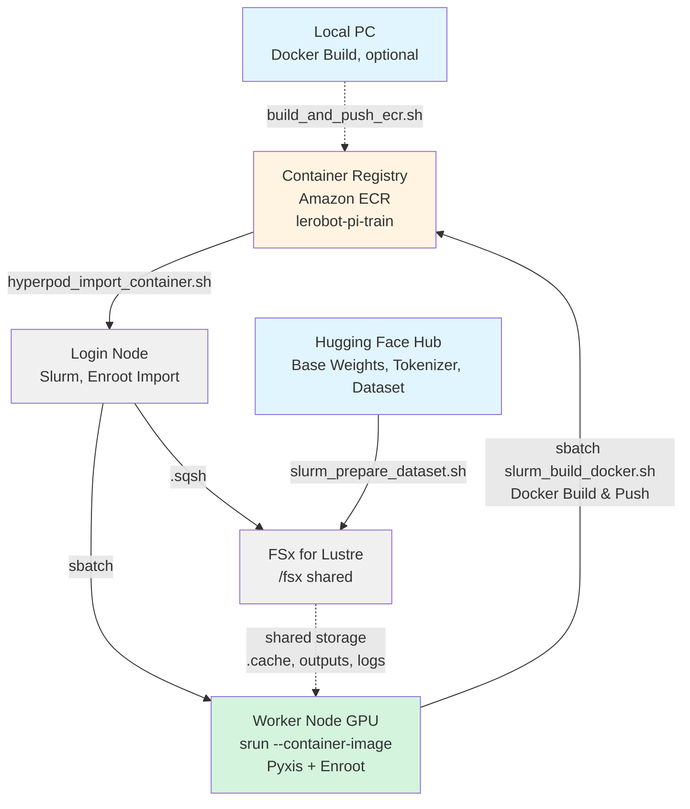

# LeRobot π0.5 Fine-Tuning Guide with HyperPod + Slurm + Enroot

A guide for fine-tuning the PyTorch π0.5 policy from Hugging Face LeRobot in Docker containers using Slurm + Enroot on Amazon SageMaker HyperPod.

## 1. Overview

This sample runs `lerobot-train` from [LeRobot](https://github.com/huggingface/lerobot) on a single GPU of a HyperPod worker node. It follows the same layout and workflow as the existing [OpenPI sample](/samples/openpi-sample/docs/en/pi0_LoRA_training.md), but uses the PyTorch port of π0 / π0.5 in LeRobot instead of the JAX implementation in the openpi repository.

The default configuration is as follows. Every value can be overridden with environment variables or arguments (see [4.6](#46-running-fine-tuning-gpu-job)).

| Item | Default |
|---|---|
| Model | π0.5 (`--policy.type=pi05`), base weights `lerobot/pi05_base` |
| Fine-tuning mode | PEFT LoRA (`r=16`, `lora_alpha=16`), with bfloat16 and gradient checkpointing |
| Dataset | `lerobot/libero` (LeRobotDataset v3.0) |
| GPU | 1 GPU (designed for `ml.g6.2xlarge`, NVIDIA L4 24 GB) |
| Container | `nvidia/cuda:12.8.1-base-ubuntu24.04` + PyPI `lerobot[pi,training,peft]` |
| ECR repository / Enroot image | `lerobot-pi-train` / `/fsx/enroot/data/lerobot-pi-train+latest.sqsh` |

The scripts are located in `samples/lerobot-openpi/training/`.

| File | Role |
|---|---|
| `Dockerfile` | Training image. Installs LeRobot into `/opt/lerobot/.venv` |
| `build_and_push_ecr.sh` | Builds the image for `linux/amd64` and pushes it to ECR. Runs on a local machine or a worker node |
| `slurm_build_docker.sh` | Slurm job that runs `build_and_push_ecr.sh` on a worker node |
| `setup.sh` | Creates the directories on FSx and adds the environment variable block to `~/.bashrc` |
| `hyperpod_import_container.sh` | Imports the ECR image to Enroot (`.sqsh`) on the login node |
| `slurm_prepare_dataset.sh` | CPU job. Downloads the base weights, tokenizer, and dataset, and prepares the statistics required by π0.5 |
| `slurm_train.sh` | GPU job. Runs `lerobot-train` on a single GPU |

***

## 2. Architecture



The files are placed on FSx as follows. `<BASE>` is `samples/lerobot-openpi/` of the cloned repository (`LEROBOT_PI_BASE_DIR`), for example `/fsx/ubuntu/sample-physical-ai-scaffolding-kit/samples/lerobot-openpi`.

```text
<BASE>/
├── training/                  Scripts
├── logs/                      Slurm logs and job logs (LEROBOT_PI_LOG_DIR)
├── outputs/<JOB_NAME>/        Training outputs and checkpoints (LEROBOT_PI_OUTPUT_DIR)
└── .cache/                    LEROBOT_PI_CACHE_DIR
    ├── huggingface/           HF_HOME inside the container (LEROBOT_PI_HF_HOME)
    │   └── lerobot/           HF_LEROBOT_HOME inside the container (LEROBOT_PI_HF_LEROBOT_HOME)
    ├── triton/                TRITON_CACHE_DIR
    ├── torchinductor/         TORCHINDUCTOR_CACHE_DIR
    └── home/                  HOME inside the container
/fsx/enroot/data/lerobot-pi-train+<IMAGE_TAG>.sqsh
```

Enroot mounts the image read-only and runs it as the submitting user (`ubuntu`). Therefore, the job scripts point every writable location (Hugging Face cache, Triton / TorchInductor cache, `HOME`, outputs) to FSx.

***

## 3. Prerequisites

1. **HyperPod cluster**: A HyperPod cluster built with the CDK included in this project.
	1. A GPU worker group is required. This sample is designed for one `ml.g6.2xlarge` (NVIDIA L4 24 GB, 8 vCPU, 32 GiB) in `worker-group-1`. Change `InstanceType` of the worker group in `hyperpod/cdk.json` and deploy it by following [Adding Worker Groups in DEPLOYMENT.md](/hyperpod/docs/en/DEPLOYMENT.md).
	2. The CPU jobs (image build and dataset preparation) also run on the same GPU node.
2. **NVIDIA driver 570.86 or later** on the worker node: The PyTorch cu128 wheels require CUDA 12.8. Check the version with the following command on the login node. `slurm_train.sh` also prints a WARNING when the driver is older.

	```bash
	srun --gres=gpu:1 nvidia-smi --query-gpu=name,driver_version --format=csv
	```

3. **Hugging Face token (`HF_TOKEN`) and license agreement**
	1. Sign up at [Hugging Face](https://huggingface.co/settings/tokens) and create a token in advance.
	2. The tokenizer [google/paligemma-3b-pt-224](https://huggingface.co/google/paligemma-3b-pt-224) used by π0 / π0.5 is a gated model. Open the model page with the account that owns the token and accept the license. Without this, the dataset preparation job fails with HTTP 403.
4. **Only when building the image on a local PC** (not required when building on a worker node):
	1. Docker (with `linux/amd64` build support)
	2. AWS credentials that can create an ECR repository and push images

***

## 4. Steps

### 4.1. SSH Connection to HyperPod

Connect by following the SSH connection instructions in [DEPLOYMENT.md](/hyperpod/docs/en/DEPLOYMENT.md).

```bash
ssh pask-cluster
```

All the following commands run on the login node as the `ubuntu` user unless otherwise noted.

### 4.2. Project Setup

```bash
# Clone the PASK repository (the home directory of ubuntu is /fsx/ubuntu)
cd
git clone https://github.com/aws-samples/sample-physical-ai-scaffolding-kit.git

# Run setup
cd sample-physical-ai-scaffolding-kit/samples/lerobot-openpi/training
bash setup.sh --hf-token "hf_xxxxx"

# Apply environment variables
source ~/.bashrc
```

**Parameters**

* `--hf-token` (optional): A Hugging Face token starting with `hf_`. If omitted, `HF_TOKEN` is not written. In that case, export `HF_TOKEN` yourself before submitting jobs, because the dataset preparation job and the training job stop with an error when `HF_TOKEN` is not set.

**What the script does**

1. Creates the following directories
	* `<BASE>/logs`, `<BASE>/outputs`
	* `<BASE>/.cache/huggingface`, `<BASE>/.cache/huggingface/lerobot`
	* `<BASE>/.cache/triton`, `<BASE>/.cache/torchinductor`, `<BASE>/.cache/home`
	* `/fsx/enroot/data`, `/fsx/enroot/tmp`
2. Adds the following block to `~/.bashrc`. If the block already exists, it is replaced (a backup is saved to `~/.bashrc.backup`). The script can be run again safely.

	```bash
	# LeRobot OpenPI Configuration
	export LEROBOT_PI_BASE_DIR=<BASE>
	export LEROBOT_PI_LOG_DIR=${LEROBOT_PI_BASE_DIR}/logs
	export LEROBOT_PI_OUTPUT_DIR=${LEROBOT_PI_BASE_DIR}/outputs
	export LEROBOT_PI_CACHE_DIR=${LEROBOT_PI_BASE_DIR}/.cache
	export LEROBOT_PI_HF_HOME=${LEROBOT_PI_CACHE_DIR}/huggingface
	export LEROBOT_PI_HF_LEROBOT_HOME=${LEROBOT_PI_HF_HOME}/lerobot
	export HF_TOKEN=<value of --hf-token>
	export ENROOT_CACHE_PATH=/fsx/enroot
	export ENROOT_DATA_PATH=/fsx/enroot/data
	export ENROOT_TEMP_PATH=/fsx/enroot/tmp
	# End LeRobot OpenPI Configuration
	```

	* `HF_TOKEN` is written only when `--hf-token` is specified.
	* `ENROOT_CACHE_PATH` / `ENROOT_DATA_PATH` are written only when `export ENROOT_DATA_PATH=` does not exist elsewhere in `~/.bashrc` (for example, written by the OpenPI sample). The same applies to `ENROOT_TEMP_PATH`.
	* `HF_HOME` and `HF_LEROBOT_HOME` are not exported in `~/.bashrc`, so other samples sharing `~/.bashrc` are not affected. The job scripts set them only for the container.

**About Weights & Biases (wandb)**: `slurm_train.sh` passes `--wandb.enable=false`. To track training with wandb, add `export WANDB_API_KEY=<your_key>` to `~/.bashrc` and pass `EXTRA_ARGS="--wandb.enable=true"` (see [4.6](#46-running-fine-tuning-gpu-job)).

### 4.3. Building the Docker Image & Pushing to ECR

#### Building on a Worker Node (Recommended)

Build the image on the worker node with a Slurm job. This is faster than an emulated `linux/amd64` build on an arm64 local PC (Apple Silicon / Graviton), and the instance role of the cluster already has the permissions to create an ECR repository and push images.

```bash
# Run from the training/ directory (SLURM_SUBMIT_DIR is used to locate build_and_push_ecr.sh)
cd ~/sample-physical-ai-scaffolding-kit/samples/lerobot-openpi/training
sbatch ./slurm_build_docker.sh

# Monitor the build
tail -f ../logs/docker_build_<JOB_ID>.out
```

`slurm_build_docker.sh` passes the following environment variables through to `build_and_push_ecr.sh`. Set them before `sbatch` when needed (for example, `IMAGE_TAG=v1.0.0 sbatch ./slurm_build_docker.sh`).

| Variable | Default | Description |
|---|---|---|
| `AWS_REGION` | Auto-detected | Resolved in the order of the environment variable, `aws configure get region`, EC2 instance metadata (IMDSv2), then `us-east-1` |
| `AWS_ACCOUNT_ID` | Auto-detected | Resolved with `aws sts get-caller-identity` when unset |
| `ECR_REPOSITORY` | `lerobot-pi-train` | ECR repository name |
| `IMAGE_TAG` | `latest` | Docker image tag |
| `LEROBOT_VERSION` | `0.6.1` | LeRobot version installed from PyPI (passed as `--build-arg LEROBOT_VERSION`) |
| `DOCKERFILE_PATH` | `training/Dockerfile` | Path to the Dockerfile |

**What the script does**

1. Creates the ECR repository `lerobot-pi-train` with scan on push enabled (if it does not exist)
2. Authenticates Docker to ECR
3. Builds the image for `linux/amd64` with `training/` as the build context. At the end of the build, it imports `torch`, `transformers`, `peft`, and `lerobot` and runs `lerobot-train --help` to detect dependency resolution failures at build time
4. Pushes the image to ECR

**Example output** (`../logs/docker_build_<JOB_ID>.out`)

```text
==================================================
Docker image successfully pushed to ECR
==================================================
Image URI: 123456789012.dkr.ecr.us-west-2.amazonaws.com/lerobot-pi-train:latest
...
Docker build and push completed successfully
```

#### Building on a Local PC

```bash
cd samples/lerobot-openpi/training

# Auto-detect region and account ID
./build_and_push_ecr.sh

# Specify region and account ID
./build_and_push_ecr.sh us-west-2 123456789012

# Specify a tag
IMAGE_TAG=v1.0.0 ./build_and_push_ecr.sh
```

The arguments and environment variables are resolved in the order of command-line arguments (`[AWS_REGION] [AWS_ACCOUNT_ID]`), environment variables, then auto-detection. The other environment variables are the same as in the table above.

### 4.4. Importing the Docker Image with Enroot

```bash
cd ~/sample-physical-ai-scaffolding-kit/samples/lerobot-openpi/training

# Auto-detect region from EC2 metadata
./hyperpod_import_container.sh

# Specify an image tag
./hyperpod_import_container.sh v1.0.0

# Specify tag, region, and account ID
./hyperpod_import_container.sh latest us-west-2 123456789012

# Overwrite an existing .sqsh
FORCE=true ./hyperpod_import_container.sh
```

**How environment information is retrieved**

| Item | Resolution order |
|---|---|
| `IMAGE_TAG` | `$1`, environment variable, `latest` |
| `AWS_REGION` | `$2`, environment variable, EC2 instance metadata (IMDSv2), `us-east-1` |
| `AWS_ACCOUNT_ID` | `$3`, environment variable, `aws sts get-caller-identity` (error if none) |
| `ECR_REPOSITORY` | Environment variable, `lerobot-pi-train` |
| `ENROOT_CACHE_PATH` / `ENROOT_DATA_PATH` / `ENROOT_TEMP_PATH` | Environment variable, `/fsx/enroot` / `/fsx/enroot/data` / `/fsx/enroot/tmp` |

**What the script does**

1. Stops with an error if the output `.sqsh` already exists, because `enroot import` cannot overwrite it. With `FORCE=true`, the existing file is deleted first
2. Pulls the image from ECR with Docker
3. Converts it to `${ENROOT_DATA_PATH}/lerobot-pi-train+<IMAGE_TAG>.sqsh` with `enroot import dockerd://...`

**Example output**

```text
==================================================
Container ready for Slurm execution
==================================================
Container Name: lerobot-pi-train+latest.sqsh
Container Path: /fsx/enroot/data/lerobot-pi-train+latest.sqsh
```

If you use a tag other than `latest`, also set `IMAGE_TAG` (or `CONTAINER_IMAGE`) when submitting the following jobs.

### 4.5. Preparing the Dataset (CPU Job)

Before allocating the GPU for training, download the base weights, the tokenizer, and the dataset into the Hugging Face cache on FSx with a CPU job. This job does not request a GPU (`NVIDIA_VISIBLE_DEVICES=void`).

```bash
cd ~/sample-physical-ai-scaffolding-kit/samples/lerobot-openpi/training

# Default: lerobot/libero + lerobot/pi05_base
sbatch ./slurm_prepare_dataset.sh

# Specify the dataset and base weights as arguments
sbatch ./slurm_prepare_dataset.sh lerobot/libero lerobot/pi05_base
```

**Arguments and environment variables**

| Variable | Argument | Default | Description |
|---|---|---|---|
| `DATASET_REPO_ID` | `$1` | `lerobot/libero` | Dataset repository ID |
| `PRETRAINED_PATH` | `$2` | `lerobot/pi05_base` | Base weights repository ID |
| `POLICY_TYPE` | - | `pi05` | `pi05` or `pi0`. Used to decide whether quantile statistics are needed |
| `TOKENIZER_REPO_ID` | - | `google/paligemma-3b-pt-224` | Tokenizer repository ID |
| `CONVERT_V21` | - | `false` | `true` converts a v2.1 dataset to v3.0 in place |
| `RECOMPUTE_STATS` | - | `auto` | `auto`, `true`, or `false` (see below) |
| `IMAGE_TAG` | - | `latest` | Tag of the `.sqsh` image |
| `CONTAINER_IMAGE` | - | `${ENROOT_DATA_PATH}/lerobot-pi-train+${IMAGE_TAG}.sqsh` | Full path to the `.sqsh` image |

Resources: `--cpus-per-task=4 --mem=16G --time=4:00:00`.

**What the job does**

1. `[1/4]` Downloads the base weights (`PRETRAINED_PATH`) into `HF_HOME` (`${LEROBOT_PI_HF_HOME}`)
2. `[2/4]` Downloads the tokenizer files of `TOKENIZER_REPO_ID`. If access is denied, the job prints that the license of the gated model must be accepted
3. `[3/4]` Downloads the dataset to `${LEROBOT_PI_HF_LEROBOT_HOME}/<DATASET_REPO_ID>`. LeRobot training requires v3.0, so the job stops with an error for other versions unless `CONVERT_V21=true`
4. `[4/4]` π0.5 normalizes the state and action with quantiles, so `meta/stats.json` must contain `q01` / `q99` for `observation.state` and `action`
	* `auto`: For `pi05`, the statistics are recomputed in place with `lerobot-edit-dataset --operation.type=recompute_stats` only when the quantiles are missing. For `pi0`, nothing is done
	* `true`: Always recomputes
	* `false`: Skips the check

**Checking progress**

```bash
squeue -u ubuntu
tail -f ${LEROBOT_PI_LOG_DIR}/prepare_<JOB_ID>.log
tail -f ${LEROBOT_PI_LOG_DIR}/prepare_<JOB_ID>.err
```

The Slurm output is also written to `../logs/slurm_<JOB_ID>.out` / `.err`. On success, the job prints the dataset summary (codebase version, number of episodes and frames, and whether `q01` / `q99` exist).

If you prepared a dataset other than `lerobot/libero`, export the same `DATASET_REPO_ID` before submitting the training job.

### 4.6. Running Fine-Tuning (GPU Job)

```bash
cd ~/sample-physical-ai-scaffolding-kit/samples/lerobot-openpi/training

# Default: pi0.5 + LoRA, JOB_NAME = pi05_lora_<timestamp>
sbatch ./slurm_train.sh

# Specify a job name (used as the output directory name)
sbatch ./slurm_train.sh my_pi05_lora_run

# Switch the fine-tuning mode
FINETUNE_MODE=expert_only sbatch ./slurm_train.sh my_pi05_expert_run

# Change the number of steps and the batch size
STEPS=10000 BATCH_SIZE=2 sbatch ./slurm_train.sh my_pi05_short_run
```

`JOB_NAME` is resolved in the order of `$1`, the `JOB_NAME` environment variable, then `pi05_lora_<YYYYmmdd_HHMMSS>`. The default name is the same regardless of `POLICY_TYPE` and `FINETUNE_MODE`, so specify a job name explicitly when you change them.

**Environment variables**

| Variable | Default | Description |
|---|---|---|
| `POLICY_TYPE` | `pi05` | `pi05` or `pi0` (`--policy.type`) |
| `PRETRAINED_PATH` | `lerobot/pi05_base` | Base weights (`--policy.pretrained_path`) |
| `DATASET_REPO_ID` | `lerobot/libero` | Dataset repository ID (`--dataset.repo_id`) |
| `DATASET_ROOT` | `${LEROBOT_PI_HF_LEROBOT_HOME}/${DATASET_REPO_ID}` | Local dataset path (`--dataset.root`) |
| `FINETUNE_MODE` | `lora` | `lora`, `expert_only`, or `full` (see below) |
| `LORA_R` | `16` | LoRA rank (`--peft.r`). Used only in `lora` mode |
| `LORA_ALPHA` | `16` | LoRA alpha (`--peft.lora_alpha`). Used only in `lora` mode |
| `STEPS` | `30000` | Number of training steps (with `RESUME=true`, used only when set explicitly) |
| `BATCH_SIZE` | `4` | Batch size |
| `SAVE_FREQ` | `5000` | Checkpoint interval in steps |
| `LOG_FREQ` | `100` | Log interval in steps |
| `NUM_WORKERS` | `4` | Number of DataLoader workers |
| `COMPILE_MODEL` | `false` | `true` enables `torch.compile` (`--policy.compile_model`) |
| `RESUME` | `false` | `true` resumes from `${OUTPUT_DIR}/checkpoints/last` (see [4.9](#49-resuming-training)) |
| `OUTPUT_DIR` | `${LEROBOT_PI_OUTPUT_DIR}/${JOB_NAME}` | Output directory (`--output_dir`) |
| `EXTRA_ARGS` | Empty | Additional arguments appended to `lerobot-train`, split on whitespace |
| `IMAGE_TAG` | `latest` | Tag of the `.sqsh` image |
| `CONTAINER_IMAGE` | `${ENROOT_DATA_PATH}/lerobot-pi-train+${IMAGE_TAG}.sqsh` | Full path to the `.sqsh` image |

The learning rate is not passed, so the LeRobot policy preset is used. To change it or other `lerobot-train` options, use `EXTRA_ARGS`.

**Fine-tuning modes (`FINETUNE_MODE`)**

All modes add `--policy.dtype=bfloat16 --policy.gradient_checkpointing=true`.

| Mode | Added arguments | Trained parameters |
|---|---|---|
| `lora` (default) | `--peft.method_type=LORA --peft.r=${LORA_R} --peft.lora_alpha=${LORA_ALPHA}` | LoRA adapters on the default targets of LeRobot (`q_proj` / `v_proj` of the action expert, and the state / action projection layers) |
| `expert_only` | `--policy.train_expert_only=true` | Action expert and projection layers (the VLM is frozen) |
| `full` | None | All parameters |

**Using π0 instead of π0.5**

Pass the same `POLICY_TYPE` and `PRETRAINED_PATH` to both the dataset preparation job and the training job.

```bash
POLICY_TYPE=pi0 PRETRAINED_PATH=lerobot/pi0_base sbatch ./slurm_prepare_dataset.sh
POLICY_TYPE=pi0 PRETRAINED_PATH=lerobot/pi0_base sbatch ./slurm_train.sh my_pi0_lora_run
```

To train under the same conditions as the official LeRobot [LIBERO example](https://github.com/huggingface/lerobot/blob/v0.6.1/docs/source/pi05.mdx), use `lerobot/pi05_libero_base` as the base weights and pass the following four arguments through `EXTRA_ARGS`.

1. `--policy.normalization_mapping`: normalizes STATE and ACTION with mean and standard deviation instead of quantiles. The official results were measured with this setting.
2. `--policy.n_action_steps=10` and `--policy.empty_cameras=1`: `--policy.pretrained_path` loads weights only, so these two values stored in `lerobot/pi05_libero_base` fall back to their defaults (`50` and `0`) unless set explicitly.
3. `--seed=1000`: the same random seed as the official example.

`EXTRA_ARGS` is split on whitespace, so do not put spaces in the `normalization_mapping` value.

```bash
PRETRAINED_PATH=lerobot/pi05_libero_base sbatch ./slurm_prepare_dataset.sh
PRETRAINED_PATH=lerobot/pi05_libero_base \
EXTRA_ARGS='--policy.normalization_mapping={"ACTION":"MEAN_STD","STATE":"MEAN_STD","VISUAL":"IDENTITY"} --policy.n_action_steps=10 --policy.empty_cameras=1 --seed=1000' \
sbatch ./slurm_train.sh pi05_libero_lora
```

**Slurm resources**

The `#SBATCH` values target `ml.g6.2xlarge`: `--gres=gpu:1 --cpus-per-task=8 --mem=28G --time=48:00:00`. For other instance types, override them on the `sbatch` command line.

```bash
sbatch --cpus-per-task=16 --mem=60G ./slurm_train.sh my_job
```

**What the job does**

1. `[1/4]` Checks the `LEROBOT_PI_*` variables, `HF_TOKEN`, `ENROOT_DATA_PATH`, and the `.sqsh` image
2. `[2/4]` Validates `FINETUNE_MODE`. Stops with an error if `OUTPUT_DIR` already exists and `RESUME` is not `true`
3. `[3/4]` Builds the `lerobot-train` command and prints it
4. `[4/4]` Starts the container with `srun --container-image=... --container-mounts=/fsx:/fsx`, sets `HOME`, `HF_HOME`, `HF_LEROBOT_HOME`, `TRITON_CACHE_DIR`, and `TORCHINDUCTOR_CACHE_DIR` to FSx, prints the GPU and driver information, and runs `lerobot-train`. `HF_TOKEN` is passed to the container as an environment variable, not as a command-line string

### 4.7. Monitoring

```bash
# Job status
squeue -u ubuntu

# Training log
tail -f ${LEROBOT_PI_LOG_DIR}/train_<JOB_ID>.log
tail -f ${LEROBOT_PI_LOG_DIR}/train_<JOB_ID>.err

# Slurm output (same content)
tail -f ../logs/slurm_<JOB_ID>.out

# GPU usage on the allocated node
srun --jobid=<JOB_ID> --overlap nvidia-smi

# Completion status
sacct -j <JOB_ID> --format=JobID,JobName,State,ExitCode,Elapsed
```

Cancel a job with `scancel <JOB_ID>`, or cancel all training jobs with `scancel --name=lerobot_pi_train`.

### 4.8. Checking Checkpoints

Checkpoints are saved every `SAVE_FREQ` steps and at the end of training.

```text
${LEROBOT_PI_OUTPUT_DIR}/<JOB_NAME>/
└── checkpoints/
    ├── <step>/                 Zero-padded step number
    │   ├── pretrained_model/   config.json, train_config.json, model weights (safetensors), pre/post-processors
    │   └── training_state/     Optimizer, scheduler, and RNG state for resuming
    └── last -> <step>          Latest checkpoint
```

```bash
ls -lh ${LEROBOT_PI_OUTPUT_DIR}/<JOB_NAME>/checkpoints/
ls -lh ${LEROBOT_PI_OUTPUT_DIR}/<JOB_NAME>/checkpoints/last/pretrained_model/
```

With `FINETUNE_MODE=lora`, `pretrained_model/` does not contain `model.safetensors`. Only the trained LoRA adapter is saved, as `adapter_model.safetensors` and `adapter_config.json`. On `ml.g6.2xlarge` with `LORA_R=16`, one checkpoint was about 16 MB.

When the training succeeds, `slurm_train.sh` prints `Latest checkpoint: <OUTPUT_DIR>/checkpoints/last/pretrained_model` and the command to resume.

### 4.9. Resuming Training

Submit the job again with `RESUME=true` and the same `JOB_NAME` (or `OUTPUT_DIR`) as the run to resume.

```bash
RESUME=true sbatch ./slurm_train.sh my_pi05_lora_run
```

The job runs `lerobot-train --resume=true --config_path=${OUTPUT_DIR}/checkpoints/last/pretrained_model/train_config.json`. The training settings are read from `train_config.json`, so `POLICY_TYPE`, `FINETUNE_MODE`, `BATCH_SIZE`, and the other variables in [4.6](#46-running-fine-tuning-gpu-job) are not used. Only `EXTRA_ARGS` is appended. If `train_config.json` does not exist, the job stops with an error.

The exception is `STEPS`. When you set it explicitly, it is passed as `--steps` and changes the total number of steps. For example, to continue a run that ended at step 20 up to step 30:

```bash
RESUME=true STEPS=30 sbatch ./slurm_train.sh my_pi05_lora_run
```

If `STEPS` is not set, the number of steps in `train_config.json` is used. The learning rate schedule is recomputed for the new total number of steps.

***

## 5. Comparison with the Existing OpenPI Sample

| Aspect | [OpenPI sample](/samples/openpi-sample/README.md) | This sample |
|---|---|---|
| Framework | JAX (openpi implementation) | PyTorch (LeRobot port) |
| Entry point | `python scripts/train.py <CONFIG_NAME>` | `lerobot-train --policy.type=pi05 ...` |
| Training configuration | TrainConfig defined in code in openpi (`src/openpi/training/config.py`). Custom data requires code changes | CLI arguments only. Custom data is specified with `--dataset.repo_id` / `--dataset.root` |
| Source code | openpi is cloned to FSx and referenced through `PYTHONPATH` | LeRobot is installed into the image at a fixed version. No clone on FSx |
| Python / CUDA | Python 3.11.9 / CUDA 12.2 | Python 3.12 / CUDA 12.8 (driver 570.86 or later) |
| Dataset format | LeRobotDataset v2.1 (`physical-intelligence/libero`) | LeRobotDataset v3.0 (`lerobot/libero`). v2.1 can be converted with `CONVERT_V21=true` |
| Normalization statistics | Computed by a separate job (`compute_norm_stats.py`) | `meta/stats.json` of the dataset. For π0.5, `q01` / `q99` are recomputed when missing |
| Base weights | openpi checkpoints | Hugging Face Hub (`lerobot/pi05_base`). Requires the license agreement of the gated PaliGemma tokenizer |
| LoRA | Select a TrainConfig with a LoRA variant | `--peft.method_type=LORA`. `expert_only` and `full` can also be selected |
| Checkpoint | orbax format, `<openpi>/checkpoints/<config>/<exp>/<step>/` | safetensors, `<output_dir>/checkpoints/<step>/pretrained_model/`, `checkpoints/last` |
| Image build | Local PC | Worker node (`slurm_build_docker.sh`) or local PC |
| GPU memory settings | `XLA_PYTHON_CLIENT_MEM_FRACTION` / `XLA_FLAGS` | Not required. Caches for Triton / TorchInductor are placed on FSx |
| wandb | `--no-wandb-enabled` | `--wandb.enable=false` |

Use this sample to fine-tune with LeRobot-format datasets (for example, data recorded with SO-101) without modifying the openpi source, or when you want the checkpoints in the Hugging Face format used by LeRobot tools.

***

## 6. GPU Memory Guidance

π0 / π0.5 has about 3.3B parameters. The following table is guidance for choosing a fine-tuning mode, not measured values. Check the actual usage with `nvidia-smi` (see [4.7](#47-monitoring)).

| Mode | 24 GB GPU (L4 / A10G, e.g. `ml.g6.2xlarge`) | 48 GB GPU (L40S) | 80 GB GPU (A100 / H100) |
|---|---|---|---|
| `lora` | Intended default. Start with `BATCH_SIZE=4` | Larger batch sizes | Larger batch sizes |
| `expert_only` | Reduce `BATCH_SIZE` to 1 or 2 | Possible | Possible |
| `full` | Not practical (weights, gradients, and optimizer states do not fit) | Small batch sizes only | Configuration assumed by the LeRobot documentation |

The following values were measured on `ml.g6.2xlarge` with the defaults (`lora`, `BATCH_SIZE=4`, `LORA_R=16`) on `lerobot/libero`. `expert_only` and `full` were not measured.

| Item | Measured value |
|---|---|
| GPU memory | About 9.3 to 9.7 GB (of 23 GB) |
| Peak host memory (`MaxRSS` in `sacct`) | About 22.6 GB (of `--mem=28G`) |
| Time per step | About 1.4 seconds |
| Time before the first step (loading the model and applying LoRA) | About 6 minutes |

If you run out of GPU memory (`torch.OutOfMemoryError: CUDA out of memory`):

1. Reduce `BATCH_SIZE` (for example, `BATCH_SIZE=2` or `1`).
2. Use a lighter mode (`full` to `expert_only` to `lora`), or reduce `LORA_R`.
3. Use an instance type with a larger GPU memory and override `--cpus-per-task` / `--mem` on the `sbatch` command line.

If you run out of host memory (the job is killed with `OUT_OF_MEMORY`), reduce `NUM_WORKERS`.

***

## 7. Troubleshooting

### Hugging Face Rate Limit (HTTP 429)

The dataset preparation job prints `ERROR: Hugging Face rate limit reached (HTTP 429)` when it hits the API request quota.

```text
huggingface_hub.errors.HfHubHTTPError: 429 Client Error: Too Many Requests for url: ...
We had to rate limit you, you hit the quota of 1000 api requests per 5 minutes period.
```

Wait at least 5 minutes and submit `slurm_prepare_dataset.sh` again. The download resumes from the files already fetched.

### Gated Repository (HTTP 401 / 403)

If the job prints `ERROR: Access to the gated tokenizer google/paligemma-3b-pt-224 was denied (HTTP 401/403)`, check the following.

1. You accepted the license at [google/paligemma-3b-pt-224](https://huggingface.co/google/paligemma-3b-pt-224) with the account that owns `HF_TOKEN`.
2. `HF_TOKEN` is valid and has read permission. Check the value with `echo ${HF_TOKEN:0:10}`, and run `bash setup.sh --hf-token "hf_xxxxx"` and `source ~/.bashrc` again if needed.
3. `HF_TOKEN` is exported in the shell where you run `sbatch`. Slurm passes the environment at submission time to the job.

### Insufficient Space on the Root Disk

The root volume of the login node is small.

1. Enroot temporary files are kept in `/fsx/enroot/tmp` (`ENROOT_TEMP_PATH`). If `ENROOT_TEMP_PATH` is defined elsewhere in `~/.bashrc` with a path on the root volume, change it to FSx.
2. `hyperpod_import_container.sh` pulls the image into the local Docker storage of the login node. After the import, you can delete it with `docker image rm <ECR_URI>:<IMAGE_TAG>`.
3. Check the usage with `df -h /` and `docker system df`.

### Job Stays PENDING

Check the reason with `squeue -u ubuntu -o "%.18i %.30j %.2t %.10M %R"`.

1. `Resources`: Another job is using the node. The CPU jobs and the GPU job share the same GPU node, and `slurm_prepare_dataset.sh` (16G) and `slurm_train.sh` (28G) cannot run at the same time on a 32 GiB node. Wait for the other job to finish, or cancel it with `scancel`.
2. `ReqNodeNotAvail` or the job is rejected with `Requested node configuration is not available`: The requested `--gres`, `--mem`, or `--cpus-per-task` exceeds the node. Check `Gres` and `RealMemory` with `scontrol show node`, and override the values on the `sbatch` command line.
3. No GPU node: Check that the GPU worker group is `idle` with `sinfo`.

### Output Directory Already Exists

```text
ERROR: Output directory already exists: <OUTPUT_DIR>
```

`lerobot-train` does not overwrite an existing output directory. Use a different `JOB_NAME`, resume with `RESUME=true sbatch ./slurm_train.sh <JOB_NAME>`, or delete the directory if it is no longer needed.

### Interference with the OpenPI Sample `setup.sh`

`samples/openpi-sample/lora_training/setup.sh` removes every line containing `export HF_TOKEN=`, `ENROOT_CACHE_PATH`, or `ENROOT_DATA_PATH` from `~/.bashrc`, including the lines in the `# LeRobot OpenPI Configuration` block. If you run it after this sample's `setup.sh`, run this sample's `setup.sh` again and `source ~/.bashrc`.

### Insufficient Disk Space During Docker Build

The training image includes PyTorch with CUDA libraries and is large. If `slurm_build_docker.sh` fails with `no space left on device`:

1. Check the storage used by Docker on the worker node: `srun docker system df` and `srun bash -c 'df -h "$(docker info --format "{{.DockerRootDir}}")"'`.
2. Remove unused images and build cache: `srun docker system prune -f` and `srun docker builder prune -f`.
3. Submit `slurm_build_docker.sh` again.

***

## 8. Out of Scope

The following are not covered by this sample.

1. Inference and evaluation with the trained checkpoints (`lerobot-eval` for LIBERO simulation, `lerobot-rollout` for real robots)
2. Multi-GPU training on a single node (`torchrun` / Accelerate with DDP or FSDP)
3. Multi-node training (torchrun rendezvous and EFA settings)

***

## 9. References

* [LeRobot](https://github.com/huggingface/lerobot)
* [LeRobot π0.5 documentation](https://huggingface.co/docs/lerobot/pi05)
* [LeRobot π0 documentation](https://huggingface.co/docs/lerobot/pi0)
* [lerobot/pi05_base](https://huggingface.co/lerobot/pi05_base)
* [lerobot/libero](https://huggingface.co/datasets/lerobot/libero)
* [google/paligemma-3b-pt-224](https://huggingface.co/google/paligemma-3b-pt-224)
* [OpenPI sample (LoRA training guide)](/samples/openpi-sample/docs/en/pi0_LoRA_training.md)
* [AWS HyperPod Documentation](https://docs.aws.amazon.com/sagemaker/latest/dg/sagemaker-hyperpod.html)
* [Enroot Documentation](https://github.com/NVIDIA/enroot)
* [Pyxis](https://github.com/NVIDIA/pyxis)
* [Slurm Documentation](https://slurm.schedmd.com/documentation.html)
