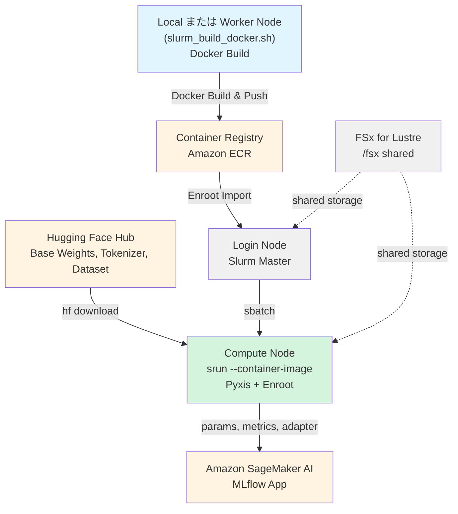

# HyperPod + Slurm + Enroot での LeRobot π0.5 LoRA トレーニング実行ガイド

Amazon SageMaker HyperPod 上で Slurm と Enroot を使い、LeRobot の PyTorch 版 π0.5 を LoRA で finetuning するガイドです。
LeRobot はコンテナイメージに PyPI の `lerobot==0.6.1` を固定してインストールします。
データセットは Hugging Face Hub の [`lerobot/libero`](https://huggingface.co/datasets/lerobot/libero)（LeRobotDataset v3.0 形式）を使い、GPU 1 枚で学習します。
学習の設定、metrics、LoRA のアダプタは Amazon SageMaker AI の MLflow App に記録できます。

## アーキテクチャ



---

## 前提条件

1. 本リポジトリの CDK で構築した HyperPod クラスタに、GPU を持つ worker group があること。
   本ガイドの既定値は `ml.g6.2xlarge`（NVIDIA L4 24 GB × 1、8 vCPU、32 GiB）を想定しています。
   worker group の追加方法は [DEPLOYMENT.md](../../../../hyperpod/docs/ja/DEPLOYMENT.md) の「worker groupを追加」を参照してください。
2. GPU ノードの NVIDIA ドライバが 570.86 以上であること。
   コンテナの PyTorch は CUDA 12.8 用（cu128）のビルドで、CUDA 12.8 はこのバージョン以上のドライバを必要とします。
3. Hugging Face のアカウントとアクセストークン（`hf_` で始まる文字列）があること。
   トークンは [Hugging Face の設定画面](https://huggingface.co/settings/tokens) で発行します。
   π0.5 のトークナイザーは利用条件への同意が必要な gated repo の [`google/paligemma-3b-pt-224`](https://huggingface.co/google/paligemma-3b-pt-224) にあるため、同じアカウントでライセンスに同意しておきます。
4. ローカル PC でイメージをビルドする場合は、Docker と、ECR に push できる AWS 認証情報があること。
   HyperPod の worker ノードでビルドする場合、ローカル PC には不要です。
5. 学習を Amazon SageMaker AI の MLflow App に記録する場合は、スタックの Outputs に `MlflowAppArn` があること。`hyperpod/cdk.json` の `Mlflow.Enabled` を `true` にしてデプロイすると出力されます。
   MLflow App と、HyperPod の ExecutionRole から App に記録するための権限は、本リポジトリの CDK が作成します。
   Outputs は [DEPLOYMENT.md](../../../../hyperpod/docs/ja/DEPLOYMENT.md) の「スタックのデプロイ」を参照してください。
   MLflow UI をローカル PC から開くには、AWS CLI v2.34.5 以上が必要です。

---

## 実行手順

### HyperPod への SSH 接続

[DEPLOYMENT.md](../../../../hyperpod/docs/ja/DEPLOYMENT.md) の「クラスタの初期設定」に従って SSH を設定し、Login Node に ubuntu ユーザーで接続します。

```bash
ssh pask-cluster
```

ubuntu ユーザーのホームディレクトリは FSx for Lustre 上の `/fsx/ubuntu` です。
以降の手順はすべて Login Node で実行します。

### プロジェクトのセットアップ

PASK リポジトリを clone し、`setup.sh` を実行します。

```bash
cd
git clone https://github.com/aws-samples/sample-physical-ai-scaffolding-kit.git

cd sample-physical-ai-scaffolding-kit/samples/lerobot-openpi/training
bash setup.sh --hf-token "hf_xxxxx"

source ~/.bashrc
```

`--hf-token` には Hugging Face のアクセストークンを指定します。
省略すると `HF_TOKEN` は書き込まれず、データセット準備ジョブと学習ジョブが `HF_TOKEN is not set` のエラーで止まります。

MLflow に関するオプションは次のとおりです。
何も指定しなければ、スタック `PASK` の Outputs から MLflow App の ARN を読み取り、学習を MLflow に記録する設定を書き込みます。

| オプション | 既定値 | 説明 |
|---|---|---|
| `--mlflow-tracking-uri <ARN>` | なし | MLflow App の ARN を直接指定します。スタックの `MlflowAppArn` より優先します |
| `--stack-name <name>` | `PASK` | Outputs を読む CloudFormation スタックの名前 |
| `--region <region>` | EC2 インスタンスメタデータ（IMDSv2）のリージョン | スタックのリージョン |
| `--no-mlflow` | なし | MLflow の設定をブロックに書き込みません。学習は MLflow に記録されません |

`setup.sh` は次の処理を行います。

1. FSx 上に次のディレクトリを作成します。
   `<サンプル>` は `samples/lerobot-openpi` の絶対パス（上の手順では `/fsx/ubuntu/sample-physical-ai-scaffolding-kit/samples/lerobot-openpi`）です。
    - `<サンプル>/logs`
    - `<サンプル>/outputs`
    - `<サンプル>/.cache/huggingface`
    - `<サンプル>/.cache/huggingface/lerobot`
    - `<サンプル>/.cache/triton`
    - `<サンプル>/.cache/torchinductor`
    - `<サンプル>/.cache/home`
    - `/fsx/enroot/data`
    - `/fsx/enroot/tmp`
2. `aws cloudformation describe-stacks` でスタックの Outputs を読み、MLflow App の ARN（`MlflowAppArn`）と HyperPod のクラスタ名（`HyperPodClusterId` で始まるキー）を取得します。
   `--no-mlflow` を指定した場合は読みません。
   ARN を取得できない場合は `WARNING: Continuing without MLflow` を表示し、MLflow の設定を書かずに続けます。
3. `~/.bashrc` に `# LeRobot OpenPI Configuration` から `# End LeRobot OpenPI Configuration` までのブロックを追記します。
   ブロックがすでにある場合は `~/.bashrc.backup` にバックアップを取ってから置き換えます。
   ブロックには次の環境変数を書き込みます。

| 環境変数 | 値 |
|---|---|
| `LEROBOT_PI_BASE_DIR` | `<サンプル>` |
| `LEROBOT_PI_LOG_DIR` | `${LEROBOT_PI_BASE_DIR}/logs` |
| `LEROBOT_PI_OUTPUT_DIR` | `${LEROBOT_PI_BASE_DIR}/outputs` |
| `LEROBOT_PI_CACHE_DIR` | `${LEROBOT_PI_BASE_DIR}/.cache` |
| `LEROBOT_PI_HF_HOME` | `${LEROBOT_PI_CACHE_DIR}/huggingface` |
| `LEROBOT_PI_HF_LEROBOT_HOME` | `${LEROBOT_PI_HF_HOME}/lerobot` |
| `HF_TOKEN` | `--hf-token` で指定した値（指定したときだけ書き込みます） |
| `MLFLOW_TRACKING_URI` | MLflow App の ARN（取得できたときだけ書き込みます） |
| `AWS_DEFAULT_REGION` | ARN の 4 番目のフィールド（`arn:aws:sagemaker:<region>:...` の `<region>`）。`MLFLOW_TRACKING_URI` と同時に書き込みます |
| `PASK_CLUSTER_NAME` | HyperPod のクラスタ名（`MLFLOW_TRACKING_URI` を書き込み、クラスタ名も取得できたときだけ書き込みます） |
| `ENROOT_CACHE_PATH` | `/fsx/enroot`（`~/.bashrc` に `export ENROOT_DATA_PATH=` が無いときだけ書き込みます） |
| `ENROOT_DATA_PATH` | `/fsx/enroot/data`（同上） |
| `ENROOT_TEMP_PATH` | `/fsx/enroot/tmp`（`~/.bashrc` に `export ENROOT_TEMP_PATH=` が無いときだけ書き込みます） |

`HF_HOME` と `HF_LEROBOT_HOME` は `~/.bashrc` では設定しません。
`~/.bashrc` で設定すると、同じユーザーで動かす他のサンプルの Hugging Face キャッシュの場所まで変わるためです。
ジョブスクリプトがコンテナの中でだけ `HF_HOME=${LEROBOT_PI_HF_HOME}`、`HF_LEROBOT_HOME=${LEROBOT_PI_HF_LEROBOT_HOME}`、`HOME=${LEROBOT_PI_CACHE_DIR}/home` などを設定します。

`AWS_DEFAULT_REGION` は、コンテナ内の MLflow クライアントが MLflow App の API を呼ぶリージョンとして使います。
ARN からリージョンを取り出して書くため、`--region` で指定したスタックのリージョンとは独立に決まります。

### Docker イメージのビルドと ECR への Push

イメージは `Dockerfile` から `linux/amd64` 向けにビルドし、ECR リポジトリ `lerobot-pi-train` に push します。
ビルド方法は次の 2 つから選びます。
作業 PC が arm64（Apple Silicon など）の場合、ローカルビルドは amd64 のエミュレーションになり時間がかかるため、worker ノードでのビルドを推奨します。

イメージには LeRobot に加えて、MLflow に記録するための次のパッケージをバージョンを固定してインストールします。

| パッケージ | バージョン | 用途 |
|---|---|---|
| `mlflow-skinny` | `3.10.1` | MLflow のクライアント。MLflow App のサーバー（MLflow 3.10）に合わせています |
| `sagemaker-mlflow` | `0.5.0` | MLflow App の ARN を tracking URI として使うためのプラグイン。リクエストに SigV4 の署名を付けます |
| `nvidia-ml-py` | `13.615.71` | system metrics で GPU の使用率とメモリを取得します |

これらのパッケージを追加する前にビルドしたイメージには MLflow が入っていません。
MLflow に記録する場合は、イメージをビルドし直して ECR に push し、[Enroot へのイメージのインポート](#enroot-へのイメージのインポート) を `FORCE=true` 付きでやり直します。

worker ノードでビルドする場合は、`training/` ディレクトリから Slurm ジョブを投入します。

```bash
cd ~/sample-physical-ai-scaffolding-kit/samples/lerobot-openpi/training
sbatch ./slurm_build_docker.sh
```

ログは `${LEROBOT_PI_LOG_DIR}/docker_build_<JOB_ID>.out` と `.err` に出力されます。
出力先の `logs/` は `setup.sh` が作るため、`setup.sh` の実行前にこのジョブを投入するとログを書き込めずに失敗します。

ローカル PC でビルドする場合は、リポジトリを clone した PC で次を実行します。

```bash
cd samples/lerobot-openpi/training

# リージョンとアカウント ID を自動で取得する
./build_and_push_ecr.sh

# リージョンとアカウント ID を指定する
./build_and_push_ecr.sh us-west-2 123456789012
```

どちらの方法でも、処理は `build_and_push_ecr.sh` が行います。
リージョンとアカウント ID は次の順で決まります。

1. コマンドライン引数（`./build_and_push_ecr.sh [AWS_REGION] [AWS_ACCOUNT_ID]`）。
2. 環境変数 `AWS_REGION` と `AWS_ACCOUNT_ID`。
3. 自動検出。
   リージョンは `aws configure get region`、EC2 インスタンスメタデータ（IMDSv2）の順に調べ、どちらでも取れなければ `us-east-1` を使います。
   アカウント ID は `aws sts get-caller-identity` で取得します。

次の環境変数でビルドの内容を変えられます。

| 環境変数 | 既定値 | 説明 |
|---|---|---|
| `LEROBOT_VERSION` | `0.6.1` | PyPI からインストールする `lerobot` のバージョン（build-arg として渡します） |
| `IMAGE_TAG` | `latest` | イメージタグ |
| `ECR_REPOSITORY` | `lerobot-pi-train` | ECR リポジトリ名 |
| `DOCKERFILE_PATH` | スクリプトと同じディレクトリの `Dockerfile` | 使用する Dockerfile |

`sbatch` は投入時の環境変数をジョブに引き継ぐため、worker ノードでのビルドでも同じ書き方で上書きできます。

```bash
LEROBOT_VERSION=0.6.1 IMAGE_TAG=v1.0.0 sbatch ./slurm_build_docker.sh

IMAGE_TAG=v1.0.0 ./build_and_push_ecr.sh
```

`IMAGE_TAG` を変えた場合は、以降のインポートとジョブ投入でも同じタグを指定します。

スクリプトは次の処理を行います。

1. ECR リポジトリが無ければ、push 時のイメージスキャンを有効にして作成します。
2. Docker を ECR に認証します。
3. イメージをビルドします。
4. イメージを ECR に push します。

成功すると次のように出力されます。

```
==================================================
Docker image successfully pushed to ECR
==================================================
Image URI: 123456789012.dkr.ecr.us-west-2.amazonaws.com/lerobot-pi-train:latest
```

### Enroot へのイメージのインポート

Login Node で ECR のイメージを pull し、Enroot の SquashFS 形式（`.sqsh`）に変換します。

```bash
cd ~/sample-physical-ai-scaffolding-kit/samples/lerobot-openpi/training

# リージョンとアカウント ID を自動で取得する
./hyperpod_import_container.sh

# イメージタグを指定する
./hyperpod_import_container.sh v1.0.0

# タグ、リージョン、アカウント ID を指定する
./hyperpod_import_container.sh latest us-west-2 123456789012

# 既存の .sqsh を削除してからインポートし直す
FORCE=true ./hyperpod_import_container.sh
```

引数は `./hyperpod_import_container.sh [IMAGE_TAG] [AWS_REGION] [AWS_ACCOUNT_ID]` の順で、省略した値は次のように決まります。

| 項目 | 引数が無いときの取得元 | 既定値 |
|---|---|---|
| `IMAGE_TAG` | 環境変数 `IMAGE_TAG` | `latest` |
| `AWS_REGION` | 環境変数 `AWS_REGION`、EC2 インスタンスメタデータ（IMDSv2） | `us-east-1` |
| `AWS_ACCOUNT_ID` | 環境変数 `AWS_ACCOUNT_ID`、`aws sts get-caller-identity` | なし（取得できなければエラー） |
| `ECR_REPOSITORY` | 環境変数 `ECR_REPOSITORY` | `lerobot-pi-train` |
| `ENROOT_CACHE_PATH` | 環境変数 `ENROOT_CACHE_PATH` | `/fsx/enroot` |
| `ENROOT_DATA_PATH` | 環境変数 `ENROOT_DATA_PATH` | `/fsx/enroot/data` |
| `ENROOT_TEMP_PATH` | 環境変数 `ENROOT_TEMP_PATH` | `/fsx/enroot/tmp` |
| `FORCE` | 環境変数 `FORCE` | 未設定（`true` のときだけ既存の `.sqsh` を削除します） |

変換後のファイルは `${ENROOT_DATA_PATH}/lerobot-pi-train+<IMAGE_TAG>.sqsh`（何も指定しない場合は `/fsx/enroot/data/lerobot-pi-train+latest.sqsh`）です。
`enroot import` は既存のファイルを上書きできないため、同じファイルがあると `FORCE=true` を付けるように促すエラーで止まります。

成功すると次のように出力されます。

```
==================================================
Container ready for Slurm execution
==================================================
Container Name: lerobot-pi-train+latest.sqsh
Container Path: /fsx/enroot/data/lerobot-pi-train+latest.sqsh
```

### データセットとベース重みの準備

学習の前に、ベース重み、トークナイザー、データセットを FSx 上の Hugging Face キャッシュにダウンロードします。
このジョブは GPU を使いませんが、GPU ノードでも動きます。

```bash
cd ~/sample-physical-ai-scaffolding-kit/samples/lerobot-openpi/training
sbatch ./slurm_prepare_dataset.sh

# データセットとベース重みを引数で指定する
sbatch ./slurm_prepare_dataset.sh lerobot/libero lerobot/pi05_base
```

ジョブは次の処理を順に行います。

1. ベース重み（`PRETRAINED_PATH`）をダウンロードします。
2. トークナイザー（`TOKENIZER_REPO_ID`）のファイルをダウンロードします。
3. データセット（`DATASET_REPO_ID`）を `${LEROBOT_PI_HF_LEROBOT_HOME}/<DATASET_REPO_ID>` にダウンロードし、形式が v3.0 であることを確認します。
   `CONVERT_V21=true` のときは、v2.1 のデータセットをその場で v3.0 に変換します。
4. π0.5 は状態と行動を分位点で正規化するため、`meta/stats.json` に `observation.state` と `action` の `q01` と `q99` があるかを確認します。
   無ければ `lerobot-edit-dataset` で統計を再計算します。

引数と環境変数は次のとおりです。
引数は環境変数より優先します。

| 引数 | 環境変数 | 既定値 | 説明 |
|---|---|---|---|
| 第 1 引数 | `DATASET_REPO_ID` | `lerobot/libero` | データセットのリポジトリ ID |
| 第 2 引数 | `PRETRAINED_PATH` | `lerobot/pi05_base` | ベース重みのリポジトリ ID |
| なし | `POLICY_TYPE` | `pi05` | `pi05` または `pi0` |
| なし | `TOKENIZER_REPO_ID` | `google/paligemma-3b-pt-224` | トークナイザーのリポジトリ ID |
| なし | `CONVERT_V21` | `false` | `true` で v2.1 のデータセットを v3.0 に変換します |
| なし | `RECOMPUTE_STATS` | `auto` | `auto` は `POLICY_TYPE=pi05` で分位点が無いときだけ再計算します。`true` は常に再計算し、`false` は再計算しません |
| なし | `CONTAINER_IMAGE` | `${ENROOT_DATA_PATH}/lerobot-pi-train+${IMAGE_TAG}.sqsh`（`IMAGE_TAG` の既定は `latest`） | 使用する `.sqsh` ファイル |

`lerobot/libero` 以外のデータセットを準備した場合は、学習ジョブでも同じ `DATASET_REPO_ID` を指定します。

ログは `${LEROBOT_PI_LOG_DIR}/prepare_<JOB_ID>.log` と `prepare_<JOB_ID>.err` に出力されます。
`#SBATCH --output` による `${LEROBOT_PI_LOG_DIR}/slurm_<JOB_ID>.out` と `.err` にも同じ内容が出力されます。

### 学習ジョブの実行

`slurm_train.sh` は、コンテナの中で `lerobot-train` を GPU 1 枚で実行します。
引数にはジョブ名を指定します。
ジョブ名は出力ディレクトリ `${LEROBOT_PI_OUTPUT_DIR}/<JOB_NAME>` の名前になり、省略すると `pi05_lora_<YYYYMMDD_HHMMSS>` になります。

```bash
cd ~/sample-physical-ai-scaffolding-kit/samples/lerobot-openpi/training
sbatch ./slurm_train.sh pi05_lora_run1
```

環境変数を指定しない場合は、次の設定で学習します。

- ベース重み `lerobot/pi05_base` から π0.5（`--policy.type=pi05`）を学習します。
- PEFT の LoRA（`--peft.method_type=LORA --peft.r=16 --peft.lora_alpha=16`）を使います。
- `--policy.gradient_checkpointing=true` と `--policy.dtype=bfloat16` を常に付けます。
- 学習率は指定せず、LeRobot の policy の既定値を使います。
- `MLFLOW_TRACKING_URI` が設定されていれば MLflow App に記録し、設定されていなければ記録しません（[MLflow への記録](#mlflow-への記録)）。
  Weights & Biases（W&B）にはどちらの場合も接続しません。

次の環境変数で設定を変えられます。

| 環境変数 | 既定値 | 説明 |
|---|---|---|
| `JOB_NAME` | `pi05_lora_<YYYYMMDD_HHMMSS>` | ジョブ名（第 1 引数が優先します） |
| `POLICY_TYPE` | `pi05` | `pi05` または `pi0` |
| `PRETRAINED_PATH` | `lerobot/pi05_base` | ベース重み |
| `DATASET_REPO_ID` | `lerobot/libero` | データセットのリポジトリ ID |
| `DATASET_ROOT` | `${LEROBOT_PI_HF_LEROBOT_HOME}/${DATASET_REPO_ID}` | データセットのローカルパス |
| `FINETUNE_MODE` | `lora` | `lora`、`expert_only`、`full` のいずれか |
| `LORA_R` | `16` | LoRA の rank（`FINETUNE_MODE=lora` のとき） |
| `LORA_ALPHA` | `16` | LoRA の alpha（`FINETUNE_MODE=lora` のとき） |
| `STEPS` | `30000` | 学習ステップ数（`RESUME=true` のときは指定した場合だけ反映します） |
| `BATCH_SIZE` | `4` | バッチサイズ |
| `SAVE_FREQ` | `5000` | チェックポイントを保存する間隔（ステップ） |
| `LOG_FREQ` | `100` | ログを出力する間隔（ステップ） |
| `NUM_WORKERS` | `4` | DataLoader のワーカー数 |
| `COMPILE_MODEL` | `false` | `true` で `torch.compile` を有効にします |
| `RESUME` | `false` | `true` で `${OUTPUT_DIR}/checkpoints/last` から再開します |
| `OUTPUT_DIR` | `${LEROBOT_PI_OUTPUT_DIR}/${JOB_NAME}` | 出力ディレクトリ |
| `EXTRA_ARGS` | 空 | `lerobot-train` の末尾に追加する引数（空白で区切ります） |
| `IMAGE_TAG` | `latest` | コンテナイメージのタグ |
| `CONTAINER_IMAGE` | `${ENROOT_DATA_PATH}/lerobot-pi-train+${IMAGE_TAG}.sqsh` | 使用する `.sqsh` ファイル |
| `MLFLOW_TRACKING_URI` | `~/.bashrc` の値 | MLflow App の ARN。空にすると MLflow に記録しません |
| `MLFLOW_EXPERIMENT_NAME` | `lerobot-pi` | 新しい run を作る MLflow の experiment 名 |
| `MLFLOW_DISABLE_ARTIFACT` | `false` | `true` で LoRA のアダプタを artifact として上げません |
| `MLFLOW_ADAPTER_MAX_MB` | `200` | artifact として上げるアダプタのファイルの合計サイズの上限（MB） |
| `MLFLOW_SYSTEM_METRICS_SAMPLING_INTERVAL` | `10` | system metrics を取得する間隔（秒） |

`FINETUNE_MODE` は次の 3 つから選びます。

| `FINETUNE_MODE` | `lerobot-train` に追加する引数 | 学習するパラメータ |
|---|---|---|
| `lora` | `--peft.method_type=LORA --peft.r=${LORA_R} --peft.lora_alpha=${LORA_ALPHA}` | LoRA のアダプタ |
| `expert_only` | `--policy.train_expert_only=true` | action expert と射影層（VLM は凍結します） |
| `full` | なし | すべてのパラメータ |

```bash
# action expert だけを学習する
FINETUNE_MODE=expert_only sbatch ./slurm_train.sh pi05_expert_run

# ステップ数とバッチサイズを変える
STEPS=10000 BATCH_SIZE=2 SAVE_FREQ=2000 sbatch ./slurm_train.sh pi05_lora_short

# π0 に切り替える（データセット準備ジョブも同じ値で実行しておきます）
POLICY_TYPE=pi0 PRETRAINED_PATH=lerobot/pi0_base sbatch ./slurm_train.sh pi0_lora_run
```

LeRobot 公式の [LIBERO の例](https://github.com/huggingface/lerobot/blob/v0.6.1/docs/source/pi05.mdx) と同じ条件で学習する場合は、ベース重みを `lerobot/pi05_libero_base` にし、次の 4 つの引数を `EXTRA_ARGS` で渡します。

1. `--policy.normalization_mapping`: STATE と ACTION を分位点ではなく平均と標準偏差で正規化します。公式の評価結果はこの設定で測られています。
2. `--policy.n_action_steps=10` と `--policy.empty_cameras=1`: `--policy.pretrained_path` は重みだけを読み込むため、`lerobot/pi05_libero_base` に保存されたこの 2 つの値は明示しないと既定値（`50` と `0`）に戻ります。
3. `--seed=1000`: 公式の例と同じ乱数シードです。

`EXTRA_ARGS` は空白で区切って分割されるため、`normalization_mapping` の値には空白を入れません。

```bash
PRETRAINED_PATH=lerobot/pi05_libero_base sbatch ./slurm_prepare_dataset.sh
PRETRAINED_PATH=lerobot/pi05_libero_base \
EXTRA_ARGS='--policy.normalization_mapping={"ACTION":"MEAN_STD","STATE":"MEAN_STD","VISUAL":"IDENTITY"} --policy.n_action_steps=10 --policy.empty_cameras=1 --seed=1000' \
sbatch ./slurm_train.sh pi05_libero_lora
```

ジョブが要求するリソースは `#SBATCH --gres=gpu:1 --cpus-per-task=8 --mem=28G --time=48:00:00` で、`ml.g6.2xlarge` に合わせてあります。
別のインスタンスタイプで実行する場合や制限時間を延ばす場合は、`sbatch` のオプションで上書きします。

```bash
# 制限時間を 72 時間にする
sbatch --time=72:00:00 ./slurm_train.sh pi05_lora_long

# CPU とメモリの多いインスタンスで実行する
sbatch --cpus-per-task=16 --mem=60G ./slurm_train.sh pi05_lora_large
```

ジョブは開始時に、コンテナ内の PyTorch から GPU が見えるかと、NVIDIA ドライバのバージョンを表示します。
ドライバが 570.86 より古い場合は `WARNING: NVIDIA driver ... is older than 570.86` を出力しますが、学習はそのまま開始します。

### MLflow への記録

`MLFLOW_TRACKING_URI` が設定されていると、`slurm_train.sh` は `lerobot-train` の代わりに `python training/mlflow_train.py` を起動します。
`mlflow_train.py` は、LeRobot が W&B に記録するためのロガーを MLflow に記録するロガーに差し替えてから、`lerobot-train` と同じ処理を呼び出します。
LeRobot 本体は変更しません。
ジョブの開始時に `MLflow: enabled (<ARN>)` が、学習の開始時に `Logging to MLflow run <run ID>` がログに出力されます。

ロガーの差し替えに LeRobot の `--wandb.*` の引数をそのまま使うため、`slurm_train.sh` は次の値を渡します。
W&B には接続しないため、`WANDB_API_KEY` は不要です。

| 引数 | 値 | MLflow での意味 |
|---|---|---|
| `--wandb.enable` | `true` | MLflow への記録を有効にします |
| `--wandb.project` | `${MLFLOW_EXPERIMENT_NAME}` | experiment 名 |
| `--wandb.disable_artifact` | `${MLFLOW_DISABLE_ARTIFACT}` | `true` でアダプタを artifact として上げません |

`MLFLOW_TRACKING_URI` が設定されていなければ、これまでどおり `lerobot-train` を `--wandb.enable=false` で起動し、何も記録しません。

```bash
# experiment を変えて記録する
MLFLOW_EXPERIMENT_NAME=lerobot-pi-libero sbatch ./slurm_train.sh pi05_lora_run2

# このジョブだけ MLflow に記録しない
MLFLOW_TRACKING_URI= sbatch ./slurm_train.sh pi05_lora_nolog
```

run 名はジョブ名です。
experiment には、MLflow UI でモデル学習向けの表示を使うためのタグ `mlflow.experimentKind=custom_model_development` を付けます。
run には次の内容を記録します。

| 種類 | 名前 | 内容 |
|---|---|---|
| params | `dataset.repo_id`、`steps` など | 学習の設定をドット区切りのキーに展開した値（1 つの値は 6000 文字まで）。run を作ったときだけ記録します |
| artifact | `train_config.json` | 学習の設定全体。run を作ったときだけ記録します |
| metrics | `train/*` | `LOG_FREQ` ステップごとの `train/loss`、`train/grad_norm`、`train/lr` など |
| metrics | `eval/*` | LeRobot の評価を `EXTRA_ARGS` で有効にした場合の評価結果。評価の動画は artifact の `videos/eval/` に上げます |
| metrics | `checkpoint_step` | チェックポイントを保存したステップ |
| metrics | `system/*` | CPU、メモリ、GPU の使用状況。`MLFLOW_SYSTEM_METRICS_SAMPLING_INTERVAL` 秒ごとに取得します |
| artifact | `adapter/<step>/` | 最終ステップの LoRA のアダプタ（`adapter_model.safetensors`、`adapter_config.json`、`config.json`） |

タグは次のとおりです。
値が空のタグは付けません。

| タグ | 値 |
|---|---|
| `lerobot.version` | LeRobot のバージョン |
| `lerobot.policy_type` | `pi05` または `pi0` |
| `lerobot.finetune_mode` | `lora`、`expert_only`、`full` のいずれか |
| `lerobot.dataset_repo_id` | データセットのリポジトリ ID |
| `lerobot.pretrained_path` | ベース重み（run を作ったときだけ記録します） |
| `pask.output_dir` | 出力ディレクトリ |
| `pask.last_checkpoint_dir` | 最後に保存したチェックポイントのディレクトリ |
| `pask.image_tag` | コンテナイメージのタグ（`IMAGE_TAG`） |
| `pask.cluster` | HyperPod のクラスタ名（`PASK_CLUSTER_NAME`） |
| `pask.run_type` | `train` |
| `slurm.job_id` | 最後にこの run に記録したジョブの ID |
| `slurm.job_ids` | この run に記録したすべてのジョブの ID（カンマ区切り） |

LoRA のアダプタは、最終ステップ（`STEPS`）のチェックポイントを保存したときに 1 回だけ artifact に上げます。
上げるのは、`adapter_model.safetensors` があり、3 つのファイルの合計が `MLFLOW_ADAPTER_MAX_MB` 以下で、`MLFLOW_DISABLE_ARTIFACT` が `false` のときです。
合計が上限を超えた場合は、ログに `over MLFLOW_ADAPTER_MAX_MB` を出力して上げません。
`FINETUNE_MODE=expert_only` と `full` のチェックポイントにはアダプタが無く、重み全体を MLflow に上げると数 GB になるため、どの場合も上げません。
上げなかった重みは、タグ `pask.last_checkpoint_dir` のパスから FSx 上のチェックポイントを参照します。

run の状態は、学習が終わると `FINISHED` になります。
学習がエラーで止まった場合は `FAILED`、`scancel` や制限時間でジョブが止められた場合は `KILLED` になります。

### 進捗の確認

```bash
# ジョブの状態を確認する
squeue -u ubuntu

# 学習ログを表示する
tail -f ${LEROBOT_PI_LOG_DIR}/train_<JOB_ID>.log

# エラーログを表示する
tail -f ${LEROBOT_PI_LOG_DIR}/train_<JOB_ID>.err

# 実行中のジョブの GPU 使用状況を確認する
srun --jobid=<JOB_ID> nvidia-smi
```

学習ログは `train_<JOB_ID>.log` と `.err` に出力されます。
`#SBATCH --output` による `slurm_<JOB_ID>.out` と `.err` にも同じ内容が出力されます。

ジョブが終わったら、終了状態を確認します。

```bash
sacct -j <JOB_ID> --format=JobID,State,ExitCode
```

### チェックポイントの確認

チェックポイントは `SAVE_FREQ` ステップごとに `${LEROBOT_PI_OUTPUT_DIR}/<JOB_NAME>/checkpoints/<step>/` に保存されます。
`<step>` は 6 桁にゼロ埋めしたステップ数です。
`checkpoints/last` は最新のチェックポイントを指します。

```bash
ls ${LEROBOT_PI_OUTPUT_DIR}/<JOB_NAME>/checkpoints/

# 出力例（STEPS=30000、SAVE_FREQ=5000 の場合）
# 005000  010000  015000  020000  025000  030000  last
```

各チェックポイントには次の 2 つのディレクトリがあります。

- `pretrained_model/`：モデルの重み（safetensors）、`config.json`、`train_config.json`、前処理と後処理の設定。
- `training_state/`：オプティマイザなど、学習の再開に使う状態。

`FINETUNE_MODE=lora` では、`pretrained_model/` に `model.safetensors` は作られません。
学習した LoRA のアダプタだけが `adapter_model.safetensors` と `adapter_config.json` として保存されます。
`ml.g6.2xlarge` での確認では、`LORA_R=16` のチェックポイント 1 つは約 16 MB でした。

学習が成功すると、ジョブは最後に `checkpoints/last/pretrained_model` の中身を表示します。

### 学習の再開

中断したジョブは、同じジョブ名を指定して `RESUME=true` で再投入すると、`checkpoints/last` から再開します。

```bash
RESUME=true sbatch ./slurm_train.sh pi05_lora_run1
```

再開時は `checkpoints/last/pretrained_model/train_config.json` の設定で学習するため、`FINETUNE_MODE` や `BATCH_SIZE` などの環境変数は反映されません。
例外は `STEPS` で、明示的に指定した場合だけ `--steps` として渡し、総ステップ数を変えられます。
たとえば 20 ステップで終えた学習を 30 ステップまで続けるには、次のように投入します。

```bash
RESUME=true STEPS=30 sbatch ./slurm_train.sh pi05_lora_run1
```

`STEPS` を指定しない場合は `train_config.json` のステップ数を使います。
学習率のスケジュールは、新しい総ステップ数に合わせて計算し直されます。
`OUTPUT_DIR` を変えて学習した場合は、再開時も同じ `OUTPUT_DIR` を指定します。

MLflow に記録していた学習を再開すると、記録は同じ run に続きます。
`mlflow_train.py` が MLflow の run ID を `train_config.json` の `wandb.run_id` に保存し、再開時にその run ID の run を開くためです。
experiment とアダプタを上げるかどうかも `train_config.json` の値を使うため、再開時の `MLFLOW_EXPERIMENT_NAME` と `MLFLOW_DISABLE_ARTIFACT` は反映されません。
タグ `slurm.job_id` は再開したジョブの ID で上書きし、`slurm.job_ids` には再開したジョブの ID を追記します。
params と `train_config.json` の artifact は、run を作ったときの値のままです。

MLflow の記録の有無を、最初の学習と再開とで変えた場合は次のようになります。

| 最初の学習 | 再開時の `MLFLOW_TRACKING_URI` | 再開した学習の記録 |
|---|---|---|
| MLflow に記録していた | 設定あり | 同じ run に続けて記録します |
| MLflow に記録していなかった | 設定あり | `MLFLOW_EXPERIMENT_NAME` の experiment に新しい run を作って記録します |
| どちらでも | 設定なし | `--wandb.enable=false` で `lerobot-train` を起動し、記録しません |

### MLflow UI での記録の確認

MLflow UI は、MLflow App の presigned URL をローカル PC で発行して開きます。
コマンドには AWS CLI v2.34.5 以上と、MLflow App のあるアカウントで `sagemaker:CreatePresignedMlflowAppUrl` を実行できる認証情報が必要です。
`<region>` はスタックをデプロイしたリージョンです。

```bash
MLFLOW_APP_ARN=$(aws cloudformation describe-stacks \
  --stack-name PASK \
  --region <region> \
  --query "Stacks[0].Outputs[?starts_with(OutputKey, 'MlflowAppArn')].OutputValue | [0]" \
  --output text)

aws sagemaker create-presigned-mlflow-app-url \
  --arn "${MLFLOW_APP_ARN}" \
  --expires-in-seconds 300 \
  --session-expiration-duration-in-seconds 43200 \
  --region <region>
```

出力の `AuthorizedUrl` をブラウザで開きます。
URL は 1 回だけ使え、`--expires-in-seconds` の秒数（5〜300 秒）を過ぎると使えなくなります。
ブラウザのセッションは `--session-expiration-duration-in-seconds` の秒数（1800〜43200 秒）だけ続きます。

MLflow UI では、experiment `lerobot-pi`（`MLFLOW_EXPERIMENT_NAME` を変えた場合はその名前）を開き、ジョブ名の run を選びます。
同じ experiment の run を複数選んで比較すると、`train/loss` などの metrics を重ねて表示できます。

---

## 既存の openpi sample との使い分け

本リポジトリの [openpi sample](../../../openpi-sample/README.ja.md) は、Physical Intelligence の openpi（JAX 実装）で π0 を LoRA 学習します。
本サンプルは LeRobot に移植された PyTorch 実装を使います。
主な違いは次のとおりです。

| 観点 | openpi sample | 本サンプル |
|---|---|---|
| 学習フレームワーク | JAX（openpi） | PyTorch（LeRobot） |
| 学習設定 | openpi のコードに定義された TrainConfig を名前で選びます。独自データを使うにはコードの追加が必要です | `lerobot-train` の CLI 引数ですべて指定します |
| ソースコードの配置 | openpi を FSx に clone し、コンテナから参照します | LeRobot をバージョンを固定してイメージにインストールします |
| Python と CUDA | Python 3.11 と CUDA 12.2 | Python 3.12 と CUDA 12.8（ドライバ 570.86 以上） |
| データセット形式 | LeRobotDataset v2.1（`physical-intelligence/libero`） | LeRobotDataset v3.0（`lerobot/libero`）。v2.1 は変換して使います |
| 正規化統計 | 学習前に別ジョブで計算します | データセットの `meta/stats.json` を使います。π0.5 で分位点が無ければ準備ジョブで再計算します |
| ベース重み | openpi の公開チェックポイント | Hugging Face Hub の `lerobot/pi05_base` など。PaliGemma のライセンス同意が必要です |
| finetuning 方式 | LoRA を含む TrainConfig を選びます | `FINETUNE_MODE` で LoRA、action expert のみ、全パラメータを切り替えます |
| チェックポイント | orbax 形式 | safetensors 形式 |

openpi の TrainConfig をそのまま使いたい場合や JAX で学習したい場合は openpi sample を、CLI 引数だけで学習の設定を変えたい場合や LeRobot 形式のデータセットを直接使いたい場合は本サンプルを選びます。

---

## GPU メモリと finetuning 方式の目安

GPU メモリの使用量は、`FINETUNE_MODE` によって大きく変わります。
`lora` は学習するパラメータが LoRA のアダプタに限られ、勾配とオプティマイザの状態を持つパラメータが最も少ないため、3 つの方式で最も軽量です。
24 GB の GPU（`ml.g6.2xlarge` の L4）では、`lora` でバッチサイズ 4 程度が目安です。

`expert_only` と `full` は学習するパラメータが多く、24 GB の GPU には収まらない可能性が高いため、メモリの大きい GPU を用意します。
LeRobot の π0.5 のドキュメントは、LIBERO での学習に 80 GB の GPU 1 枚を想定しています。

`ml.g6.2xlarge` で既定値（`lora`、`BATCH_SIZE=4`、`LORA_R=16`）のまま `lerobot/libero` を学習したときの計測値は次のとおりです。

| 項目 | 計測値 |
|---|---|
| GPU メモリ | 約 9.3〜9.7 GB（23 GB 中） |
| ホストメモリの最大値（`sacct` の `MaxRSS`） | 約 22.6 GB（`--mem=28G` 中） |
| 1 ステップの時間 | 約 1.4 秒 |
| 1 ステップ目までの準備時間（モデルの読み込みと LoRA の適用） | 約 6 分 |

`expert_only` と `full` は計測していません。
GPU メモリが不足して学習が止まる場合は、`BATCH_SIZE` を小さくしてから再投入します。
ホストメモリが不足してジョブが `OUT_OF_MEMORY` で止まる場合は、`NUM_WORKERS` を小さくします。

---

## トラブルシュート

### Hugging Face の 429 エラー

データセット準備ジョブで Hugging Face の API 呼び出しの上限に達すると、`ERROR: Hugging Face rate limit reached (HTTP 429)` で止まります。
5 分以上空けてから同じジョブを再投入します。
ダウンロード済みのファイルは再取得しないため、2 回目以降は残りのファイルだけを取得します。

### gated repo の 403 エラー

`ERROR: Access to the gated tokenizer google/paligemma-3b-pt-224 was denied (HTTP 401/403)` で止まった場合は、`HF_TOKEN` を発行したアカウントで [`google/paligemma-3b-pt-224`](https://huggingface.co/google/paligemma-3b-pt-224) のライセンスに同意しているかを確認します。
同意済みの場合は、トークンが有効か、`~/.bashrc` の `HF_TOKEN` が正しい値かを確認します。

### Login Node の容量不足

`hyperpod_import_container.sh` の pull や変換中に容量不足で失敗する場合は、Enroot の一時領域が Login Node のルートボリュームを指している可能性があります。
スクリプトの既定は `/fsx/enroot/tmp` ですが、`~/.bashrc` などで `ENROOT_TEMP_PATH` を別の場所に設定していると、その値を使います。
`ENROOT_TEMP_PATH` を FSx 上に向けてから再実行します。

```bash
echo ${ENROOT_TEMP_PATH}
export ENROOT_TEMP_PATH=/fsx/enroot/tmp
FORCE=true ./hyperpod_import_container.sh
```

### ジョブが PENDING のまま進まない

学習ジョブは GPU 1 枚、8 CPU、28 GB のメモリを要求します。
GPU を持つノードが無い場合や、要求を満たすノードがほかのジョブで埋まっている場合は、ジョブが PENDING のまま進みません。
ノードの GPU（`Gres`）と CPU とメモリを確認します。

```bash
sinfo -o "%N %G %c %m %t"
scontrol show node <ノード名>
squeue -u ubuntu -o "%.10i %.25j %.8T %R"
```

`Gres` に GPU が無い場合は、GPU の worker group を追加します。
インスタンスのメモリや CPU が要求に足りない場合は、`sbatch --cpus-per-task=... --mem=...` で要求を下げます。

### 出力ディレクトリが既にある

`RESUME=true` を付けずに既存のジョブ名で投入すると、`ERROR: Output directory already exists` で止まります。
`lerobot-train` は既存の出力ディレクトリに上書きしないためです。
新しく学習する場合は別のジョブ名を指定し、続きから学習する場合は `RESUME=true` を付けます。

### openpi sample の setup.sh を後から実行した

`samples/openpi-sample/lora_training/setup.sh` は、`~/.bashrc` に `export HF_TOKEN=` を追記し、2 回目以降の実行では `export HF_TOKEN=`、`ENROOT_CACHE_PATH`、`ENROOT_DATA_PATH` を含む行を `~/.bashrc` からすべて削除します。
そのため、本サンプルのブロックにある `HF_TOKEN` が空の値で上書きされたり、`HF_TOKEN` と Enroot の行が消えたりします。
本サンプルのブロックにある `MLFLOW_TRACKING_URI`、`AWS_DEFAULT_REGION`、`PASK_CLUSTER_NAME` の行は消えません。
openpi sample の `setup.sh` が削除するのは、自分が書いた `# OpenPI MLflow` の付いた行だけだからです。
openpi sample の `setup.sh` を実行したあとは、本サンプルの `setup.sh` を `--hf-token` 付きで再実行し、`source ~/.bashrc` を実行します。

```bash
cd ~/sample-physical-ai-scaffolding-kit/samples/lerobot-openpi/training
bash setup.sh --hf-token "hf_xxxxx"
source ~/.bashrc
```

### 学習ジョブが `No module named 'mlflow'` で止まる

MLflow のパッケージを追加する前にビルドしたイメージで、`MLFLOW_TRACKING_URI` を設定して学習ジョブを投入すると、`ModuleNotFoundError: No module named 'mlflow'` で止まります。
イメージをビルドし直して ECR に push し、`FORCE=true ./hyperpod_import_container.sh` でインポートし直してから再投入します。
イメージを更新せずに学習だけ進める場合は、`MLFLOW_TRACKING_URI=` を付けて投入すると、MLflow に記録せずに学習します。

### setup.sh が `Continuing without MLflow` を表示する

`setup.sh` がスタックの Outputs から `MlflowAppArn` を読めなかったことを示します。
直前の `WARNING` で原因を確認します。

- `Could not determine the region`：`--region` でスタックのリージョンを指定します。
- `Could not read the MlflowAppArn output`：`--stack-name` のスタック名とリージョンが正しいか、スタックが MLflow App を含む版の CDK でデプロイされているかを確認します。

ARN が分かっている場合は、`--mlflow-tracking-uri` で直接指定することもできます。

### worker ノードでの docker build のディスク不足

`slurm_build_docker.sh` のログに `no space left on device` が出る場合は、worker ノードの Docker のデータ領域が不足しています。
以前のビルドのイメージやキャッシュが残っていることが多いため、学習ジョブが動いていないときに worker ノードで不要なデータを削除してから再投入します。

```bash
srun --nodes=1 docker system df
srun --nodes=1 docker system prune -f
srun --nodes=1 docker builder prune -f
```

削除しても足りない場合は、ローカル PC で `build_and_push_ecr.sh` を使ってビルドします。

---

## スコープ外

本サンプルは次の内容を扱いません。

- 学習したモデルの推論と評価（`lerobot-eval` や `lerobot-rollout`）
- 1 ノード内での複数 GPU による学習
- 複数ノードにまたがる学習

---

## 参考リソース

- [LeRobot π0.5 ドキュメント](https://huggingface.co/docs/lerobot/pi05)
- [LeRobot PEFT ドキュメント](https://huggingface.co/docs/lerobot/peft_training)
- [openpi sample](../../../openpi-sample/README.ja.md)
- [Amazon SageMaker HyperPod ドキュメント](https://docs.aws.amazon.com/sagemaker/latest/dg/sagemaker-hyperpod.html)
- [Enroot ドキュメント](https://github.com/NVIDIA/enroot)
- [Slurm ドキュメント](https://slurm.schedmd.com/documentation.html)
