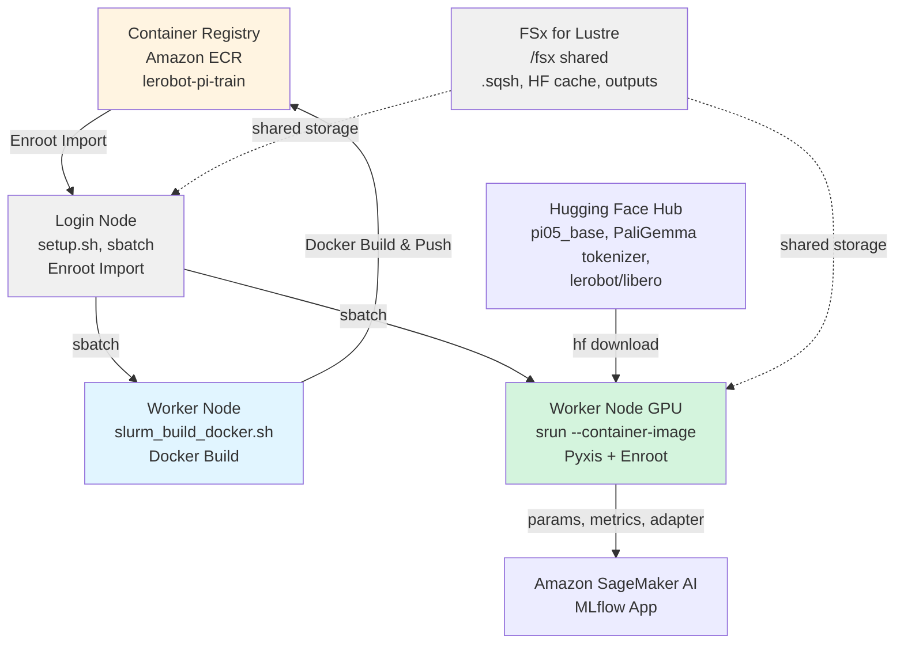

# LeRobot π0.5 Training Guide with HyperPod + Slurm + Enroot

AWS SageMaker HyperPod에서 Slurm + Enroot를 사용해 Docker container 안에서 Hugging Face LeRobot의 π0.5 policy를 fine-tuning하는 가이드입니다.

## 1. 개요

이 sample은 Physical Intelligence의 π0 / π0.5를 PyTorch로 이식한 LeRobot 구현을 `lerobot-train` CLI로 학습합니다. 기존 [OpenPI LoRA Training Guide](/samples/openpi-sample/docs/ko/pi0_LoRA_training.md)(JAX 구현)와 같은 운영 절차(container build → Enroot import → CPU job으로 data 준비 → GPU job으로 training)를 따릅니다.

기본 설정은 다음과 같습니다.

| 항목 | 기본값 |
|---|---|
| Policy | π0.5 (`--policy.type=pi05`) |
| Base weights | `lerobot/pi05_base` |
| Dataset | `lerobot/libero` (LeRobotDataset v3.0) |
| Finetuning 방식 | PEFT LoRA (`r=16`, `lora_alpha=16`) |
| GPU | 1 GPU (`ml.g6.2xlarge`, NVIDIA L4 24 GB 기준) |
| LeRobot | PyPI의 `lerobot==0.6.1` (build-arg `LEROBOT_VERSION`) |
| ECR repository | `lerobot-pi-train` |
| Enroot image | `/fsx/enroot/data/lerobot-pi-train+latest.sqsh` |
| 출력 위치 | `${LEROBOT_PI_OUTPUT_DIR}/<JOB_NAME>` |
| Experiment tracking | `MLFLOW_TRACKING_URI`가 설정되어 있으면 Amazon SageMaker AI MLflow App에 기록 ([MLflow Tracking](#mlflow-tracking) 참고) |

Scripts는 `samples/lerobot-openpi/training/`에 있습니다.

| File | 역할 |
|---|---|
| `Dockerfile` | `nvidia/cuda:12.8.1-base-ubuntu24.04` + uv + Python 3.12에 `lerobot[pi,training,peft]`를 설치합니다. venv는 `/opt/lerobot/.venv`입니다. |
| `setup.sh` | FSx 위의 directory를 만들고, stack outputs에서 MLflow App ARN을 읽어 `~/.bashrc`에 environment variables를 추가합니다. |
| `slurm_build_docker.sh` | Worker node에서 `build_and_push_ecr.sh`를 실행하는 Slurm job입니다 (권장). |
| `build_and_push_ecr.sh` | Docker image를 `linux/amd64`로 build해 ECR에 push합니다. Local PC에서도 실행할 수 있습니다. |
| `hyperpod_import_container.sh` | Login node에서 ECR image를 pull해 Enroot의 `.sqsh`로 변환합니다. |
| `slurm_prepare_dataset.sh` | CPU job입니다. Base weights, tokenizer, dataset을 download하고 π0.5용 quantile statistics를 확인합니다. |
| `slurm_train.sh` | GPU job입니다. 1 GPU로 `lerobot-train`을 실행합니다. |
| `mlflow_train.py` | W&B logger 대신 MLflow logger로 `lerobot-train`을 실행합니다. `MLFLOW_TRACKING_URI`가 설정되어 있을 때 사용됩니다. |

***

## 2. 아키텍처



Container image는 read-only squashfs로 mount되고, 제출한 user (ubuntu)로 실행됩니다. 따라서 runtime에 쓰기가 필요한 위치(container 안의 `HOME`, Hugging Face cache, Triton / TorchInductor cache, 학습 출력)는 모두 job script가 `/fsx` 쪽으로 지정합니다.

***

## 3. 사전 요구사항

1. **HyperPod Cluster**: 이 project에 포함된 CDK로 AWS에 구축한 HyperPod cluster가 필요합니다.
   Console에서 수동으로 생성한 cluster도 사용할 수 있습니다.
2. **GPU worker group**: `ml.g6.2xlarge`(NVIDIA L4 24 GB × 1, 8 vCPU, 32 GiB) 등 GPU instance의 worker group이 필요합니다.
   - Worker group 추가 방법은 [/hyperpod/docs/ko/DEPLOYMENT.md](/hyperpod/docs/ko/DEPLOYMENT.md)의 "2.8. Adding Worker Groups"를 참고하세요.
   - 이 sample의 CPU job(build, dataset 준비)도 같은 worker node에서 실행됩니다. 별도의 CPU worker group은 필요하지 않습니다.
3. **NVIDIA driver 570.86 이상**: Container는 CUDA 12.8 (PyTorch cu128 wheel)을 사용하므로 worker node의 driver가 570.86 이상이어야 합니다. Login node에서 다음 명령으로 확인합니다.

   ```bash
   srun --gres=gpu:1 nvidia-smi --query-gpu=name,driver_version,memory.total --format=csv
   ```

   `slurm_train.sh`도 시작 시 driver version을 확인하고, 570.86보다 오래되었으면 `WARNING`을 출력합니다.
4. **Hugging Face Token**: Base weights, tokenizer, dataset download에 필요합니다 (`HF_TOKEN`).
   1. [Hugging Face](https://huggingface.co/settings/tokens)에 sign up하고 token을 미리 생성합니다.
   2. π0 / π0.5는 gated model인 [google/paligemma-3b-pt-224](https://huggingface.co/google/paligemma-3b-pt-224)의 tokenizer를 사용합니다. Token을 발급한 account로 이 page에 접속해 license에 동의해야 합니다. 동의하지 않으면 `slurm_prepare_dataset.sh`가 HTTP 401/403 error로 종료됩니다.
5. **Local PC (선택)**: Local에서 build하는 경우에만 AWS credentials(ECR access)와 Docker가 필요합니다. Worker node에서 build하는 경우에는 필요하지 않습니다.
6. **MLflow (선택)**: 학습을 MLflow에 기록하는 경우 stack outputs에 `MlflowAppArn`이 있어야 합니다. `hyperpod/cdk.json`의 `Mlflow.Enabled`를 `true`로 하여 배포하면 출력됩니다. MLflow App과 HyperPod ExecutionRole이 App에 기록하기 위한 권한은 이 repository의 CDK가 생성합니다. Outputs는 [/hyperpod/docs/ko/DEPLOYMENT.md](/hyperpod/docs/ko/DEPLOYMENT.md)의 "2.6. Deploy the Stack"을 참고하세요. Local PC에서 MLflow UI를 열려면 AWS CLI v2.34.5 이상이 필요합니다.

***

## 4. 실행 절차

### 4.1 HyperPod SSH Connection

[/hyperpod/docs/ko/DEPLOYMENT.md](/hyperpod/docs/ko/DEPLOYMENT.md)의 SSH connection 안내에 따라 login node에 접속합니다.

```bash
ssh pask-cluster
```

### 4.2 Project Setup

```bash
# PASK repository clone (home directory is /fsx/ubuntu)
cd
git clone https://github.com/aws-samples/sample-physical-ai-scaffolding-kit.git

# setup 실행
cd ~/sample-physical-ai-scaffolding-kit/samples/lerobot-openpi/training
bash setup.sh --hf-token "hf_xxxxx"

# environment variables 적용
source ~/.bashrc
```

**Parameters**

* `--hf-token` (optional): "hf\_"로 시작하는 Hugging Face token을 지정합니다. 지정하지 않으면 `HF_TOKEN`은 이 block에 쓰이지 않으며, data 준비와 training job 제출 전에 직접 `export HF_TOKEN=...`해야 합니다.
* `--mlflow-tracking-uri <ARN>` (optional): MLflow App ARN을 직접 지정합니다. Stack outputs의 `MlflowAppArn`보다 우선합니다.
* `--stack-name <name>` (optional, 기본값 `PASK`): Outputs를 읽을 CloudFormation stack 이름입니다.
* `--region <region>` (optional, 기본값은 EC2 instance metadata (IMDSv2)의 region): Stack의 region입니다.
* `--no-mlflow` (optional): MLflow 설정을 block에 쓰지 않습니다. 학습은 MLflow에 기록되지 않습니다.

MLflow option을 지정하지 않으면 stack `PASK`의 outputs에서 MLflow App ARN을 읽어 학습을 MLflow에 기록하는 설정을 씁니다.

**What the script does**

1. 다음 directory를 생성합니다 (`<BASE>` = `samples/lerobot-openpi`의 absolute path. 위 절차대로라면 `/fsx/ubuntu/sample-physical-ai-scaffolding-kit/samples/lerobot-openpi`).
   - `<BASE>/logs/`
   - `<BASE>/outputs/`
   - `<BASE>/.cache/huggingface/`, `<BASE>/.cache/huggingface/lerobot/`
   - `<BASE>/.cache/triton/`, `<BASE>/.cache/torchinductor/`, `<BASE>/.cache/home/`
   - `/fsx/enroot/data/`, `/fsx/enroot/tmp/`
2. `aws cloudformation describe-stacks`로 stack outputs를 읽어 MLflow App ARN(`MlflowAppArn`)과 HyperPod cluster 이름(`HyperPodClusterId`로 시작하는 key)을 가져옵니다.
   - `--no-mlflow`를 지정하면 읽지 않습니다.
   - ARN을 가져오지 못하면 `WARNING: Continuing without MLflow`를 출력하고 MLflow 설정 없이 계속합니다.
3. `~/.bashrc`에 `# LeRobot OpenPI Configuration`부터 `# End LeRobot OpenPI Configuration`까지의 block을 추가합니다.
   - 같은 block이 이미 있으면 `~/.bashrc.backup`에 backup한 뒤 block을 교체합니다.
   - 기존 openpi sample의 `# OpenPI Configuration` block은 변경하지 않습니다.
   - 추가되는 environment variables는 다음과 같습니다.
     * `export LEROBOT_PI_BASE_DIR=<BASE>`
     * `export LEROBOT_PI_LOG_DIR=${LEROBOT_PI_BASE_DIR}/logs`
     * `export LEROBOT_PI_OUTPUT_DIR=${LEROBOT_PI_BASE_DIR}/outputs`
     * `export LEROBOT_PI_CACHE_DIR=${LEROBOT_PI_BASE_DIR}/.cache`
     * `export LEROBOT_PI_HF_HOME=${LEROBOT_PI_CACHE_DIR}/huggingface`
     * `export LEROBOT_PI_HF_LEROBOT_HOME=${LEROBOT_PI_HF_HOME}/lerobot`
     * `export HF_TOKEN=<argument value>` (`--hf-token`을 지정한 경우에만)
     * `export MLFLOW_TRACKING_URI=<MLflow App ARN>` (ARN을 가져온 경우에만)
     * `export AWS_DEFAULT_REGION=<ARN의 region>` (`MLFLOW_TRACKING_URI`와 함께. ARN의 4번째 field인 `arn:aws:sagemaker:<region>:...`의 `<region>`)
     * `export PASK_CLUSTER_NAME=<HyperPod cluster 이름>` (`MLFLOW_TRACKING_URI`를 쓰고 cluster 이름도 가져온 경우에만)
     * `export ENROOT_CACHE_PATH=/fsx/enroot`, `export ENROOT_DATA_PATH=/fsx/enroot/data` (`~/.bashrc`에 `ENROOT_DATA_PATH`가 없을 때만)
     * `export ENROOT_TEMP_PATH=/fsx/enroot/tmp` (`~/.bashrc`에 `ENROOT_TEMP_PATH`가 없을 때만)

`HF_HOME`과 `HF_LEROBOT_HOME`은 `~/.bashrc`에 export하지 않습니다. 다른 sample에 영향을 주지 않도록 job script가 container 안에서만 `HF_HOME=${LEROBOT_PI_HF_HOME}`, `HF_LEROBOT_HOME=${LEROBOT_PI_HF_LEROBOT_HOME}`으로 설정합니다.

`AWS_DEFAULT_REGION`은 container 안의 MLflow client가 MLflow App API를 호출하는 region으로 사용합니다.

**About Weights & Biases (W&B)**: `slurm_train.sh`는 W&B에 접속하지 않습니다. `MLFLOW_TRACKING_URI`가 설정되어 있으면 `--wandb.*` option을 MLflow용으로 사용하고([MLflow Tracking](#mlflow-tracking) 참고), 설정되어 있지 않으면 `--wandb.enable=false`를 전달합니다.

***

### 4.3 Docker Image Build 및 ECR Push

Image에는 LeRobot 외에 MLflow 기록을 위한 다음 package를 version 고정으로 설치합니다.

| Package | Version | 용도 |
|---|---|---|
| `mlflow-skinny` | `3.10.1` | MLflow client. MLflow App의 server (MLflow 3.10)에 맞춥니다. |
| `sagemaker-mlflow` | `0.5.0` | MLflow App ARN을 tracking URI로 사용하기 위한 plugin. Request에 SigV4 서명을 붙입니다. |
| `nvidia-ml-py` | `13.615.71` | System metrics로 GPU 사용률과 memory를 수집합니다. |

이 package들을 추가하기 전에 build한 image에는 MLflow가 없습니다. MLflow에 기록하려면 image를 다시 build해 ECR에 push하고, [4.4](#44-enroot로-docker-image-import)의 import를 `FORCE=true`로 다시 실행합니다.

#### 방법 A: Worker Node에서 Build (권장)

Worker node에서 build하고 ECR에 push합니다. Local PC가 arm64(Apple Silicon / Graviton)인 경우 `linux/amd64` build가 emulation으로 매우 느리므로 이 방법을 권장합니다.

```bash
cd ~/sample-physical-ai-scaffolding-kit/samples/lerobot-openpi/training
sbatch ./slurm_build_docker.sh

# Example: image tag와 LeRobot version 변경
IMAGE_TAG=v1.0.0 LEROBOT_VERSION=0.6.1 sbatch ./slurm_build_docker.sh
```

`sbatch`는 반드시 `training/` directory에서 실행합니다. `#SBATCH --output=../logs/...`가 `sbatch`를 실행한 directory 기준으로 해석되기 때문입니다.

**Checking progress**:

```bash
squeue -u ubuntu
tail -f ${LEROBOT_PI_LOG_DIR}/docker_build_<JOB_ID>.out
tail -f ${LEROBOT_PI_LOG_DIR}/docker_build_<JOB_ID>.err
```

**Example output**:

```
==================================================
Docker build and push completed successfully
End Time: ...
==================================================
```

#### 방법 B: Local PC에서 Build

```bash
cd samples/lerobot-openpi/training

# Auto-detect region and account
./build_and_push_ecr.sh

# region과 account ID를 지정
./build_and_push_ecr.sh us-west-2 123456789012

# 특정 tag 지정
IMAGE_TAG=v1.0.0 ./build_and_push_ecr.sh
```

**Environment Information을 가져오는 방식**:

1. **Command-line arguments** (`./build_and_push_ecr.sh [AWS_REGION] [AWS_ACCOUNT_ID]`. `slurm_build_docker.sh` 경유 시에는 argument 없음)
2. **Environment variables** (`AWS_REGION`, `AWS_ACCOUNT_ID`)
3. **Auto-detection**
   * Region: `aws configure get region` → EC2 instance metadata (IMDSv2)
   * Account ID: `aws sts get-caller-identity`
4. **Fallback**: Region default는 `us-east-1`

**Available Environment Variables** (두 방법 공통):

| Variable | Default | Description |
|---|---|---|
| `AWS_REGION` | Auto-detected | AWS region |
| `AWS_ACCOUNT_ID` | Auto-detected | AWS account ID |
| `ECR_REPOSITORY` | `lerobot-pi-train` | ECR repository name |
| `IMAGE_TAG` | `latest` | Docker image tag |
| `LEROBOT_VERSION` | `0.6.1` | PyPI에서 설치할 lerobot version (build-arg) |
| `DOCKERFILE_PATH` | `training/Dockerfile` | Dockerfile path |

**What the script does**:

* ECR repository `lerobot-pi-train`을 생성합니다. 이미 있으면 건너뜁니다.
* `linux/amd64`용 Docker image를 build합니다. Build 마지막에 `mlflow`, `sagemaker_mlflow`, `pynvml` 등의 import와 `lerobot-train --help` 등을 실행해 dependency 문제를 build 단계에서 검출합니다.
* ECR에 push합니다.

***

### 4.4 Enroot로 Docker Image Import

Login node에서 실행합니다.

```bash
cd ~/sample-physical-ai-scaffolding-kit/samples/lerobot-openpi/training

# EC2 metadata에서 auto-detect
./hyperpod_import_container.sh

# image tag 지정
./hyperpod_import_container.sh v1.0.0

# tag, region, account ID 지정
./hyperpod_import_container.sh latest us-west-2 123456789012

# 기존 .sqsh를 삭제하고 다시 import
FORCE=true ./hyperpod_import_container.sh
```

**Environment Information을 가져오는 방식**:

1. **Command-line arguments**: `./hyperpod_import_container.sh [IMAGE_TAG] [AWS_REGION] [AWS_ACCOUNT_ID]`
2. **Environment variables**: `IMAGE_TAG`, `AWS_REGION`, `AWS_ACCOUNT_ID`, `ECR_REPOSITORY`
3. **Auto-detection**: Region은 EC2 instance metadata (IMDSv2), Account ID는 AWS STS
4. **Fallback**: `IMAGE_TAG`는 `latest`, Region은 `us-east-1`

**What the script does**:

* ECR에서 Docker image를 pull합니다.
* `enroot import dockerd://...`로 SquashFS format (`.sqsh`)으로 변환합니다. Enroot의 temporary file은 `ENROOT_TEMP_PATH`(기본 `/fsx/enroot/tmp`)에 둡니다.
* `/fsx/enroot/data/lerobot-pi-train+<IMAGE_TAG>.sqsh`에 저장합니다. 같은 file이 이미 있으면 error로 종료하므로, 덮어쓰려면 `FORCE=true`를 지정합니다.

**Example output**:

```
==================================================
Container ready for Slurm execution
==================================================
Container Name: lerobot-pi-train+latest.sqsh
Container Path: /fsx/enroot/data/lerobot-pi-train+latest.sqsh
```

***

### 4.5 Dataset 준비 (CPU Job)

GPU를 확보한 상태로 대용량 download를 기다리지 않도록, training 전에 CPU job으로 data를 준비합니다. 이 job은 `NVIDIA_VISIBLE_DEVICES=void`로 실행되며 GPU를 사용하지 않습니다.

```bash
cd ~/sample-physical-ai-scaffolding-kit/samples/lerobot-openpi/training

# 기본값 (lerobot/libero, lerobot/pi05_base)
sbatch ./slurm_prepare_dataset.sh

# dataset과 base weights를 argument로 지정
sbatch ./slurm_prepare_dataset.sh lerobot/libero lerobot/pi05_base

# π0을 사용하는 경우
POLICY_TYPE=pi0 sbatch ./slurm_prepare_dataset.sh lerobot/libero lerobot/pi0_base
```

**Arguments and Environment Variables**:

| Argument / Variable | Default | Description |
|---|---|---|
| `$1` / `DATASET_REPO_ID` | `lerobot/libero` | Dataset repo id |
| `$2` / `PRETRAINED_PATH` | `lerobot/pi05_base` | Base weights repo id |
| `POLICY_TYPE` | `pi05` | `pi05` 또는 `pi0` |
| `TOKENIZER_REPO_ID` | `google/paligemma-3b-pt-224` | Tokenizer repo id |
| `CONVERT_V21` | `false` | `true`이면 v2.1 dataset을 v3.0으로 변환합니다. |
| `RECOMPUTE_STATS` | `auto` | `auto` / `true` / `false`. `auto`는 `pi05`일 때 q01/q99가 없으면 재계산합니다. |
| `IMAGE_TAG` | `latest` | Container image tag |
| `CONTAINER_IMAGE` | `${ENROOT_DATA_PATH}/lerobot-pi-train+${IMAGE_TAG}.sqsh` | `.sqsh` file path |

`#SBATCH` 기본값은 `--cpus-per-task=4 --mem=16G --time=4:00:00`입니다.

**What the script does**:

1. `[1/4]` Base weights (`PRETRAINED_PATH`)를 `HF_HOME`(= `${LEROBOT_PI_HF_HOME}`)에 download합니다.
2. `[2/4]` PaliGemma tokenizer를 download합니다. License 미동의로 거부되면 error message와 license page URL을 출력합니다.
3. `[3/4]` Dataset을 `${LEROBOT_PI_HF_LEROBOT_HOME}/<DATASET_REPO_ID>`에 download합니다. `meta/info.json`의 `codebase_version`이 v3.0이 아니면 `CONVERT_V21=true`로 다시 제출하라는 error로 종료합니다.
4. `[4/4]` π0.5는 `STATE` / `ACTION`을 quantile로 정규화하므로 `meta/stats.json`에 `observation.state`와 `action`의 `q01` / `q99`가 필요합니다. 없으면 `lerobot-edit-dataset --operation.type=recompute_stats`로 그 자리에서 재계산합니다.

**Checking progress**:

```bash
squeue -u ubuntu
tail -f ${LEROBOT_PI_LOG_DIR}/slurm_<JOB_ID>.out
tail -f ${LEROBOT_PI_LOG_DIR}/prepare_<JOB_ID>.log
tail -f ${LEROBOT_PI_LOG_DIR}/prepare_<JOB_ID>.err
```

완료되면 `Dataset summary:` 아래에 dataset path, codebase version, episode 수, frame 수, q01/q99 유무가 출력됩니다.

`lerobot/libero` 이외의 dataset을 준비한 경우에는 training job 제출 전에도 같은 `DATASET_REPO_ID`를 export합니다.

***

### 4.6 Fine-Tuning 실행 (GPU Job)

```bash
cd ~/sample-physical-ai-scaffolding-kit/samples/lerobot-openpi/training

# LoRA (기본값)
sbatch ./slurm_train.sh my_pi05_lora

# JOB_NAME을 생략하면 pi05_lora_<YYYYmmdd_HHMMSS>
sbatch ./slurm_train.sh

# 짧은 동작 확인
STEPS=200 SAVE_FREQ=100 sbatch ./slurm_train.sh pi05_smoke_test

# action expert만 학습
FINETUNE_MODE=expert_only sbatch ./slurm_train.sh pi05_expert_run

# π0으로 전환
POLICY_TYPE=pi0 PRETRAINED_PATH=lerobot/pi0_base sbatch ./slurm_train.sh pi0_lora_run

# 다른 instance type에 맞춰 #SBATCH 값을 덮어쓰기
sbatch --cpus-per-task=16 --mem=60G ./slurm_train.sh my_job
```

LeRobot 공식 [LIBERO 예제](https://github.com/huggingface/lerobot/blob/v0.6.1/docs/source/pi05.mdx)와 같은 조건으로 학습하려면 base weights를 `lerobot/pi05_libero_base`로 하고, 다음 4개의 인수를 `EXTRA_ARGS`로 전달합니다.

1. `--policy.normalization_mapping`: STATE와 ACTION을 분위수가 아닌 평균과 표준편차로 정규화합니다. 공식 평가 결과는 이 설정으로 측정되었습니다.
2. `--policy.n_action_steps=10`과 `--policy.empty_cameras=1`: `--policy.pretrained_path`는 weights만 불러오므로, `lerobot/pi05_libero_base`에 저장된 이 두 값은 명시하지 않으면 기본값(`50`과 `0`)으로 돌아갑니다.
3. `--seed=1000`: 공식 예제와 같은 random seed입니다.

`EXTRA_ARGS`는 공백으로 분할되므로 `normalization_mapping` 값에는 공백을 넣지 않습니다.

```bash
PRETRAINED_PATH=lerobot/pi05_libero_base sbatch ./slurm_prepare_dataset.sh
PRETRAINED_PATH=lerobot/pi05_libero_base \
EXTRA_ARGS='--policy.normalization_mapping={"ACTION":"MEAN_STD","STATE":"MEAN_STD","VISUAL":"IDENTITY"} --policy.n_action_steps=10 --policy.empty_cameras=1 --seed=1000' \
sbatch ./slurm_train.sh pi05_libero_lora
```

**Arguments and Environment Variables**:

| Argument / Variable | Default | Description |
|---|---|---|
| `$1` / `JOB_NAME` | `pi05_lora_<timestamp>` | Job 이름. 출력 directory 이름이 됩니다. |
| `POLICY_TYPE` | `pi05` | `pi05` 또는 `pi0` |
| `PRETRAINED_PATH` | `lerobot/pi05_base` | Base weights |
| `DATASET_REPO_ID` | `lerobot/libero` | Dataset repo id |
| `DATASET_ROOT` | `${LEROBOT_PI_HF_LEROBOT_HOME}/${DATASET_REPO_ID}` | Local dataset root |
| `FINETUNE_MODE` | `lora` | `lora` / `expert_only` / `full` |
| `LORA_R` | `16` | LoRA rank (`lora`일 때만) |
| `LORA_ALPHA` | `16` | LoRA alpha (`lora`일 때만) |
| `STEPS` | `30000` | Training steps (`RESUME=true`일 때는 명시적으로 지정한 경우에만 반영) |
| `BATCH_SIZE` | `4` | Batch size |
| `SAVE_FREQ` | `5000` | Checkpoint 저장 간격 (steps) |
| `LOG_FREQ` | `100` | Log 출력 간격 (steps) |
| `NUM_WORKERS` | `4` | DataLoader workers |
| `COMPILE_MODEL` | `false` | `true`이면 `torch.compile`을 사용합니다. |
| `RESUME` | `false` | `true`이면 `${OUTPUT_DIR}/checkpoints/last`에서 재개합니다. |
| `OUTPUT_DIR` | `${LEROBOT_PI_OUTPUT_DIR}/${JOB_NAME}` | 출력 directory |
| `EXTRA_ARGS` | (empty) | `lerobot-train`에 추가할 argument. 공백으로 분리되며 quote는 해석되지 않습니다. |
| `IMAGE_TAG` | `latest` | Container image tag |
| `CONTAINER_IMAGE` | `${ENROOT_DATA_PATH}/lerobot-pi-train+${IMAGE_TAG}.sqsh` | `.sqsh` file path |
| `MLFLOW_TRACKING_URI` | `~/.bashrc`의 값 | MLflow App ARN. 비워 두면 MLflow에 기록하지 않습니다. |
| `MLFLOW_EXPERIMENT_NAME` | `lerobot-pi` | 새 run을 만드는 MLflow experiment 이름 |
| `MLFLOW_DISABLE_ARTIFACT` | `false` | `true`이면 LoRA adapter를 artifact로 upload하지 않습니다. |
| `MLFLOW_ADAPTER_MAX_MB` | `200` | Artifact로 upload할 adapter file 합계 크기의 상한 (MB) |
| `MLFLOW_SYSTEM_METRICS_SAMPLING_INTERVAL` | `10` | System metrics 수집 간격 (초) |

`#SBATCH` 기본값은 `ml.g6.2xlarge` 기준의 `--gres=gpu:1 --cpus-per-task=8 --mem=28G --time=48:00:00`입니다. Learning rate는 지정하지 않으며 LeRobot policy의 기본값을 사용합니다.

**FINETUNE_MODE별로 추가되는 argument**:

| FINETUNE_MODE | 추가 argument |
|---|---|
| `lora` | `--peft.method_type=LORA --peft.r=${LORA_R} --peft.lora_alpha=${LORA_ALPHA}` |
| `expert_only` | `--policy.train_expert_only=true` |
| `full` | (없음) |

모든 mode에 `--policy.dtype=bfloat16 --policy.gradient_checkpointing=true --policy.push_to_hub=false --policy.device=cuda`가 붙습니다. `MLFLOW_TRACKING_URI`가 없으면 `--wandb.enable=false`가 붙습니다. 실행되는 command 전체는 log의 `[3/4] Building the lerobot-train command...` 아래에 출력됩니다.

#### MLflow Tracking

`MLFLOW_TRACKING_URI`가 설정되어 있으면 `slurm_train.sh`는 `lerobot-train` 대신 `python training/mlflow_train.py`를 실행합니다. `mlflow_train.py`는 LeRobot이 W&B 기록에 사용하는 logger를 MLflow에 기록하는 logger로 교체한 뒤 `lerobot-train`과 같은 처리를 호출합니다. LeRobot 자체는 변경하지 않습니다. Job 시작 시 `MLflow: enabled (<ARN>)`, training 시작 시 `Logging to MLflow run <run ID>`가 log에 출력됩니다.

Logger 교체에 LeRobot의 `--wandb.*` option을 그대로 사용하므로, `slurm_train.sh`는 다음 값을 전달합니다. W&B에는 접속하지 않으므로 `WANDB_API_KEY`는 필요하지 않습니다.

| Option | 값 | MLflow에서의 의미 |
|---|---|---|
| `--wandb.enable` | `true` | MLflow 기록을 활성화합니다. |
| `--wandb.project` | `${MLFLOW_EXPERIMENT_NAME}` | Experiment 이름 |
| `--wandb.disable_artifact` | `${MLFLOW_DISABLE_ARTIFACT}` | `true`이면 adapter를 artifact로 upload하지 않습니다. |

`MLFLOW_TRACKING_URI`가 설정되어 있지 않으면 지금까지처럼 `lerobot-train`을 `--wandb.enable=false`로 실행하고 아무것도 기록하지 않습니다.

```bash
# 다른 experiment에 기록
MLFLOW_EXPERIMENT_NAME=lerobot-pi-libero sbatch ./slurm_train.sh my_pi05_lora2

# 이 job만 MLflow에 기록하지 않음
MLFLOW_TRACKING_URI= sbatch ./slurm_train.sh my_pi05_lora_nolog
```

Run 이름은 job 이름입니다. Experiment에는 MLflow UI에서 model training용 화면을 사용하기 위한 tag `mlflow.experimentKind=custom_model_development`를 붙입니다. Run에는 다음 내용을 기록합니다.

| 종류 | 이름 | 내용 |
|---|---|---|
| params | `dataset.repo_id`, `steps` 등 | 학습 설정을 dot으로 구분한 key로 펼친 값 (값 하나는 6000자까지). Run을 만들 때만 기록합니다. |
| artifact | `train_config.json` | 학습 설정 전체. Run을 만들 때만 기록합니다. |
| metrics | `train/*` | `LOG_FREQ` step마다의 `train/loss`, `train/grad_norm`, `train/lr` 등 |
| metrics | `eval/*` | `EXTRA_ARGS`로 LeRobot의 evaluation을 활성화한 경우의 결과. Evaluation video는 artifact의 `videos/eval/`에 upload합니다. |
| metrics | `checkpoint_step` | Checkpoint를 저장한 step |
| metrics | `system/*` | CPU, memory, GPU 사용 상황. `MLFLOW_SYSTEM_METRICS_SAMPLING_INTERVAL`초마다 수집합니다. |
| artifact | `adapter/<step>/` | 마지막 step의 LoRA adapter (`adapter_model.safetensors`, `adapter_config.json`, `config.json`) |

Tag는 다음과 같습니다. 값이 빈 tag는 붙이지 않습니다.

| Tag | 값 |
|---|---|
| `lerobot.version` | LeRobot version |
| `lerobot.policy_type` | `pi05` 또는 `pi0` |
| `lerobot.finetune_mode` | `lora` / `expert_only` / `full` |
| `lerobot.dataset_repo_id` | Dataset repo id |
| `lerobot.pretrained_path` | Base weights (run을 만들 때만 기록) |
| `pask.output_dir` | 출력 directory |
| `pask.last_checkpoint_dir` | 마지막으로 저장한 checkpoint directory |
| `pask.image_tag` | Container image tag (`IMAGE_TAG`) |
| `pask.cluster` | HyperPod cluster 이름 (`PASK_CLUSTER_NAME`) |
| `pask.run_type` | `train` |
| `slurm.job_id` | 이 run에 마지막으로 기록한 job ID |
| `slurm.job_ids` | 이 run에 기록한 모든 job ID (comma 구분) |

LoRA adapter는 마지막 step(`STEPS`)의 checkpoint를 저장할 때 한 번만 artifact로 upload합니다. `adapter_model.safetensors`가 있고, 3개 file의 합계가 `MLFLOW_ADAPTER_MAX_MB` 이하이며, `MLFLOW_DISABLE_ARTIFACT`가 `false`일 때만 upload합니다. 합계가 상한을 넘으면 log에 `over MLFLOW_ADAPTER_MAX_MB`를 출력하고 upload하지 않습니다. `FINETUNE_MODE=expert_only`와 `full`의 checkpoint에는 adapter가 없고, weights 전체를 MLflow에 올리면 수 GB가 되므로 어떤 경우에도 upload하지 않습니다. Upload하지 않은 weights는 tag `pask.last_checkpoint_dir`의 path로 FSx 위의 checkpoint를 참조합니다.

Run 상태는 학습이 끝나면 `FINISHED`, error로 멈추면 `FAILED`, `scancel`이나 시간 제한으로 job이 중지되면 `KILLED`가 됩니다.

### 4.7 Monitoring

```bash
# job status 확인
squeue -u ubuntu

# Slurm stdout / stderr
tail -f ${LEROBOT_PI_LOG_DIR}/slurm_<JOB_ID>.out
tail -f ${LEROBOT_PI_LOG_DIR}/slurm_<JOB_ID>.err

# training job log (tee로 같은 내용이 출력됩니다)
tail -f ${LEROBOT_PI_LOG_DIR}/train_<JOB_ID>.log
tail -f ${LEROBOT_PI_LOG_DIR}/train_<JOB_ID>.err

# GPU usage 확인 (job에 할당된 node에서)
srun --jobid=<JOB_ID> --overlap nvidia-smi
```

Training이 시작되면 container 안의 torch version, `torch.cuda.is_available()`, GPU 이름과 driver version이 출력되고, 이후 `LOG_FREQ` step마다 loss 등이 출력됩니다.

### 4.8 Checkpoint 확인

```bash
# job completion status 확인
sacct -j <JOB_ID> --format=JobID,State,ExitCode

# checkpoints 확인
ls -lh ${LEROBOT_PI_OUTPUT_DIR}/<JOB_NAME>/checkpoints/
ls -lh ${LEROBOT_PI_OUTPUT_DIR}/<JOB_NAME>/checkpoints/last/pretrained_model/
```

Checkpoint는 다음 구조로 출력됩니다.

```
${OUTPUT_DIR}/checkpoints/
├── <step>/
│   ├── pretrained_model/   # config.json, train_config.json, model weights (safetensors), pre/post-processor
│   └── training_state/     # optimizer, scheduler, RNG state
└── last -> <step>          # 최신 checkpoint
```

`FINETUNE_MODE=lora`에서는 `pretrained_model/`에 `model.safetensors`가 만들어지지 않습니다. 학습한 LoRA adapter만 `adapter_model.safetensors`와 `adapter_config.json`으로 저장됩니다. `ml.g6.2xlarge`에서 `LORA_R=16`으로 확인했을 때 checkpoint 1개는 약 16 MB였습니다.

Job이 정상 종료되면 log 마지막에 `Latest checkpoint: .../checkpoints/last/pretrained_model`와 재개용 command가 표시됩니다.

### 4.9 Training 재개

같은 `JOB_NAME`으로 `RESUME=true`를 지정합니다. `${OUTPUT_DIR}/checkpoints/last/pretrained_model/train_config.json`을 읽어 `--resume=true --config_path=...`로 재개합니다.

```bash
cd ~/sample-physical-ai-scaffolding-kit/samples/lerobot-openpi/training
RESUME=true sbatch ./slurm_train.sh my_pi05_lora
```

재개 시에는 저장된 `train_config.json`의 설정이 사용되므로 `FINETUNE_MODE`, `BATCH_SIZE` 등의 environment variables는 반영되지 않습니다. `OUTPUT_DIR`을 바꿔서 학습한 경우에는 재개할 때도 같은 `OUTPUT_DIR`을 지정합니다.

예외는 `STEPS`입니다. 명시적으로 지정한 경우에만 `--steps`로 전달되어 총 step 수를 바꿀 수 있습니다. 예를 들어 step 20에서 끝난 학습을 step 30까지 이어서 하려면 다음과 같이 제출합니다.

```bash
RESUME=true STEPS=30 sbatch ./slurm_train.sh my_pi05_lora
```

`STEPS`를 지정하지 않으면 `train_config.json`의 step 수를 사용합니다. Learning rate schedule은 새로운 총 step 수에 맞춰 다시 계산됩니다.

MLflow에 기록하던 학습을 재개하면 같은 run에 이어서 기록합니다. `mlflow_train.py`가 MLflow run ID를 `train_config.json`의 `wandb.run_id`에 저장하고, 재개 시 그 ID의 run을 열기 때문입니다. Experiment와 adapter upload 여부도 `train_config.json`의 값을 사용하므로, 재개 시의 `MLFLOW_EXPERIMENT_NAME`과 `MLFLOW_DISABLE_ARTIFACT`는 반영되지 않습니다. Tag `slurm.job_id`는 재개한 job ID로 덮어쓰고, `slurm.job_ids`에는 재개한 job ID를 추가합니다. Params와 `train_config.json` artifact는 run을 만들 때의 값 그대로입니다.

처음 학습과 재개에서 MLflow 기록 여부가 다른 경우는 다음과 같습니다.

| 처음 학습 | 재개 시 `MLFLOW_TRACKING_URI` | 재개한 학습의 기록 |
|---|---|---|
| MLflow에 기록함 | 설정됨 | 같은 run에 이어서 기록합니다. |
| MLflow에 기록하지 않음 | 설정됨 | `MLFLOW_EXPERIMENT_NAME` experiment에 새 run을 만들어 기록합니다. |
| 어느 쪽이든 | 설정되지 않음 | `lerobot-train`을 `--wandb.enable=false`로 실행하고 기록하지 않습니다. |

### 4.10 MLflow UI에서 기록 확인

MLflow UI는 local PC에서 MLflow App의 presigned URL을 발급해 엽니다. AWS CLI v2.34.5 이상과, MLflow App이 있는 account에서 `sagemaker:CreatePresignedMlflowAppUrl`을 실행할 수 있는 credentials가 필요합니다. `<region>`은 stack을 deploy한 region입니다.

```bash
MLFLOW_APP_ARN=$(aws cloudformation describe-stacks \
  --stack-name PASK \
  --region <region> \
  --query "Stacks[0].Outputs[?starts_with(OutputKey, 'MlflowAppArn')].OutputValue | [0]" \
  --output text)

aws sagemaker create-presigned-mlflow-app-url \
  --arn "${MLFLOW_APP_ARN}" \
  --expires-in-seconds 300 \
  --session-expiration-duration-in-seconds 43200 \
  --region <region>
```

출력의 `AuthorizedUrl`을 browser로 엽니다. URL은 한 번만 사용할 수 있고, `--expires-in-seconds`(5~300초)가 지나면 사용할 수 없습니다. Browser session은 `--session-expiration-duration-in-seconds`(1800~43200초) 동안 유지됩니다.

MLflow UI에서 experiment `lerobot-pi`(`MLFLOW_EXPERIMENT_NAME`을 바꾼 경우 그 이름)를 열고 job 이름의 run을 선택합니다. 같은 experiment의 run을 여러 개 선택해 비교하면 `train/loss` 등의 metrics를 겹쳐 표시할 수 있습니다.

***

## 5. 기존 openpi sample과의 비교

| 관점 | 기존 openpi sample (`samples/openpi-sample/`) | 이 sample (`samples/lerobot-openpi/`) |
|---|---|---|
| Framework | JAX (openpi 본가 구현) | PyTorch (LeRobot 이식판) |
| Entry point | `python scripts/train.py <CONFIG_NAME>` | `lerobot-train --policy.type=pi05 ...` |
| 학습 설정 정의 위치 | openpi의 `src/openpi/training/config.py`에 code로 정의된 TrainConfig. 독자 data를 쓰려면 code 추가가 필요 | 모두 CLI argument (이 sample에서는 environment variables로 전달) |
| Source code 배치 | FSx에 openpi를 clone하고 container에서 참조 | LeRobot을 version 고정으로 image에 설치. Clone 불필요 |
| Python / CUDA | Python 3.11.9 / CUDA 12.2 | Python 3.12 / CUDA 12.8 (driver 570.86 이상) |
| Dataset format | LeRobotDataset v2.1 (`physical-intelligence/libero`) | LeRobotDataset v3.0 (`lerobot/libero`). v2.1은 `CONVERT_V21=true`로 변환 |
| 정규화 통계 | `slurm_compute_norm_stats.sh`로 `norm_stats.json`을 계산 | Dataset의 `meta/stats.json`을 사용. π0.5는 q01/q99가 없으면 `slurm_prepare_dataset.sh`가 재계산 |
| Base weights | openpi 공개 checkpoint (GCS) | Hugging Face Hub의 `lerobot/pi05_base` 등. PaliGemma license 동의 필요 |
| LoRA | LoRA variant를 포함한 TrainConfig 선택 | `FINETUNE_MODE=lora` (`--peft.method_type=LORA`). `expert_only` / `full`로도 전환 가능 |
| Checkpoint | orbax 형식. `<openpi>/checkpoints/<config>/<exp>/<step>/` | safetensors. `<OUTPUT_DIR>/checkpoints/<step>/pretrained_model/` + `training_state/`, `checkpoints/last` |
| 재개 | (가이드에 절차 없음) | `RESUME=true sbatch ./slurm_train.sh <JOB_NAME>` |
| GPU memory 설정 | `XLA_PYTHON_CLIENT_MEM_FRACTION` / `XLA_FLAGS` | 불필요. bf16 + gradient checkpointing을 항상 사용 |
| Container build | Local PC에서 build | Worker node의 Slurm job (`slurm_build_docker.sh`) 또는 local PC |
| FSx 위의 path | `.../openpi-sample/{openpi,logs,.cache}`, `/fsx/enroot/data/openpi-lora-train+latest.sqsh` | `.../lerobot-openpi/{logs,outputs,.cache}`, `/fsx/enroot/data/lerobot-pi-train+latest.sqsh` |
| `~/.bashrc` block | `OPENPI_*` | `LEROBOT_PI_*` (`# LeRobot OpenPI Configuration` block) |
| wandb | `--no-wandb-enabled` | `--wandb.enable=false`. `MLFLOW_TRACKING_URI`가 있으면 MLflow App에 기록 ([MLflow Tracking](#mlflow-tracking) 참고) |

다음 경우에는 이 sample을 사용합니다.

1. LeRobot 형식의 독자 dataset(SO-101 등으로 수집한 data)을 openpi 쪽 code를 수정하지 않고 학습에 사용하고 싶은 경우
2. 학습 결과를 Hugging Face Hub 형식(`pretrained_model/`)으로 받아 LeRobot의 도구로 다루고 싶은 경우

openpi 본가의 JAX 구현이나 TrainConfig(예: `pi0_libero_low_mem_finetune`)를 그대로 재현하고 싶은 경우에는 기존 openpi sample을 사용합니다.

***

## 6. GPU 메모리 가이드

π0 / π0.5는 약 3.3B parameter의 model입니다. 이 sample은 모든 mode에서 `--policy.dtype=bfloat16`과 `--policy.gradient_checkpointing=true`를 사용합니다. 아래는 측정값이 아니라 기준입니다.

| FINETUNE_MODE | 학습 대상 | 메모리 사용량 | 24 GB GPU (L4)에서 |
|---|---|---|---|
| `lora` (기본값) | `gemma_expert`의 `q_proj` / `v_proj`와 `state_proj` / `action_in_proj` / `action_out_proj` / `action_time_mlp_*`에 LoRA adapter 적용 | 가장 적음 | 이 sample의 기본 대상. `BATCH_SIZE=4`부터 시작 |
| `expert_only` | VLM을 freeze하고 action expert와 projection layer를 학습 | `lora`보다 많음 | `BATCH_SIZE`를 줄여도 부족할 수 있음 |
| `full` | 모든 parameter | 가장 많음 | Gradient와 optimizer state가 parameter 수만큼 필요하므로 부족할 것으로 예상 |

`ml.g6.2xlarge`에서 기본값(`lora`, `BATCH_SIZE=4`, `LORA_R=16`)으로 `lerobot/libero`를 학습했을 때의 측정값은 다음과 같습니다. `expert_only`와 `full`은 측정하지 않았습니다.

| 항목 | 측정값 |
|---|---|
| GPU memory | 약 9.3~9.7 GB (23 GB 중) |
| Host memory 최대값 (`sacct`의 `MaxRSS`) | 약 22.6 GB (`--mem=28G` 중) |
| 1 step당 시간 | 약 1.4초 |
| 첫 step까지의 준비 시간 (model 로딩과 LoRA 적용) | 약 6분 |

조정 방법은 다음과 같습니다.

1. CUDA out of memory가 발생하면 `BATCH_SIZE`를 2, 1로 줄입니다.
2. `expert_only` / `full`을 사용하려면 메모리가 더 큰 GPU instance(예: `ml.g6e` 계열의 L40S 48 GB)의 worker group을 사용합니다. LeRobot 공식 문서의 π0.5 LIBERO quickstart는 80 GB GPU 1장을 전제로 합니다.
3. Instance type을 바꾼 경우 `sbatch --cpus-per-task=<N> --mem=<M>`으로 `#SBATCH` 값을 덮어씁니다. Host memory가 부족해 job이 `OUT_OF_MEMORY`로 종료되면 `NUM_WORKERS`를 줄입니다.
4. `COMPILE_MODEL=true`는 첫 step에서 compile 시간이 걸립니다. Compile cache는 `${LEROBOT_PI_CACHE_DIR}/triton`과 `${LEROBOT_PI_CACHE_DIR}/torchinductor`에 저장됩니다.

***

## 7. 트러블슈팅

### Hugging Face Quota Error (HTTP 429)

Download 중 다음과 같은 rate limit error가 발생할 수 있습니다. `slurm_prepare_dataset.sh`는 `ERROR: Hugging Face rate limit reached (HTTP 429)`를 출력하고 종료합니다.

```
huggingface_hub.errors.HfHubHTTPError: 429 Client Error: Too Many Requests for url: ...
```

최소 5분을 기다린 뒤 같은 command로 다시 제출하세요. 이미 download한 file은 다시 받지 않습니다.

### Gated Repository Error (HTTP 401/403)

`ERROR: Access to the gated tokenizer google/paligemma-3b-pt-224 was denied (HTTP 401/403)`가 출력되면 다음을 확인합니다.

1. `HF_TOKEN`을 발급한 account로 [google/paligemma-3b-pt-224](https://huggingface.co/google/paligemma-3b-pt-224)의 license에 동의했는지
2. `echo ${HF_TOKEN:0:3}`이 `hf_`를 출력하는지 (`source ~/.bashrc`를 잊지 않았는지)

### Login Node의 Root Disk 용량 부족

`hyperpod_import_container.sh`가 `No space left on device`로 실패하는 경우가 있습니다.

1. Script는 `ENROOT_TEMP_PATH`(기본 `/fsx/enroot/tmp`)를 사용합니다. `~/.bashrc`에 다른 `ENROOT_TEMP_PATH`가 정의되어 있지 않은지 확인합니다.
2. Docker image 자체는 login node의 Docker data directory에 pull됩니다. `docker image prune`으로 불필요한 image를 삭제합니다.

### `.sqsh`가 이미 존재함

`ERROR: Container file already exists`가 출력되면 `FORCE=true ./hyperpod_import_container.sh`로 기존 file을 삭제하고 다시 import합니다.

### Job이 PENDING 상태로 유지됨

`squeue -u ubuntu`의 `NODELIST(REASON)`을 확인합니다.

1. `Resources`: 필요한 CPU / memory / GPU가 비어 있지 않습니다. 이 sample의 CPU job은 GPU worker node에서 실행되므로, build job이나 dataset 준비 job이 실행 중이면 training job(`--cpus-per-task=8 --mem=28G`)은 그 job이 끝날 때까지 기다립니다.
2. `ReqNodeNotAvail` / `PartitionConfig` 등: GPU worker group이 없거나 node가 사용 불가 상태입니다. `sinfo -N -o "%N %G %c %m %t"`로 node의 GRES (`gpu:1`), CPU 수, memory, 상태를 확인합니다.
3. Instance의 memory가 `--mem`보다 작으면 job은 시작되지 않습니다. `sbatch --mem=<M>`으로 줄입니다.

### Job이 바로 종료되고 log가 없음

`#SBATCH --output=../logs/...`는 `sbatch`를 실행한 directory 기준입니다. `training/` directory에서 `sbatch`를 실행했는지, `setup.sh`가 `../logs`를 만들었는지 확인합니다.

### `ERROR: Required environment variables not set`

`setup.sh`를 실행하지 않았거나 `source ~/.bashrc`를 하지 않았습니다. 기존 openpi sample의 `setup.sh`를 나중에 실행하면 `export HF_TOKEN=` 또는 `ENROOT_`를 포함한 행이 이 sample의 block에서도 삭제됩니다. 이 경우 이 sample의 `setup.sh`를 다시 실행합니다. 이 sample의 block에 있는 `MLFLOW_TRACKING_URI`, `AWS_DEFAULT_REGION`, `PASK_CLUSTER_NAME` 행은 삭제되지 않습니다. 기존 openpi sample의 `setup.sh`는 자신이 쓴 `# OpenPI MLflow` marker가 붙은 행만 삭제하기 때문입니다.

### `No module named 'mlflow'`로 training job이 종료됨

MLflow package를 추가하기 전에 build한 image로 `MLFLOW_TRACKING_URI`를 설정해 training job을 제출하면 `ModuleNotFoundError: No module named 'mlflow'`로 종료됩니다. Image를 다시 build해 ECR에 push하고, `FORCE=true ./hyperpod_import_container.sh`로 다시 import한 뒤 제출합니다. Image를 update하지 않고 학습만 진행하려면 `MLFLOW_TRACKING_URI=`를 붙여 제출하면 MLflow에 기록하지 않고 학습합니다.

### setup.sh가 `Continuing without MLflow`를 출력함

`setup.sh`가 stack outputs에서 `MlflowAppArn`을 읽지 못했다는 뜻입니다. 바로 앞의 `WARNING`으로 원인을 확인합니다.

1. `Could not determine the region`: `--region`으로 stack의 region을 지정합니다.
2. `Could not read the MlflowAppArn output`: `--stack-name`의 stack 이름과 region이 맞는지, stack이 MLflow App을 포함한 version의 CDK로 deploy되었는지 확인합니다.

ARN을 알고 있다면 `--mlflow-tracking-uri`로 직접 지정할 수도 있습니다.

### `ERROR: Output directory already exists`

`lerobot-train`은 기존 출력 directory를 덮어쓰지 않습니다. 다른 `JOB_NAME`을 지정하거나, 이어서 학습하려면 `RESUME=true`를 지정합니다.

### Dataset Codebase Version Error

`ERROR: Dataset codebase version is v2.1, but LeRobot training requires v3.0`가 출력되면 `CONVERT_V21=true sbatch ./slurm_prepare_dataset.sh <DATASET_REPO_ID>`로 v3.0으로 변환합니다.

### NVIDIA Driver Warning

`WARNING: NVIDIA driver ... is older than 570.86 required by CUDA 12.8`가 출력되면 CUDA 초기화에 실패할 수 있습니다. HyperPod cluster의 AMI를 update해 driver를 570.86 이상으로 올립니다.

***

## 8. 범위 외

이 sample에는 다음이 포함되지 않습니다.

1. 학습한 checkpoint를 사용한 inference와 evaluation (`lerobot-eval`에 의한 LIBERO simulation 평가, `lerobot-rollout`에 의한 실기 inference)
2. 1 node 복수 GPU (DDP / FSDP)와 multi-node 학습 (`torchrun`, EFA 설정)
3. 독자 dataset의 변환과 feature 이름의 mapping (`--rename_map`)
4. `physai/` SDK의 container 형식으로의 통합
5. 기존 `samples/openpi-sample/`과 `hyperpod/` CDK code의 변경

***

## 9. 참고 자료

### This Repository

* [OpenPI LoRA Training Guide](/samples/openpi-sample/docs/ko/pi0_LoRA_training.md)
* [HyperPod Deployment](/hyperpod/docs/ko/DEPLOYMENT.md)

### LeRobot

* [LeRobot GitHub repository](https://github.com/huggingface/lerobot)
* [π0.5 documentation (`docs/source/pi05.mdx`)](https://github.com/huggingface/lerobot/blob/main/docs/source/pi05.mdx)
* [π0 documentation (`docs/source/pi0.mdx`)](https://github.com/huggingface/lerobot/blob/main/docs/source/pi0.mdx)
* [PEFT training (`docs/source/peft_training.mdx`)](https://github.com/huggingface/lerobot/blob/main/docs/source/peft_training.mdx)
* [lerobot/pi05_base](https://huggingface.co/lerobot/pi05_base)
* [lerobot/libero](https://huggingface.co/datasets/lerobot/libero)
* [google/paligemma-3b-pt-224](https://huggingface.co/google/paligemma-3b-pt-224)

### Documentation

* [AWS HyperPod Documentation](https://docs.aws.amazon.com/sagemaker/latest/dg/sagemaker-hyperpod.html)
* [Enroot Documentation](https://github.com/NVIDIA/enroot)
* [Slurm Documentation](https://slurm.schedmd.com/documentation.html)
