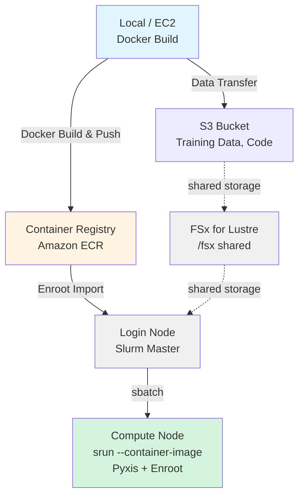

# OpenPI LoRA Training Guide with HyperPod + Slurm + Enroot

A guide for running LoRA fine-tuning in Docker containers using Slurm + Enroot on AWS SageMaker HyperPod.

## Architecture



***

## Prerequisites

1. **HyperPod Cluster**: A HyperPod cluster built on AWS using the CDK included in this project.
	The steps below assume a HyperPod cluster deployed via CDK, but clusters created manually through the console can also be used for training.
	The CDK stack also includes an Amazon SageMaker AI MLflow App that stores training records. See [Tracking Training with MLflow](#tracking-training-with-mlflow) for what is recorded.
2. **Development Environment**: The following setup is required:
	1. AWS credentials configuration: For ECR access
	2. Docker: For building the pi0 training image
3. **Hugging Face Token**: For downloading sample training datasets (`HF_TOKEN`)
	1. You need to sign up at [Hugging Face](https://huggingface.co/settings/tokens) and generate a token in advance. This is not required if you use your own training data.

***

## Execution Steps

### Building the Image Locally & Pushing to ECR

#### Building the Docker Image and Pushing to ECR

```bash
cd samples/openpi-sample/

# Clone openpi and pin it to the same commit as setup.sh
git clone https://github.com/Physical-Intelligence/openpi.git
git -C openpi checkout 215abfb217dbac7d5f1273282331b9b1866c0479

cd lora_training/

# Build & push to ECR (uses the AWS CLI default region)
./build_and_push_ecr.sh

# To specify both region and account ID
./build_and_push_ecr.sh us-west-2 123456789012

# To specify a specific tag
IMAGE_TAG=v1.0.0 ./build_and_push_ecr.sh
```

**About the openpi commit**:

The Python dependencies of the container are installed from the `uv.lock` of the openpi clone on your local machine.
The training code, on the other hand, is loaded from the openpi clone that `setup.sh` creates on FSx.
If the two commits differ, the training code and the dependency versions in the container no longer match, so pin the local clone to the same commit as `setup.sh` (`215abfb217dbac7d5f1273282331b9b1866c0479`).
The MLflow tracking patch is applied only to the clone on FSx, so do not apply it to the local clone.
If you have already cloned openpi, run `git -C openpi fetch` and then the `git -C openpi checkout` command above.

**If you use an image built earlier**:

The container includes `mlflow-skinny` 3.10.1, `sagemaker-mlflow` 0.5.0, and `nvidia-ml-py` 12.575.51 for MLflow tracking.
Images built without these packages cannot log to MLflow, so rebuild the image, push it to ECR, and import it again by following [Importing the Docker Image with Enroot](#importing-the-docker-image-with-enroot).

**How Environment Information Is Retrieved (Local PC)**:

The script retrieves environment information in the following priority order:

1. **Command-line arguments** (highest priority)
2. **Environment variables** (`AWS_REGION`, `AWS_ACCOUNT_ID`)
3. **AWS CLI configuration**
   * Region: `aws configure get region`
   * Account ID: `aws sts get-caller-identity --query Account --output text`

**What the script does**:
* Creates the ECR repository `openpi-lora-train` (if it does not exist)
* Builds the Docker image (using `train_lora.Dockerfile`)
* Pushes to ECR

**Example output**:

```
✅ Docker image successfully pushed to ECR
Image URI: 123456789012.dkr.ecr.us-west-2.amazonaws.com/openpi-lora-train:latest
```

***

### Preparation on the HyperPod Login Node

#### SSH Connection to HyperPod

Connect by following the SSH connection instructions in [DEPLOYMENT.md](/hyperpod/docs/en/DEPLOYMENT.md).
```
ssh pask-cluster
```

#### Project Setup

```bash
# Clone the PASK repository
cd
git clone https://github.com/aws-samples/sample-physical-ai-scaffolding-kit.git

# Run setup. See below for parameters
cd samples/openpi-sample/lora_training
./setup.sh --hf-token "hf_xxxxx"

# Apply environment variables
source ~/.bashrc
```

**Parameters**
* hf-token (optional): Specify a Hugging Face token starting with "hf\_"
	* You need to sign up at [Hugging Face](https://huggingface.co/settings/tokens) and generate a token in advance.
* mlflow-tracking-uri (optional): Specify the ARN of an MLflow App
	* If omitted, the `MlflowAppArn` output of the stack is used. Specify it to log to an MLflow App that was not created by the CDK.
* stack-name (optional): Name of the CloudFormation stack whose outputs are read. Default: `PASK`
* region (optional): Region of the stack. Default: the region obtained from the EC2 instance metadata (IMDSv2) of the Login Node
* no-mlflow (optional): Do not read the stack outputs, and do not write the MLflow and S3 link environment variables to `~/.bashrc`

Examples of specifying the MLflow App ARN explicitly and of not using MLflow:

```bash
./setup.sh --hf-token "hf_xxxxx" --mlflow-tracking-uri arn:aws:sagemaker:us-west-2:123456789012:mlflow-app/app-XXXXXXXXXXXX
./setup.sh --hf-token "hf_xxxxx" --no-mlflow
```

**What the script does**

1. Clones the OpenPI repository
	- If /fsx/ubuntu/samples/openpi-sample/openpi/ does not exist
	- Runs git clone <https://github.com/Physical-Intelligence/openpi.git> from GitHub and checks out commit `215abfb217dbac7d5f1273282331b9b1866c0479`
2. Applies the MLflow tracking patch
	- Applies `lora_training/patches/mlflow_tracking.patch` to the cloned openpi with `git apply`
	- Does nothing if the patch is already applied
3. Creates directory structure
	- /fsx/ubuntu/samples/openpi-sample/logs/
	- /fsx/ubuntu/samples/openpi-sample/.cache/
	- /fsx/ubuntu/samples/openpi-sample/openpi/assets/physical-intelligence/libero/
4. Reads the CloudFormation stack outputs (skipped when `--no-mlflow` is specified)
	- Reads `MlflowAppArn`, `S3LinkUri`, `S3LinkMountPath`, and the output whose key starts with `HyperPodClusterId` with `aws cloudformation describe-stacks`
	- For values that cannot be read, prints a warning and does not write the environment variables that depend on them to `~/.bashrc`
5. Sets environment variables in \~/.bashrc
	- Removes existing OpenPI/Enroot settings if present (creates a backup)
	- Appends the following environment variables: These environment variables are used in all Slurm job scripts.
		* export OPENPI\_BASE\_DIR=/fsx/ubuntu/samples/openpi-sample
		* export OPENPI\_PROJECT\_ROOT=\${OPENPI\_BASE\_DIR}/openpi
		* export OPENPI\_DATA\_HOME=\${OPENPI\_BASE\_DIR}/.cache
		* export OPENPI\_LOG\_DIR=\${OPENPI\_BASE\_DIR}/logs
		* export HF\_TOKEN=<value specified as argument or empty>
		* export ENROOT\_CACHE\_PATH=/fsx/enroot
		* export ENROOT\_DATA\_PATH=/fsx/enroot/data
	- If the stack outputs were read, also appends the following environment variables. Each line ends with `# OpenPI MLflow` and is replaced when you run `setup.sh` again.
		* export MLFLOW\_TRACKING\_URI=<MlflowAppArn, or the value of --mlflow-tracking-uri>
		* export AWS\_DEFAULT\_REGION=<4th field (region) of the MLflow App ARN>
		* export PASK\_CLUSTER\_NAME=<value of the output whose key starts with HyperPodClusterId>
		* export PASK\_S3LINK\_DIR=<value of S3LinkMountPath, e.g. /fsx/s3link>
		* export PASK\_S3LINK\_URI=<value of S3LinkUri>

**If the existing openpi clone is at a different commit**:

`setup.sh` does not recreate an existing clone.
If HEAD differs from the pinned commit, it prints a warning, and if the patch cannot be applied, it stops with an error.
In that case, move the existing clone aside and run `setup.sh` again to clone the pinned commit.

```bash
# OPENPI_PROJECT_ROOT is the value written to ~/.bashrc by the previous setup.sh run
mv "${OPENPI_PROJECT_ROOT}" "${OPENPI_PROJECT_ROOT}.old"
./setup.sh --hf-token "hf_xxxxx"
source ~/.bashrc
```

Checkpoints (`openpi/checkpoints/`) and normalization statistics (`openpi/assets/`) are inside the openpi directory, so the new clone does not see them after you move the old clone aside.
To continue training, move them from the old directory to the same locations in the new clone.

**About Weights & Biases (wandb)**:
* The default scripts disable wandb (`--no-wandb-enabled`)
* If you want to track training with wandb:
  1. Create an account at [wandb.ai](https://wandb.ai)
  2. Get your API key and add it to `~/.bashrc`: `export WANDB_API_KEY=your_key_here`
  3. Remove `--no-wandb-enabled` from the script (or change it to `--wandb-enabled`)

---
#### Importing the Docker Image with Enroot

```bash
# Convert ECR image to Enroot format
cd samples/openpi-sample/lora_training

# Auto-detect from EC2 metadata
./hyperpod_import_container.sh

# Specify an image tag
./hyperpod_import_container.sh v1.0.0

# Specify a region
./hyperpod_import_container.sh latest us-west-2
```

**How Environment Information Is Retrieved (HyperPod Cluster)**:

The script retrieves environment information in the following priority order. When running inside HyperPod without specifying command-line arguments or environment variables, information is retrieved from EC2 instance metadata:

1. **Command-line arguments** (highest priority)

   ```bash
   ./hyperpod_import_container.sh [IMAGE_TAG] [AWS_REGION] [AWS_ACCOUNT_ID]
   ```

2. **Environment variables**

   ```bash
   export AWS_REGION=us-west-2
   export AWS_ACCOUNT_ID=123456789012
   ./hyperpod_import_container.sh
   ```

3. **Auto-detection**

   * **Region**: EC2 instance metadata (IMDSv2)

     ```bash
     TOKEN=$(curl -X PUT "http://169.254.169.254/latest/api/token" \
       -H "X-aws-ec2-metadata-token-ttl-seconds: 21600" -s)
     curl -H "X-aws-ec2-metadata-token: $TOKEN" -s \
       http://169.254.169.254/latest/meta-data/placement/region
     ```

   * **Account ID**: AWS STS

     ```bash
     aws sts get-caller-identity --query Account --output text
     ```

4. **Fallback**: Region defaults to `us-east-1`

**What the script does**:
* Pulls the Docker image from ECR
* Converts it to SquashFS format (`.sqsh`)
* Saves it to `/fsx/enroot/data/`

**Importing again**:

`enroot import` fails if a file with the same name already exists at the output path, so after rebuilding the image, delete the old `.sqsh` before importing.

```bash
rm /fsx/enroot/data/openpi-lora-train+latest.sqsh
./hyperpod_import_container.sh
```

**Example output**:

```
✅ Container ready for Slurm execution
Container Name: openpi-lora-train+latest.sqsh
```

**Verification**:

```bash
# Check the imported container
enroot list

# Example output:
# openpi-lora-train+latest.sqsh
```


***

### Running Slurm Jobs

#### Computing Normalization Statistics (First Time Only)

```bash
cd samples/openpi-sample/lora_training

# Submit as a Slurm job
sbatch ./slurm_compute_norm_stats.sh pi0_libero_low_mem_finetune

# A job ID is returned (e.g., Submitted batch job 1234)
```

**Checking progress**:

```bash
# Check job status
squeue -u ubuntu

# Monitor logs in real time
tail -f ${OPENPI_LOG_DIR}/slurm_<JOB_ID>.out

# Check error logs
tail -f ${OPENPI_LOG_DIR}/slurm_<JOB_ID>.err
```

If `MLFLOW_TRACKING_URI` is set, this job is recorded as an MLflow run when the computation completes.
See [Normalization Statistics Job Run](#normalization-statistics-job-run) for what is recorded.


##### Execution Errors
**Hugging Face Quota Error**:
When using sample training data, you may encounter a quota error like the following during download from Hugging Face.
In this case, wait at least 5 minutes and then run `./slurm_compute_norm_stats.sh` again.
Since the download resumes from where it left off, the process will complete without a quota error on the second attempt.

```
huggingface_hub.errors.HfHubHTTPError: 429 Client Error: Too Many Requests for url: https://huggingface.co/api/datasets/physical-intelligence/
We had to rate limit you, you hit the quota of 1000 api requests per 5 minutes period. Upgrade to a PRO user or Team/Enterprise organization account (https://hf.co/pricing) to get higher limits. See https://huggingface.co/docs/hub/rate-limits
```


***

#### Running LoRA Fine-Tuning (GPU Job)

```bash
cd samples/openpi-sample/lora_training

# Submit LoRA training
sbatch ./slurm_train_lora.sh pi0_libero_low_mem_finetune my_lora_run

# Run with a custom experiment name
sbatch ./slurm_train_lora.sh pi0_libero_low_mem_finetune experiment_$(date +%Y%m%d)

# Resume from the latest checkpoint of the same experiment name
RESUME=true sbatch ./slurm_train_lora.sh pi0_libero_low_mem_finetune my_lora_run
```

**Environment variables read by the job**:

The job inherits the environment variables of the shell that runs `sbatch`.

| Environment variable | Default | Description |
|---|---|---|
| `RESUME` | `false` | If `true`, resumes from the latest checkpoint of the same experiment name with `--resume`. If `false`, deletes the checkpoints of the same experiment name with `--overwrite` and trains from the beginning |
| `EXPORT_CHECKPOINT` | `true` | If `true`, copies the final checkpoint to the S3-linked FSx directory after training completes. Requires `PASK_S3LINK_DIR` and `PASK_S3LINK_URI` |
| `MLFLOW_TRACKING_URI` | Value written to `~/.bashrc` by `setup.sh` | ARN of the MLflow App. If unset, nothing is logged to MLflow |
| `MLFLOW_EXPERIMENT_NAME` | `TrainConfig.project_name` of the training config (`openpi`) | Name of the MLflow experiment to log to |
| `MLFLOW_SYSTEM_METRICS_SAMPLING_INTERVAL` | `10` | Interval in seconds for collecting system metrics |

See [Tracking Training with MLflow](#tracking-training-with-mlflow) for what is recorded and how resumed training is handled.

**Checking progress**:

```bash
# Check job status
squeue -u ubuntu

# GPU usage (on the compute node)
srun --jobid=<JOB_ID> nvidia-smi

# Monitor logs in real time
tail -f ${OPENPI_LOG_DIR}/train_<JOB_ID>.out

# Check error logs
tail -f ${OPENPI_LOG_DIR}/train_<JOB_ID>.err
```

**Typical logs during training**:

```
[1000/30000] loss=0.234 lr=1e-4 step_time=1.2s
[2000/30000] loss=0.189 lr=9e-5 step_time=1.1s
Saving checkpoint to /fsx/ubuntu/openpi_test/openpi/checkpoints/pi0_libero_low_mem_finetune/my_lora_run/2000
```

**Verifying completion**:

```bash
# Check job completion status
sacct -j <JOB_ID> --format=JobID,State,ExitCode

# Check checkpoints
ls -lh ${OPENPI_PROJECT_ROOT}/checkpoints/pi0_libero_low_mem_finetune/my_lora_run/

# Example output:
# drwxr-xr-x  1000/
# drwxr-xr-x  2000/
# drwxr-xr-x  5000/
# drwxr-xr-x  30000/  <- Final checkpoint
```

***

## Tracking Training with MLflow

When `MLFLOW_TRACKING_URI` is set to the ARN of an MLflow App, the training job and the normalization statistics job log their results to the MLflow App.
The tracking code is in the patch that `setup.sh` applies to openpi (`lora_training/patches/mlflow_tracking.patch`).
Requests to the MLflow App are authenticated with the IAM role of the node (the ExecutionRole of the HyperPod cluster).
The CDK stack grants this role permission to log to the MLflow App.

### Training Job Run

The training job creates a run named after the experiment name (the second argument of `slurm_train_lora.sh`) in the experiment (`openpi` by default) and records the following.

| Type | Content |
|---|---|
| params | All fields of the training config (`TrainConfig`). Keys of nested fields are joined with `.` |
| artifact | `config.json` containing the whole training config. When training completes, `norm_stats.json` of the final checkpoint |
| metrics | `loss`, `grad_norm`, and `param_norm` averaged over each `log_interval` steps, and `learning_rate` at that step. `checkpoint_step` at each step where a checkpoint is saved |
| system metrics | CPU, memory, GPU utilization, and so on, collected every `MLFLOW_SYSTEM_METRICS_SAMPLING_INTERVAL` seconds |

The run has the following tags.

| Tag | Content |
|---|---|
| `openpi.config_name` | Name of the training config |
| `openpi.git_commit` | Commit of openpi on FSx (short form) |
| `slurm.job_id` | ID of the most recent Slurm job |
| `slurm.job_ids` | IDs of all Slurm jobs logged to this run (comma-separated) |
| `pask.cluster` | Value of `PASK_CLUSTER_NAME` |
| `pask.checkpoint_dir` | Checkpoint directory |
| `pask.run_type` | `train` |
| `pask.norm_stats_run_id` | ID of the run of the normalization statistics used for training. Not set if the normalization statistics were not logged to MLflow |
| `pask.checkpoint_s3_uri` | S3 URI of the copied final checkpoint. Not set if the checkpoint was not copied |

The experiment has the tag `mlflow.experimentKind=custom_model_development`.
The MLflow 3 UI uses this tag to treat the experiment as a model training experiment.

The run status depends on how the job ends.

| How the job ends | Run status |
|---|---|
| Normal completion | `FINISHED` |
| Exception | `FAILED` |
| Stopped by `scancel` or the time limit (Slurm sends SIGTERM) | `KILLED` |

### Run of Resumed Training

When you resume with `RESUME=true`, the training job reads the run ID saved in the checkpoint directory (`mlflow_run_id.txt`) and continues logging to the same run.
At this point, it overwrites `slurm.job_id` with the ID of the new job and appends the new job ID to the end of `slurm.job_ids`.
Params cannot be changed once logged, so they are logged only when a new run is created.

With `RESUME=false` (default), `--overwrite` restarts training from the beginning, so a new run is created.
If you resume training that was started without MLflow, a new run is also created because no run ID was saved.

### Copying the Final Checkpoint to S3

If `EXPORT_CHECKPOINT=true` (default) and `PASK_S3LINK_DIR` and `PASK_S3LINK_URI` are set, the training job copies the final checkpoint to the following location after training completes.

```
${PASK_S3LINK_DIR}/checkpoints/<training config name>/<experiment name>/<step>/
```

`PASK_S3LINK_DIR` (`/fsx/s3link` unless you changed the setting in `cdk.json`) is an FSx directory linked to an S3 bucket, and the copied files are exported to S3 by the automatic export of FSx.
When logging to MLflow, the S3 URI of the copy is recorded in the `pask.checkpoint_s3_uri` tag.
The export to S3 proceeds asynchronously after the copy completes, so not all files may be in S3 yet when the tag is set.

The final checkpoint is about 7 GB per training run and consumes FSx and S3 capacity.
If you do not need the copy, submit the job with `EXPORT_CHECKPOINT=false`.
The copy is independent of MLflow tracking and runs even when `MLFLOW_TRACKING_URI` is not set.

### Normalization Statistics Job Run

When the computation completes, the normalization statistics job creates a run named `norm_stats_<training config name>` in the same experiment as the training job.
The `pask.run_type` tag of this run is `norm_stats`.

| Type | Content |
|---|---|
| params | `config_name`, `repo_id`, `max_frames`, `batch_size` |
| artifact | `norm_stats.json` |
| tags | `openpi.config_name`, `openpi.git_commit`, `slurm.job_id`, `pask.cluster`, `pask.run_type` |

This job does not use a GPU, so it does not record system metrics.

The run ID is saved to `mlflow_run_id.txt` in the same directory as `norm_stats.json`.
The training job reads this file and records the ID in the `pask.norm_stats_run_id` tag of the training run.
With this tag, you can trace the run of the normalization statistics used for training in MLflow.

### Opening the MLflow UI

To open the MLflow UI, issue a presigned URL and open it in a browser.
The IAM role of the HyperPod nodes does not have permission to issue the URL (`sagemaker:CreatePresignedMlflowAppUrl`), so run the commands in an environment that has this permission, such as with the credentials used for the CDK deployment.
AWS CLI commands for the MLflow App require AWS CLI v2.34.5 or later.

```bash
# Check the AWS CLI version
aws --version

# Get the ARN of the MLflow App
aws cloudformation describe-stacks --stack-name PASK \
  --query "Stacks[0].Outputs[?OutputKey=='MlflowAppArn'].OutputValue" --output text

# Issue a presigned URL
aws sagemaker create-presigned-mlflow-app-url \
  --arn <MlflowAppArn> \
  --expires-in-seconds 300 \
  --session-expiration-duration-in-seconds 43200
```

Open the output URL in a browser.
The URL can be used only once, and it expires after the number of seconds specified with `--expires-in-seconds` (5 to 300 seconds).
`--session-expiration-duration-in-seconds` is the length of the browser session, from 1800 to 43200 seconds (30 minutes to 12 hours).
If the default region of the AWS CLI differs from the region of the MLflow App, add `--region` to both commands.

### Running Without MLflow

If `MLFLOW_TRACKING_URI` is not set, the training job and the normalization statistics job log nothing to MLflow and behave the same as before the patch was applied.
In this case, the job log shows `MLflow: disabled (MLFLOW_TRACKING_URI is not set)`.

To stop logging to MLflow, run `setup.sh --no-mlflow`, or run `unset MLFLOW_TRACKING_URI` in the shell that submits the jobs.
`setup.sh --no-mlflow` removes the MLflow and S3 link lines from `~/.bashrc`, but the environment variables remain in shells that have already loaded `~/.bashrc`, so log in again before submitting jobs.
With `--no-mlflow`, `PASK_S3LINK_DIR` and `PASK_S3LINK_URI` are not written either, so the final checkpoint is not copied to S3.

### Runs Left in `RUNNING`

If a job is stopped by SIGKILL or a node failure, the code that updates the run status does not run, and the run stays `RUNNING`.
If you resume the same training with `RESUME=true`, logging continues in the same run, and the run becomes `FINISHED` when training completes.

If you do not resume, change the run status to `KILLED` with `MlflowClient().set_terminated()` of MLflow.
You can find the run ID in the MLflow UI or in `mlflow_run_id.txt` in the checkpoint directory.
Run the following from the Login Node with the training container.

```bash
NVIDIA_VISIBLE_DEVICES=void srun --container-image="${ENROOT_DATA_PATH}/openpi-lora-train+latest.sqsh" \
  /.venv/bin/python -c "import mlflow; mlflow.MlflowClient().set_terminated('<RUN_ID>', 'KILLED')"
```

`NVIDIA_VISIBLE_DEVICES=void` prevents the container from failing to start because of its GPU settings when the job is allocated to a node without a GPU.

***

## Slurm Job Management Commands

### Checking Jobs

```bash
# List your jobs
squeue -u ubuntu

# Detailed information
squeue -u ubuntu -o "%.18i %.9P %.30j %.8u %.2t %.10M %.6D %R"

# All jobs (entire cluster)
squeue
```

### Canceling Jobs

```bash
# Cancel a specific job
scancel <JOB_ID>

# Cancel all your jobs
scancel -u ubuntu

# Cancel jobs by name
scancel --name=openpi_lora_train
```

***

## Reference Resources

### Documentation

* [AWS HyperPod Documentation](https://docs.aws.amazon.com/sagemaker/latest/dg/sagemaker-hyperpod.html)
* [Enroot Documentation](https://github.com/NVIDIA/enroot)
* [Slurm Documentation](https://slurm.schedmd.com/documentation.html)
