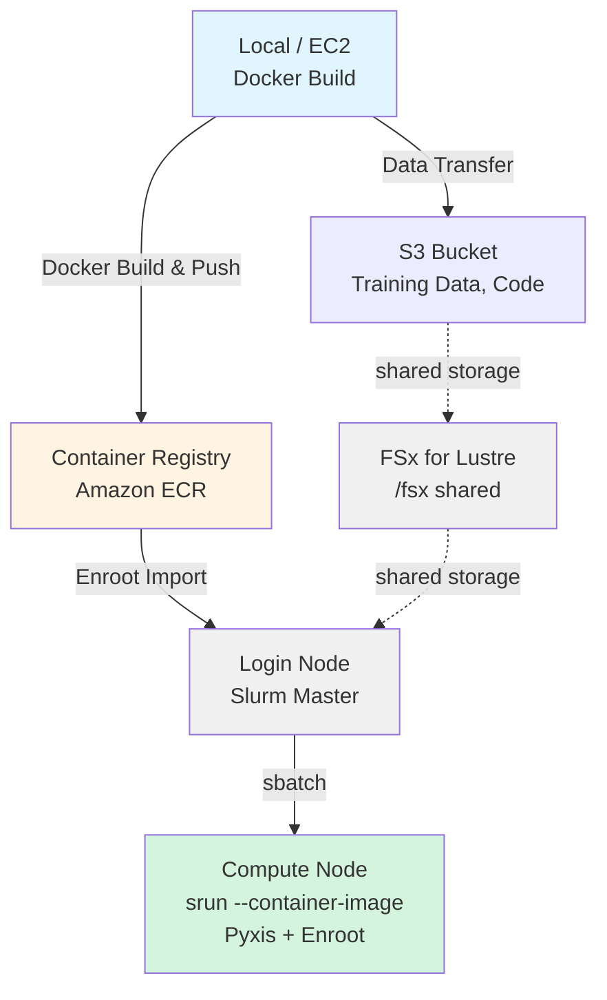

# HyperPod + Slurm + Enroot での OpenPI LoRA トレーニング実行ガイド

AWS SageMaker HyperPod 上で Slurm + Enroot を使用して Docker コンテナで LoRA ファインチューニングを実行するガイドです。

## アーキテクチャ



***

## 環境準備

1. **Hyperpod クラスタ**: 本プロジェクト内の CDK を使って Hyperpod クラスタを AWS 上に構築している
	以下の手順では、CDK で構築されている Hyperpod を前提に記述しますが、コンソールなどから手動で作成した Hyperpod でも同様に学習実行は可能です。
	CDK のスタックには、学習の記録先になる Amazon SageMaker AI の MLflow App も含まれます。記録の内容は「[MLflow による学習の記録](#mlflow-による学習の記録)」を参照してください。
2. **開発環境**: 以下の設定が必要になります。
	1. AWS 認証情報設定: ECR アクセス用
	2. Docker: pi0 学習用イメージのBuild用
3. **Hugging Face トークン**: サンプル学習データセットダウンロード用 (`HF_TOKEN`)
	1. [Hugging Face](https://huggingface.co/settings/tokens) での事前 Sign Up とToken の払い出しが必要です。独自の学習データを使用する場合は不要です。

***

## 実行手順

### ローカル環境でのイメージビルド & ECR プッシュ

#### Docker イメージのビルドと ECR への Push

```bash
cd samples/openpi-sample/

# openpi を Clone し、setup.sh と同じ commit に固定
git clone https://github.com/Physical-Intelligence/openpi.git
git -C openpi checkout 215abfb217dbac7d5f1273282331b9b1866c0479

cd lora_training/

# ECR にビルド & プッシュ（AWS CLI のデフォルトリージョンを使用）
./build_and_push_ecr.sh

# リージョンとアカウントIDの両方を指定する場合 
./build_and_push_ecr.sh us-west-2 123456789012

# 特定のタグを指定する場合
IMAGE_TAG=v1.0.0 ./build_and_push_ecr.sh
```

**openpi の commit について**:

コンテナの Python 依存は、ローカルに clone した openpi の `uv.lock` から入ります。
一方、学習コードは `setup.sh` が FSx 上に clone した openpi から読み込まれます。
両者の commit が違うと、学習コードとコンテナの依存のバージョンがずれるため、ローカルの clone も `setup.sh` と同じ commit（`215abfb217dbac7d5f1273282331b9b1866c0479`）に固定します。
MLflow の記録用パッチは FSx 上の clone にだけ当てるため、ローカルの clone には当てません。
すでに clone してある場合は、`git -C openpi fetch` のあとに上の `git -C openpi checkout` を実行します。

**以前にビルドしたイメージを使っている場合**:

コンテナには、MLflow への記録に使う `mlflow-skinny` 3.10.1、`sagemaker-mlflow` 0.5.0、`nvidia-ml-py` 12.575.51 が入っています。
これらを含まない以前のイメージでは MLflow に記録できないため、イメージを再ビルドして ECR に push し、「[Enroot で Docker イメージをインポート](#enroot-で-docker-イメージをインポート)」の手順で再インポートします。

**環境情報の取得方法（ローカルPC）**:

スクリプトは以下の優先順位で環境情報を取得します：

1. **コマンドライン引数**（最優先）
2. **環境変数** (`AWS_REGION`, `AWS_ACCOUNT_ID`)
3. **AWS CLI設定**
   * リージョン: `aws configure get region`
   * アカウントID: `aws sts get-caller-identity --query Account --output text`

**実行内容**:
* ECR リポジトリ `openpi-lora-train` の作成（存在しない場合）
* Docker イメージのビルド（`train_lora.Dockerfile` を使用）
* ECR へのプッシュ

**出力例**:

```
✅ Docker image successfully pushed to ECR
Image URI: 123456789012.dkr.ecr.us-west-2.amazonaws.com/openpi-lora-train:latest
```

***

### HyperPod Login Node での準備

#### HyperPod への SSH 接続

[DEPLOYMENT.md](/hyperpod/docs/ja/DEPLOYMENT.md) の HyperPod への SSH 接続方法を参考に接続。
```
ssh pask-cluster
```

#### プロジェクトのセットアップ

```bash
# コード一式を PASK リポジトリのclone
cd
git clone https://github.com/aws-samples/sample-physical-ai-scaffolding-kit.git

# セットアップを実行。パラメータについて以下を参照
cd sample-physical-ai-scaffolding-kit/samples/openpi-sample/lora_training
bash setup.sh --hf-token "hf_xxxxx"

# 環境変数を反映
source ~/.bashrc
```

**パラメータについて**
* hf-token（オプション）:  "hf\_" から始まる Hugging Face のTokenを指定
	* [Hugging Face](https://huggingface.co/settings/tokens) での事前 Sign Up とToken の払い出しが必要です。
* mlflow-tracking-uri（オプション）: MLflow App の ARN を指定
	* 指定しない場合は、スタックの Outputs の `MlflowAppArn` を使います。CDK 以外で作成した MLflow App に記録する場合に指定します。
* stack-name（オプション）: Outputs を読む CloudFormation スタックの名前。既定は `PASK`
* region（オプション）: スタックのリージョン。既定は Login Node の EC2 インスタンスメタデータ（IMDSv2）から取得したリージョン
* no-mlflow（オプション）: スタックの Outputs を読まず、MLflow と S3 リンクの環境変数を `~/.bashrc` に書かない

MLflow App の ARN を明示する場合と、MLflow を使わない場合の例です。

```bash
bash setup.sh --hf-token "hf_xxxxx" --mlflow-tracking-uri arn:aws:sagemaker:us-west-2:123456789012:mlflow-app/app-XXXXXXXXXXXX
bash setup.sh --hf-token "hf_xxxxx" --no-mlflow
```

**実行内容について**

1. OpenPI リポジトリのクローン
	- /fsx/ubuntu/samples/openpi-sample/openpi/ が存在しない場合
	- GitHub から git clone <https://github.com/Physical-Intelligence/openpi.git> を実行し、commit `215abfb217dbac7d5f1273282331b9b1866c0479` を checkout
2. MLflow の記録用パッチの適用
	- `lora_training/patches/mlflow_tracking.patch` を clone した openpi に `git apply` で当てる
	- すでに当たっている場合は何もしない
3. ディレクトリ構造の作成
	- /fsx/ubuntu/samples/openpi-sample/logs/
	- /fsx/ubuntu/samples/openpi-sample/.cache/
	- /fsx/ubuntu/samples/openpi-sample/openpi/assets/physical-intelligence/libero/
4. CloudFormation スタックの Outputs の取得（`--no-mlflow` を指定した場合は行わない）
	- `aws cloudformation describe-stacks` で `MlflowAppArn`、`S3LinkUri`、`S3LinkMountPath`、`HyperPodClusterId` で始まる Output を読む
	- 読めなかった値は警告を出し、その値を使う環境変数を `~/.bashrc` に書かない
5. 環境変数を \~/.bashrc に設定
	- 既存の OpenPI/Enroot 設定があれば削除（バックアップ作成）
	- 以下の環境変数を追記：これらの環境変数は、すべての Slurm ジョブスクリプトで使用されます。
		* export OPENPI\_BASE\_DIR=/fsx/ubuntu/samples/openpi-sample
		* export OPENPI\_PROJECT\_ROOT=\${OPENPI\_BASE\_DIR}/openpi
		* export OPENPI\_DATA\_HOME=\${OPENPI\_BASE\_DIR}/.cache
		* export OPENPI\_LOG\_DIR=\${OPENPI\_BASE\_DIR}/logs
		* export HF\_TOKEN=<引数で指定した値 or 空>
		* export ENROOT\_CACHE\_PATH=/fsx/enroot
		* export ENROOT\_DATA\_PATH=/fsx/enroot/data
	- スタックの Outputs から読めた場合は、以下の環境変数も追記します。各行の末尾には `# OpenPI MLflow` が付き、`setup.sh` を再実行すると置き換わります。
		* export MLFLOW\_TRACKING\_URI=<MlflowAppArn、または --mlflow-tracking-uri の値>
		* export AWS\_DEFAULT\_REGION=<MLflow App の ARN の4番目のフィールド（リージョン）>
		* export PASK\_CLUSTER\_NAME=<HyperPodClusterId で始まる Output の値>
		* export PASK\_S3LINK\_DIR=<S3LinkMountPath の値。例: /fsx/s3link>
		* export PASK\_S3LINK\_URI=<S3LinkUri の値>

**既存の openpi の clone が別の commit の場合**:

`setup.sh` は既存の clone を作り直しません。
HEAD が固定の commit と違う場合は警告を出し、パッチを当てられなければエラーで止まります。
この場合は既存の clone を退避してから `setup.sh` を再実行し、固定の commit で clone し直します。

```bash
# OPENPI_PROJECT_ROOT は前回の setup.sh で ~/.bashrc に書かれた値
mv "${OPENPI_PROJECT_ROOT}" "${OPENPI_PROJECT_ROOT}.old"
bash setup.sh --hf-token "hf_xxxxx"
source ~/.bashrc
```

checkpoint（`openpi/checkpoints/`）と正規化統計（`openpi/assets/`）は openpi のディレクトリの中にあるため、退避すると新しい clone からは見えなくなります。
続きから学習する場合は、退避したディレクトリから新しい clone の同じ場所に移します。

**Weights & Biases (wandb) について**:
* デフォルトのスクリプトでは wandb を無効化しています (`--no-wandb-enabled`)
* wandb でトレーニングをトラッキングしたい場合:
  1. [wandb.ai](https://wandb.ai) でアカウントを作成
  2. API key を取得して `~/.bashrc` に追加: `export WANDB_API_KEY=your_key_here`
  3. スクリプトから `--no-wandb-enabled` を削除（または `--wandb-enabled` に変更）

---
#### Enroot で Docker イメージをインポート

```bash
# ECR イメージを Enroot 形式に変換
cd sample-physical-ai-scaffolding-kit/samples/openpi-sample/lora_training

# EC2 メタデータから自動取得
./hyperpod_import_container.sh

# イメージタグを指定
./hyperpod_import_container.sh v1.0.0

# リージョンを指定
./hyperpod_import_container.sh latest us-west-2
```

**環境情報の取得方法（HyperPod Cluster）**:

スクリプトは以下の優先順位で環境情報を取得します。Hyperpod 内で特にコマンドライン引数や環境変数設定なしに実行した場合、EC2インスタンスメタデータから取得することになります。：

1. **コマンドライン引数**（最優先）

   ```bash
   ./hyperpod_import_container.sh [IMAGE_TAG] [AWS_REGION] [AWS_ACCOUNT_ID]
   ```

2. **環境変数**

   ```bash
   export AWS_REGION=us-west-2
   export AWS_ACCOUNT_ID=123456789012
   ./hyperpod_import_container.sh
   ```

3. **自動検出**

   * **リージョン**: EC2インスタンスメタデータ（IMDSv2）

     ```bash
     TOKEN=$(curl -X PUT "http://169.254.169.254/latest/api/token" \
       -H "X-aws-ec2-metadata-token-ttl-seconds: 21600" -s)
     curl -H "X-aws-ec2-metadata-token: $TOKEN" -s \
       http://169.254.169.254/latest/meta-data/placement/region
     ```

   * **アカウントID**: AWS STS

     ```bash
     aws sts get-caller-identity --query Account --output text
     ```

4. **フォールバック**: リージョンは `us-east-1`

**実行内容**:
* ECR から Docker イメージを Pull
* SquashFS 形式 (`.sqsh`) に変換
* `/fsx/enroot/data/` に保存

**再インポートする場合**:

`enroot import` は出力先に同じ名前のファイルがあると失敗するため、イメージを再ビルドしたときは古い `.sqsh` を削除してからインポートします。

```bash
rm /fsx/enroot/data/openpi-lora-train+latest.sqsh
./hyperpod_import_container.sh
```

**ルートディスク容量について**:

Docker の Pull 先（`/opt/sagemaker/docker/data-root`）と Enroot の一時領域（既定は `/tmp`）はどちらも Login Node のルートボリューム上にあります。展開後のイメージは約 18 GB で、SquashFS 変換中はさらに同程度の一時領域を消費するため、ルートボリュームの空きが 40 GB 程度しかない場合は一時領域を FSx に退避してから実行します。

```bash
mkdir -p /fsx/enroot/tmp
export ENROOT_TEMP_PATH=/fsx/enroot/tmp
./hyperpod_import_container.sh
```

変換完了後、`/fsx/enroot/tmp` に残った中間ファイルは削除して構いません。

**出力例**:

```
✅ Container ready for Slurm execution
Container Name: openpi-lora-train+latest.sqsh
```

**確認**:

```bash
# インポートされたコンテナを確認
enroot list

# 出力例:
# openpi-lora-train+latest.sqsh
```


***

### Slurm ジョブの実行

#### 正規化統計の計算（初回のみ）

```bash
cd sample-physical-ai-scaffolding-kit/samples/openpi-sample/lora_training

# Slurm ジョブとして投入
sbatch ./slurm_compute_norm_stats.sh pi0_libero_low_mem_finetune

# ジョブ ID が返される（例: Submitted batch job 1234）
```

**進捗確認**:

```bash
# ジョブ状態確認
squeue -u ubuntu

# リアルタイムログ監視
tail -f ${OPENPI_LOG_DIR}/slurm_<JOB_ID>.out

# エラーログ確認
tail -f ${OPENPI_LOG_DIR}/slurm_<JOB_ID>.err
```

`MLFLOW_TRACKING_URI` が設定されている場合、計算が完了した時点で、このジョブを MLflow の run として記録します。
記録の内容は「[正規化統計ジョブの run](#正規化統計ジョブの-run)」を参照してください。


##### 実行エラーについて
**Hugging Face Quota エラー**:
サンプルの学習データを使用する場合、Hugging Face からのダウンロード時に以下のような Quota エラーが発生することがあります。
この場合は、5分以上時間をあけてから再度 `./slurm_compute_norm_stats.sh` を実行してください。
ダウンロードの途中から再開されるため、2回目では  Quota エラーなく処理が完了します。

```
huggingface_hub.errors.HfHubHTTPError: 429 Client Error: Too Many Requests for url: https://huggingface.co/api/datasets/physical-intelligence/
We had to rate limit you, you hit the quota of 1000 api requests per 5 minutes period. Upgrade to a PRO user or Team/Enterprise organization account (https://hf.co/pricing) to get higher limits. See https://huggingface.co/docs/hub/rate-limits
```


***

#### LoRA ファインチューニングの実行（GPU ジョブ）

このジョブは `--gres=gpu:1 --cpus-per-task=8 --mem=28G` を要求します。クラスタに GPU 付きの worker group が無い場合、ジョブは投入できてもリソースが確保できず PENDING のままになります。`sinfo` と `scontrol show node <ノード名>` の `Gres` を確認し、GPU が割り当てられていなければ CDK の `cdk.json` の `WorkerGroup` に GPU インスタンス（例: `ml.g5.2xlarge` = A10G 24 GB / 8 vCPU / 32 GB）を追加してからデプロイしてください。

```bash
cd sample-physical-ai-scaffolding-kit/samples/openpi-sample/lora_training

# LoRA トレーニングを投入
sbatch ./slurm_train_lora.sh pi0_libero_low_mem_finetune my_lora_run

# カスタム実験名で実行
sbatch ./slurm_train_lora.sh pi0_libero_low_mem_finetune experiment_$(date +%Y%m%d)

# 同じ実験名の最新の checkpoint から再開
RESUME=true sbatch ./slurm_train_lora.sh pi0_libero_low_mem_finetune my_lora_run
```

**ジョブが読む環境変数**:

`sbatch` を実行するシェルの環境変数がジョブに引き継がれます。

| 環境変数 | 既定値 | 内容 |
|---|---|---|
| `RESUME` | `false` | `true` の場合は `--resume` で同じ実験名の最新の checkpoint から再開する。`false` の場合は `--overwrite` で同じ実験名の checkpoint を消して最初から学習する |
| `EXPORT_CHECKPOINT` | `true` | `true` の場合は、学習の完了後に最終 checkpoint を S3 にリンクした FSx のディレクトリにコピーする。`PASK_S3LINK_DIR` と `PASK_S3LINK_URI` が必要 |
| `MLFLOW_TRACKING_URI` | `setup.sh` が `~/.bashrc` に書いた値 | MLflow App の ARN。設定されていない場合は MLflow に記録しない |
| `MLFLOW_EXPERIMENT_NAME` | 学習設定の `TrainConfig.project_name`（`openpi`） | 記録先の MLflow の experiment 名 |
| `MLFLOW_SYSTEM_METRICS_SAMPLING_INTERVAL` | `10` | system metrics を取得する間隔（秒） |

記録の内容と再開時の扱いは「[MLflow による学習の記録](#mlflow-による学習の記録)」を参照してください。

**進捗確認**:

```bash
# ジョブ状態確認
squeue -u ubuntu

# GPU 使用状況（compute node で）
srun --jobid=<JOB_ID> nvidia-smi

# リアルタイムログ監視
tail -f ${OPENPI_LOG_DIR}/train_<JOB_ID>.out

# エラーログ確認
tail -f ${OPENPI_LOG_DIR}/train_<JOB_ID>.err
```

**トレーニング中の典型的なログ**:

```
[1000/30000] loss=0.234 lr=1e-4 step_time=1.2s
[2000/30000] loss=0.189 lr=9e-5 step_time=1.1s
Saving checkpoint to /fsx/ubuntu/openpi_test/openpi/checkpoints/pi0_libero_low_mem_finetune/my_lora_run/2000
```

**完了確認**:

```bash
# ジョブ完了状態
sacct -j <JOB_ID> --format=JobID,State,ExitCode

# チェックポイントの確認
ls -lh ${OPENPI_PROJECT_ROOT}/checkpoints/pi0_libero_low_mem_finetune/my_lora_run/

# 出力例:
# drwxr-xr-x  1000/
# drwxr-xr-x  2000/
# drwxr-xr-x  5000/
# drwxr-xr-x  30000/  ← 最終チェックポイント
```

***

## MLflow による学習の記録

`MLFLOW_TRACKING_URI` に MLflow App の ARN が設定されている場合、学習ジョブと正規化統計ジョブは、それぞれの結果を MLflow App に記録します。
記録の処理は、`setup.sh` が openpi に当てたパッチ（`lora_training/patches/mlflow_tracking.patch`）にあります。
MLflow App への認証には、ノードの IAM ロール（HyperPod クラスタの ExecutionRole）を使います。
CDK のスタックは、このロールに MLflow App へ記録する権限を付けています。

### 学習ジョブの run

学習ジョブは、experiment（既定は `openpi`）の中に、実験名（`slurm_train_lora.sh` の2番目の引数）を名前にした run を作り、次の内容を記録します。

| 種類 | 内容 |
|---|---|
| params | 学習設定（`TrainConfig`）の全項目。入れ子の項目はキーを `.` でつなぐ |
| artifact | 学習設定全体の `config.json`。学習の完了時に、最終 checkpoint の `norm_stats.json` |
| metrics | `log_interval` ステップごとの区間平均の `loss`、`grad_norm`、`param_norm` と、そのステップの `learning_rate`。checkpoint を保存したステップでは `checkpoint_step` |
| system metrics | CPU、メモリ、GPU の使用率など。`MLFLOW_SYSTEM_METRICS_SAMPLING_INTERVAL` 秒ごとに取得する |

run には次のタグを付けます。

| タグ | 内容 |
|---|---|
| `openpi.config_name` | 学習設定の名前 |
| `openpi.git_commit` | FSx 上の openpi の commit（短縮形） |
| `slurm.job_id` | 最後に実行した Slurm ジョブの ID |
| `slurm.job_ids` | この run に記録したすべての Slurm ジョブの ID（カンマ区切り） |
| `pask.cluster` | `PASK_CLUSTER_NAME` の値 |
| `pask.checkpoint_dir` | checkpoint のディレクトリ |
| `pask.run_type` | `train` |
| `pask.norm_stats_run_id` | 学習に使った正規化統計の run の ID。正規化統計を MLflow に記録していない場合は付かない |
| `pask.checkpoint_s3_uri` | 最終 checkpoint のコピー先の S3 URI。コピーしなかった場合は付かない |

experiment には `mlflow.experimentKind=custom_model_development` のタグを付けます。
MLflow 3 の UI は、このタグで experiment をモデル学習向けのものとして扱います。

run の状態は、ジョブの終わり方によって次のようになります。

| ジョブの終わり方 | run の状態 |
|---|---|
| 正常終了 | `FINISHED` |
| 例外による終了 | `FAILED` |
| `scancel` や時間制限による停止（Slurm が SIGTERM を送る） | `KILLED` |

### 学習を再開したときの run

`RESUME=true` で再開すると、学習ジョブは checkpoint のディレクトリに保存した run の ID（`mlflow_run_id.txt`）を読み、同じ run に記録を続けます。
このとき、`slurm.job_id` を新しいジョブの ID で上書きし、`slurm.job_ids` の末尾に新しいジョブの ID を追記します。
params は一度記録すると値を変えられないため、新しい run を作ったときにだけ記録します。

`RESUME=false`（既定）では `--overwrite` で学習を最初からやり直すため、新しい run を作ります。
MLflow を使わずに始めた学習を再開した場合も、run の ID が保存されていないため、新しい run を作ります。

### 最終 checkpoint の S3 へのコピー

`EXPORT_CHECKPOINT=true`（既定）で、`PASK_S3LINK_DIR` と `PASK_S3LINK_URI` が設定されている場合、学習ジョブは学習の完了後に最終 checkpoint を次の場所にコピーします。

```
${PASK_S3LINK_DIR}/checkpoints/<学習設定の名前>/<実験名>/<ステップ>/
```

`PASK_S3LINK_DIR`（`cdk.json` の設定を変えていなければ `/fsx/s3link`）は S3 バケットにリンクした FSx のディレクトリで、コピーしたファイルは FSx の自動エクスポートで S3 に書き出されます。
MLflow に記録している場合は、コピー先の S3 URI を `pask.checkpoint_s3_uri` タグに記録します。
S3 への書き出しはコピーの完了後に非同期で進むため、タグが付いた時点では、S3 にまだすべてのファイルがそろっていないことがあります。

最終 checkpoint は1回の学習あたり約 7 GB あり、FSx と S3 の容量を消費します。
コピーが不要な場合は `EXPORT_CHECKPOINT=false` を付けてジョブを投入します。
コピーは MLflow への記録とは独立しており、`MLFLOW_TRACKING_URI` が設定されていなくても行います。

### 正規化統計ジョブの run

正規化統計ジョブは、計算が完了した時点で、学習ジョブと同じ experiment に `norm_stats_<学習設定の名前>` という名前の run を作ります。
この run の `pask.run_type` タグは `norm_stats` です。

| 種類 | 内容 |
|---|---|
| params | `config_name`、`repo_id`、`max_frames`、`batch_size` |
| artifact | `norm_stats.json` |
| tags | `openpi.config_name`、`openpi.git_commit`、`slurm.job_id`、`pask.cluster`、`pask.run_type` |

このジョブは GPU を使わないため、system metrics は記録しません。

run の ID は、`norm_stats.json` と同じディレクトリの `mlflow_run_id.txt` に保存します。
学習ジョブはこのファイルを読み、学習の run の `pask.norm_stats_run_id` タグに記録します。
このタグから、学習に使った正規化統計の run を MLflow 上でたどれます。

### MLflow UI の開き方

MLflow UI は、presigned URL を発行してブラウザで開きます。
HyperPod のノードの IAM ロールには URL を発行する権限（`sagemaker:CreatePresignedMlflowAppUrl`）がないため、CDK でデプロイしたときの認証情報など、この権限を持つ環境で実行します。
MLflow App を操作する AWS CLI のコマンドには、AWS CLI v2.34.5 以上が必要です。

```bash
# AWS CLI のバージョンを確認
aws --version

# MLflow App の ARN を取得
aws cloudformation describe-stacks --stack-name PASK \
  --query "Stacks[0].Outputs[?starts_with(OutputKey, 'MlflowAppArn')].OutputValue | [0]" --output text

# presigned URL を発行
aws sagemaker create-presigned-mlflow-app-url \
  --arn <MlflowAppArn> \
  --expires-in-seconds 300 \
  --session-expiration-duration-in-seconds 43200
```

出力された URL をブラウザで開きます。
URL は1回しか使えず、有効期限は `--expires-in-seconds` で指定した秒数（5〜300秒）です。
`--session-expiration-duration-in-seconds` はブラウザのセッションの長さで、1800〜43200秒（30分〜12時間）の範囲で指定します。
AWS CLI の既定のリージョンが MLflow App のリージョンと違う場合は、どちらのコマンドにも `--region` を付けます。

### MLflow を使わない場合

`MLFLOW_TRACKING_URI` が設定されていない場合、学習ジョブと正規化統計ジョブは MLflow に何も記録せず、パッチを当てる前と同じように動きます。
このとき、ジョブのログには `MLflow: disabled (MLFLOW_TRACKING_URI is not set)` と出力されます。

MLflow への記録を止めるには、`setup.sh --no-mlflow` を実行するか、ジョブを投入するシェルで `unset MLFLOW_TRACKING_URI` を実行します。
`setup.sh --no-mlflow` は `~/.bashrc` から MLflow と S3 リンクの行を消しますが、すでに `~/.bashrc` を読み込んだシェルには環境変数が残るため、ログインし直してからジョブを投入します。
`--no-mlflow` では `PASK_S3LINK_DIR` と `PASK_S3LINK_URI` も書かないため、最終 checkpoint の S3 へのコピーも行いません。

### `RUNNING` のまま残った run

SIGKILL やノードの障害でジョブが止まると、run の状態を更新する処理が動かないため、run は `RUNNING` のまま残ります。
同じ学習を `RESUME=true` で再開すると、同じ run に記録を続け、学習の完了時に `FINISHED` になります。

再開しない場合は、MLflow の `MlflowClient().set_terminated()` で run の状態を `KILLED` に変えます。
run の ID は、MLflow UI か、checkpoint のディレクトリの `mlflow_run_id.txt` で確認できます。
Login Node から、学習用のコンテナで次のように実行します。

```bash
NVIDIA_VISIBLE_DEVICES=void srun --container-image="${ENROOT_DATA_PATH}/openpi-lora-train+latest.sqsh" \
  /.venv/bin/python -c "import mlflow; mlflow.MlflowClient().set_terminated('<RUN_ID>', 'KILLED')"
```

`NVIDIA_VISIBLE_DEVICES=void` は、GPU のないノードに割り当てられた場合に、コンテナの GPU 設定で起動に失敗しないようにするための指定です。

***

## Slurm ジョブ管理コマンド

### ジョブの確認

```bash
# 自分のジョブ一覧
squeue -u ubuntu

# 詳細情報
squeue -u ubuntu -o "%.18i %.9P %.30j %.8u %.2t %.10M %.6D %R"

# すべてのジョブ（クラスター全体）
squeue
```

### ジョブのキャンセル

```bash
# 特定のジョブをキャンセル
scancel <JOB_ID>

# 自分のすべてのジョブをキャンセル
scancel -u ubuntu

# 特定の名前のジョブをキャンセル
scancel --name=openpi_lora_train
```

***

## 参考リソース

### ドキュメント

* [AWS HyperPod ドキュメント](https://docs.aws.amazon.com/sagemaker/latest/dg/sagemaker-hyperpod.html)
* [Enroot ドキュメント](https://github.com/NVIDIA/enroot)
* [Slurm ドキュメント](https://slurm.schedmd.com/documentation.html)
