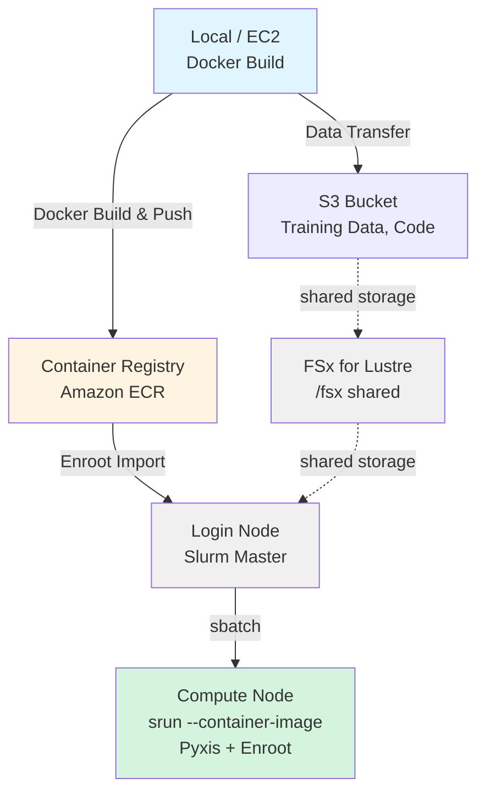

# OpenPI LoRA Training Guide with HyperPod + Slurm + Enroot

AWS SageMaker HyperPod에서 Slurm + Enroot를 사용해 Docker container 안에서 LoRA fine-tuning을 실행하는 가이드입니다.

## Architecture



***

## Prerequisites

1. **HyperPod Cluster**: 이 project에 포함된 CDK로 AWS에 구축한 HyperPod cluster가 필요합니다.
   아래 단계는 CDK로 deploy한 HyperPod cluster를 가정하지만, console에서 수동으로 생성한 cluster도 training에 사용할 수 있습니다.
   CDK stack에는 training 기록을 저장하는 Amazon SageMaker AI MLflow App도 포함됩니다. 기록되는 내용은 [MLflow로 Training Tracking](#mlflow로-training-tracking)을 참고하세요.
2. **Development Environment**: 다음 setup이 필요합니다.
   1. AWS credentials configuration: ECR access에 필요합니다.
   2. Docker: pi0 training image build에 필요합니다.
3. **Hugging Face Token**: Sample training dataset download에 필요합니다 (`HF_TOKEN`).
   1. [Hugging Face](https://huggingface.co/settings/tokens)에 sign up하고 token을 미리 생성해야 합니다. 직접 준비한 training data를 사용할 경우 필요하지 않습니다.

***

## Execution Steps

### Local에서 Image Build 및 ECR Push

#### Docker Image Build 및 ECR Push

```bash
cd samples/openpi-sample/

# openpi를 clone하고 setup.sh와 같은 commit으로 고정
git clone https://github.com/Physical-Intelligence/openpi.git
git -C openpi checkout 215abfb217dbac7d5f1273282331b9b1866c0479

cd lora_training/

# ECR로 build & push (AWS CLI default region 사용)
./build_and_push_ecr.sh

# region과 account ID를 모두 지정
./build_and_push_ecr.sh us-west-2 123456789012

# 특정 tag 지정
IMAGE_TAG=v1.0.0 ./build_and_push_ecr.sh
```

**openpi commit에 대해**:

Container의 Python dependencies는 local에 clone한 openpi의 `uv.lock`에서 설치됩니다.
반면 training code는 `setup.sh`가 FSx에 clone한 openpi에서 로드됩니다.
두 commit이 다르면 training code와 container의 dependency version이 어긋나므로, local clone도 `setup.sh`와 같은 commit (`215abfb217dbac7d5f1273282331b9b1866c0479`)으로 고정합니다.
MLflow tracking patch는 FSx의 clone에만 적용하므로 local clone에는 적용하지 않습니다.
이미 clone한 경우에는 `git -C openpi fetch`를 실행한 뒤 위의 `git -C openpi checkout`을 실행합니다.

**이전에 build한 image를 사용하는 경우**:

Container에는 MLflow tracking에 사용하는 `mlflow-skinny` 3.10.1, `sagemaker-mlflow` 0.5.0, `nvidia-ml-py` 12.575.51이 포함되어 있습니다.
이 package가 없는 이전 image로는 MLflow에 기록할 수 없으므로, image를 다시 build해서 ECR에 push하고 [Enroot로 Docker Image Import](#enroot로-docker-image-import) 절차에 따라 다시 import합니다.

**Environment Information을 가져오는 방식 (Local PC)**:

Script는 다음 priority로 environment information을 가져옵니다.

1. **Command-line arguments** (highest priority)
2. **Environment variables** (`AWS_REGION`, `AWS_ACCOUNT_ID`)
3. **AWS CLI configuration**
   * Region: `aws configure get region`
   * Account ID: `aws sts get-caller-identity --query Account --output text`

**What the script does**:
* ECR repository `openpi-lora-train`을 생성합니다. 이미 있으면 건너뜁니다.
* Docker image를 build합니다. `train_lora.Dockerfile`을 사용합니다.
* ECR에 push합니다.

**Example output**:

```
✅ Docker image successfully pushed to ECR
Image URI: 123456789012.dkr.ecr.us-west-2.amazonaws.com/openpi-lora-train:latest
```

***

### HyperPod Login Node 준비

#### HyperPod SSH Connection

[/hyperpod/docs/ko/DEPLOYMENT.md](/hyperpod/docs/ko/DEPLOYMENT.md)의 SSH connection 안내에 따라 접속합니다.

```
ssh pask-cluster
```

#### Project Setup

```bash
# PASK repository clone
cd
git clone https://github.com/aws-samples/sample-physical-ai-scaffolding-kit.git

# setup 실행. Parameter는 아래 설명 참고
cd samples/openpi-sample/lora_training
./setup.sh --hf-token "hf_xxxxx"

# environment variables 적용
source ~/.bashrc
```

**Parameters**
* hf-token (optional): "hf\_"로 시작하는 Hugging Face token을 지정합니다.
  * [Hugging Face](https://huggingface.co/settings/tokens)에 sign up하고 token을 미리 생성해야 합니다.
* mlflow-tracking-uri (optional): MLflow App의 ARN을 지정합니다.
  * 지정하지 않으면 stack output의 `MlflowAppArn`을 사용합니다. CDK 외의 방법으로 생성한 MLflow App에 기록할 때 지정합니다.
* stack-name (optional): Output을 읽을 CloudFormation stack 이름입니다. Default는 `PASK`입니다.
* region (optional): Stack의 region입니다. Default는 Login Node의 EC2 instance metadata (IMDSv2)에서 가져온 region입니다.
* no-mlflow (optional): Stack output을 읽지 않고, MLflow와 S3 link environment variables를 `~/.bashrc`에 쓰지 않습니다.

MLflow App ARN을 직접 지정하는 경우와 MLflow를 사용하지 않는 경우의 예입니다.

```bash
./setup.sh --hf-token "hf_xxxxx" --mlflow-tracking-uri arn:aws:sagemaker:us-west-2:123456789012:mlflow-app/app-XXXXXXXXXXXX
./setup.sh --hf-token "hf_xxxxx" --no-mlflow
```

**What the script does**

1. OpenPI repository를 clone합니다.
   - /fsx/ubuntu/samples/openpi-sample/openpi/ 가 없을 때 실행됩니다.
   - GitHub에서 git clone <https://github.com/Physical-Intelligence/openpi.git> 를 실행하고 commit `215abfb217dbac7d5f1273282331b9b1866c0479`을 checkout합니다.
2. MLflow tracking patch를 적용합니다.
   - `lora_training/patches/mlflow_tracking.patch`를 clone한 openpi에 `git apply`로 적용합니다.
   - 이미 적용되어 있으면 아무것도 하지 않습니다.
3. Directory structure를 생성합니다.
   - /fsx/ubuntu/samples/openpi-sample/logs/
   - /fsx/ubuntu/samples/openpi-sample/.cache/
   - /fsx/ubuntu/samples/openpi-sample/openpi/assets/physical-intelligence/libero/
4. CloudFormation stack output을 읽습니다. `--no-mlflow`를 지정하면 실행하지 않습니다.
   - `aws cloudformation describe-stacks`로 `MlflowAppArn`, `S3LinkUri`, `S3LinkMountPath`, 그리고 key가 `HyperPodClusterId`로 시작하는 output을 읽습니다.
   - 읽지 못한 값은 warning을 출력하고, 그 값을 사용하는 environment variables를 `~/.bashrc`에 쓰지 않습니다.
5. \~/.bashrc에 environment variables를 설정합니다.
   - 기존 OpenPI/Enroot 설정이 있으면 제거하고 backup을 생성합니다.
   - 다음 environment variables를 추가합니다. 이 environment variables는 모든 Slurm job script에서 사용됩니다.
     * export OPENPI\_BASE\_DIR=/fsx/ubuntu/samples/openpi-sample
     * export OPENPI\_PROJECT\_ROOT=\${OPENPI\_BASE\_DIR}/openpi
     * export OPENPI\_DATA\_HOME=\${OPENPI\_BASE\_DIR}/.cache
     * export OPENPI\_LOG\_DIR=\${OPENPI\_BASE\_DIR}/logs
     * export HF\_TOKEN=<value specified as argument or empty>
     * export ENROOT\_CACHE\_PATH=/fsx/enroot
     * export ENROOT\_DATA\_PATH=/fsx/enroot/data
   - Stack output을 읽은 경우 다음 environment variables도 추가합니다. 각 줄 끝에는 `# OpenPI MLflow`가 붙고, `setup.sh`를 다시 실행하면 교체됩니다.
     * export MLFLOW\_TRACKING\_URI=<MlflowAppArn 또는 --mlflow-tracking-uri 값>
     * export AWS\_DEFAULT\_REGION=<MLflow App ARN의 4번째 field (region)>
     * export PASK\_CLUSTER\_NAME=<key가 HyperPodClusterId로 시작하는 output 값>
     * export PASK\_S3LINK\_DIR=<S3LinkMountPath 값. 예: /fsx/s3link>
     * export PASK\_S3LINK\_URI=<S3LinkUri 값>

**기존 openpi clone이 다른 commit인 경우**:

`setup.sh`는 기존 clone을 다시 만들지 않습니다.
HEAD가 고정된 commit과 다르면 warning을 출력하고, patch를 적용할 수 없으면 error로 중단합니다.
이 경우 기존 clone을 다른 이름으로 옮긴 뒤 `setup.sh`를 다시 실행해 고정된 commit으로 다시 clone합니다.

```bash
# OPENPI_PROJECT_ROOT는 이전 setup.sh 실행에서 ~/.bashrc에 기록된 값
mv "${OPENPI_PROJECT_ROOT}" "${OPENPI_PROJECT_ROOT}.old"
./setup.sh --hf-token "hf_xxxxx"
source ~/.bashrc
```

Checkpoints (`openpi/checkpoints/`)와 normalization statistics (`openpi/assets/`)는 openpi directory 안에 있으므로, 기존 clone을 옮기면 새 clone에서는 보이지 않습니다.
Training을 이어서 하려면 옮긴 directory에서 새 clone의 같은 위치로 옮깁니다.

**About Weights & Biases (wandb)**:
* Default scripts는 wandb를 disable합니다 (`--no-wandb-enabled`).
* wandb로 training을 track하려면:
  1. [wandb.ai](https://wandb.ai)에서 account를 생성합니다.
  2. API key를 가져와 `~/.bashrc`에 추가합니다: `export WANDB_API_KEY=your_key_here`
  3. Script에서 `--no-wandb-enabled`를 제거하거나 `--wandb-enabled`로 변경합니다.

---

#### Enroot로 Docker Image Import

```bash
# ECR image를 Enroot format으로 변환
cd samples/openpi-sample/lora_training

# EC2 metadata에서 auto-detect
./hyperpod_import_container.sh

# image tag 지정
./hyperpod_import_container.sh v1.0.0

# region 지정
./hyperpod_import_container.sh latest us-west-2
```

**Environment Information을 가져오는 방식 (HyperPod Cluster)**:

Script는 다음 priority로 environment information을 가져옵니다. HyperPod 안에서 command-line argument나 environment variable을 지정하지 않으면 EC2 instance metadata에서 정보를 가져옵니다.

1. **Command-line arguments** (highest priority)

   ```bash
   ./hyperpod_import_container.sh [IMAGE_TAG] [AWS_REGION] [AWS_ACCOUNT_ID]
   ```

2. **Environment variables**

   ```bash
   export AWS_REGION=us-west-2
   export AWS_ACCOUNT_ID=123456789012
   ./hyperpod_import_container.sh
   ```

3. **Auto-detection**

   * **Region**: EC2 instance metadata (IMDSv2)

     ```bash
     TOKEN=$(curl -X PUT "http://169.254.169.254/latest/api/token" \
       -H "X-aws-ec2-metadata-token-ttl-seconds: 21600" -s)
     curl -H "X-aws-ec2-metadata-token: $TOKEN" -s \
       http://169.254.169.254/latest/meta-data/placement/region
     ```

   * **Account ID**: AWS STS

     ```bash
     aws sts get-caller-identity --query Account --output text
     ```

4. **Fallback**: Region default는 `us-east-1`

**What the script does**:
* ECR에서 Docker image를 pull합니다.
* SquashFS format (`.sqsh`)으로 변환합니다.
* `/fsx/enroot/data/`에 저장합니다.

**다시 import하는 경우**:

`enroot import`는 output path에 같은 이름의 file이 있으면 실패하므로, image를 다시 build한 경우에는 이전 `.sqsh`를 삭제한 뒤 import합니다.

```bash
rm /fsx/enroot/data/openpi-lora-train+latest.sqsh
./hyperpod_import_container.sh
```

**Example output**:

```
✅ Container ready for Slurm execution
Container Name: openpi-lora-train+latest.sqsh
```

**Verification**:

```bash
# import된 container 확인
enroot list

# Example output:
# openpi-lora-train+latest.sqsh
```

***

### Slurm Jobs 실행

#### Normalization Statistics 계산 (처음 한 번만)

```bash
cd samples/openpi-sample/lora_training

# Slurm job으로 submit
sbatch ./slurm_compute_norm_stats.sh pi0_libero_low_mem_finetune

# job ID가 반환됩니다. 예: Submitted batch job 1234
```

**Checking progress**:

```bash
# job status 확인
squeue -u ubuntu

# log를 real time으로 monitor
tail -f ${OPENPI_LOG_DIR}/slurm_<JOB_ID>.out

# error log 확인
tail -f ${OPENPI_LOG_DIR}/slurm_<JOB_ID>.err
```

`MLFLOW_TRACKING_URI`가 설정되어 있으면 계산이 완료된 시점에 이 job을 MLflow run으로 기록합니다.
기록되는 내용은 [Normalization Statistics Job Run](#normalization-statistics-job-run)을 참고하세요.

##### Execution Errors

**Hugging Face Quota Error**:
Sample training data를 사용할 때 Hugging Face에서 download 중 다음과 같은 quota error가 발생할 수 있습니다.
이 경우 최소 5분을 기다린 뒤 `./slurm_compute_norm_stats.sh`를 다시 실행하세요.
Download는 중단된 지점부터 resume되므로 두 번째 시도에서는 quota error 없이 완료됩니다.

```
huggingface_hub.errors.HfHubHTTPError: 429 Client Error: Too Many Requests for url: https://huggingface.co/api/datasets/physical-intelligence/
We had to rate limit you, you hit the quota of 1000 api requests per 5 minutes period. Upgrade to a PRO user or Team/Enterprise organization account (https://hf.co/pricing) to get higher limits. See https://huggingface.co/docs/hub/rate-limits
```

***

#### LoRA Fine-Tuning 실행 (GPU Job)

```bash
cd samples/openpi-sample/lora_training

# LoRA training submit
sbatch ./slurm_train_lora.sh pi0_libero_low_mem_finetune my_lora_run

# custom experiment name으로 실행
sbatch ./slurm_train_lora.sh pi0_libero_low_mem_finetune experiment_$(date +%Y%m%d)

# 같은 experiment name의 최신 checkpoint에서 resume
RESUME=true sbatch ./slurm_train_lora.sh pi0_libero_low_mem_finetune my_lora_run
```

**Job이 읽는 environment variables**:

`sbatch`를 실행하는 shell의 environment variables가 job에 전달됩니다.

| Environment variable | Default | Description |
|---|---|---|
| `RESUME` | `false` | `true`이면 `--resume`으로 같은 experiment name의 최신 checkpoint에서 resume합니다. `false`이면 `--overwrite`로 같은 experiment name의 checkpoints를 삭제하고 처음부터 training합니다 |
| `EXPORT_CHECKPOINT` | `true` | `true`이면 training 완료 후 final checkpoint를 S3에 link된 FSx directory로 copy합니다. `PASK_S3LINK_DIR`와 `PASK_S3LINK_URI`가 필요합니다 |
| `MLFLOW_TRACKING_URI` | `setup.sh`가 `~/.bashrc`에 쓴 값 | MLflow App의 ARN. 설정되어 있지 않으면 MLflow에 기록하지 않습니다 |
| `MLFLOW_EXPERIMENT_NAME` | Training config의 `TrainConfig.project_name` (`openpi`) | 기록할 MLflow experiment 이름 |
| `MLFLOW_SYSTEM_METRICS_SAMPLING_INTERVAL` | `10` | System metrics를 수집하는 간격 (초) |

기록되는 내용과 resume 시의 동작은 [MLflow로 Training Tracking](#mlflow로-training-tracking)을 참고하세요.

**Checking progress**:

```bash
# job status 확인
squeue -u ubuntu

# GPU usage 확인 (compute node에서)
srun --jobid=<JOB_ID> nvidia-smi

# log를 real time으로 monitor
tail -f ${OPENPI_LOG_DIR}/train_<JOB_ID>.out

# error log 확인
tail -f ${OPENPI_LOG_DIR}/train_<JOB_ID>.err
```

**Typical logs during training**:

```
[1000/30000] loss=0.234 lr=1e-4 step_time=1.2s
[2000/30000] loss=0.189 lr=9e-5 step_time=1.1s
Saving checkpoint to /fsx/ubuntu/openpi_test/openpi/checkpoints/pi0_libero_low_mem_finetune/my_lora_run/2000
```

**Verifying completion**:

```bash
# job completion status 확인
sacct -j <JOB_ID> --format=JobID,State,ExitCode

# checkpoints 확인
ls -lh ${OPENPI_PROJECT_ROOT}/checkpoints/pi0_libero_low_mem_finetune/my_lora_run/

# Example output:
# drwxr-xr-x  1000/
# drwxr-xr-x  2000/
# drwxr-xr-x  5000/
# drwxr-xr-x  30000/  <- Final checkpoint
```

***

## MLflow로 Training Tracking

`MLFLOW_TRACKING_URI`에 MLflow App의 ARN이 설정되어 있으면 training job과 normalization statistics job은 각각의 결과를 MLflow App에 기록합니다.
Tracking 처리는 `setup.sh`가 openpi에 적용한 patch (`lora_training/patches/mlflow_tracking.patch`)에 있습니다.
MLflow App 인증에는 node의 IAM role (HyperPod cluster의 ExecutionRole)을 사용합니다.
CDK stack은 이 role에 MLflow App에 기록할 수 있는 권한을 부여합니다.

### Training Job Run

Training job은 experiment (default는 `openpi`) 안에 experiment name (`slurm_train_lora.sh`의 두 번째 argument)을 이름으로 하는 run을 만들고 다음 내용을 기록합니다.

| Type | Content |
|---|---|
| params | Training config (`TrainConfig`)의 모든 항목. 중첩된 항목의 key는 `.`으로 연결합니다 |
| artifact | Training config 전체를 담은 `config.json`. Training 완료 시 final checkpoint의 `norm_stats.json` |
| metrics | `log_interval` step마다 구간 평균한 `loss`, `grad_norm`, `param_norm`과 해당 step의 `learning_rate`. Checkpoint를 저장한 step에서는 `checkpoint_step` |
| system metrics | CPU, memory, GPU utilization 등. `MLFLOW_SYSTEM_METRICS_SAMPLING_INTERVAL`초마다 수집합니다 |

Run에는 다음 tag를 붙입니다.

| Tag | Content |
|---|---|
| `openpi.config_name` | Training config 이름 |
| `openpi.git_commit` | FSx에 있는 openpi의 commit (short form) |
| `slurm.job_id` | 마지막으로 실행한 Slurm job의 ID |
| `slurm.job_ids` | 이 run에 기록한 모든 Slurm job의 ID (comma-separated) |
| `pask.cluster` | `PASK_CLUSTER_NAME` 값 |
| `pask.checkpoint_dir` | Checkpoint directory |
| `pask.run_type` | `train` |
| `pask.norm_stats_run_id` | Training에 사용한 normalization statistics run의 ID. Normalization statistics를 MLflow에 기록하지 않은 경우에는 붙지 않습니다 |
| `pask.checkpoint_s3_uri` | Copy한 final checkpoint의 S3 URI. Copy하지 않은 경우에는 붙지 않습니다 |

Experiment에는 `mlflow.experimentKind=custom_model_development` tag를 붙입니다.
MLflow 3 UI는 이 tag로 experiment를 model training용 experiment로 다룹니다.

Run status는 job이 끝나는 방식에 따라 다음과 같습니다.

| Job이 끝나는 방식 | Run status |
|---|---|
| 정상 종료 | `FINISHED` |
| Exception으로 종료 | `FAILED` |
| `scancel`이나 time limit으로 중지 (Slurm이 SIGTERM을 보냄) | `KILLED` |

### Resume한 Training의 Run

`RESUME=true`로 resume하면 training job은 checkpoint directory에 저장한 run ID (`mlflow_run_id.txt`)를 읽고 같은 run에 계속 기록합니다.
이때 `slurm.job_id`를 새 job의 ID로 덮어쓰고, `slurm.job_ids` 끝에 새 job ID를 추가합니다.
Params는 한 번 기록하면 값을 바꿀 수 없으므로 새 run을 만들 때만 기록합니다.

`RESUME=false` (default)에서는 `--overwrite`로 training을 처음부터 다시 하므로 새 run을 만듭니다.
MLflow 없이 시작한 training을 resume한 경우에도 run ID가 저장되어 있지 않으므로 새 run을 만듭니다.

### Final Checkpoint를 S3로 Copy

`EXPORT_CHECKPOINT=true` (default)이고 `PASK_S3LINK_DIR`와 `PASK_S3LINK_URI`가 설정되어 있으면, training job은 training 완료 후 final checkpoint를 다음 위치로 copy합니다.

```
${PASK_S3LINK_DIR}/checkpoints/<training config 이름>/<experiment name>/<step>/
```

`PASK_S3LINK_DIR` (`cdk.json` 설정을 바꾸지 않았다면 `/fsx/s3link`)는 S3 bucket에 link된 FSx directory이며, copy한 file은 FSx의 automatic export로 S3에 기록됩니다.
MLflow에 기록하는 경우 copy한 위치의 S3 URI를 `pask.checkpoint_s3_uri` tag에 기록합니다.
S3로의 export는 copy 완료 후 비동기로 진행되므로, tag가 붙은 시점에는 아직 모든 file이 S3에 없을 수 있습니다.

Final checkpoint는 training 1회당 약 7 GB이며 FSx와 S3 용량을 사용합니다.
Copy가 필요 없으면 `EXPORT_CHECKPOINT=false`를 붙여 job을 submit합니다.
Copy는 MLflow tracking과 독립적이며 `MLFLOW_TRACKING_URI`가 설정되어 있지 않아도 실행됩니다.

### Normalization Statistics Job Run

Normalization statistics job은 계산이 완료된 시점에 training job과 같은 experiment에 `norm_stats_<training config 이름>`이라는 run을 만듭니다.
이 run의 `pask.run_type` tag는 `norm_stats`입니다.

| Type | Content |
|---|---|
| params | `config_name`, `repo_id`, `max_frames`, `batch_size` |
| artifact | `norm_stats.json` |
| tags | `openpi.config_name`, `openpi.git_commit`, `slurm.job_id`, `pask.cluster`, `pask.run_type` |

이 job은 GPU를 사용하지 않으므로 system metrics를 기록하지 않습니다.

Run ID는 `norm_stats.json`과 같은 directory의 `mlflow_run_id.txt`에 저장합니다.
Training job은 이 file을 읽고 training run의 `pask.norm_stats_run_id` tag에 기록합니다.
이 tag로 training에 사용한 normalization statistics run을 MLflow에서 찾아갈 수 있습니다.

### MLflow UI 열기

MLflow UI는 presigned URL을 발행해 browser에서 엽니다.
HyperPod node의 IAM role에는 URL을 발행하는 권한 (`sagemaker:CreatePresignedMlflowAppUrl`)이 없으므로, CDK deploy에 사용한 credentials처럼 이 권한이 있는 환경에서 실행합니다.
MLflow App을 다루는 AWS CLI command에는 AWS CLI v2.34.5 이상이 필요합니다.

```bash
# AWS CLI version 확인
aws --version

# MLflow App의 ARN 가져오기
aws cloudformation describe-stacks --stack-name PASK \
  --query "Stacks[0].Outputs[?OutputKey=='MlflowAppArn'].OutputValue" --output text

# presigned URL 발행
aws sagemaker create-presigned-mlflow-app-url \
  --arn <MlflowAppArn> \
  --expires-in-seconds 300 \
  --session-expiration-duration-in-seconds 43200
```

출력된 URL을 browser에서 엽니다.
URL은 한 번만 사용할 수 있으며, 유효 기간은 `--expires-in-seconds`로 지정한 초 (5~300초)입니다.
`--session-expiration-duration-in-seconds`는 browser session의 길이이며 1800~43200초 (30분~12시간) 범위에서 지정합니다.
AWS CLI의 default region이 MLflow App의 region과 다르면 두 command 모두에 `--region`을 붙입니다.

### MLflow를 사용하지 않는 경우

`MLFLOW_TRACKING_URI`가 설정되어 있지 않으면 training job과 normalization statistics job은 MLflow에 아무것도 기록하지 않고, patch를 적용하기 전과 같이 동작합니다.
이때 job log에는 `MLflow: disabled (MLFLOW_TRACKING_URI is not set)`가 출력됩니다.

MLflow 기록을 중지하려면 `setup.sh --no-mlflow`를 실행하거나, job을 submit하는 shell에서 `unset MLFLOW_TRACKING_URI`를 실행합니다.
`setup.sh --no-mlflow`는 `~/.bashrc`에서 MLflow와 S3 link 줄을 삭제하지만, 이미 `~/.bashrc`를 읽은 shell에는 environment variables가 남아 있으므로 다시 login한 뒤 job을 submit합니다.
`--no-mlflow`에서는 `PASK_S3LINK_DIR`와 `PASK_S3LINK_URI`도 쓰지 않으므로 final checkpoint의 S3 copy도 실행하지 않습니다.

### `RUNNING` 상태로 남은 Run

SIGKILL이나 node 장애로 job이 중지되면 run status를 업데이트하는 처리가 실행되지 않아 run이 `RUNNING` 상태로 남습니다.
같은 training을 `RESUME=true`로 resume하면 같은 run에 계속 기록하고, training이 완료되면 `FINISHED`가 됩니다.

Resume하지 않는 경우에는 MLflow의 `MlflowClient().set_terminated()`로 run status를 `KILLED`로 변경합니다.
Run ID는 MLflow UI 또는 checkpoint directory의 `mlflow_run_id.txt`에서 확인할 수 있습니다.
Login Node에서 training container로 다음과 같이 실행합니다.

```bash
NVIDIA_VISIBLE_DEVICES=void srun --container-image="${ENROOT_DATA_PATH}/openpi-lora-train+latest.sqsh" \
  /.venv/bin/python -c "import mlflow; mlflow.MlflowClient().set_terminated('<RUN_ID>', 'KILLED')"
```

`NVIDIA_VISIBLE_DEVICES=void`는 GPU가 없는 node에 할당되었을 때 container의 GPU 설정 때문에 시작에 실패하지 않도록 하기 위한 지정입니다.

***

## Slurm Job Management Commands

### Checking Jobs

```bash
# 본인 job 목록
squeue -u ubuntu

# 상세 정보
squeue -u ubuntu -o "%.18i %.9P %.30j %.8u %.2t %.10M %.6D %R"

# 모든 job (entire cluster)
squeue
```

### Canceling Jobs

```bash
# 특정 job cancel
scancel <JOB_ID>

# 본인 job 전체 cancel
scancel -u ubuntu

# name으로 job cancel
scancel --name=openpi_lora_train
```

***

## Reference Resources

### Documentation

* [AWS HyperPod Documentation](https://docs.aws.amazon.com/sagemaker/latest/dg/sagemaker-hyperpod.html)
* [Enroot Documentation](https://github.com/NVIDIA/enroot)
* [Slurm Documentation](https://slurm.schedmd.com/documentation.html)
